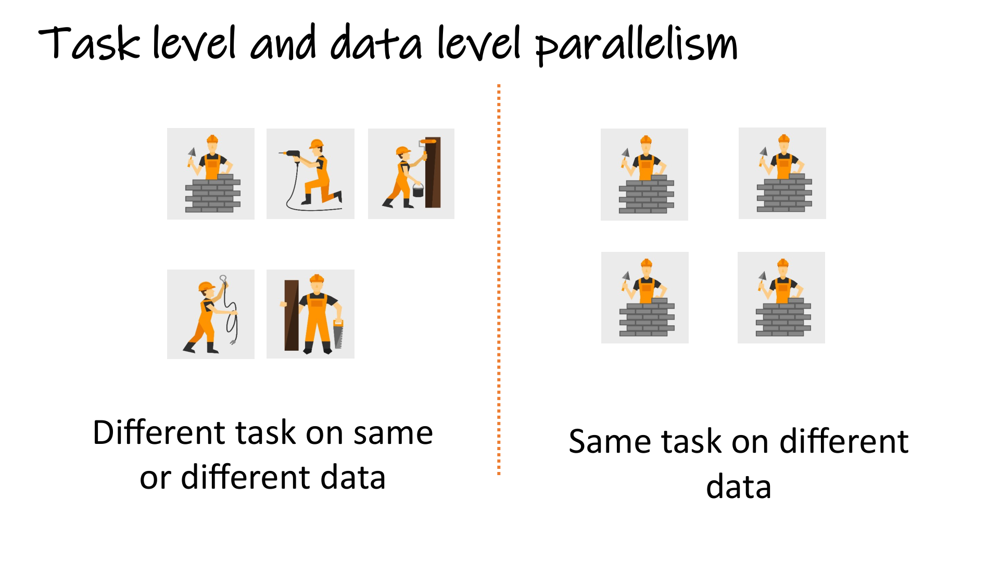
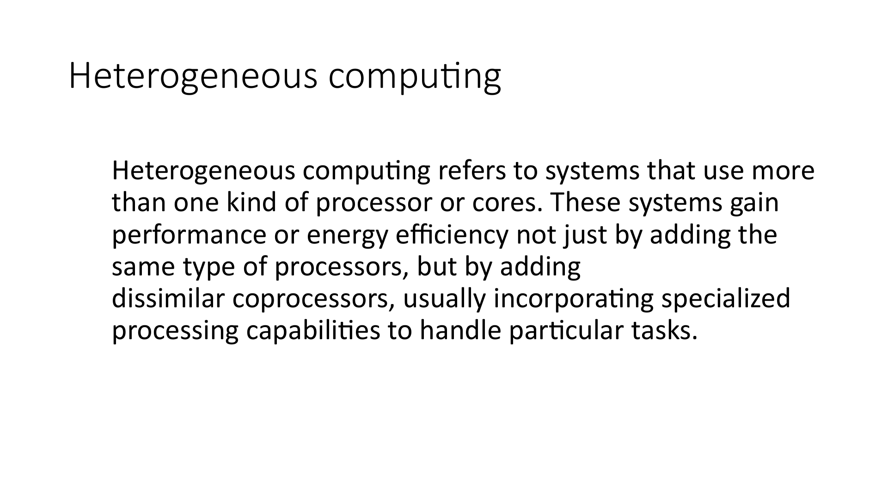

# 第 1 章 并行计算与 CUDA 入门



*图 1.1　任务级并行与数据级并行：前者分配不同任务，后者对大量数据执行相似操作。*

## 并行计算与异构系统

并行计算的目标，是把一个问题的可独立部分交给多个执行单元协同完成，从而缩短求解时间或扩大可处理的问题规模。并行化并不是简单地增加处理器数量；只有先识别计算中的依赖关系，才能判断哪些部分可以同时推进，哪些部分必须保持顺序。

### 并发、并行、进程与线程

进程是应用程序的一个运行实例，拥有独立的地址空间和运行上下文。线程是进程内可被独立调度的一条执行序列；同一进程中的线程通常共享该进程的地址空间。操作系统可以保存并恢复上下文，使多个任务在有限的处理器上交替推进。

**并发**描述多个任务在同一时间段内取得进展，**并行**则强调多个任务在同一时刻由不同硬件执行单元运行。单核处理器可以通过时间片和上下文切换形成并发，但任意瞬间仍只执行一个指令流；多核处理器才可能让多个线程真正同时运行。并发有助于组织任务和提高响应性，并不自动等于计算加速。

### 数据并行与任务并行

数据并行把相同或相似的操作应用于不同数据元素。例如，向量对应元素相加时，每个输出只取决于两个同下标输入，各输出之间没有依赖，适合由大量线程同时处理。

任务并行把不同功能分配给不同执行单元，例如让一组任务解码数据，另一组任务执行滤波。实际应用可以同时包含两种形式。CUDA 尤其擅长数据量大、计算规则相对统一的数据并行问题，但数据准备、调度和串行控制仍通常由 CPU 完成。

## CPU 与 GPU 的设计取向

CPU 通常以较低延迟完成复杂控制和串行指令流为重要目标，具备复杂的控制与缓存机制。GPU 则把更多面积用于大量并行执行单元，以高吞吐量处理大批相互独立的任务。两者的差别是设计取向，而不是“GPU 在所有计算上都更快”。

GPU 能在硬件中维持大量可调度线程，并在某些线程等待数据时执行其他就绪线程，以此隐藏延迟。要发挥这种吞吐能力，程序必须提供足够的并行工作，并控制内存访问、分支和同步成本。线程数超过物理执行单元数并不意味着所有线程都在同一瞬间运行。

高性能计算系统常以每秒浮点运算次数（FLOPS）描述计算能力，也会用每瓦特可完成的运算量评价能效。气候模拟、分子动力学、工程仿真和机器学习等负载需要处理大量变量，因而广泛使用 CPU、GPU 及其他加速器。评价这些系统时，既不能只看峰值 FLOPS，也不能脱离数据移动、能耗和应用效率比较硬件。



*图 1.2　异构计算通过不同类型处理器协同工作，将合适任务分配给合适的执行单元。*

## 异构系统中的主机与设备

由不同类型的处理器共同完成计算的系统称为异构系统。在 CUDA 的经典主机—设备模型中，CPU 及其内存构成主机侧，GPU 及其设备内存构成设备侧。主机通常负责：

1. 准备输入和分配资源；
2. 配置并启动设备核函数；
3. 管理主机与设备之间的数据传输；
4. 检查结果并执行后续串行逻辑。

设备负责适合大规模并行的计算阶段。主机与设备之间的数据移动需要时间和带宽，因此“核函数执行更快”不等于“整个应用更快”。若一个简单计算前后都需要复制大量数据，传输和同步开销可能抵消设备计算的收益。设计异构程序时，应尽量减少不必要的数据往返，并让能够连续执行的设备任务保持在设备侧。

并行程序还必须显式处理正确性问题。多个执行单元同时修改同一位置可能产生竞态，缺少必要同步可能读取尚未完成的结果，错误的任务划分则可能造成遗漏或重复。任何性能优化都应以结果仍然正确为前提。

## 完整示例：分析数据并行性

下面的主机端程序计算 `y[i] = 2 * x[i] + 1`。它不是 GPU 程序，也不用于展示加速，而是把后续 CUDA 示例中的数据依赖单独提取出来：每个输出元素只读取同下标的输入，循环迭代之间没有读写依赖。

将代码保存为 `data_parallel.cpp`，使用任意支持 C++11 的主机编译器构建即可。

```cpp
#include <cstddef>
#include <iostream>
#include <vector>

int main() {
    const std::vector<float> x{0.0f, 1.0f, 2.0f, 3.0f,
                               4.0f, 5.0f, 6.0f, 7.0f};
    std::vector<float> y(x.size(), -1.0f);

    for (std::size_t i = 0; i < x.size(); ++i) {
        y[i] = 2.0f * x[i] + 1.0f;
    }

    for (std::size_t i = 0; i < y.size(); ++i) {
        std::cout << "y[" << i << "] = " << y[i] << '\n';
    }
    return 0;
}
```

一种主机端构建与运行方式如下；可执行文件名称可按平台习惯调整。

```bash
c++ -std=c++11 data_parallel.cpp -o data_parallel
./data_parallel
```

八个循环迭代可以分配给两个工作者，分别处理 `[0, 4)` 和 `[4, 8)`，也可以分配给四个工作者，每个处理两个元素。只要各工作者写入互不重叠的范围，划分方式不会改变结果。这个“把循环迭代映射到不同执行单元”的思想，正是后续线程索引的出发点。

## 实验：划分工作与识别依赖

1. 在纸上把八个迭代分别按二路和四路划分，列出每个工作者的下标范围。确认所有下标恰好出现一次，且不存在两个工作者写入同一个 `y[i]` 的情况。
2. 将计算改为 `y[i] = x[i] + y[i - 1]`，并令 `y[0] = x[0]`。分析为什么后一个迭代必须等待前一个迭代，原来的任意划分为何不再成立。这类递推需要改变算法，而不能直接套用独立元素的映射。
3. 选择 CUDA Samples 中的一个基础示例，先只阅读其主机流程，标出输入初始化、设备内存管理、核函数启动、结果复制和资源释放的位置，再阅读设备代码。
4. 对一个感兴趣的应用分别列出可并行部分、必须串行部分以及主机与设备之间需要移动的数据。若通信量远大于计算量，应重新评估是否适合使用 GPU。

## CUDA 学习方法

### 以官方文档校准示例

CUDA 学习需要同时使用示例代码、官方文档和开发工具。示例适合理解完整流程，官方文档用于确认 API 签名、错误语义、设备限制和版本要求，论坛与问题记录则可帮助定位具体故障。推荐保留以下入口：

- [NVIDIA CUDA 文档](https://docs.nvidia.com/cuda/)：安装指南、编程指南和运行时 API 的首要依据；
- [NVIDIA CUDA Samples](https://github.com/NVIDIA/cuda-samples)：按主题组织的官方示例；
- [NVIDIA Developer Forums](https://forums.developer.nvidia.com/)：检索编译、运行和性能问题。

课程示例可能基于较早的操作系统、集成开发环境和 CUDA 工具包。界面、安装包名称和设备支持范围会变化，实际安装与函数语义应以当前官方文档为准，不应把旧示例中的版本号或硬件参数当作固定要求。

### 建立可验证的学习闭环

每个示例都应完成“理解概念—预测行为—编译运行—验证结果—测量性能”的闭环。程序能够编译，只说明通过了静态构建；核函数能够结束，也不能证明索引、传输和数值结果正确。性能结论则需要明确测量区间，并在相同数据规模与编译条件下比较。

实验记录至少应包含 GPU 型号、驱动与 CUDA 工具包版本、主机编译器、编译选项、输入规模和线程配置。修改一个变量后重新验证结果，再进行多次测量，可以避免把偶然的运行顺序或单次计时误认为普遍规律。

## 小结

并行计算建立在独立工作与依赖分析之上，数据并行是 CUDA 应用的重要入口。CPU 与 GPU 在异构系统中分别发挥低延迟控制和高吞吐计算的优势，但传输、同步和串行部分会共同限制整体收益。学习 CUDA 时，应把官方文档、完整代码、独立验证和可复现实验结合起来，而不是只追求程序能够运行。
