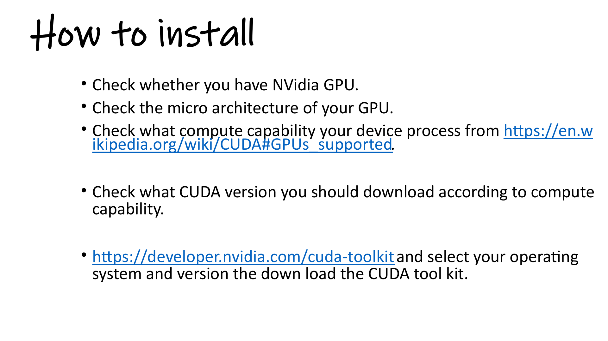
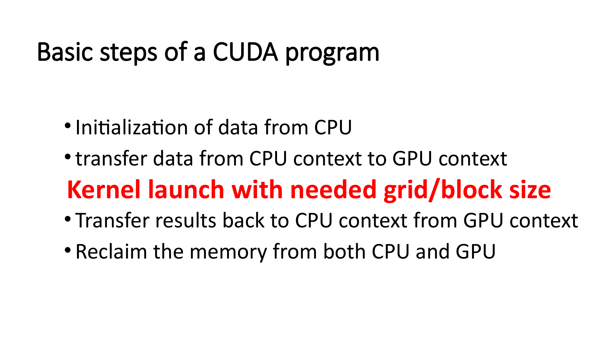

# 第 2 章 配置环境并运行第一个 CUDA 程序



*图 2.1　安装前应检查 GPU、计算能力、CUDA 工具包和主机开发环境，课程清单还需结合当前版本核对。*

## 开发环境的组成与兼容性

CUDA（Compute Unified Device Architecture）是由 NVIDIA 提供的并行计算平台和编程接口。进行 CUDA C/C++ 开发，通常需要受支持的 NVIDIA GPU、与之兼容的驱动、CUDA 工具包以及主机 C/C++ 编译器。集成开发环境不是必需条件，命令行同样可以完成构建和运行。

安装前应核对四类兼容性：GPU 架构与目标 CUDA 工具包、工具包与最低驱动版本、工具包与操作系统、工具包与主机编译器。旧版课程中的下载页面和 IDE 模板只能作为流程示例，实际版本选择应查阅对应工具包的官方安装指南。

这里的“GPU 计算能力”（compute capability）是标识 GPU 架构与功能的主、次版本号（如 8.0），**不是性能分数，也不等同于 CUDA 工具包版本**。

安装后可分别检查：

```bash
nvcc --version
nvidia-smi
```

`nvcc --version` 报告 CUDA 编译器及其所属工具包的信息；`nvidia-smi` 主要报告驱动、可见 GPU 和驱动所支持的最高 CUDA 驱动 API 版本。两处出现的“CUDA 版本”含义不同，不能仅凭 `nvidia-smi` 判断本地安装了哪个工具包。

## nvcc 与 CUDA 源文件

CUDA C/C++ 源文件通常以 `.cu` 为扩展名。`nvcc` 将同一源文件中的主机代码和设备代码分离，分别交给合适的编译流程处理，再链接为可执行程序。主机代码可以使用普通 C++ 功能；设备代码则受 CUDA 设备语言、目标架构和可用资源约束。

最基本的构建命令是：

```bash
nvcc source.cu -o program
```

本书完整示例采用 C++11，构建命令通过 `-std=c++11` 显式指定语言标准。需要面向特定 GPU 功能或控制生成的设备代码时，可以使用架构相关编译选项。具体 `-gencode` 或 `-arch` 参数应与目标设备的计算能力和工具包支持范围一致，不宜直接复制其他机器的数值。



*图 2.2　CUDA 程序的基本流程：主机初始化、数据传输、核函数执行、结果回收与资源释放。*

## CUDA 程序的基本要素

典型 CUDA 应用由主机代码和设备代码组成。主机负责初始化数据、分配和复制内存、启动核函数、取得结果并释放资源；设备负责执行大规模并行部分。复杂程序可能多次重复这一过程，但基本主线不变。

CUDA 使用函数执行空间说明符区分代码位置：

| 说明符 | 调用位置与执行位置 | 典型用途 |
| --- | --- | --- |
| `__global__` | 通常由主机启动，在设备上执行 | 核函数入口，返回类型为 `void` |
| `__device__` | 由设备代码调用，在设备上执行 | 核函数内部的辅助函数 |
| `__host__` | 由主机调用，在主机上执行 | 普通主机函数；未标注的主机函数默认如此 |

`__host__` 与 `__device__` 可以在适用条件下组合，使同一函数为主机和设备分别编译；`__global__` 则用于通过执行配置启动的设备入口。

核函数启动使用 `<<<grid, block>>>`。`grid` 指定各维度上的**线程块数**，`block` 指定每个线程块各维度上的**线程数**。整数参数表示一维配置，`dim3` 可描述一维、二维或三维配置，未显式指定的分量默认为 1。完整执行配置还可以包含动态共享内存和流，本章只使用最简形式。

核函数启动通常是异步的：主机提交启动后继续执行，并不自动等待设备完成。需要结果或确保设备输出已经刷新时，主机必须建立适当的同步。`cudaDeviceSynchronize()` 会等待当前设备上此前提交的工作完成，并可返回此前设备执行产生的错误。

## 完整代码：Hello CUDA World

下面的 `hello.cu` 启动一个线程块，其中只有一个线程。设备线程输出一行文本，主机等待核函数完成后输出另一行文本。代码同时检查核函数启动错误和同步错误，避免程序在设备失败后仍静默退出。

前提：本机已安装兼容的驱动与 CUDA 工具包，存在可用 NVIDIA GPU，且所用设备支持设备端 `printf`。此处的检查宏用于保持示例完整，其系统说明见第 6 章。

```cpp
#include <cstdio>
#include <cstdlib>
#include <cuda_runtime.h>

#define CUDA_CHECK(call)                                                   \
    do {                                                                   \
        cudaError_t status = (call);                                       \
        if (status != cudaSuccess) {                                       \
            std::fprintf(stderr, "%s:%d: %s failed: %s\n",               \
                         __FILE__, __LINE__, #call,                        \
                         cudaGetErrorString(status));                       \
            std::exit(EXIT_FAILURE);                                       \
        }                                                                  \
    } while (0)

__global__ void hello_cuda() {
    printf("Hello CUDA World from the device\n");
}

int main() {
    dim3 grid(1);
    dim3 block(1);

    std::printf("Host: grid=(%u, %u, %u), block=(%u, %u, %u)\n",
                grid.x, grid.y, grid.z, block.x, block.y, block.z);

    hello_cuda<<<grid, block>>>();
    CUDA_CHECK(cudaGetLastError());
    CUDA_CHECK(cudaDeviceSynchronize());

    std::printf("Host: kernel completed\n");
    return 0;
}
```

在 Linux 类环境中构建并运行：

```bash
nvcc -std=c++11 hello.cu -o hello
./hello
```

在使用 `nvcc` 命令行的 Windows 环境中，可执行文件可命名为 `hello.exe`：

```bash
nvcc -std=c++11 hello.cu -o hello.exe
hello.exe
```

程序正常完成时，应出现一次设备消息和一次 `Host: kernel completed`。如果没有设备输出，应依次检查构建是否成功、GPU 与驱动是否可用、启动和同步调用是否报错，而不能假定设备 `printf` 与主机输出具有相同的即时刷新行为。

## 实验：只改变执行配置

保持核函数不变，依次替换 `main` 中的 `grid` 和 `block`：

| 配置 | 线程块数 | 每块线程数 | 总线程数 |
| --- | ---: | ---: | ---: |
| `grid(1)`、`block(20)` | 1 | 20 | 20 |
| `grid(8)`、`block(4)` | 8 | 4 | 32 |
| `grid(2, 2)`、`block(8, 2)` | 4 | 16 | 64 |

每次运行前先预测设备消息数量，再编译运行。多个设备线程的输出顺序不受这份代码控制，因此不应把文本出现顺序解释为线程启动或执行顺序。

再把 `grid(8)`、`block(4)` 交换为 `grid(4)`、`block(8)`。两种配置都包含 32 个线程，消息数量相同，但线程块组织不同。仅靠相同的输出文本无法区分它们，后续章节需要用内置索引变量验证。

最后尝试明显不合法的块配置，观察 `cudaGetLastError()` 如何报告启动失败。许多设备的每块线程总数上限为 1024，但各维度上限、总线程数上限和网格限制必须同时满足；该经验值不能代替设备属性查询。

## 小结

CUDA 开发环境的关键是 GPU、驱动、工具包和主机编译器相互兼容，`nvcc` 则负责协调主机与设备代码的构建。`__global__` 定义设备核函数，`<<<grid, block>>>` 描述线程块和每块线程的组织。第一个完整程序已经包含启动、异步执行、同步与错误检查，是后续索引、内存传输和性能实验的基础。
