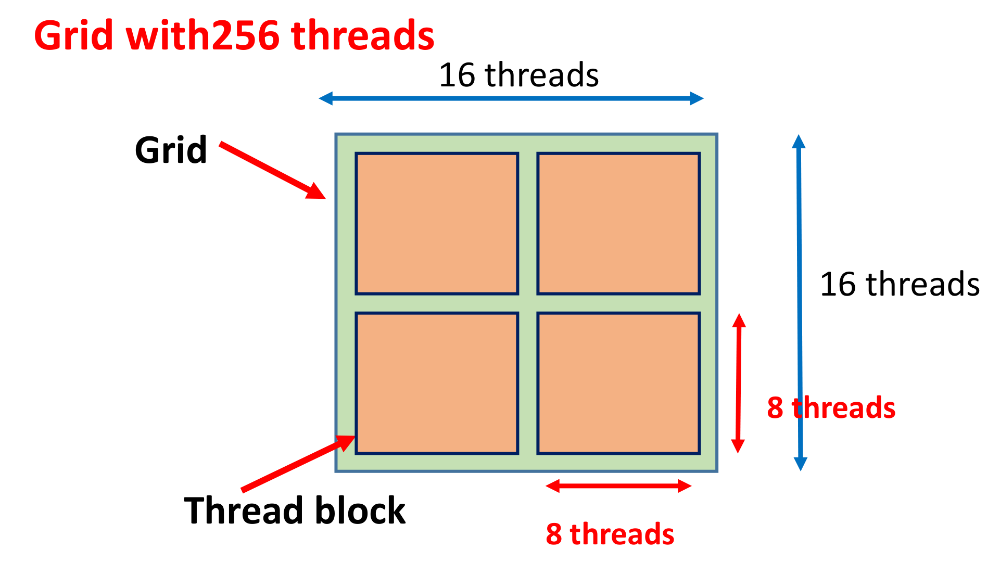
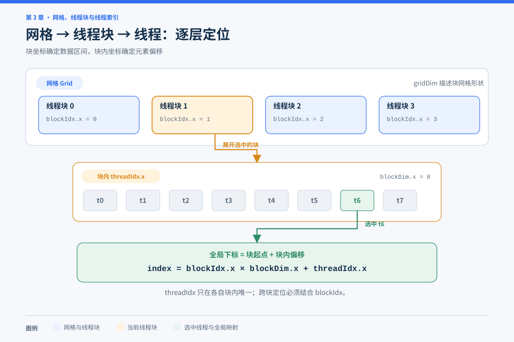
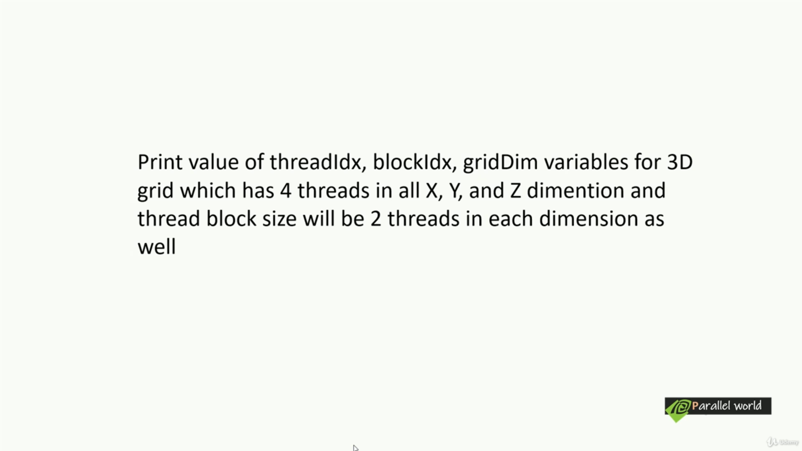

# 第 3 章 网格、线程块与线程索引实验

## 网格与线程块的坐标

一次核函数启动对应一个网格，网格由线程块组成，线程块再包含线程。网格和线程块都可以采用一维、二维或三维形状；同一次启动中的线程块具有相同的形状。若执行配置为 `grid(4, 2)`、`block(16, 8)`，网格包含 `4 × 2 = 8` 个线程块，每块包含 `16 × 8 = 128` 个线程，总计 1024 个线程。

执行配置描述的是逻辑组织，不表示所有线程会同时占用物理执行单元，也不规定线程块之间的执行先后。程序不能依赖某个块先于另一个块完成。



*图 3.1　网格由线程块组成，线程块再由线程组成；各层尺寸共同决定线程总数。（原课程课件）*



*图 3.2　网格、线程块与线程的层级关系：threadIdx 只在块内唯一，跨块定位需要结合 blockIdx 与 blockDim。（SVG 示意图）*

## 四组内置变量

CUDA 在设备代码中提供四组含 `x`、`y`、`z` 分量的内置变量，用于描述当前线程与本次启动的关系：

| 变量 | 含义 | 关键性质 |
| --- | --- | --- |
| `threadIdx` | 当前线程在线程块内的坐标 | 只在块内唯一，不同块会重复 |
| `blockIdx` | 当前线程块在网格中的坐标 | 同一块内所有线程具有相同值 |
| `blockDim` | 每个线程块的形状 | 同一次启动中各块一致，单位为线程 |
| `gridDim` | 网格的形状 | 各分量表示对应方向的线程块数 |

未使用的索引维度取 0，未使用的形状维度取 1。例如一维配置 `<<<2, 4>>>` 中，`threadIdx.x` 在每个块内取 0—3，`blockIdx.x` 取 0—1，`blockDim.x` 为 4，`gridDim.x` 为 2；相应的 `y`、`z` 索引均为 0，形状分量均为 1。

`threadIdx` 的重复性尤其重要。把一维配置从 `<<<1, 8>>>` 改为 `<<<2, 4>>>` 后，总线程数仍是 8，但两个块中的 `threadIdx.x` 都会遍历 0—3。若仍把 `threadIdx.x` 直接作为数组下标，前半部分会被重复访问，后半部分则无人处理。

## 块内与块间的线性编号

采用 `x` 变化最快、其次为 `y`、最后为 `z` 的顺序，可以把块内三维坐标展开为局部编号：

```cpp
unsigned int local_id =
    threadIdx.x + blockDim.x *
    (threadIdx.y + blockDim.y * threadIdx.z);
```

同样可以把线程块坐标展开为块编号：

```cpp
unsigned int block_id =
    blockIdx.x + gridDim.x *
    (blockIdx.y + gridDim.y * blockIdx.z);
```

`local_id` 只在单个块内唯一，`block_id` 标识整个网格中的一个块。将二者组合，可得到按“块优先”排列的全网格线性编号：

```cpp
unsigned int threads_per_block =
    blockDim.x * blockDim.y * blockDim.z;
unsigned int grid_linear_id = block_id * threads_per_block + local_id;
```

这个编号覆盖规则网格中的全部线程，且同一块内各线程的编号连续。它描述的是**线程组织**；访问矩阵等具有自身逻辑尺寸的数据时，还需要区分线程编号与数据下标，下一章将展开这一点。

## 完整代码：三维线程组织探针

下面的 `index_probe.cu` 使用 `grid(2, 2, 2)` 和 `block(2, 2, 2)`。每个维度上的总线程数均为 4，共启动 64 个线程。程序输出四组内置变量、局部编号、块编号和全网格线性编号，不需要分配设备数组。

前提与第 2 章相同：具备可用的 CUDA 构建、运行环境及设备端 `printf`。设备输出顺序不固定，判断结果时应按字段核对，而不是按行序核对。

```cpp
#include <cstdio>
#include <cstdlib>
#include <cuda_runtime.h>

#define CUDA_CHECK(call)                                                   \
    do {                                                                   \
        cudaError_t status = (call);                                       \
        if (status != cudaSuccess) {                                       \
            std::fprintf(stderr, "%s:%d: %s failed: %s\n",               \
                         __FILE__, __LINE__, #call,                        \
                         cudaGetErrorString(status));                       \
            std::exit(EXIT_FAILURE);                                       \
        }                                                                  \
    } while (0)

__global__ void print_indices() {
    const unsigned int local_id =
        threadIdx.x + blockDim.x *
        (threadIdx.y + blockDim.y * threadIdx.z);

    const unsigned int block_id =
        blockIdx.x + gridDim.x *
        (blockIdx.y + gridDim.y * blockIdx.z);

    const unsigned int threads_per_block =
        blockDim.x * blockDim.y * blockDim.z;
    const unsigned int grid_linear_id =
        block_id * threads_per_block + local_id;

    printf(
        "grid_id=%2u | block=(%u,%u,%u), block_id=%u | "
        "thread=(%u,%u,%u), local_id=%u | "
        "blockDim=(%u,%u,%u), gridDim=(%u,%u,%u)\n",
        grid_linear_id,
        blockIdx.x, blockIdx.y, blockIdx.z, block_id,
        threadIdx.x, threadIdx.y, threadIdx.z, local_id,
        blockDim.x, blockDim.y, blockDim.z,
        gridDim.x, gridDim.y, gridDim.z);
}

int main() {
    dim3 grid(2, 2, 2);
    dim3 block(2, 2, 2);

    const unsigned int block_count = grid.x * grid.y * grid.z;
    const unsigned int threads_per_block = block.x * block.y * block.z;
    std::printf("Host: %u blocks, %u threads per block, %u threads total\n",
                block_count, threads_per_block,
                block_count * threads_per_block);

    print_indices<<<grid, block>>>();
    CUDA_CHECK(cudaGetLastError());
    CUDA_CHECK(cudaDeviceSynchronize());
    return 0;
}
```

构建与运行：

```bash
nvcc -std=c++11 index_probe.cu -o index_probe
./index_probe
```

正常结果应包含 64 条设备记录。`grid_linear_id` 恰好覆盖 0—63；每个 `block_id` 对应 8 条记录，每个块内的 `local_id` 覆盖 0—7。所有记录中的 `blockDim` 和 `gridDim` 都相同。



*图 3.3　线程索引练习：在三维网格与三维线程块中输出 threadIdx、blockIdx 和 gridDim，核对其坐标与执行配置。（原课程视频帧）*

## 实验：预测并核对索引

1. 将配置改为 `grid(1)`、`block(8)`。预测 `threadIdx.x`、`blockIdx.x`、`blockDim.x` 和 `gridDim.x` 的范围，再运行核对。
2. 改为 `grid(2)`、`block(4)`。确认总线程数仍为 8，但 `threadIdx.x` 的每个取值出现两次。把输出与“只用 `threadIdx.x` 访问八个元素会重复前四项、遗漏后四项”的推论对照。
3. 使用 `grid(2, 2)`、`block(4, 2)`。计算线程块数、每块线程数和总线程数，检查二维坐标展开后的 `local_id` 与 `block_id` 是否分别保持唯一性。
4. 恢复三维示例，将 `grid` 与 `block` 的数值互换。两者都可能产生 64 个线程，但块数、每块线程数和局部坐标不同，说明“总线程数相同”不代表组织方式相同。
5. 统计三维示例中每个 `local_id` 出现的次数。它应等于线程块数，而不是 1；只有 `block_id` 与 `local_id` 的组合才在当前映射中全局唯一。

## 小结

`threadIdx` 定位块内线程，`blockIdx` 定位网格中的线程块，`blockDim` 与 `gridDim` 给出两者的形状。局部坐标会在不同块中重复，因此多线程块程序不能仅凭 `threadIdx` 访问全局数据。三维探针把这些抽象变量转化为可核对的输出，并为全局索引和边界检查建立了实验基础。
