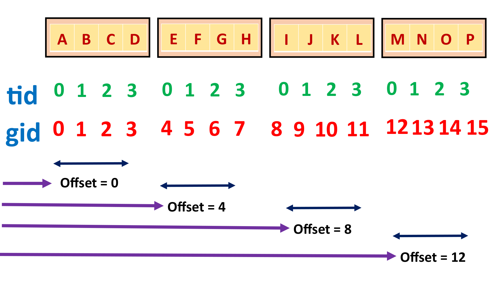
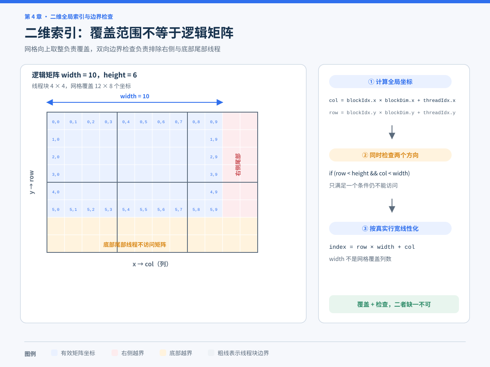

# 第 4 章 一维与二维全局索引、网格覆盖和边界检查



*图 4.1　一维全局索引由线程块偏移和块内线程编号组合而成。（原课程课件）*

## 一维全局索引

处理一维数组时，目标通常是让每个有效线程负责一个不同的元素。对一维网格和一维线程块，当前块之前共有 `blockIdx.x * blockDim.x` 个线程，再加块内偏移即可得到全局索引：

```cpp
int index = blockIdx.x * blockDim.x + threadIdx.x;
```

若每块包含 256 个线程，第 0 块对应索引 0—255，第 1 块对应 256—511。`blockIdx.x * blockDim.x` 给出块起点，`threadIdx.x` 给出块内偏移。只使用 `threadIdx.x` 会让每个块从 0 重新编号，无法覆盖整个数组。

同一份核函数应使用 `blockDim` 等运行时内置变量，而不是把主机端的块大小另写成一个可能失去同步的常量。这样修改执行配置时，索引公式仍与实际线程组织一致。

## 网格覆盖与边界检查

若数组有 `n` 个元素、每块有 `threads` 个线程，并且每个线程至多处理一个元素，则线程块数可按向上取整计算：

```cpp
int blocks = (n + threads - 1) / threads;
```

这要求 `n > 0` 且 `threads > 0`；`n == 0` 时应在主机端跳过核函数启动。以 `n = 1000`、`threads = 256` 为例，`blocks = 4`，实际启动 1024 个线程。向上取整保证网格**覆盖**全部元素，却也引入 24 个没有对应元素的线程，因此核函数必须检查边界：

```cpp
__global__ void scale(float* data, int n, float factor) {
    int index = blockIdx.x * blockDim.x + threadIdx.x;
    if (index < n) {
        data[index] *= factor;
    }
}
```

网格计算与边界检查承担不同职责：前者防止元素遗漏，后者防止多余线程越界访问。只用 `n / threads` 向下取整会遗漏尾部；只增加边界检查而不启动足够线程，同样无法处理全部数据。大规模数据还应使用足够宽的整数类型，并检查元素数、字节数和索引乘法是否溢出。



*图 4.2　二维网格向上取整保证覆盖，row 与 col 的双向边界检查排除尾部线程，线性化必须使用矩阵真实宽度。（SVG 示意图）*

## 二维索引的两种视角

### 全局行列坐标与行主序内存

矩阵和图像天然具有行、列坐标。约定 `x` 对应列、`y` 对应行，可以先分别扩展一维公式：

```cpp
int col = blockIdx.x * blockDim.x + threadIdx.x;
int row = blockIdx.y * blockDim.y + threadIdx.y;
```

若数据按行主序存放在一段连续内存中，逻辑宽度为 `width`，则坐标 `(row, col)` 的数据下标为：

```cpp
if (row < height && col < width) {
    int index = row * width + col;
    // 在此处访问 matrix[index]
}
```

`row * width` 跳过当前行之前的元素，`col` 给出行内偏移。`width` 是矩阵的真实列数，不是网格覆盖宽度 `gridDim.x * blockDim.x`。两个边界条件必须同时成立：仅列合法不能排除底部多余线程，仅行合法也不能排除右侧多余线程。相邻 `threadIdx.x` 通常映射到相邻列，因而也形成连续的内存访问。

主机端分别在两个方向上向上取整：

```cpp
dim3 block(16, 16);
dim3 grid((width + block.x - 1) / block.x,
          (height + block.y - 1) / block.y);
```

该结构不要求矩阵为方阵，也不要求宽、高能被块形状整除。行列交换或把行宽误写成 `height`，在方阵测试中可能被掩盖，在非方阵中会直接造成错位。

### 整个网格的块优先线性编号

如果目标只是给规则二维网格中的线程一个从 0 开始、块内连续的编号，可以沿用第 3 章的展开方式：

```cpp
unsigned int local_id = threadIdx.y * blockDim.x + threadIdx.x;
unsigned int block_id = blockIdx.y * gridDim.x + blockIdx.x;
unsigned int threads_per_block = blockDim.x * blockDim.y;
unsigned int grid_id = block_id * threads_per_block + local_id;
```

展开后即：

```text
grid_id = blockIdx.y * gridDim.x * blockDim.x * blockDim.y
        + blockIdx.x * blockDim.x * blockDim.y
        + threadIdx.y * blockDim.x + threadIdx.x
```

当线程块是一维而网格是二维时，`blockDim.y = 1`、`threadIdx.y = 0`，公式自然退化。这个 `grid_id` 按块优先枚举**执行配置中的线程**；前面的 `row * width + col` 则按矩阵坐标枚举**逻辑数据**。两种编号都可唯一，但排列顺序不同，不能把其中一项的宽度或偏移混用到另一公式中。若把块优先编号用于一维连续数组且线程总数大于元素数，同样需要 `grid_id < n` 检查。

## 完整代码：验证一维与二维覆盖

下面的 `index_coverage.cu` 同时验证两种情况：

- 长度为 1000 的一维数组使用 256 线程的块，启动 4 个块；
- `100 × 80` 的行主序矩阵使用 `16 × 16` 的块，启动 `7 × 5` 个块。

核函数把自己的数据下标写入对应元素。主机预置设备内存为 `0xff`，取回后检查每个位置是否恰好得到预期值，从而同时发现遗漏和错位。示例中的内存管理调用将在第 5 章集中解释；此处只要求输入尺寸为正且索引乘积不超过 `int` 范围。

```cpp
#include <cstddef>
#include <cstdio>
#include <cstdlib>
#include <vector>
#include <cuda_runtime.h>

#define CUDA_CHECK(call)                                                   \
    do {                                                                   \
        cudaError_t status = (call);                                       \
        if (status != cudaSuccess) {                                       \
            std::fprintf(stderr, "%s:%d: %s failed: %s\n",               \
                         __FILE__, __LINE__, #call,                        \
                         cudaGetErrorString(status));                       \
            std::exit(EXIT_FAILURE);                                       \
        }                                                                  \
    } while (0)

__global__ void fill_vector_index(int* output, int n) {
    int index = blockIdx.x * blockDim.x + threadIdx.x;
    if (index < n) {
        output[index] = index;
    }
}

__global__ void fill_matrix_index(int* output, int width, int height) {
    int col = blockIdx.x * blockDim.x + threadIdx.x;
    int row = blockIdx.y * blockDim.y + threadIdx.y;

    if (row < height && col < width) {
        int index = row * width + col;
        output[index] = index;
    }
}

int main() {
    const int n = 1000;
    const int width = 100;
    const int height = 80;
    const int matrix_size = width * height;

    std::vector<int> h_vector(n, -1);
    std::vector<int> h_matrix(matrix_size, -1);
    int* d_vector = nullptr;
    int* d_matrix = nullptr;

    const std::size_t vector_bytes = static_cast<std::size_t>(n) * sizeof(int);
    const std::size_t matrix_bytes =
        static_cast<std::size_t>(matrix_size) * sizeof(int);

    CUDA_CHECK(cudaMalloc(reinterpret_cast<void**>(&d_vector), vector_bytes));
    CUDA_CHECK(cudaMalloc(reinterpret_cast<void**>(&d_matrix), matrix_bytes));
    CUDA_CHECK(cudaMemset(d_vector, 0xff, vector_bytes));
    CUDA_CHECK(cudaMemset(d_matrix, 0xff, matrix_bytes));

    const int threads = 256;
    const int blocks = (n + threads - 1) / threads;
    fill_vector_index<<<blocks, threads>>>(d_vector, n);
    CUDA_CHECK(cudaGetLastError());

    dim3 block2(16, 16);
    dim3 grid2((width + static_cast<int>(block2.x) - 1) /
                   static_cast<int>(block2.x),
               (height + static_cast<int>(block2.y) - 1) /
                   static_cast<int>(block2.y));
    fill_matrix_index<<<grid2, block2>>>(d_matrix, width, height);
    CUDA_CHECK(cudaGetLastError());

    CUDA_CHECK(cudaDeviceSynchronize());
    CUDA_CHECK(cudaMemcpy(h_vector.data(), d_vector, vector_bytes,
                          cudaMemcpyDeviceToHost));
    CUDA_CHECK(cudaMemcpy(h_matrix.data(), d_matrix, matrix_bytes,
                          cudaMemcpyDeviceToHost));

    bool valid = true;
    for (int i = 0; i < n; ++i) {
        if (h_vector[i] != i) {
            std::fprintf(stderr, "Vector mismatch at %d: got %d, expected %d\n",
                         i, h_vector[i], i);
            valid = false;
            break;
        }
    }

    for (int i = 0; i < matrix_size; ++i) {
        if (h_matrix[i] != i) {
            std::fprintf(stderr, "Matrix mismatch at %d: got %d, expected %d\n",
                         i, h_matrix[i], i);
            valid = false;
            break;
        }
    }

    std::printf("1D coverage: %d data elements, %d launched threads\n",
                n, blocks * threads);
    std::printf("2D coverage: %d x %d data, %u x %u launched coordinates\n",
                width, height,
                grid2.x * block2.x, grid2.y * block2.y);

    CUDA_CHECK(cudaFree(d_matrix));
    CUDA_CHECK(cudaFree(d_vector));
    return valid ? EXIT_SUCCESS : EXIT_FAILURE;
}
```

构建并运行：

```bash
nvcc -std=c++11 index_coverage.cu -o index_coverage
./index_coverage
```

程序应在没有不匹配信息的情况下结束。一维覆盖为 1000 个元素对应 1024 个线程；二维覆盖为 `100 × 80` 个数据坐标对应 `112 × 80` 个线程坐标，右侧多余线程被 `col < width` 排除。

## 实验：非整除尺寸与错误映射

1. 把一维长度依次改为 1、256、257、1024，先预测块数与多余线程数，再运行验证。整除与不能整除的尺寸都必须通过。
2. 把矩阵尺寸改为 `width = 100`、`height = 73`。网格仍覆盖 `112 × 80` 个坐标，但底部和右侧都有多余线程，二维边界检查缺一不可。
3. 改用非方阵和很小的矩阵，例如 `3 × 5`，手工列出每个全局 `(row, col)` 及其线性下标，检查最后一行是否仍按真实 `width` 展开。
4. 在纸面上把核函数改为只计算 `col`，或使用 `row * height + col`。预测哪些位置重复、哪些位置遗漏，再用独立的小尺寸实现验证分析；不要在原程序中通过删除边界检查来“测试”越界行为。
5. 对块优先 `grid_id` 与坐标式 `row * width + col` 分别列出一个小型 `2 × 2` 网格的编号表，说明两种唯一编号为何具有不同排列，以及各自描述的对象是什么。

## 小结

一维全局索引由“块起点 + 块内偏移”构成。二维数据处理先求全局行列坐标，再按真实行宽展开；块优先线性编号则用于枚举整个规则网格。向上取整的网格计算保证完整覆盖，边界检查排除多余线程，两者必须配合。使用非整除、非方阵和极小尺寸验证，比只测试整齐尺寸更容易暴露重复、遗漏、错位和越界问题。
