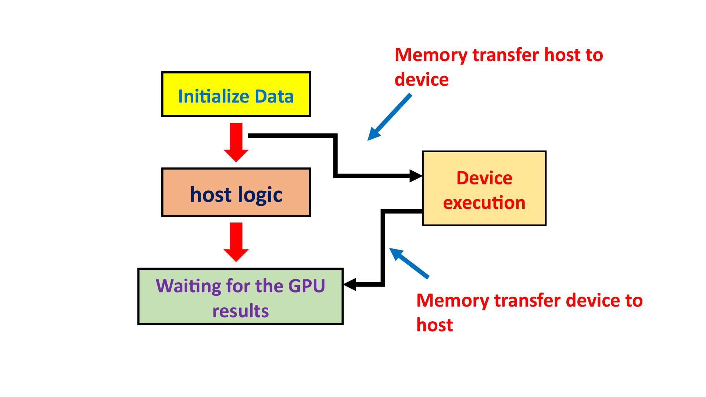
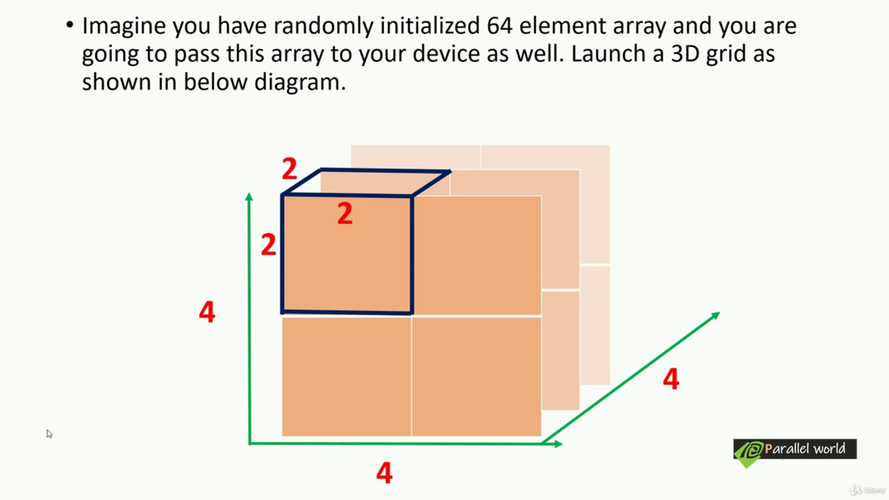

# 第 5 章 完成一次向量加法

## 主机内存与设备内存

本章采用经典的显式设备内存模型：主机代码使用普通主机内存，核函数使用由 CUDA 分配的设备全局内存。主机上保存的设备指针变量本身位于主机，但它表示的设备地址不能由普通主机代码随意解引用；主机数组地址也不能直接当作设备全局内存地址交给核函数使用。指针命名采用 `h_` 与 `d_` 前缀，有助于避免混淆。

向量加法把两个等长数组 `A`、`B` 的对应元素相加，得到 `C[i] = A[i] + B[i]`。不同输出元素互不依赖，因此每个有效线程完成一次独立计算。完整程序需要把前面各章的索引知识与下面的数据流程组合起来：

1. 在主机上分配并初始化 `A`、`B` 和接收输出的 `C`；
2. 为三个设备数组分配空间；
3. 把两个输入从主机复制到设备；
4. 启动核函数，让每个线程计算一个有效元素；
5. 把设备输出复制回主机；
6. 检查结果并释放主机、设备资源。

设备输出 `d_c` 只需分配空间，不必在启动前从尚未计算的 `h_c` 复制内容。设备内存和主机内存的分配也要分别使用对应接口。



*图 5.1　主机逻辑、设备执行以及主机到设备、设备到主机的数据传输共同构成完整数据流。*

## 分配、复制与释放

常用 C 内存操作与 CUDA 设备内存操作具有如下对应关系：

| 操作 | 主机内存 | 设备内存 |
| --- | --- | --- |
| 分配 | `malloc`、C++ 容器等 | `cudaMalloc` |
| 按字节设置 | `memset` | `cudaMemset` |
| 释放 | `free`、容器析构等 | `cudaFree` |

`cudaMalloc` 通过指针参数返回设备地址，长度以字节为单位。`cudaFree` 释放对应的设备分配，不能把同一块设备内存交给普通 `free`，也不能把主机指针交给 `cudaFree`。

### 字节数与复制方向

同步复制接口的核心形式为：

```cpp
cudaMemcpy(destination, source, byte_count, direction);
```

目标指针总是第一个参数，源指针是第二个参数。`byte_count` 是字节数而不是元素个数，对 `float` 数组通常写成：

```cpp
std::size_t bytes = static_cast<std::size_t>(n) * sizeof(float);
```

复制方向必须与源、目标空间相符：

- `cudaMemcpyHostToDevice`：主机输入复制到设备；
- `cudaMemcpyDeviceToHost`：设备结果复制回主机；
- `cudaMemcpyDeviceToDevice`：设备内存之间复制。

把方向写反、交换目标和源、漏乘 `sizeof(float)`，都可能造成运行错误或不易察觉的数据截断。实际代码还应检查每次分配、复制和释放的返回值。

### 复制、启动与同步的关系

核函数启动通常是异步的，而本章使用同步版 `cudaMemcpy`。设备到主机的同步复制不仅要完成自身传输，还必须等待此前相关设备工作产生可读结果，因此可以构成主机等待点。本章的完整示例在启动后检查启动错误，再通过设备到主机复制取得结果，不额外插入一次冗余的设备同步。

这些复制调用与核函数使用默认流中的顺序关系；异步复制、显式流以及通信与计算重叠将在后文讨论。同步等待不会消除传输成本，简单地把各阶段拼接起来也不代表获得了最佳整体性能。

## 完整代码：向量加法

下面的 `vector_add.cu` 使用 1000 个元素和每块 256 个线程，因此最后一个块包含多余线程。输入值随下标变化，主机输出数组先设为 `-1`。代码包含全部设备内存管理和基本错误检查，可在第 2 章所述 CUDA 环境中直接构建。

```cpp
#include <cstddef>
#include <cstdio>
#include <cstdlib>
#include <vector>
#include <cuda_runtime.h>

#define CUDA_CHECK(call)                                                   \
    do {                                                                   \
        cudaError_t status = (call);                                       \
        if (status != cudaSuccess) {                                       \
            std::fprintf(stderr, "%s:%d: %s failed: %s\n",               \
                         __FILE__, __LINE__, #call,                        \
                         cudaGetErrorString(status));                       \
            std::exit(EXIT_FAILURE);                                       \
        }                                                                  \
    } while (0)

__global__ void vector_add(const float* a, const float* b,
                           float* c, int n) {
    int index = blockIdx.x * blockDim.x + threadIdx.x;
    if (index < n) {
        c[index] = a[index] + b[index];
    }
}

int main() {
    const int n = 1000;
    const std::size_t bytes = static_cast<std::size_t>(n) * sizeof(float);

    std::vector<float> h_a(n);
    std::vector<float> h_b(n);
    std::vector<float> h_c(n, -1.0f);

    for (int i = 0; i < n; ++i) {
        h_a[i] = 0.5f * static_cast<float>(i);
        h_b[i] = 0.25f * static_cast<float>(n - i);
    }

    float* d_a = nullptr;
    float* d_b = nullptr;
    float* d_c = nullptr;
    CUDA_CHECK(cudaMalloc(reinterpret_cast<void**>(&d_a), bytes));
    CUDA_CHECK(cudaMalloc(reinterpret_cast<void**>(&d_b), bytes));
    CUDA_CHECK(cudaMalloc(reinterpret_cast<void**>(&d_c), bytes));

    CUDA_CHECK(cudaMemcpy(d_a, h_a.data(), bytes, cudaMemcpyHostToDevice));
    CUDA_CHECK(cudaMemcpy(d_b, h_b.data(), bytes, cudaMemcpyHostToDevice));

    const int threads = 256;
    const int blocks = (n + threads - 1) / threads;
    vector_add<<<blocks, threads>>>(d_a, d_b, d_c, n);
    CUDA_CHECK(cudaGetLastError());

    CUDA_CHECK(cudaMemcpy(h_c.data(), d_c, bytes, cudaMemcpyDeviceToHost));

    std::printf("C[0] = %f, C[%d] = %f\n", h_c[0], n - 1, h_c[n - 1]);

    CUDA_CHECK(cudaFree(d_c));
    CUDA_CHECK(cudaFree(d_b));
    CUDA_CHECK(cudaFree(d_a));
    return 0;
}
```

构建并运行：

```bash
nvcc -std=c++11 vector_add.cu -o vector_add
./vector_add
```

`std::vector` 在主机端自动管理三个数组，设备指针则必须在正常路径上逐一 `cudaFree`。两个打印值只能说明程序产生了部分输出，不能证明所有元素都正确；独立参考计算、浮点容差和更完整的错误处理在下一章加入。



*图 5.2　64 元素数组的三维网格启动练习。*

## 实验：尺寸、三维映射与传输开销

1. 将 `n` 分别改为 1、256、257、1000 和 1 000 000。每次先预测线程块数与最后一个块的多余线程数，并检查结果的首尾元素。大尺寸测试还必须确认字节数计算没有溢出。
2. 把 `h_c` 的初值改为另一个醒目标记，思考为什么它不会自动初始化 `d_c`，以及为什么漏写位置复制回来的未初始化数据有时能暴露问题、有时却可能碰巧看似合理。下一章将改为在设备输出上设置标记，并用完整参考计算检查。
3. 将 `n` 设为 64，使用第 3 章的 `grid(2,2,2)`、`block(2,2,2)`，把核函数下标改为该章由 `block_id`、`local_id` 组合的 `grid_linear_id`，保留下标小于 `n` 的检查。此时仍为 64 个线程处理 64 个元素，但传输和向量加法逻辑不变，只改变三维线程到数据的映射。
4. 分别记录输入复制、核函数和输出复制所占的工作量，分析为什么简单向量加法容易被主机—设备传输限制。不要只凭核函数耗时判断整个应用是否加速。
5. 连续执行多个设备计算时，检查中间结果是否真的需要复制回主机。减少无意义的数据往返，通常比单纯增加线程更接近整体性能问题。

## 小结

显式主机—设备编程要求区分指针空间、按字节计算复制长度、选择正确方向，并成对管理设备资源。向量加法完整呈现了输入初始化、设备分配、主机到设备复制、并行计算、设备到主机复制和资源释放。设备到主机的同步复制可以等待计算结果，但完整正确性仍需独立验证，整体性能也必须把传输开销计算在内。
