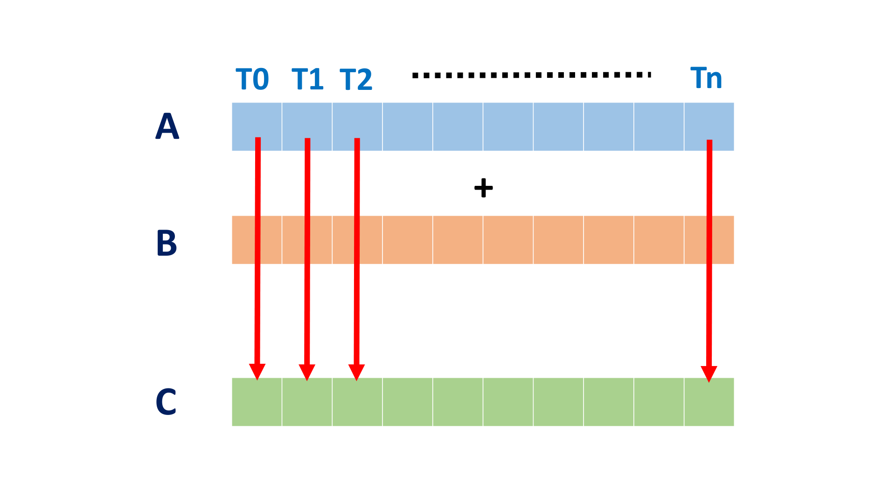
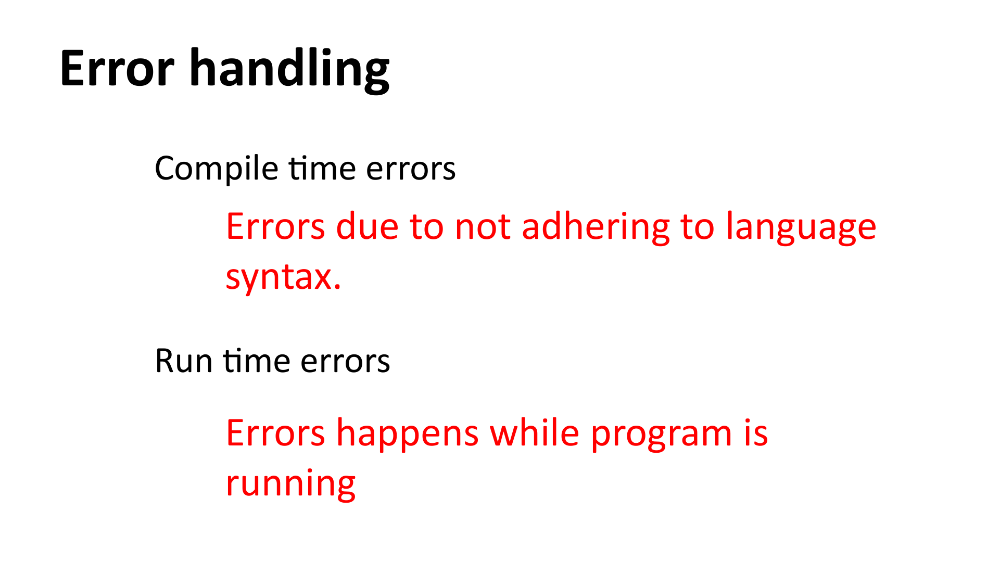

# 第 6 章 验证结果并处理 CUDA 错误



*图 6.1　向量加法的逐元素依赖关系简单，适合用来练习独立结果验证。*

## 独立参考实现与有效测试

成功编译、核函数启动没有报错、程序能够打印结果，都不足以证明计算正确。索引错位、数据复制方向错误、同步缺失和越界访问可能留下未初始化数据，也可能产生看似合理的数值。CUDA 程序必须建立独立于设备实现的正确性检查。

对向量加法，最直接的参考实现是在主机上用简单循环重新计算：

```cpp
for (int i = 0; i < n; ++i) {
    float expected = h_a[i] + h_b[i];
    // 将 expected 与设备复制回来的 h_c[i] 比较。
}
```

参考实现应保持简单，避免与设备代码共享同一套复杂索引逻辑，否则两处相同错误可能互相掩盖。整数运算在值域允许且没有溢出的前提下可以逐项精确比较；浮点运算则需要明确容差。

有区分度的测试数据同样重要。把所有输入都设为 0 或同一个常数，可能让下标偏移和重复访问仍然得到“正确”结果。更合适的方法是令输入随下标变化，包含不同符号，并测试不能被线程块大小整除的长度。设备输出还可以先填充特殊位模式，使未被核函数写入的位置在验证时暴露，而不是偶然保留旧结果。

## 浮点容差

浮点运算受有限精度、舍入模式和运算顺序影响。归约、并行扫描等算法会改变加法结合顺序，即使数学公式相同，主机与设备的最后若干位也可能不同。因此通常不能只用 `actual == expected` 作为所有浮点算法的通用验证方式。

一种常见的逐元素判据是：

```text
absolute_error = |actual - expected|
absolute_error <= absolute_tolerance
                  + relative_tolerance * |expected|
```

绝对容差处理接近 0 的结果，相对容差随结果量级调整允许误差。对于本章这种有限范围内的一次加法，`1e-6` 量级的示例容差足以表达比较方法，但不是适用于所有问题的固定常数。选择容差时应考虑数据类型、输入范围、运算次数、条件数和算法精度要求；容差过大可能放过真正的索引错误，过小则可能把合理舍入差异报告为失败。

验证失败时，应报告首个失败下标、两个输入、参考值、实际值、绝对误差和所用容差。这些信息比单纯输出“结果错误”更容易定位问题。任何性能优化都应重新通过同一套验证。



*图 6.2　CUDA 错误处理需要区分编译期问题与运行时问题，并进一步定位 API、启动和执行错误。*

## CUDA 错误处理原理

### API 返回值与检查宏

编译错误由编译器在构建阶段发现，运行时错误则发生在分配、复制、启动或设备执行期间。大多数 CUDA 运行时 API 返回 `cudaError_t`，`cudaSuccess` 表示调用没有报告错误，其他值可通过 `cudaGetErrorString` 转换为诊断文本。

把检查集中到一个宏中，可以保留调用表达式、源文件和行号：

```cpp
#define CUDA_CHECK(call)                                                   \
    do {                                                                   \
        cudaError_t status = (call);                                       \
        if (status != cudaSuccess) {                                       \
            std::fprintf(stderr, "%s:%d: %s failed: %s\n",               \
                         __FILE__, __LINE__, #call,                        \
                         cudaGetErrorString(status));                       \
            std::exit(EXIT_FAILURE);                                       \
        }                                                                  \
    } while (0)
```

`do ... while (0)` 使宏可以像单条语句一样安全使用，局部变量名也不会污染调用处。`#call` 在预处理时把传入表达式转换为文本。诊断信息应写到标准错误流，避免与正常结果混淆。

### 启动错误与执行错误

核函数启动语句本身没有可交给 `CUDA_CHECK` 的 `cudaError_t` 返回值，因此需要两种不同检查：

```cpp
vector_add<<<blocks, threads>>>(d_a, d_b, d_c, n);
CUDA_CHECK(cudaGetLastError());
CUDA_CHECK(cudaDeviceSynchronize());
```

启动后立即调用 `cudaGetLastError()`，可检查无效执行配置、参数等启动阶段错误，并返回、清除此前记录的最后错误。`cudaDeviceSynchronize()` 等待设备工作完成，并可报告此前核函数执行期间产生的部分错误。两者不能互相替代：只检查启动无法发现所有执行故障，只做同步又会让真正的启动位置变得不明确。

并非每次都需要像本章这样紧跟一次完整设备同步。同步设备到主机复制等操作也可以形成等待并返回错误，但程序必须清楚哪个调用负责等待、哪个调用负责诊断，而不能忽略全部返回值。

### 错误路径与资源回收

本章宏在失败时直接退出进程，适合入门示例中突出首个失败位置。大型应用通常需要把错误传播给调用者，并通过统一清理路径或 RAII 释放已经分配的主机与设备资源。直接退出不能替代库代码中的错误恢复策略，也不是所有设备错误都能恢复后继续执行。

CUDA 提供的计算正确性工具可以进一步定位非法内存访问等问题。宏回答“哪个 CUDA 调用报告了错误”，`compute-sanitizer` 等工具则帮助解释“设备代码为何出错”。

## 完整代码：带验证和错误检查的向量加法

下面的 `vector_add_checked.cu` 是完整独立版本。它使用 100003 个元素、随下标变化的正负输入和不能整除 256 的长度；设备输出先按字节设为 `0xff`。在 CUDA 所用的 IEEE 754 单精度格式下，全 `0xff` 位模式是 NaN，因此漏写元素会被 `std::isfinite` 检查捕获。

```cpp
#include <algorithm>
#include <cmath>
#include <cstddef>
#include <cstdio>
#include <cstdlib>
#include <vector>
#include <cuda_runtime.h>

#define CUDA_CHECK(call)                                                   \
    do {                                                                   \
        cudaError_t status = (call);                                       \
        if (status != cudaSuccess) {                                       \
            std::fprintf(stderr, "%s:%d: %s failed: %s\n",               \
                         __FILE__, __LINE__, #call,                        \
                         cudaGetErrorString(status));                       \
            std::exit(EXIT_FAILURE);                                       \
        }                                                                  \
    } while (0)

__global__ void vector_add(const float* a, const float* b,
                           float* c, int n) {
    int index = blockIdx.x * blockDim.x + threadIdx.x;
    if (index < n) {
        c[index] = a[index] + b[index];
    }
}

bool verify_vector(const std::vector<float>& a,
                   const std::vector<float>& b,
                   const std::vector<float>& actual) {
    const float absolute_tolerance = 1.0e-6f;
    const float relative_tolerance = 1.0e-6f;
    float maximum_error = 0.0f;

    for (std::size_t i = 0; i < actual.size(); ++i) {
        const float expected = a[i] + b[i];
        const float difference = std::fabs(actual[i] - expected);
        const float tolerance = absolute_tolerance +
                                relative_tolerance * std::fabs(expected);

        if (!std::isfinite(actual[i]) || !(difference <= tolerance)) {
            std::fprintf(stderr,
                         "Mismatch at %zu: a=%g, b=%g, expected=%g, "
                         "actual=%g, error=%g, tolerance=%g\n",
                         i, a[i], b[i], expected, actual[i], difference,
                         tolerance);
            return false;
        }
        maximum_error = std::max(maximum_error, difference);
    }

    std::printf("Verification passed; maximum absolute error = %g\n",
                maximum_error);
    return true;
}

int main() {
    const int n = 100003;
    const std::size_t bytes = static_cast<std::size_t>(n) * sizeof(float);

    std::vector<float> h_a(n);
    std::vector<float> h_b(n);
    std::vector<float> h_c(n, 0.0f);
    for (int i = 0; i < n; ++i) {
        h_a[i] = static_cast<float>((i % 97) - 48) * 0.25f;
        h_b[i] = static_cast<float>((i % 31) - 15) * 0.125f;
    }

    float* d_a = nullptr;
    float* d_b = nullptr;
    float* d_c = nullptr;
    CUDA_CHECK(cudaMalloc(reinterpret_cast<void**>(&d_a), bytes));
    CUDA_CHECK(cudaMalloc(reinterpret_cast<void**>(&d_b), bytes));
    CUDA_CHECK(cudaMalloc(reinterpret_cast<void**>(&d_c), bytes));

    CUDA_CHECK(cudaMemcpy(d_a, h_a.data(), bytes, cudaMemcpyHostToDevice));
    CUDA_CHECK(cudaMemcpy(d_b, h_b.data(), bytes, cudaMemcpyHostToDevice));
    CUDA_CHECK(cudaMemset(d_c, 0xff, bytes));

    const int threads = 256;
    const int blocks = (n + threads - 1) / threads;
    vector_add<<<blocks, threads>>>(d_a, d_b, d_c, n);
    CUDA_CHECK(cudaGetLastError());
    CUDA_CHECK(cudaDeviceSynchronize());

    CUDA_CHECK(cudaMemcpy(h_c.data(), d_c, bytes, cudaMemcpyDeviceToHost));
    const bool valid = verify_vector(h_a, h_b, h_c);

    CUDA_CHECK(cudaFree(d_c));
    CUDA_CHECK(cudaFree(d_b));
    CUDA_CHECK(cudaFree(d_a));
    return valid ? EXIT_SUCCESS : EXIT_FAILURE;
}
```

构建与运行：

```bash
nvcc -std=c++11 vector_add_checked.cu -o vector_add_checked
./vector_add_checked
```

正常程序会报告验证通过及最大绝对误差。显式同步位于结果复制之前，是为了把启动错误、执行错误和复制错误分开展示；在已经理解等待关系后，可以根据程序结构避免不必要的额外同步。

## 实验：让验证与检查真正发现故障

1. 在未修改的程序上分别测试 `n = 1`、256、257 和 100003，确认参考计算与边界处理在各种覆盖情况下都有效。
2. 临时把核函数条件改为 `index < n - 1`，使最后一个元素不被写入。验证应报告最后一个下标的实际值不是有限数；恢复条件后再确认测试通过。这个实验验证了测试本身确实能发现漏写。
3. 临时把启动语句中的网格块数写成 0。`cudaGetLastError()` 应在启动位置报告无效配置；恢复后再运行。不要通过删除边界检查制造非法访问来测试错误宏。
4. 在支持该工具的环境中运行 `compute-sanitizer --tool memcheck ./vector_add_checked`，比较工具报告与 `CUDA_CHECK` 报告所提供的信息层次。
5. 将输入数量级显著增大或缩小，观察绝对误差与容差的关系。进一步分析归约等改变运算顺序的算法为何需要重新确定容差，而不是机械沿用本章常数。

## 小结

可靠的 CUDA 结果来自独立参考实现、有区分度的数据、合理浮点容差和完整错误检查。`CUDA_CHECK` 用于检查运行时 API，`cudaGetLastError()` 定位启动错误，同步或复制调用用于暴露设备执行错误。验证必须覆盖遗漏和错位，错误路径必须考虑资源回收，性能实验则必须始终保持这套正确性约束。
