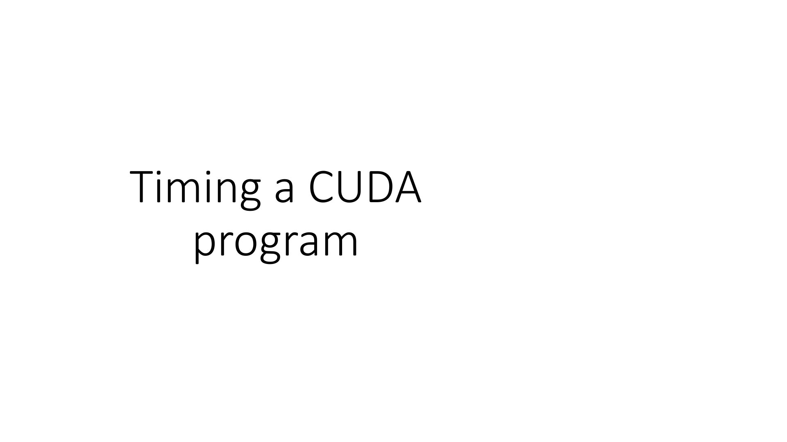
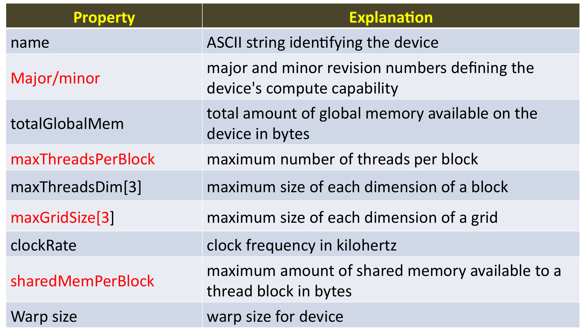

# 第 7 章 计时并查询设备能力



*图 7.1　计时的基本形式是明确开始与结束位置；CUDA 异步程序还必须保证结束位置覆盖实际设备完成。*

## 明确计时对象

性能比较之前，必须先说明测量区间。整个应用耗时、主机到设备复制、核函数执行和设备到主机复制是不同对象；只测核函数得到的加速比，不能直接代表端到端加速比。简单向量加法的计算量很小，传输往往占据显著成本，甚至可能使包含传输的 GPU 流程慢于优化的主机实现。

主机墙钟时间（wall-clock time）适合评估端到端流程，可以使用 `std::chrono::steady_clock` 等单调时钟。由于核函数启动是异步的，如果启动后立即记录主机结束时刻，测到的可能只是任务提交时间。主机计时区间若要求包含设备工作，就必须在结束前建立适当同步。

还应避免把 C `clock()` 返回的处理器时间不加区分地当作所有平台上的设备实际经过时间。无论选择哪种主机时钟，都应明确其语义、单位和计时区间，并确保设备工作已经完成。

## CUDA 事件计时原理

CUDA 事件可以记录在设备工作流中，用于测量两个事件完成时刻之间经过的设备时间线。记录事件本身并不等于等待事件完成；通常需要同步结束事件，再调用 `cudaEventElapsedTime` 取得毫秒为单位的差值。

**本章首次使用事件时，所有事件和核函数都使用默认流。** 代码把 `cudaEventRecord` 的流参数显式写为 `0`，核函数也没有另行指定流，因此事件与被测核函数位于同一默认流中。此处只利用同一默认流内这些操作按提交顺序执行的性质；默认流与显式流的同步规则、流的创建和销毁、跨流依赖及并发语义将在后文详述。

事件适合测量设备区间，不自动包含事件之外的主机分配、初始化或其他工作。若要分别测量默认流中的输入复制、核函数和输出复制，可以为每个区间设置对应事件；若要评估整个应用，则还应测量主机墙钟时间，并避免把重叠阶段简单相加后当作总时间。

## 完整代码：测量核函数平均耗时

下面的 `event_timing.cu` 先执行一次不计入测量的预热核函数，再用一对事件包围 20 次核函数启动，报告每次启动的平均设备耗时。所有设备指针、事件和主机输出均在正常路径上释放或销毁，最后还会执行完整结果验证；不正确的实现不具有可比较的性能。

代码使用默认流和 1 048 576 个单精度元素。前提是设备内存足以容纳三个数组，且第 2 章所述构建环境可用。

```cpp
#include <cmath>
#include <cstddef>
#include <cstdio>
#include <cstdlib>
#include <vector>
#include <cuda_runtime.h>

#define CUDA_CHECK(call)                                                   \
    do {                                                                   \
        cudaError_t status = (call);                                       \
        if (status != cudaSuccess) {                                       \
            std::fprintf(stderr, "%s:%d: %s failed: %s\n",               \
                         __FILE__, __LINE__, #call,                        \
                         cudaGetErrorString(status));                       \
            std::exit(EXIT_FAILURE);                                       \
        }                                                                  \
    } while (0)

__global__ void vector_add(const float* a, const float* b,
                           float* c, int n) {
    int index = blockIdx.x * blockDim.x + threadIdx.x;
    if (index < n) {
        c[index] = a[index] + b[index];
    }
}

bool verify(const std::vector<float>& a, const std::vector<float>& b,
            const std::vector<float>& c) {
    for (std::size_t i = 0; i < c.size(); ++i) {
        const float expected = a[i] + b[i];
        const float error = std::fabs(c[i] - expected);
        const float tolerance = 1.0e-6f + 1.0e-6f * std::fabs(expected);
        if (!std::isfinite(c[i]) || !(error <= tolerance)) {
            std::fprintf(stderr, "Mismatch at %zu: expected %g, got %g\n",
                         i, expected, c[i]);
            return false;
        }
    }
    return true;
}

int main() {
    const int n = 1 << 20;
    const int iterations = 20;
    const std::size_t bytes = static_cast<std::size_t>(n) * sizeof(float);

    std::vector<float> h_a(n);
    std::vector<float> h_b(n);
    std::vector<float> h_c(n, 0.0f);
    for (int i = 0; i < n; ++i) {
        h_a[i] = static_cast<float>((i % 101) - 50) * 0.25f;
        h_b[i] = static_cast<float>((i % 37) - 18) * 0.125f;
    }

    float* d_a = nullptr;
    float* d_b = nullptr;
    float* d_c = nullptr;
    CUDA_CHECK(cudaMalloc(reinterpret_cast<void**>(&d_a), bytes));
    CUDA_CHECK(cudaMalloc(reinterpret_cast<void**>(&d_b), bytes));
    CUDA_CHECK(cudaMalloc(reinterpret_cast<void**>(&d_c), bytes));
    CUDA_CHECK(cudaMemcpy(d_a, h_a.data(), bytes, cudaMemcpyHostToDevice));
    CUDA_CHECK(cudaMemcpy(d_b, h_b.data(), bytes, cudaMemcpyHostToDevice));

    const int threads = 256;
    const int blocks = (n + threads - 1) / threads;

    // 预热不计入事件区间。
    vector_add<<<blocks, threads>>>(d_a, d_b, d_c, n);
    CUDA_CHECK(cudaGetLastError());
    CUDA_CHECK(cudaDeviceSynchronize());

    cudaEvent_t start;
    cudaEvent_t stop;
    CUDA_CHECK(cudaEventCreate(&start));
    CUDA_CHECK(cudaEventCreate(&stop));

    // 0 表示默认流；事件与核函数必须处于一致的计时上下文。
    CUDA_CHECK(cudaEventRecord(start, 0));
    for (int iteration = 0; iteration < iterations; ++iteration) {
        vector_add<<<blocks, threads>>>(d_a, d_b, d_c, n);
        CUDA_CHECK(cudaGetLastError());
    }
    CUDA_CHECK(cudaEventRecord(stop, 0));
    CUDA_CHECK(cudaEventSynchronize(stop));

    float total_milliseconds = 0.0f;
    CUDA_CHECK(cudaEventElapsedTime(&total_milliseconds, start, stop));
    const float average_milliseconds = total_milliseconds / iterations;

    CUDA_CHECK(cudaMemcpy(h_c.data(), d_c, bytes, cudaMemcpyDeviceToHost));
    const bool valid = verify(h_a, h_b, h_c);

    std::printf("Kernel average over %d iterations: %.6f ms\n",
                iterations, average_milliseconds);
    std::printf("Result verification: %s\n", valid ? "passed" : "FAILED");

    CUDA_CHECK(cudaEventDestroy(stop));
    CUDA_CHECK(cudaEventDestroy(start));
    CUDA_CHECK(cudaFree(d_c));
    CUDA_CHECK(cudaFree(d_b));
    CUDA_CHECK(cudaFree(d_a));
    return valid ? EXIT_SUCCESS : EXIT_FAILURE;
}
```

构建与运行：

```bash
nvcc -std=c++11 event_timing.cu -o event_timing
./event_timing
```

结束事件同步之后，`cudaEventElapsedTime` 才能得到完整区间。示例把 20 次启动放在同一事件区间内，因此结果包含这些核函数及默认流中相应调度的总设备时间，再除以迭代次数；它不包含计时前的主机初始化、设备分配和输入复制，也不包含计时后的结果复制与验证。若主机提交工作不够及时，事件区间还可能包含设备等待后续工作的间隔，因此该数值是整个重复核函数区间的平均值，而不是单条设备指令的执行时间。

## 获得可复现的性能数据

单次测量容易受到设备初始化、频率变化和其他系统活动影响。预热可以排除部分首次使用成本，多次重复则能降低偶然波动。报告平均值、中位数或最小值都可以，但应说明统计方法，并保留足够的重复次数；不要把单次异常偏低的测量值当作稳定性能。

比较实现或线程配置时，应保持数据规模、输入分布、编译选项、设备和测量区间一致，并对每种配置重新验证结果。可以在设备限制允许时比较 128、256、512、1024 等块大小，但“上限更大”并不意味着“性能更好”。这种系统试验比假定某一块大小普遍最优更可靠。

除执行时间外，实际工程还可能需要考虑数值精度、能耗、设备资源、硬件成本和内存容量。若一种实现通过少做有效工作获得更短时间，其性能数字没有意义。



*图 7.2　设备属性提供计算能力、内存和线程限制等信息，具体字段以目标 CUDA 版本为准。*

## 运行时查询设备属性

不同 GPU 的计算能力、SM 数量、线程块限制、共享内存和内存容量差异明显。程序不应把某台机器的参数硬编码为所有设备的固定条件。CUDA 运行时可通过 `cudaGetDeviceCount` 枚举设备，通过 `cudaGetDeviceProperties` 查询属性；已经选择当前设备的应用也可先用 `cudaGetDevice` 取得其编号。

与执行配置最相关的字段包括：

| 属性 | 含义与使用注意 |
| --- | --- |
| `name`、`major`、`minor` | 设备名称与计算能力主、次版本 |
| `totalGlobalMem` | 设备全局内存总量，不等于当前空闲量 |
| `multiProcessorCount` | SM 数量，可描述设备规模，不能直接推出最佳网格 |
| `maxThreadsPerBlock` | 每块线程总数的乘积上限，不是三个分量之和 |
| `maxThreadsDim[3]` | 块在 `x`、`y`、`z` 各维度上的限制 |
| `maxGridSize[3]` | 网格在各维度上的线程块数限制 |
| `sharedMemPerBlock`、`regsPerBlock` | 每块共享内存和寄存器资源的重要限制 |
| `maxThreadsPerMultiProcessor` | 每个 SM 的理论线程驻留上限之一 |
| `warpSize` | 设备的线程束大小，执行模型将在后文展开 |
| `memoryBusWidth`、`clockRate` | 内存总线宽度与设备时钟信息，不能单独代表应用性能 |

合法块形状既要满足各维度限制，也要满足 `block.x * block.y * block.z <= maxThreadsPerBlock`。网格各维度同样不能超过 `maxGridSize`。这些理论上限用于合法性检查和诊断，并不等于最佳性能工作点。

## 完整代码：枚举设备属性

将下面代码保存为 `device_info.cu`。它枚举所有 CUDA 可见设备，不依赖特定 GPU 型号，也不假定设备数量恰好为一。

```cpp
#include <cstddef>
#include <cstdio>
#include <cstdlib>
#include <cuda_runtime.h>

#define CUDA_CHECK(call)                                                   \
    do {                                                                   \
        cudaError_t status = (call);                                       \
        if (status != cudaSuccess) {                                       \
            std::fprintf(stderr, "%s:%d: %s failed: %s\n",               \
                         __FILE__, __LINE__, #call,                        \
                         cudaGetErrorString(status));                       \
            std::exit(EXIT_FAILURE);                                       \
        }                                                                  \
    } while (0)

int main() {
    int device_count = 0;
    CUDA_CHECK(cudaGetDeviceCount(&device_count));
    if (device_count == 0) {
        std::fprintf(stderr, "No CUDA devices are available\n");
        return EXIT_FAILURE;
    }

    for (int device = 0; device < device_count; ++device) {
        cudaDeviceProp prop{};
        CUDA_CHECK(cudaGetDeviceProperties(&prop, device));

        std::printf("Device %d: %s\n", device, prop.name);
        std::printf("  Compute capability: %d.%d\n", prop.major, prop.minor);
        std::printf("  Global memory: %.2f MiB\n",
                    static_cast<double>(prop.totalGlobalMem) /
                        (1024.0 * 1024.0));
        std::printf("  SMs: %d\n", prop.multiProcessorCount);
        std::printf("  Max threads per block: %d\n", prop.maxThreadsPerBlock);
        std::printf("  Max block dimensions: [%d, %d, %d]\n",
                    prop.maxThreadsDim[0], prop.maxThreadsDim[1],
                    prop.maxThreadsDim[2]);
        std::printf("  Max grid dimensions: [%d, %d, %d]\n",
                    prop.maxGridSize[0], prop.maxGridSize[1],
                    prop.maxGridSize[2]);
        std::printf("  Max threads per SM: %d\n",
                    prop.maxThreadsPerMultiProcessor);
        std::printf("  Shared memory per block: %zu bytes\n",
                    static_cast<std::size_t>(prop.sharedMemPerBlock));
        std::printf("  Registers per block: %d\n", prop.regsPerBlock);
        std::printf("  Warp size: %d\n", prop.warpSize);
        std::printf("  Memory bus width: %d bits\n", prop.memoryBusWidth);
        std::printf("  Device clock: %.2f MHz\n",
                    static_cast<double>(prop.clockRate) / 1000.0);
    }
    return 0;
}
```

构建与运行：

```bash
nvcc -std=c++11 device_info.cu -o device_info
./device_info
```

具体字段会随 CUDA 版本扩展，编译时应以所用工具包的头文件和官方文档为准。属性输出适合写入实验记录，也可用于启动前的合法性检查；涉及性能的选择仍需实际基准测试。

## 实验：分阶段计时与配置扫描

1. 在 `event_timing.cu` 的输入复制、核函数循环和输出复制之外分别增加主机墙钟计时，再在核函数区间使用现有事件结果。比较两组数字，列出每个区间包含和不包含的工作，避免把核函数平均耗时误称为整个应用耗时。
2. 保持默认流不变，为输入复制和输出复制分别添加事件对。把三个阶段的时间与一次主机端到端测量对照，并解释同步、主机工作和统计区间为何会造成差异。
3. 根据 `device_info` 输出的 `maxThreadsPerBlock` 和 `maxThreadsDim`，选择若干合法块大小重复事件计时。每种配置都重新运行结果验证，记录多批测量后再比较平均值或中位数。
4. 把数据规模扩大或缩小，观察核函数与传输在整体流程中的比例变化。确认任何性能结论都同时注明设备、编译选项、数据规模、块大小和计时方法。
5. 对准备使用的 `dim3 block` 逐项检查三个维度及总线程数乘积，再检查网格各维度。人为写出一个超过属性上限的配置，只在纸面上判断它会违反哪一项约束，不通过非法内存访问验证限制。

## 入门工程清单

完成第一部分后，一个最小但可靠的 CUDA 工程应逐项满足以下要求：

1. **环境可复现**：记录 GPU、驱动、工具包、主机编译器、编译选项和目标架构，不用旧界面或他人机器的版本号代替兼容性检查。
2. **问题适合并行**：说明独立工作、数据依赖、串行部分和主机—设备数据移动，先建立正确的主机参考实现。
3. **执行配置合法**：区分网格中的块数与每块线程数，查询设备限制，并验证维度乘积和网格上限。
4. **索引唯一且安全**：根据数据布局选择全局索引，使用向上取整覆盖元素，保留一维或二维边界检查，测试非整除尺寸。
5. **内存管理成对**：区分 `h_` 与 `d_` 指针，按字节分配和复制，确认方向，正常与错误路径都考虑资源释放。
6. **异步行为明确**：知道哪个操作只提交工作、哪个操作负责等待，不把核函数启动返回误认为计算已经完成。
7. **错误检查完整**：检查 CUDA API 返回值，启动后调用 `cudaGetLastError`，通过同步或后续操作检查设备执行错误，必要时使用计算正确性工具。
8. **结果独立验证**：使用有区分度的输入和独立参考计算，按算法选择精确比较或浮点容差，报告失败下标和数值差异。
9. **计时区间清楚**：区分核函数、传输与端到端时间，预热并重复测量，确保事件与核函数处于一致的流上下文。
10. **优化保留基线**：每次只改变可识别的变量，保存正确版本和实验记录，在相同条件下比较，并重新验证每种优化。

后续执行模型将在此基础上讨论线程束、分支分化、资源划分、延迟隐藏、占用率和同步，并通过更复杂的并行算法说明这些概念如何影响正确性与性能。

## 小结

CUDA 事件适合测量设备时间线，本章示例中的事件与核函数均明确使用默认流；主机墙钟计时则适合评价端到端流程。稳定结论需要预热、重复测量和持续正确性验证。设备属性查询把硬件差异转化为运行时可检查的信息，但理论上限不替代基准测试。把环境、索引、内存、同步、错误、验证和计时纳入同一份工程清单，才能形成可靠的 CUDA 开发流程。
