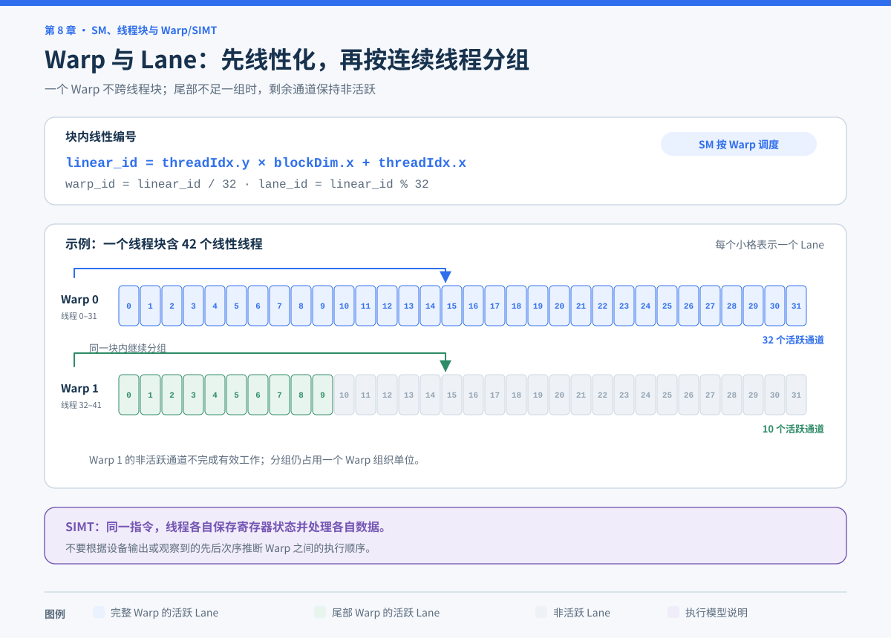
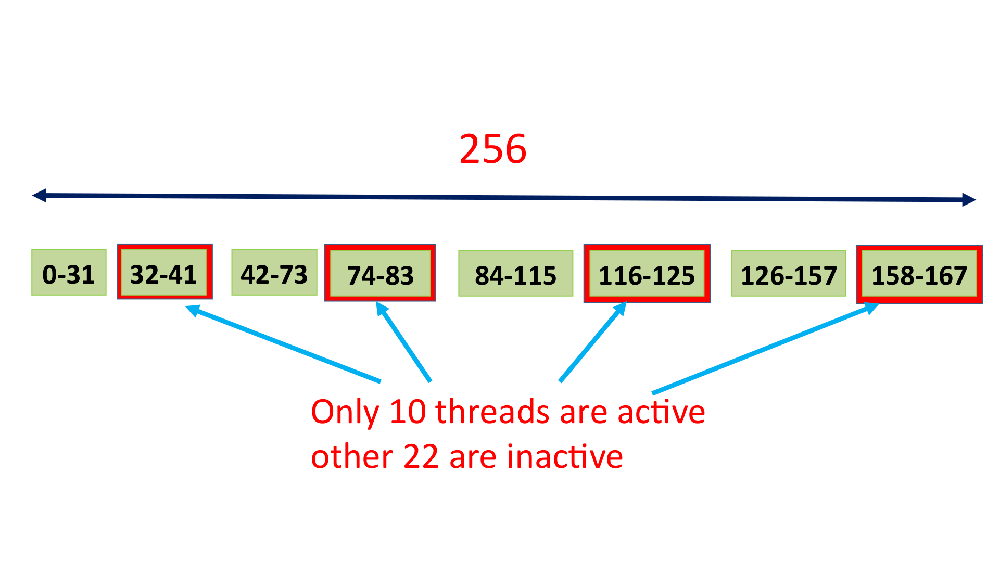

# 第 8 章 理解 SM、Warp 与线程执行

## 逻辑并行与物理执行

CUDA 允许一次核函数启动包含数百万个逻辑线程，但 GPU 不会让这些线程在同一时刻全部向前执行。线程块首先被分配到流式多处理器（SM）上，SM 再按照线程束（Warp）调度指令。逻辑并行描述程序可以表达多少独立工作，物理并发则受到 SM 数量、驻留线程块和片上资源共同限制。

一个 SM 可以同时维护多个线程块的执行上下文。每个线程块占用寄存器、共享内存以及线程块和线程束槽位，资源耗尽后，即使网格中仍有大量待执行线程块，也不能继续驻留。线程块因此既是程序组织单位，也是硬件分配资源的重要单位。

线程块进入 SM 后，块内线程可以使用共享内存和 `__syncthreads()` 协作。不同线程块则可能分布在不同 SM 上，或者以无法预先假定的顺序调度，普通 CUDA 程序不能通过块内同步推导全网格执行顺序。



*图 8.1　Warp 由连续线程组成，不跨线程块。*

## Warp 是基本调度单位

在课程讨论的 NVIDIA GPU 上，一个 Warp 包含 32 个连续编号的线程。SM 以 Warp 为单位调度指令，同一 Warp 中的线程通常共同执行一条指令，但各自保留寄存器状态并处理不同数据，这构成了单指令多线程（SIMT）模型。

对于一维线程块，Warp 编号与通道编号可以直接由局部线程索引得到：

```cpp
int warp_id = threadIdx.x / 32;
int lane_id = threadIdx.x % 32;
```

二维或三维线程块需要先按照 `x`、`y`、`z` 的顺序线性化。二维情况下：

```cpp
int linear_id = threadIdx.y * blockDim.x + threadIdx.x;
int warp_id = linear_id / 32;
int lane_id = linear_id % 32;
```

这些编号描述线程在线程块内的位置。若需要全局 Warp 编号，还必须结合 `blockIdx`、网格维度和每块 Warp 数，不能把不同块中的 `warp_id = 0` 误认为同一个执行实体。



*图 8.2　非 32 倍数线程块会在最后一个 Warp 中留下非活跃通道，Warp 不会跨块拼接。*

## 非 32 倍数线程块的空槽

Warp 不会跨越两个不同的线程块。假设每个线程块包含 42 个线程，第一个 Warp 包含 32 个线程，第二个 Warp 只对应 10 个有效线程，其余 22 个通道处于非活跃状态。第二个 Warp 仍然需要调度和资源分配单位，不能因为有效线程较少就与其他块拼成完整 Warp。

若有 4 个这样的线程块，程序共有 168 个有效线程，却需要 8 个 Warp，即按 256 个硬件线程槽位组织。非活跃通道不完成有效计算，但可能降低执行资源利用率，并影响共享内存、寄存器等资源的分配。

通常应将块大小设置为 32 的合理倍数，例如 128、256 或 512。具体选择仍需结合寄存器、共享内存、占用率和实测性能；块大小是 32 的倍数只消除了尾部空槽，并不保证整个实现最优。

## 一个 Warp 编号实验

下面的核函数输出块坐标、线程坐标、Warp 编号和通道编号：

```cpp
__global__ void print_warp_info() {
    int linear_id = threadIdx.y * blockDim.x + threadIdx.x;
    int warp_id = linear_id / 32;
    int lane_id = linear_id % 32;

    printf("block=(%d,%d), thread=(%d,%d), warp=%d, lane=%d\n",
           blockIdx.x, blockIdx.y,
           threadIdx.x, threadIdx.y, warp_id, lane_id);
}
```

可以使用二维块 `dim3 block(42, 2)` 启动，观察每 32 个线性线程形成一个 Warp，以及每个块尾部出现的非完整 Warp。设备端 `printf` 的输出顺序不能用来推断 Warp 的实际调度顺序，更不能作为同步依据。

## SIMT 与分支、同步的关系

同一 Warp 中所有线程走相同控制流路径时，指令执行最为直接；不同线程进入不同分支时，可能发生线程束分化。不同 Warp 之间没有默认执行先后，块内需要协作时必须使用明确的同步机制。

即使某个示例在当前设备上多次呈现相同输出顺序，也不能把它当作硬件保证。正确的 CUDA 程序应在任何符合模型的调度顺序下都保持数据依赖成立。

## 小结

SM 负责驻留线程块并调度 Warp，Warp 通常由 32 个连续线程组成。二维和三维线程需要先线性化再计算 Warp 与 Lane，非 32 倍数线程块会产生非活跃通道。理解这些硬件关系，是分析线程束分化、资源限制和延迟隐藏的基础。
