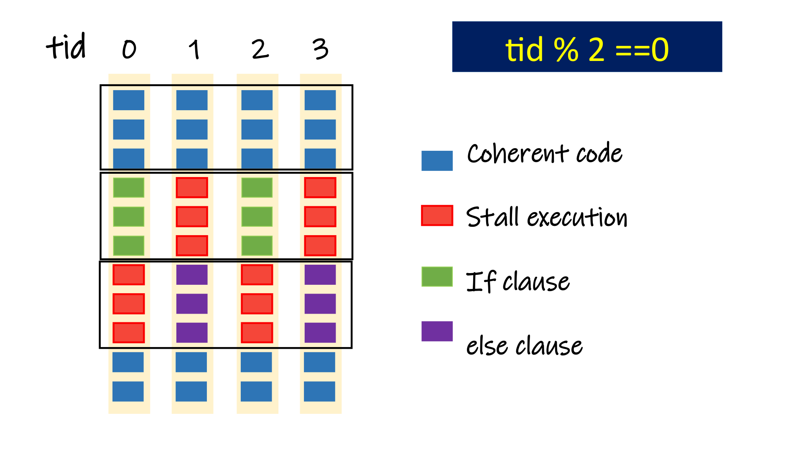
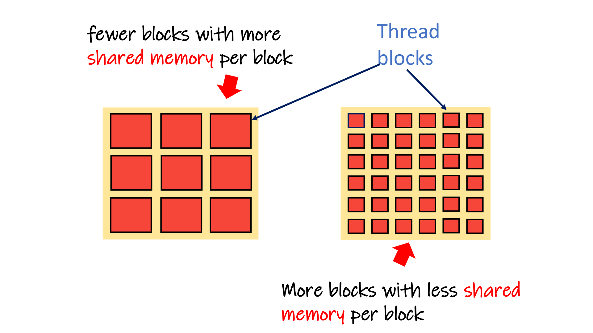
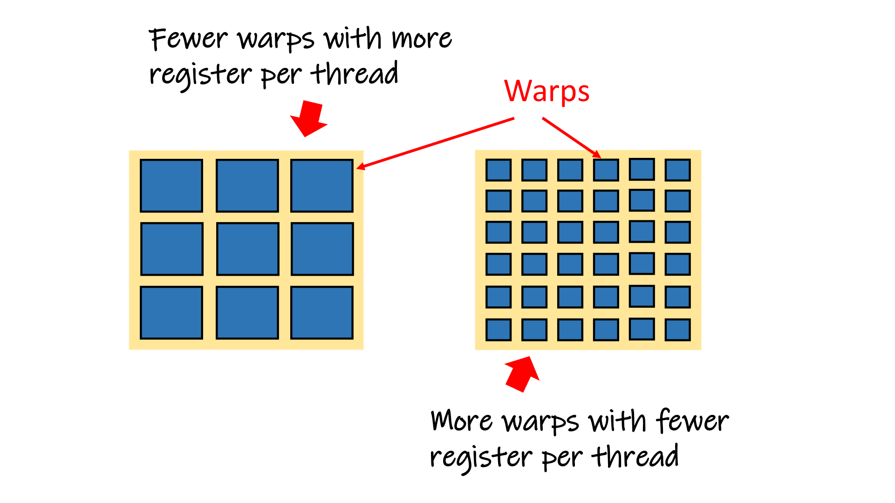
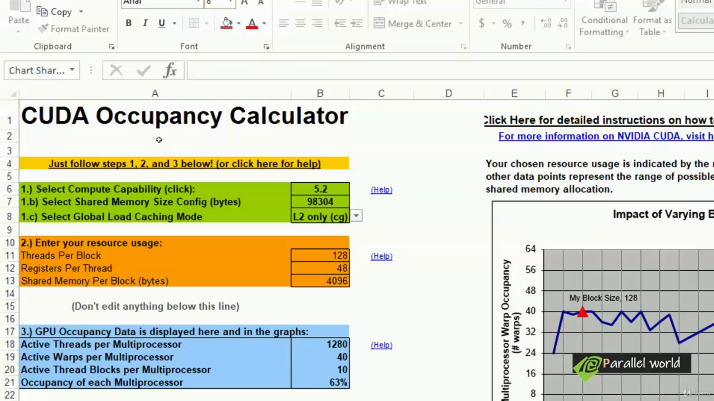

# 第 9 章 线程束分化、资源限制、延迟隐藏与占用率



*图 9.1　同一 Warp 中不同线程进入不同分支时，各路径需要分别执行并影响活跃线程集合。（原课程课件）*

## 线程束内分支如何形成分化

同一 Warp 中的线程通常共同执行指令，但条件判断可能因线程数据不同而产生不同结果。当一个 Warp 中的一部分线程进入 `path_a`，另一部分进入 `path_b` 时，硬件需要分别执行这些路径，并让不参与当前路径的线程保持非活跃，这就是线程束分化。

```cpp
if (condition) {
    path_a();
} else {
    path_b();
}
```

若整个 Warp 的 `condition` 完全一致，只需执行一条路径，不会因该判断产生 Warp 内分化。若两种结果同时存在于一个 Warp，两条路径都可能被串行执行，成本更接近路径之和，而不是只取较快分支。

分析分化不能只看整个网格中两个分支的比例，还要看相邻 32 个线程的数据分布。如果满足条件的线程被聚集到完整 Warp 中，即使全局存在两种结果，各 Warp 内部仍可保持一致。通过数据重排或任务映射改善分支聚集有时有效，但重排本身的成本也必须计入。

分化主要是性能问题，不能用来推断执行顺序。涉及块内同步时，应让所有需要到达同步点的线程执行相同的 `__syncthreads()`，而不是让不同分支分别等待。



*图 9.2　每块共享内存用量越大，可容纳的线程块通常越少。（原课程课件）*



*图 9.3　每线程寄存器用量会影响 SM 可驻留的 Warp 数量。（原课程课件）*

## 驻留并行度受多种资源共同限制

SM 可以同时维护多个线程块和 Warp 的执行上下文，但寄存器文件、共享内存、线程块槽位和 Warp 槽位都有限。每种资源都会给出一个可驻留块数上限，其中最小的上限决定实际理论驻留规模。

例如，某核函数每块包含 256 个线程，即 8 个 Warp。若 SM 最多允许 64 个 Warp，仅根据 Warp 槽位最多可驻留 8 块；若寄存器总量只允许 4 块，则寄存器成为更强限制，理论活跃 Warp 数为 32。

共享内存用量过高、每块线程数过少导致块槽位先耗尽，也会产生类似效果。增加网格中的线程块总数并不能改变单个 SM 的资源容量，只会增加等待调度的工作。


*图 9.4　理论驻留规模由最先耗尽的资源约束决定；占用率用于理解延迟隐藏，但不能替代内存、指令和实测分析。（SVG 示意图）*

## 理论占用率与实测达到占用率

**理论占用率**根据执行配置和资源使用量计算，表示硬件允许的最大驻留 Warp 数相对于硬件 Warp 上限的比例：

```text
theoretical_occupancy = resident_warps_allowed / max_hardware_warps
```

前述例子中，理论占用率为 `32 / 64 = 50%`。

**实测达到占用率**则由性能分析工具在运行期间统计，反映实际活跃程度。理论值给出资源允许的上限，实测值受到线程块完成速度、负载不均和调度等因素影响，两者不能混用。

高占用率通常有助于隐藏延迟，但并不保证性能更好。降低寄存器使用可能增加驻留 Warp，却也可能引入局部内存访问或重复计算；某些计算密集型核函数在较低占用率下就能充分利用执行管线。

## 延迟隐藏依赖线程级与指令级并行

当一个 Warp 因全局内存访问或指令依赖而停顿时，SM 可以调度其他就绪 Warp。只要仍有独立工作，计算单元就不必因单个 Warp 等待而完全空闲，这就是延迟隐藏。

驻留 Warp 数量不足时，所有 Warp 可能同时等待内存，计算资源出现空闲。增加可执行 Warp 有助于覆盖等待，但内存带宽、缓存容量和指令依赖仍会形成上限。

延迟也不只来自内存。算术指令和寄存器依赖同样可能使后续指令等待。编译器的指令调度、循环展开以及每个线程内部的独立运算，可以提供指令级并行。线程级并行与指令级并行因此共同决定延迟隐藏能力。



*图 9.5　原视频中的 CUDA 占用率计算器，把 128 线程/块、48 寄存器/线程和 4096 bytes 共享内存/块的输入与 40 个活动 Warp、63% 占用率放在同一画面中。（原课程视频帧，历史开发环境）*

## 从资源分析到优化实验

优化前应先判断瓶颈是否确实与驻留并行度有关。可以依次执行以下对照：

1. 记录块大小、寄存器和共享内存用量，计算理论驻留限制。
2. 使用性能分析工具观察达到占用率、停顿原因、内存吞吐和执行利用率。
3. 只调整一个主要因素，例如块大小或共享内存容量，保持输入和编译选项不变。
4. 同时比较正确性、执行时间和关键指标，确认收益来自预期机制。

若占用率提高但时间变长，需要检查额外指令、局部内存和资源分配开销；若占用率较低但内存吞吐已接近设备上限，继续增加 Warp 也未必有效。

## 小结

线程束分化取决于 Warp 内的数据分布，驻留并行度由多种资源共同决定。理论占用率描述资源允许的驻留上限，实测达到占用率描述运行表现，两者都不是性能分数。只有将资源计算、线程与指令级并行以及实测指标结合，才能正确分析延迟隐藏和优化空间。
