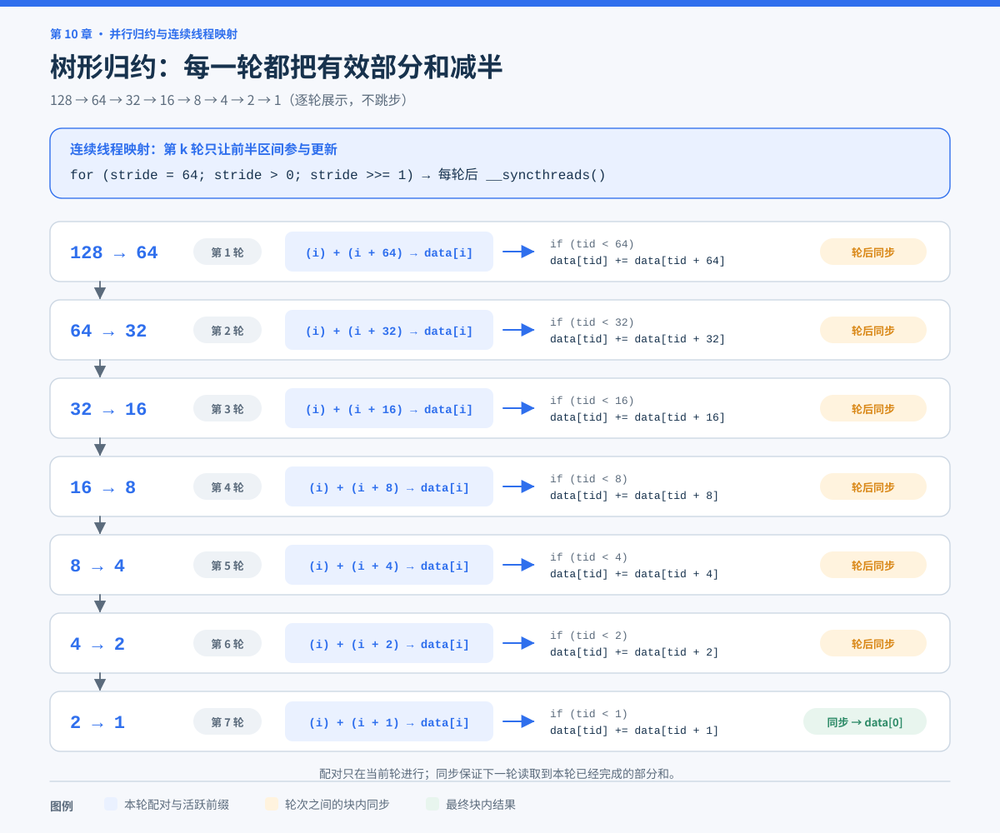

# 第 10 章 并行归约基线、连续线程映射与性能驱动分析



*图 10.1　连续线程树形归约完整展示 128→64→32→16→8→4→2→1，每轮使用当前步长配对并在轮后同步。（SVG 示意图）*

## 从逐元素计算到树形依赖

归约将一组元素通过加法、最大值等结合运算合并为一个结果。与向量加法不同，树形归约的下一轮依赖上一轮生成的部分和，因此除了线程与数据的映射，还必须明确每一轮的读写顺序和同步范围。

以求和为例，一个线程块可以先把输入加载到共享内存，再逐轮合并相邻元素，最终由 0 号线程写出块部分和。不同线程块的部分和通过后续核函数继续归约，直到只剩一个结果。


*图 10.2　树形归约逐轮合并部分和，各轮之间需要明确同步。（原课程课件）*

## 一个正确的块内基线

下面的实现使用取模条件选择工作线程。它限定线程块大小为 2 的幂，并使用动态共享内存保存块内数据：

```cpp
__global__ void reduce_sum(const float* input, float* output, int n) {
    extern __shared__ float data[];
    int tid = threadIdx.x;
    int index = blockIdx.x * blockDim.x + tid;

    data[tid] = index < n ? input[index] : 0.0f;
    __syncthreads();

    for (int stride = 1; stride < blockDim.x; stride *= 2) {
        if (tid % (2 * stride) == 0 && tid + stride < blockDim.x) {
            data[tid] += data[tid + stride];
        }
        __syncthreads();
    }

    if (tid == 0) {
        output[blockIdx.x] = data[0];
    }
}
```

启动时需要传入共享内存字节数，并在主机端约束块大小：

```cpp
int threads = 256;  // 本实现要求为 2 的幂
int blocks = (n + threads - 1) / threads;
size_t shared_bytes = threads * sizeof(float);
reduce_sum<<<blocks, threads, shared_bytes>>>(d_input, d_partial, n);
CUDA_CHECK(cudaGetLastError());
```

越界位置使用加法单位元 0 填充。若运算改为最大值或最小值，需要使用相应单位元或单独处理有效范围，不能直接照搬 0。

## 两处同步分别保护什么

初始化后的 `__syncthreads()` 确保整个块都完成全局数据加载，随后线程才能读取其他线程写入的共享元素。每轮更新后的同步则保证下一轮读取到本轮已经生成的部分和。

同步调用位于条件之外，因为非工作线程也必须到达同一个块内同步点。将它放入只有部分线程满足的分支中，可能造成未定义行为或挂起。

`__syncthreads()` 只同步一个线程块，不能等待其他块写出 `d_partial`。跨块汇总应使用新的内核启动边界，不能把一次块内同步误当作全网格同步。


*图 10.3　连续线程映射让前半部分线程参与配对，改善 Warp 内的工作分布。（原课程课件）*

## 用连续工作线程减少无效分支

取模条件会让同一 Warp 中只有部分线程满足要求。可以改为让前半部分连续线程参与计算：

```cpp
for (int stride = blockDim.x / 2; stride > 0; stride >>= 1) {
    if (tid < stride) {
        data[tid] += data[tid + stride];
    }
    __syncthreads();
}
```

该映射同样要求块大小为 2 的幂。以 96 个线程为例，步长末尾会出现 `6 → 3 → 1`，步长 1 无法合并剩余的三个部分和，因此不能把它当作任意块大小的通用实现。

连续映射使工作线程在编号上更集中，减少部分阶段的线程束分化，也为后续循环展开和最后一个 Warp 的处理提供统一基础。算法所需的加法次数没有因此改变，优化的是线程利用与控制流。


*图 10.4　nvprof 默认摘要实测：HtoD 总计 8.5506 ms，DtoH 为 8.3210 ms，sum_arrays_1Dgrid_1Dblock 为 335.27 µs；同屏保留调用次数、平均值、最小值和最大值等完整表头。（原课程视频帧，历史开发环境）*

## 用性能分析验证假设

基础版本和连续映射版本应使用相同输入、块大小、编译选项和计时区间。除了核函数时间，还要记录部分和数量、后续汇总内核和主机传输，避免只优化一个阶段却增加端到端成本。

课程使用旧版 `nvprof` 展示分析流程：

```bash
nvprof ./reduction
```

该命令只代表课程历史环境。当前环境可使用 Nsight Systems 观察应用时间线，使用 Nsight Compute 分析核函数的分支、内存、占用率和停顿指标，具体命令与指标名称以所用版本为准。

公平比较应包含预热、重复测量和独立正确性检查。浮点归约改变累加顺序后，结果可能与串行参考存在细小误差，应使用合理容差，而不是要求每一位都完全相同。

## 小结

块内树形归约通过共享内存保存部分和，通过块内同步分隔依赖阶段，通过后续内核完成跨块汇总。连续线程映射改善了取模基线的分支分布，但要求 2 的幂块大小。性能驱动分析用统一基准验证优化，而不是根据代码外观推断收益。
