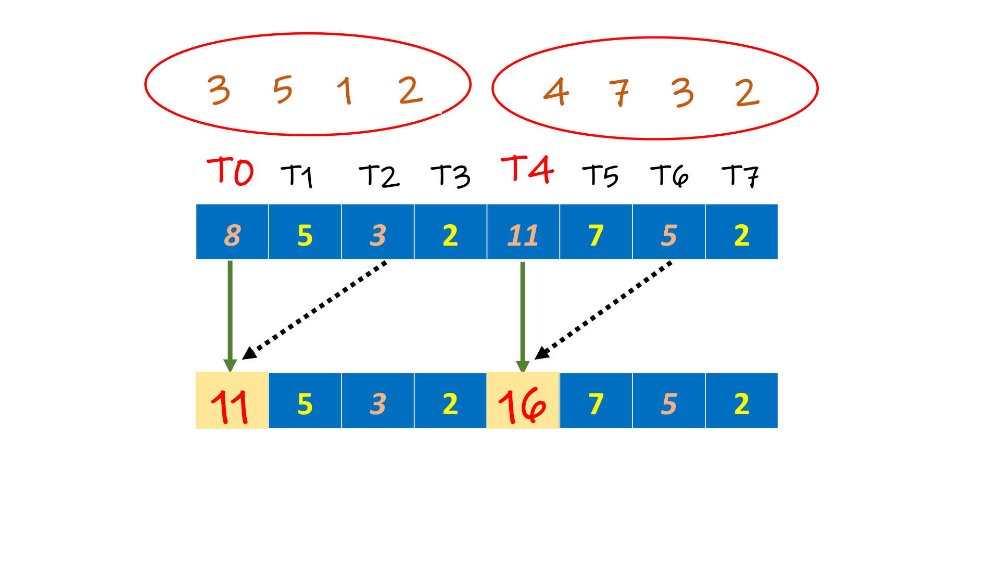
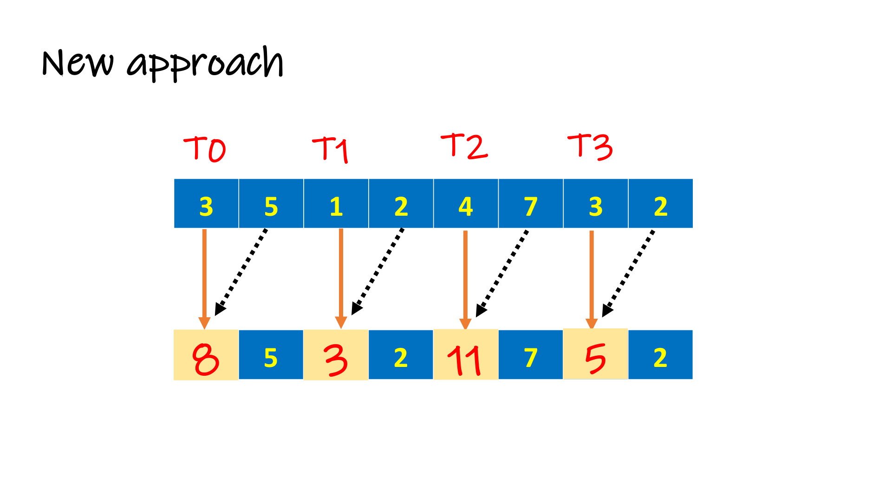
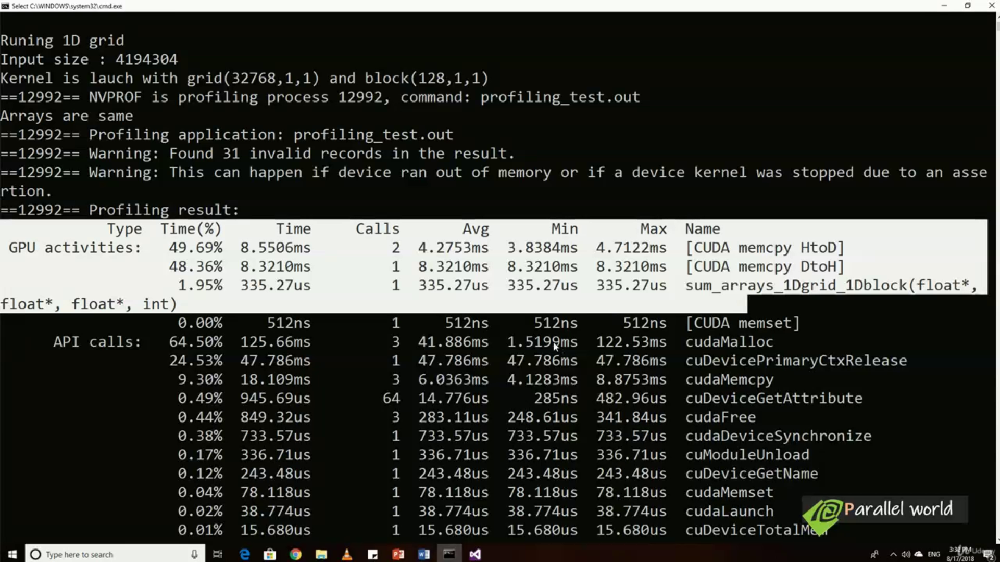

# 第 10 章 并行归约基线、连续线程映射与性能驱动分析


*图 10.1　连续线程树形归约完整展示 128→64→32→16→8→4→2→1，每轮使用当前步长配对并在轮后同步。*

## 什么是归约计算

**归约（reduction，也常被称为规约）计算**，是指反复使用同一种二元运算，把一组输入值合并成较少的结果，通常最终得到一个值。求和、求积、求最大值和求最小值都是归约。例如，对 `[1, 2, 3, 4]` 分别进行求和与求最大值，结果就是 `10` 和 `4`。

归约不是简单地把多个元素“同时处理”，而是让元素之间发生组合。以 8 个整数求和为例，串行计算通常按下面的顺序依次累加：

```text
total = 1 + 2 + 3 + 4 + 5 + 6 + 7 + 8
```

并行树形归约则先计算互不依赖的配对，再合并上一轮生成的部分和：

| 阶段 | 本轮配对 | 保留下来的部分和 |
|---|---|---|
| 初始 | 无 | `[1, 2, 3, 4, 5, 6, 7, 8]` |
| 第 1 轮 | `1+2`、`3+4`、`5+6`、`7+8` | `[3, 7, 11, 15]` |
| 第 2 轮 | `3+7`、`11+15` | `[10, 26]` |
| 第 3 轮 | `10+26` | `[36]` |

8 个元素仍然需要 7 次加法，但三轮之间才存在先后依赖；同一轮内的配对可以并行执行。这就是树形归约的基本思想：**不减少必须完成的合并运算，而是重排无依赖运算的执行方式。**

能够这样分组的核心数学前提是合并运算满足结合律，即 `(a ⊕ b) ⊕ c = a ⊕ (b ⊕ c)`。如果实现还会任意交换元素顺序，则还需要满足交换律。需要特别注意，计算机中的浮点加法并不严格满足结合律，因此并行浮点求和与串行求和可能存在细小误差。

## 从数组归约到 CUDA 分层归约

与向量加法的“一个输入位置对应一个输出位置”不同，树形归约的下一轮依赖上一轮生成的部分和。因此，除了线程与数据的映射，还必须明确每一轮的读写顺序和同步范围。

一个 CUDA 核函数先让每个线程块归约一段输入，并为该块写出一个**块部分和**。`__syncthreads()` 只能同步块内线程，不能把所有块的结果直接合并，所以不同块的部分和还要通过后续核函数继续归约，直到只剩一个结果：

```text
n 个输入元素 → 每块一个部分和 → 更少的部分和 → … → 1 个最终结果
```

本章先实现“每块一个部分和”这一阶段；第 12 章再展示如何用多层核函数得到整个数组的最终结果。



*图 10.2　树形归约逐轮合并部分和，各轮之间需要明确同步。*

## 一个正确的块内基线

下面的实现使用取模条件选择工作线程。它限定线程块大小为 2 的幂，并使用动态共享内存保存块内数据。代码中的注释编号对应后面的执行过程说明：

```cpp
__global__ void reduce_sum(const float* input, float* output, int n) {
    extern __shared__ float data[];                 // [1] 块内共享的部分和数组
    int tid = threadIdx.x;                          // [2] 块内线程编号
    int index = blockIdx.x * blockDim.x + tid;      // [3] 全局输入下标

    // [4] 每个线程装载一个元素；尾块越界位置补加法单位元 0。
    data[tid] = index < n ? input[index] : 0.0f;
    __syncthreads();                                // [5] 等待整个块完成装载

    // [6] stride 依次为 1、2、4……，逐轮减少部分和。
    for (int stride = 1; stride < blockDim.x; stride *= 2) {
        if (tid % (2 * stride) == 0 && tid + stride < blockDim.x) {
            data[tid] += data[tid + stride];
        }
        __syncthreads();                            // [7] 所有线程都必须执行
    }

    // [8] 每个块只写一个部分和，不是整个输入数组的最终结果。
    if (tid == 0) {
        output[blockIdx.x] = data[0];
    }
}
```

### 按执行顺序理解代码

1. **准备块内存储。** `extern __shared__ float data[]` 声明动态共享内存视图，每个线程使用 `data[tid]` 保存一个当前部分和。它不在声明时指定容量，实际字节数由主机启动参数给出。
2. **取得块内编号。** `tid` 只在当前块内编号，用于访问共享数组和选择工作线程。
3. **计算全局下标。** `index` 是线程在整个输入数组中的位置。例如 `blockIdx.x == 1` 且 `tid == 0` 时，`index == blockDim.x`，而不是 0。
4. **装载并初始化每个共享元素。** 条件运算符在 `index < n` 时读取真实输入，否则写入 `0.0f`。这样后续配对时，每个被读取的位置都已经初始化。
5. **等待装载完成。** 首次屏障让当前块的所有共享写入都对后续读取可见，然后才能跨线程读取 `data[tid + stride]`。
6. **逐轮合并。** `stride` 表示配对的两个下标之间的距离。满足 `tid % (2 * stride) == 0` 的线程执行 `data[tid] = data[tid] + data[tid + stride]`；右侧第二个条件保证读取位置不越过共享数组。块大小为 2 的幂时，满足第一个条件的有效配对本来就不会越界，第二个条件是显式防御。
7. **分隔相邻轮次。** 第一轮产生的部分和会被第二轮读取，因此每轮之后都要等待。`stride` 增大一倍后，工作线程数量减半，最终只有 `data[0]` 保存当前块的总和。
8. **写出一个块结果。** 只有 `tid == 0` 执行全局写入；不同块分别写入 `output[0]`、`output[1]`……，互不覆盖。

以 8 线程块为例，基线代码的实际配对如下，与开头的树形例子完全对应：

| `stride` | 执行加法的 `tid` | 配对下标 | 本轮结束后新产生的部分和 |
|---|---|---|---|
| 1 | 0、2、4、6 | `(0,1)`、`(2,3)`、`(4,5)`、`(6,7)` | `data[0]=3`、`data[2]=7`、`data[4]=11`、`data[6]=15` |
| 2 | 0、4 | `(0,2)`、`(4,6)` | `data[0]=10`、`data[4]=26` |
| 4 | 0 | `(0,4)` | `data[0]=36` |

### 启动参数与代码假设

```cpp
// 前置条件：n > 0；threads 是 2 的幂；d_partial 至少有 blocks 个元素。
int threads = 256;
int blocks = (n + threads - 1) / threads;       // 向上取整，覆盖尾块
size_t shared_bytes = threads * sizeof(float);  // 每个线程一个 float
reduce_sum<<<blocks, threads, shared_bytes>>>(d_input, d_partial, n);
CUDA_CHECK(cudaGetLastError());
```

`blocks` 使用向上取整，所以即使 `n` 不是 `threads` 的整数倍，也会启动一个尾块处理剩余元素。执行配置的第三个参数 `shared_bytes` 才是动态共享内存的实际容量；如果漏传或传得过小，`data[tid]` 就没有足够的合法存储空间。`CUDA_CHECK(cudaGetLastError())` 检查启动配置等错误，并不等同于等待核函数执行完成。

!!! note "特殊处理：尾块补 0，而不是让越界线程直接退出"

    最后一个块可能没有 `threads` 个有效输入。补 `0.0f` 的原因是 **0 是加法单位元**：任何值与 0 相加都不改变结果，同时所有共享元素都得到初始化，所有线程也都能继续到达后续屏障。

    这个补值与运算有关。求积通常补 1；求最大值或最小值时，0 可能参与并错误地成为结果，因此应使用相应单位元或明确限制有效范围。例如，对全为负数的数组求最大值时，补 0 会得到错误答案。

!!! warning "特殊限制：2 的幂要求属于块大小，不属于输入长度"

    `threads` 必须满足 `1、2、4、8……` 的形式，才能保证每轮都恰好平分当前部分和。输入长度 `n` 不需要是 2 的幂，因为尾块已经补了单位元。主机端应验证这一约束，不能只依赖注释约定。

!!! note "特殊处理：`output[blockIdx.x]` 保存的是部分和"

    该内核没有把不同线程块的结果合并。若启动了 `blocks` 个块，输出就包含 `blocks` 个值；调用方必须继续归约这些值，不能把 `output[0]` 误认为整个数组的总和。`n <= 0` 应由主机端单独处理，不能用当前公式启动 0 个块。

## 两处同步分别保护什么

初始化后的 `__syncthreads()` 确保整个块都完成全局数据加载，随后线程才能读取其他线程写入的共享元素。每轮更新后的同步则保证下一轮读取到本轮已经生成的部分和，同时防止较快线程在较慢线程完成本轮读取前覆盖共享位置。

!!! warning "特殊处理：屏障放在 `if` 外面"

    `if` 只决定哪些线程做加法，不决定哪些线程参与同步。块内所有线程，包括本轮没有工作的线程，都必须到达同一个 `__syncthreads()`。把屏障放进只有部分线程满足的分支中，可能造成未定义行为或挂起。

`__syncthreads()` 只同步一个线程块，不能等待其他块写出 `d_partial`。跨块汇总应使用新的内核启动边界，不能把一次块内同步误当作全网格同步。



*图 10.3　连续线程映射让前半部分线程参与配对，改善 Warp 内的工作分布。*

## 用连续工作线程减少无效分支

基线使用 `tid % (2 * stride) == 0` 选择线程，同一 Warp 中的工作线程会隔着不工作的线程分布。可以改成让当前有效区间的前半部分连续工作：

```cpp
// 替换基线内核中的整个归约循环；装载、同步前提和结果写出保持不变。
for (int stride = blockDim.x / 2; stride > 0; stride >>= 1) {
    if (tid < stride) {
        data[tid] += data[tid + stride];
    }
    __syncthreads();
}
```

这里的循环方向与基线相反：`stride` 从块大小的一半开始，每轮右移一位，即除以 2。`tid < stride` 选中连续的下标区间 `[0, stride)`，每个工作线程把距离为 `stride` 的右半部分折到左半部分。仍以 `[1, 2, 3, 4, 5, 6, 7, 8]` 为例：

| `stride` | 工作线程 | 新计算的有效部分和 | 下一轮仍有效的区间 |
|---|---|---|---|
| 4 | 0、1、2、3 | `data[0]=1+5=6`，`data[1]=2+6=8`，`data[2]=3+7=10`，`data[3]=4+8=12` | `data[0..3] = [6, 8, 10, 12]` |
| 2 | 0、1 | `data[0]=6+10=16`，`data[1]=8+12=20` | `data[0..1] = [16, 20]` |
| 1 | 0 | `data[0]=16+20=36` | `data[0] = 36` |

每轮只覆盖当前有效区间，其他线程不做加法但仍执行屏障。最终结果仍由 `tid == 0` 写出。它与基线采用不同的加法分组顺序，因此整数结果相同，浮点结果则可能存在不同的舍入误差。

!!! warning "特殊限制：连续映射仍然要求 2 的幂块大小"

    对半折分只有在当前部分和数量为偶数时才不会漏项。以 96 个线程为例，步长末尾出现 `6 → 3 → 1`：`stride = 3` 后还剩 3 个部分和，而 `stride = 1` 只合并其中两个，第三个会被遗漏。因此，这段代码不能当作任意块大小的通用实现。

连续映射使工作线程在编号上更集中，减少部分阶段的线程束分化，也为后续循环展开和最后一个 Warp 的处理提供统一基础。算法所需的加法次数没有因此改变，优化的是线程利用与控制流，并不意味着所有阶段都完全没有分支。



*图 10.4　nvprof 默认摘要实测：HtoD 总计 8.5506 ms，DtoH 为 8.3210 ms，sum_arrays_1Dgrid_1Dblock 为 335.27 µs；同屏保留调用次数、平均值、最小值和最大值等完整表头。*

## 用性能分析验证假设

基础版本和连续映射版本应使用相同输入、块大小、编译选项和计时区间。除了核函数时间，还要记录部分和数量、后续汇总内核和主机传输，避免只优化一个阶段却增加端到端成本。

课程使用旧版 `nvprof` 展示分析流程：

```bash
nvprof ./reduction
```

该命令只代表课程历史环境。当前环境可使用 Nsight Systems 观察应用时间线，使用 Nsight Compute 分析核函数的分支、内存、占用率和停顿指标，具体命令与指标名称以所用版本为准。

公平比较应包含预热、重复测量和独立正确性检查。浮点归约改变累加顺序后，结果可能与串行参考存在细小误差，应使用合理容差，而不是要求每一位都完全相同。

## 小结

块内树形归约通过共享内存保存部分和，通过块内同步分隔依赖阶段，通过后续内核完成跨块汇总。连续线程映射改善了取模基线的分支分布，但要求 2 的幂块大小。性能驱动分析用统一基准验证优化，而不是根据代码外观推断收益。
