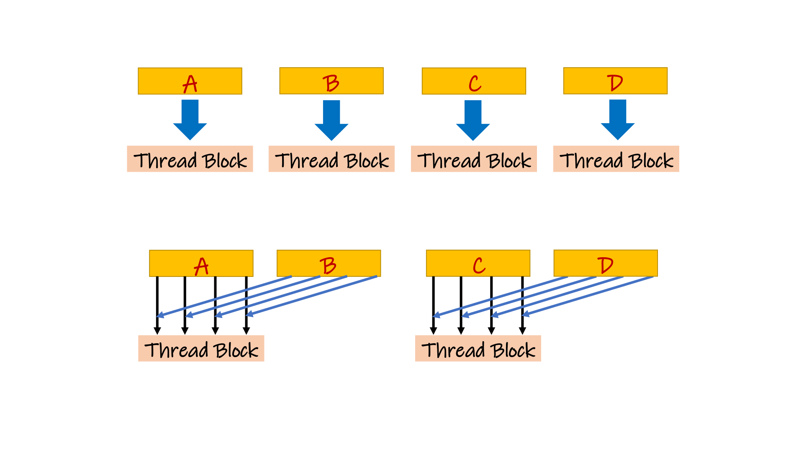
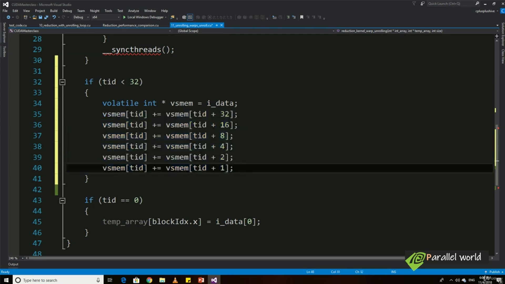
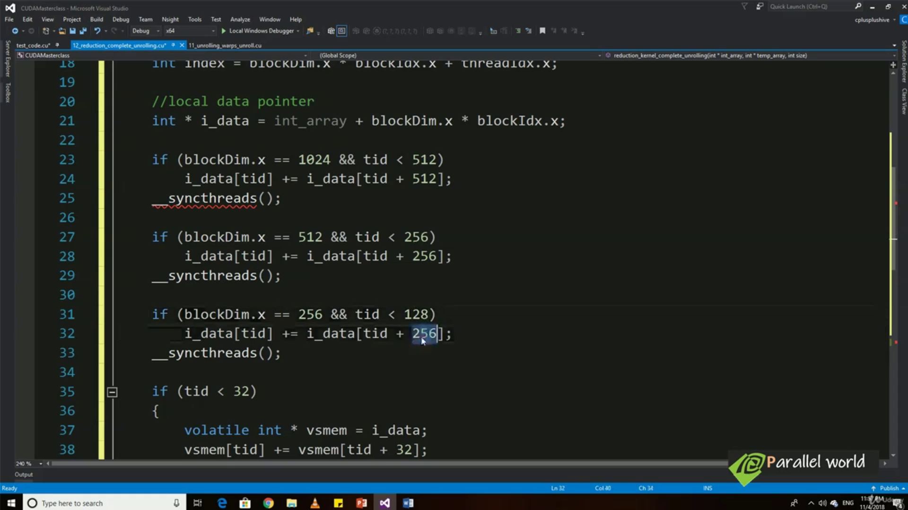

# 第 11 章 归约的循环展开、Warp 展开、完全展开与公平对比



*图 11.1　线程块展开增加每个块处理的数据量，是归约优化链中的一种组织方式。（原课程课件）*

## 三种展开解决不同问题

归约每轮只完成少量加法和地址计算，循环条件、步长更新和块级同步可能占据明显成本。循环展开减少通用循环控制，Warp 展开专门处理最后 32 个元素，完全展开则利用编译期块大小生成各阶段代码。

这些优化不能改变数据依赖。只要某个阶段仍依赖整个线程块的结果，就必须保留块级同步；只有进入最后一个 Warp 后，才能使用线程束内通信替代相应的块间通信。

## 不能遗漏 stride = 32

若块级循环写成 `stride > 32`，循环结束时仍剩 64 个部分和，而不是 32 个。直接进入 `offset = 16` 的 Warp Shuffle 会漏掉 `data[32..63]` 所代表的一半结果。

正确链条必须显式包含一次 `stride = 32` 的合并，或者让块级循环包含该步长。以下完整内核选择前一种方式，并限定 `BlockSize` 为不小于 32 的 2 的幂：

```cpp
template <unsigned int BlockSize>
__global__ void reduce_optimized(const float* input, float* output, int n) {
    extern __shared__ float data[];
    unsigned int tid = threadIdx.x;
    unsigned int index = blockIdx.x * BlockSize + tid;

    data[tid] = index < n ? input[index] : 0.0f;
    __syncthreads();

    if (BlockSize >= 64) {
        for (unsigned int stride = BlockSize / 2; stride > 32; stride >>= 1) {
            if (tid < stride) {
                data[tid] += data[tid + stride];
            }
            __syncthreads();
        }

        if (tid < 32) {
            data[tid] += data[tid + 32];  // 不可缺少的 stride = 32
        }
        __syncthreads();
    }

    if (tid < 32) {
        float value = data[tid];
        for (int offset = 16; offset > 0; offset >>= 1) {
            value += __shfl_down_sync(0xffffffff, value, offset);
        }
        if (tid == 0) {
            output[blockIdx.x] = value;
        }
    }
}
```

当 `BlockSize = 32` 时，块级阶段被跳过，第一个 Warp 直接归约 32 个元素。当块更大时，循环先处理到 64 个部分和，再执行一次 32 合并，最后由第一个 Warp 完成 16、8、4、2、1 的 Shuffle。

主机端需要约束模板实例并分配动态共享内存：

```cpp
constexpr unsigned int threads = 256;  // 2 的幂，且 >= 32
int blocks = (n + threads - 1) / threads;
size_t shared_bytes = threads * sizeof(float);
reduce_optimized<threads><<<blocks, threads, shared_bytes>>>(
    d_input, d_partial, n);
CUDA_CHECK(cudaGetLastError());
```

## 块级循环展开

块大小作为模板参数后，编译器知道循环边界，可以展开固定阶段并删除不可能执行的条件。这减少了循环控制，并为指令调度提供更多信息。

展开不能删除块级 `__syncthreads()`，因为不同 Warp 仍可能交错执行。过度展开还可能增加代码体积和寄存器压力，因此需要同时观察编译结果和占用率，而不是认为展开层数越多越好。

## 最后一个 Warp 的展开与 Shuffle

进入第一个 Warp 后，剩余数据可以通过带掩码的 Shuffle 在线程内通道之间传递。上述代码只有 `tid < 32` 的 32 个线程进入 Shuffle，因此全掩码 `0xffffffff` 与该完整 Warp 的参与集合一致。

如果核函数允许尾部非完整 Warp，或者 Shuffle 位于可能分化的条件中，就不能照抄全掩码。参与线程、源通道和有效数据范围必须重新分析。`volatile` 也不是同步原语，不能用来替代当前 CUDA 所要求的线程束同步与内存语义。

Shuffle 只完成 Warp 内归约。多个 Warp 的结果仍需通过共享内存合并，多个线程块的部分和仍需通过后续内核汇总。


*图 11.2　原视频给出的归约实现性能比较，完整保留八种实现及柱顶数值：0.067、0.225、0.167、0.113、0.074、0.040、0.035、0.030，顺序与横轴从左到右一致；图中未标单位。（原课程视频帧）*



*图 11.3　Warp 展开的归约实现。一个 Warp 内不再需要每一步都执行块级同步，偏移依次减半，最后保存当前线程块的归约结果。（原课程视频帧，历史开发环境）*



*图 11.4　完全展开归约的代码结构：块级阶段按线程块尺寸裁剪条件分支，并在各阶段同步，随后进入 Warp 内的展开归约。（原课程视频帧，历史开发环境）*

## 公平比较优化版本

比较取模基线、连续映射和完全展开版本时，应保持输入、数据类型、块大小和编译选项一致，并分别验证结果。推荐记录以下项目：

| 对比项 | 需要回答的问题 |
|---|---|
| 核函数时间 | 块内优化是否缩短了主要计算阶段 |
| 寄存器与占用率 | 展开增加的资源是否抵消控制开销收益 |
| 分支与执行效率 | 连续映射和 Warp 展开是否改善预期指标 |
| 部分和与后续内核 | 跨块汇总成本是否发生变化 |
| 端到端时间 | 启动、传输和主机等待后是否仍有收益 |
| 数值误差 | 改变累加顺序后是否仍在允许范围 |

归约通常包含大量内存读取。当全局内存带宽已经成为瓶颈时，进一步减少线程束内分支的收益会逐渐减小，优化重点可能转向增加每线程有效加载和减少中间结果。

## 小结

正确的归约优化链必须包含 `stride = 32`，并明确 2 的幂块大小和 Shuffle 参与线程。块级展开、Warp 展开与完全展开分别减少不同控制成本，但都不能破坏同步和跨块依赖。最终优劣应由正确性、资源指标和端到端测量共同决定。
