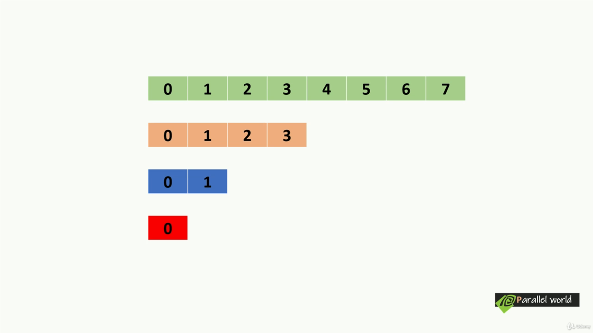

# 第 12 章 动态并行与设备端递归归约

## 由设备端启动核函数

传统 CUDA 程序由主机配置并启动核函数。动态并行允许设备端线程创建新的核函数，使 GPU 能根据运行时发现的数据规模或递归结构产生后续工作。

```cpp
__global__ void child_kernel(float* data) {
    // 处理子任务
}

__global__ void parent_kernel(float* data) {
    if (blockIdx.x == 0 && threadIdx.x == 0) {
        child_kernel<<<1, 256>>>(data);
    }
}
```

设备端启动仍需要线程块配置、参数和依赖设计。指定一个线程启动子核函数，只解决了“避免重复启动”的问题，并没有证明其他父线程块已经完成，也没有自动建立全网格阶段边界。

动态并行涉及设备能力、可重定位设备代码和设备运行库等构建要求。旧式命令行示例通常采用以下形式，具体选项应结合目标 CUDA 版本和工程工具链核对：

```bash
nvcc -rdc=true parent.cu -o parent -lcudadevrt
```



*图 12.1　块内归约的有效区间逐轮减半：八个元素经过偏移求和后，待处理区间依次缩为 0–3、0–1，最后由索引 0 得到结果。（原课程视频帧）*


*图 12.2　动态并行的设备端启动示例：父网格中的线程 0 启动规模减半的子网格，并以 size == 1 作为递归终止条件。（原课程视频帧）*

## 多内核归约仍是清晰的参考方案

多层归约可以先用主机控制实现。第一层核函数把每个线程块的输入归约为部分和，主机随后以这些部分和为输入启动下一层，直到只剩一个结果。

每次内核启动边界提供清晰的阶段关系：下一层读取之前，上一层相关输出已经完成。该方案结构直观、便于调试，也是评估动态并行是否真正带来收益的基准。

```text
输入数组 → 第 1 层块部分和 → 第 2 层部分和 → … → 单个结果
```

若部分和数量较少，也可以把最后一层放到主机执行，但应把设备到主机的传输和同步纳入端到端成本。

## 设备端递归归约需要额外协议

动态并行可以把上述递归结构移到设备端：父核函数产生部分和，指定线程根据剩余数量启动下一层，直到满足终止条件。然而，子核函数必须读取上一层**所有相关线程块**的输出，单一父块完成并不能代表整个父网格完成。

设备端父子同步只表达相应的父子关系，不能自动保证其他父块已经写完。`__syncthreads()` 同样只能同步当前块。要构造完整设备端递归，需要经过验证的全网格完成协议，例如最后完成块计数、适当内存栅栏和严格的子核函数启动规则；这些机制必须结合目标 CUDA 文档验证，不能用“由 0 号线程启动”代替。

本书因此把动态并行归约作为**概念性扩展**，不把未给出完成协议的片段标作可直接运行的递归实现。需要可靠实现时，优先采用前述主机控制的多内核方案。

## 适用场景与成本比较

动态并行适合工作量只能在运行时确定、递归任务难以预先展开，或主机频繁启动形成明显开销的场景。它并不保证递归程序一定更快，设备端子核函数仍有调度、资源和启动成本。

| 对比项 | 主机控制多内核 | 设备端动态并行 |
|---|---|---|
| 阶段边界 | 内核启动边界清晰 | 需要额外的全网格完成设计 |
| 控制结构 | 主机循环或递归展开 | 设备端根据数据决定后续任务 |
| 构建要求 | 常规 CUDA 构建 | 设备能力、RDC 与设备运行库等要求 |
| 调试难度 | 各层较容易独立测量 | 父子时间线和递归状态更复杂 |
| 性能判断 | 主机启动与传输成本 | 设备启动与资源成本，需实测比较 |

比较时应测量完整归约，而不是只比较某一层核函数。递归深度、每层块数和输出存储位置还应明确限制，防止无限递归或覆盖仍被使用的数据。

## 小结

动态并行把核函数启动能力扩展到设备端，为数据驱动递归提供表达手段。单一启动线程并不等于全网格完成，设备端递归归约需要额外的完成协议和内存语义。主机控制多内核方案仍是清晰的参考实现，是否采用动态并行应由构建条件、复杂度和端到端测量共同决定。
