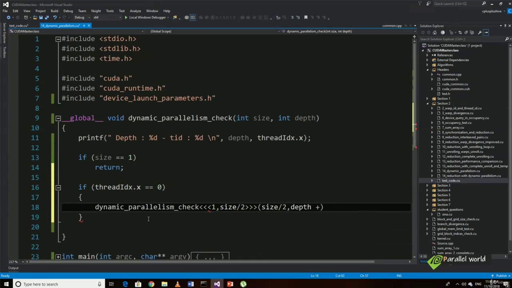

# 第 12 章 在设备端启动核函数

## 什么是动态并行

传统 CUDA 程序由主机配置并启动核函数。**动态并行（Dynamic Parallelism）**允许已经在 GPU 上执行的核函数再次启动子核函数，使设备端能够根据运行时发现的数据规模或递归结构产生后续工作。启动子核函数的网格称为父网格，被启动的新网格称为子网格。

下面的例子只展示设备端启动语法：子网格把输入数组的每个元素乘以 2，父网格负责启动它。它不是归约实现，也没有展示父子结果等待：

```cpp
__global__ void child_kernel(float* data, int n) {
    int index = blockIdx.x * blockDim.x + threadIdx.x;
    if (index < n) {
        data[index] *= 2.0f;
    }
}

__global__ void parent_kernel(float* data, int n) {
    // [1] 整个父网格只让一个线程执行启动操作。
    if (blockIdx.x == 0 && threadIdx.x == 0) {
        // [2] 根据 n 计算子网格大小，并传递子核函数参数。
        int child_blocks = (n + 255) / 256;
        child_kernel<<<child_blocks, 256>>>(data, n);
    }
}
```

代码逻辑可以拆成三部分：

1. **子核函数执行普通 CUDA 工作。** 它仍用 `blockIdx.x`、`blockDim.x` 和 `threadIdx.x` 计算全局下标，并用 `index < n` 防止尾块越界。由父线程启动并不改变子核函数内的索引规则。
2. **父核函数选择一个启动者。** `blockIdx.x == 0 && threadIdx.x == 0` 选中整个父网格的一个线程。如果去掉这个条件，每个父线程都可能启动一个子网格，造成大量重复工作。
3. **设备端仍要给出执行配置。** `child_blocks` 和 `256` 分别指定子网格的块数与每块线程数，`data` 和 `n` 是传给子核函数的参数。本例前置条件为 `n > 0`，否则应单独处理，不能按公式启动 0 个块。

**可以把这一过程概括为：CPU 启动父核函数，GPU 上的父核函数启动子核函数；子核函数的启动不需要 CPU 中转。** 子核函数的配置和调度由 GPU 端的 CUDA 设备运行库处理，CPU 仍负责最初启动父核函数，以及内存准备、最终等待和结果复制等外围工作。设备端启动仍有调度和资源管理开销，不经过 CPU 并不等于没有成本。

!!! warning "特殊处理：单线程启动只避免重复启动，不代表同步完成"

    选中一个父线程，只能保证启动操作执行一次。它既不能证明其他父线程块已经执行完毕，也不能证明子核函数已经执行完毕。本例父线程不读取子结果，因此没有展示等待操作；若父代码要使用子结果，必须按照所用 CUDA 版本的父子同步规则建立依赖，不能用 `__syncthreads()` 代替。

动态并行涉及设备能力、可重定位设备代码和设备运行库等构建要求。旧式命令行示例通常采用以下形式，具体选项应结合目标 CUDA 版本和工程工具链核对：

```bash
nvcc -rdc=true parent.cu -o parent -lcudadevrt
```

其中 `-rdc=true` 生成可重定位设备代码，`-lcudadevrt` 链接设备运行库。这两个构建选项解决的是“能否正确构建设备端启动”，不会自动提供算法所需的同步与结果可见性。


*图 12.1　块内归约逐轮减半有效区间。*



*图 12.2　父网格启动子网格及递归终止条件。*

## 先用多内核完成整个数组的归约

第 10 章的 `reduce_sum` 每启动一次，只会把当前输入缩短为每块一个部分和。要得到整个数组的总和，主机需要反复计算当前元素数和网格大小，再把上一轮输出作为下一轮输入：

```text
输入数组 → 第 1 层块部分和 → 第 2 层部分和 → … → 单个结果
```

下面的主机代码复用第 10 章的 `reduce_sum`，展示完整的层级推进过程。前置条件是 `n > 0`、`threads` 为 2 的幂，两个临时缓冲区都至少有 `(n + threads - 1) / threads` 个 `float`，并且它们彼此不重叠：

```cpp
constexpr int threads = 256;
const size_t shared_bytes = threads * sizeof(float);

const float* current_input = d_input;  // 当前层输入，最初是原数组
float* current_output = d_partial;     // 当前层输出
int current_n = n;                     // 当前层元素个数
float total = 0.0f;

while (current_n > 1) {
    const int blocks = (current_n + threads - 1) / threads;

    reduce_sum<<<blocks, threads, shared_bytes>>>(
        current_input, current_output, current_n);
    CUDA_CHECK(cudaGetLastError());

    // 下一层读取刚写出的 blocks 个部分和。
    current_input = current_output;
    current_n = blocks;

    // 在两块临时缓冲区之间交替，避免覆盖下一层仍要读取的数据。
    current_output = (current_output == d_partial) ? d_next : d_partial;
}

// 循环结束时，current_input 指向唯一的最终结果。
CUDA_CHECK(cudaMemcpy(&total, current_input, sizeof(float),
                      cudaMemcpyDeviceToHost));
```

### 主机循环在每一轮做什么

1. **按当前规模计算块数。** 每轮输入都会缩短，因此必须使用 `current_n`，不能一直沿用原数组的 `n` 或第一层的 `blocks`。
2. **启动一层归约。** 核函数把 `current_n` 个输入变成 `blocks` 个部分和，写入 `current_output`。尾块仍由第 10 章的补 0 逻辑处理。
3. **推进输入指针和元素数。** `current_input = current_output` 让下一层读取上一层结果，`current_n = blocks` 记录实际产生的部分和数量。
4. **交换输出缓冲区。** `d_partial` 与 `d_next` 交替承担输入和输出角色。若下一层仍把结果写回正在读取的同一数组，可能覆盖尚未消费的部分和。
5. **在只剩一个值时退出。** 此时最终结果位于 `current_input`，而不一定固定在 `d_partial`；最后一次复制也必须使用 `current_input`。

!!! note "特殊处理：循环内不需要用 `__syncthreads()` 等待其他块"

    `__syncthreads()` 无法跨块，更不能由主机循环调用。这里把各层核函数放在同一流中，流顺序保证下一层开始读取时，上一层核函数已经完成相关输出。主机不必为了建立这个顺序在每轮调用全设备同步。

!!! note "特殊边界：`n == 1` 时循环一次也不执行"

    此时 `current_input` 仍指向 `d_input`，它本身就是最终结果，最后的复制依然正确。`n == 0` 的“总和”需要调用方按业务定义处理，不能直接沿用本例对有效输入指针的要求。

每次内核启动边界都提供清晰的阶段关系，该方案结构直观、便于逐层检查，也是评估动态并行是否真正带来收益的基准。若部分和数量较少，也可以把最后一层放到主机执行，但应把设备到主机的传输和同步纳入端到端成本。

## 为什么不能把多内核循环直接改成设备端递归

从算法外形看，设备端递归似乎只需要两步：当前核函数生成部分和，然后由线程 0 启动处理这些部分和的子核函数。但真正正确的实现至少要同时回答下面四个问题：

1. **下一层有多少输入？** 若当前层有 `current_n` 个元素、每块处理 `threads` 个元素，则下一层有 `ceil(current_n / threads)` 个部分和。启动者必须使用这个数量计算子网格，而不是继续使用父网格的原始 `n`。
2. **何时可以启动下一层？** 子核函数必须读取上一层**所有相关线程块**的输出。某一个父块完成、甚至某一个父块执行到启动语句，都不能证明其他父块已经写完。
3. **结果写到哪里？** 子层输出不能覆盖父层仍在读取的数据；递归各层需要明确的缓冲区所有权和生命周期。
4. **何时停止？** 剩余元素数为 1 时必须停止递归。每一层都要严格缩小问题规模，否则可能形成无限递归。

!!! warning "特殊处理：父子同步不等于父网格内部的全网格同步"

    设备端父子同步只表达相应的父子关系，不能自动保证其他父块已经写完；`__syncthreads()` 也只能同步当前块。要构造完整的设备端递归归约，需要经过验证的全网格完成协议，例如最后完成块计数、适当的内存顺序和严格的子核函数启动规则。

    这种协议还要处理计数器初始化与复用、部分和对子网格的可见性，以及只启动一次子网格等细节。它必须结合目标 CUDA 的内存模型和动态并行文档验证，不能用“由 0 号线程启动”代替，也不能只添加一个 `__threadfence()` 就默认正确。

图 12.2 中的 `size == 1` 是递归终止条件，规模减半则让每层问题缩小；但这两个条件只解决上述第 4 项，并没有解决全网格完成和数据可见性。本书因此把动态并行归约作为**概念性扩展**，不把未给出完成协议的片段标作可直接运行的递归实现。需要可靠实现时，优先采用前述主机控制的多内核方案。

## 适用场景与成本比较

动态并行适合工作量只能在运行时确定、递归任务难以预先展开，或主机频繁启动形成明显开销的场景。它并不保证递归程序一定更快，设备端子核函数仍有调度、资源和启动成本。

| 对比项 | 主机控制多内核 | 设备端动态并行 |
|---|---|---|
| 阶段边界 | 内核启动边界清晰 | 需要额外的全网格完成设计 |
| 控制结构 | 主机循环或递归展开 | 设备端根据数据决定后续任务 |
| 构建要求 | 常规 CUDA 构建 | 设备能力、RDC 与设备运行库等要求 |
| 调试难度 | 各层较容易独立测量 | 父子时间线和递归状态更复杂 |
| 性能判断 | 主机启动与传输成本 | 设备启动与资源成本，需实测比较 |

比较时应测量完整归约，而不是只比较某一层核函数。递归深度、每层块数和输出存储位置还应明确限制，防止无限递归或覆盖仍被使用的数据。

## 小结

动态并行把核函数启动能力扩展到设备端，为数据驱动递归提供表达手段。单一启动线程并不等于全网格完成，设备端递归归约需要额外的完成协议和内存语义。主机控制多内核方案仍是清晰的参考实现，是否采用动态并行应由构建条件、复杂度和端到端测量共同决定。
