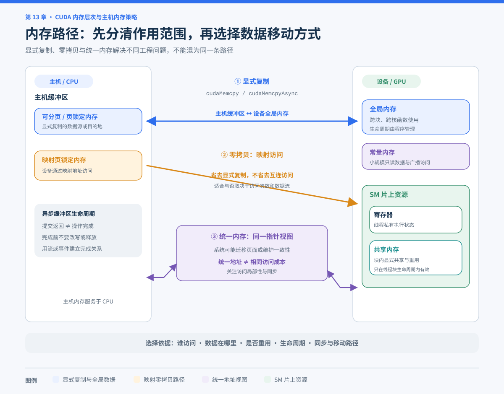

# 第 13 章 CUDA 内存层次与主机内存策略

前几章已经让 GPU 核函数能够正确处理数组，但还有一个无法回避的问题：**数组原来在 CPU 内存中，核函数却在 GPU 上执行，数据应该怎样过去？结果又怎样回来？**

本章始终使用同一个数组加法任务，不更换算法，只改变数据的存放位置和移动方式：

```text
c[i] = a[i] + b[i]，其中 0 <= i < n
```

读完全章，应当能够说清四种常见策略各自解决了什么问题：

1. 显式复制：程序明确建立设备副本；
2. 页锁定内存：改善刚才的主机—设备复制路径；
3. 零拷贝：不建立独立设备数组副本，让设备直接访问映射主机内存；
4. 统一内存：主机和设备使用同一指针，由系统管理数据位置与一致性。

## 13.1 同一个核函数，不同的数据路径

四种方案最终都调用下面这个核函数。它只负责计算，不关心指针来自哪种分配方式：

```cpp
#include <cuda_runtime.h>
#include <cstddef>
#include <stdexcept>

#define CUDA_CHECK(expression)                                           \
    do {                                                                 \
        cudaError_t status_ = (expression);                              \
        if (status_ != cudaSuccess) {                                    \
            throw std::runtime_error(cudaGetErrorString(status_));        \
        }                                                                \
    } while (false)

__global__ void addKernel(const float* a, const float* b,
                          float* c, std::size_t n) {
    std::size_t i = blockIdx.x * blockDim.x + threadIdx.x;
    if (i < n) {
        c[i] = a[i] + b[i];
    }
}
```

`i < n` 防止尾块中的线程越过数组末尾。后续示例统一采用以下约定：

- 输入 `a` 全部初始化为 1，输入 `b` 全部初始化为 2，正确结果应全部为 3；
- 假设 `n > 0`，每块使用 256 个线程，网格大小按 `(n + 255) / 256` 向上取整，并保证不超过设备网格限制；
- 每种方案都必须在结果可读之后进行相同校验；
- 后续代码为突出关键差异，省略重复的函数外壳，并假设当前示例函数已经按基线定义了 `n、bytes、threads、blocks`；页锁定片段还沿用基线中的设备缓冲区分配；
- 示例用异常突出错误，实际工程还应通过 RAII 等方式保证异常路径上的资源释放。

因此，接下来真正需要比较的不是核函数，而是三件事：**数据在哪里、经过哪条路径、主机何时可以安全读取结果。**

## 13.2 显式复制：先建立一条最清楚的基线

最直观的办法是在主机和设备上分别准备缓冲区：

- `hA、hB、hC` 位于主机内存，由 CPU 使用；
- `dA、dB、dC` 位于设备全局内存，由 GPU 核函数使用；
- 程序显式调用 `cudaMemcpy`，在两类缓冲区之间复制数据。

完整流程是：

```text
CPU 初始化 hA、hB
    → H2D：复制到 dA、dB
    → GPU 核函数读取 dA、dB，写入 dC
    → D2H：把 dC 复制到 hC
    → CPU 校验 hC
```

其中 H2D 表示 Host to Device，D2H 表示 Device to Host。下面给出完整基线，后续方案都与它比较：

```cpp
#include <vector>

void explicitCopyExample(std::size_t n) {
    const std::size_t bytes = n * sizeof(float);
    std::vector<float> hA(n, 1.0f);
    std::vector<float> hB(n, 2.0f);
    std::vector<float> hC(n, 0.0f);
    float *dA = nullptr, *dB = nullptr, *dC = nullptr;

    // 1. 建立三份独立的设备缓冲区。
    CUDA_CHECK(cudaMalloc(reinterpret_cast<void**>(&dA), bytes));
    CUDA_CHECK(cudaMalloc(reinterpret_cast<void**>(&dB), bytes));
    CUDA_CHECK(cudaMalloc(reinterpret_cast<void**>(&dC), bytes));

    // 2. 把两个输入复制到设备。
    CUDA_CHECK(cudaMemcpy(dA, hA.data(), bytes, cudaMemcpyHostToDevice));
    CUDA_CHECK(cudaMemcpy(dB, hB.data(), bytes, cudaMemcpyHostToDevice));

    // 3. 使用设备指针启动同一个核函数。
    const unsigned threads = 256;
    const unsigned blocks = static_cast<unsigned>((n + threads - 1) / threads);
    addKernel<<<blocks, threads>>>(dA, dB, dC, n);
    CUDA_CHECK(cudaGetLastError());
    CUDA_CHECK(cudaDeviceSynchronize());

    // 4. 设备计算完成后，把结果复制回主机。
    CUDA_CHECK(cudaMemcpy(hC.data(), dC, bytes, cudaMemcpyDeviceToHost));
    // 此处可以逐个检查 hC[i] 是否为 3。

    CUDA_CHECK(cudaFree(dA));
    CUDA_CHECK(cudaFree(dB));
    CUDA_CHECK(cudaFree(dC));
}
```

这段代码最重要的是指针分工：`hA.data()` 是主机缓冲区地址，`dA` 是设备缓冲区地址，二者对应不同的存储副本。`cudaGetLastError()` 检查核函数启动错误，`cudaDeviceSynchronize()` 则等待设备工作完成，两者不能互相替代。

显式复制的优势是**数据位置和传输阶段都很清楚**。如果一个输入会被多个核函数反复使用，只需复制一次，后续计算就能一直使用设备副本；如果中间结果还要继续参与设备计算，也没有必要每一步都复制回主机。

它的代价同样直观：需要管理两套缓冲区，并付出 H2D、D2H 的传输时间。

## 13.3 页锁定内存：改善刚才的复制路径

上一节中的 `std::vector` 通常分配的是**可分页主机内存**。操作系统可以移动或换出这类页面，设备 DMA 不能任意依赖其物理页始终固定。传输时，运行库和驱动可能需要借助内部暂存区完成整理和复制。

**页锁定内存**则是固定在物理内存中的主机页面，为 DMA 提供稳定地址。它仍然位于主机侧，并不会因为“页锁定”就变成设备内存。它改善的是主机—设备之间的数据移动方式。

### 从同步复制改为异步提交

页锁定缓冲还可以与非默认流配合，提交异步复制和后续核函数。**流是一系列按提交顺序执行的设备操作**；`cudaStreamNonBlocking` 创建的非默认流不会因默认流的隐式同步规则而与默认流自动同步。这里先用它明确表达操作顺序，第 20、21 章再详细讨论流和依赖。

下面只展示相对基线发生变化的关键步骤；设备缓冲区 `dA、dB、dC` 的分配和释放与基线相同。本例只有一条顺序操作链，用于说明异步提交和缓冲区生命周期，并没有通过分块和多流展示真正的传输—计算重叠：

```cpp
float *hA = nullptr, *hB = nullptr, *hC = nullptr;
CUDA_CHECK(cudaMallocHost(reinterpret_cast<void**>(&hA), bytes));
CUDA_CHECK(cudaMallocHost(reinterpret_cast<void**>(&hB), bytes));
CUDA_CHECK(cudaMallocHost(reinterpret_cast<void**>(&hC), bytes));
// 按公共约定初始化 hA、hB；dA、dB、dC 的分配同基线。

cudaStream_t stream;
CUDA_CHECK(cudaStreamCreateWithFlags(&stream, cudaStreamNonBlocking));

CUDA_CHECK(cudaMemcpyAsync(dA, hA, bytes,
                           cudaMemcpyHostToDevice, stream));
CUDA_CHECK(cudaMemcpyAsync(dB, hB, bytes,
                           cudaMemcpyHostToDevice, stream));
addKernel<<<blocks, threads, 0, stream>>>(dA, dB, dC, n);
CUDA_CHECK(cudaGetLastError());
CUDA_CHECK(cudaMemcpyAsync(hC, dC, bytes,
                           cudaMemcpyDeviceToHost, stream));

// 等待同一流中的复制、核函数和结果复制全部完成。
CUDA_CHECK(cudaStreamSynchronize(stream));
// 现在主机才能安全读取 hC。

CUDA_CHECK(cudaStreamDestroy(stream));
CUDA_CHECK(cudaFreeHost(hA));
CUDA_CHECK(cudaFreeHost(hB));
CUDA_CHECK(cudaFreeHost(hC));
// dA、dB、dC 仍需 cudaFree。
```

同一流中的操作按提交顺序执行，所以核函数会在两次输入复制之后运行，结果复制又排在核函数之后。`cudaMemcpyAsync` 返回只表示操作已经提交，并不表示结果已经可读。

!!! warning "异步操作期间，缓冲区不能提前改写或释放"

    在 `cudaStreamSynchronize` 完成之前，主机不能读取 `hC`，也不能修改或释放传输仍在使用的 `hA、hB、hC` 和设备缓冲。`cudaMallocHost` 或 `cudaHostAlloc` 得到的页锁定内存应使用 `cudaFreeHost` 释放。

页锁定也不是越多越好。分配和释放本身有成本，过量页锁定还会限制操作系统的内存调度。应优先用于频繁复用的传输缓冲和异步流水线，而不是把所有主机对象都改为页锁定对象。


*图 13.1　页锁定内存为主机—设备传输提供稳定页面，适合显式复制和异步流水线。*

## 13.4 零拷贝：不建立设备副本，让 GPU 直接访问主机内存

页锁定优化的是“怎样复制”。下一种方案换了一个问题：**能不能不建立 `dA、dB、dC`，也不执行独立的数组复制？**

零拷贝使用**映射页锁定内存**。数据仍驻留在主机内存中，但主机内存被映射到设备地址空间，核函数可以通过设备指针直接访问它。

```cpp
// 前置检查：当前设备需要支持映射主机内存。
int device = 0;
cudaDeviceProp properties{};
CUDA_CHECK(cudaGetDevice(&device));
CUDA_CHECK(cudaGetDeviceProperties(&properties, device));
if (!properties.canMapHostMemory) {
    throw std::runtime_error("mapped host memory is unavailable");
}

float *hA = nullptr, *hB = nullptr, *hC = nullptr;
CUDA_CHECK(cudaHostAlloc(reinterpret_cast<void**>(&hA), bytes,
                         cudaHostAllocMapped));
CUDA_CHECK(cudaHostAlloc(reinterpret_cast<void**>(&hB), bytes,
                         cudaHostAllocMapped));
CUDA_CHECK(cudaHostAlloc(reinterpret_cast<void**>(&hC), bytes,
                         cudaHostAllocMapped));
// 按公共约定初始化 hA、hB。

float *dA = nullptr, *dB = nullptr, *dC = nullptr;
CUDA_CHECK(cudaHostGetDevicePointer(reinterpret_cast<void**>(&dA), hA, 0));
CUDA_CHECK(cudaHostGetDevicePointer(reinterpret_cast<void**>(&dB), hB, 0));
CUDA_CHECK(cudaHostGetDevicePointer(reinterpret_cast<void**>(&dC), hC, 0));

addKernel<<<blocks, threads>>>(dA, dB, dC, n);
CUDA_CHECK(cudaGetLastError());
CUDA_CHECK(cudaDeviceSynchronize());
// 同步后直接校验 hC，没有单独的 D2H 数组复制。

CUDA_CHECK(cudaFreeHost(hA));
CUDA_CHECK(cudaFreeHost(hB));
CUDA_CHECK(cudaFreeHost(hC));
```

这里最容易误解的是 `dA`：它不再指向一块由 `cudaMalloc` 创建的设备数组副本，而只是供设备使用的**映射地址**。真正的数据仍在 `hA` 所在的主机内存中。即使某些统一虚拟地址环境中两个指针数值相同，也不应省略可移植的 `cudaHostGetDevicePointer` 步骤。

!!! note "零拷贝不等于零传输"

    它省去的是独立的 `cudaMemcpy` 数组复制和设备副本，不是数据移动本身。GPU 读取 `dA` 时，数据仍需经过主机—设备互连；重复访问同一批数据，也可能反复付出互连成本。

因此，零拷贝更适合数据只被设备访问一两次、数据量较小，或容量与共享语义比设备端带宽更重要的情况。如果同一数组会被多个核函数反复读取，先建立设备副本通常更有利。主机与设备也不能无约束地同时读写同一缓冲区，仍需用同步建立访问顺序。

## 13.5 统一内存：让主机和设备使用同一个指针

零拷贝已经不需要独立的设备数组副本，但仍有 `hA` 和 `dA` 两种指针视图。统一内存进一步简化这一点：

```cpp
float *a = nullptr, *b = nullptr, *c = nullptr;
CUDA_CHECK(cudaMallocManaged(reinterpret_cast<void**>(&a), bytes));
CUDA_CHECK(cudaMallocManaged(reinterpret_cast<void**>(&b), bytes));
CUDA_CHECK(cudaMallocManaged(reinterpret_cast<void**>(&c), bytes));

// 主机使用同一批指针初始化数据。
for (std::size_t i = 0; i < n; ++i) {
    a[i] = 1.0f;
    b[i] = 2.0f;
    c[i] = 0.0f;
}

// 设备核函数也使用同一批指针。
addKernel<<<blocks, threads>>>(a, b, c, n);
CUDA_CHECK(cudaGetLastError());
CUDA_CHECK(cudaDeviceSynchronize());

// 同步后由主机校验 c，最后仍要释放托管分配。
for (std::size_t i = 0; i < n; ++i) {
    if (c[i] != 3.0f) {
        throw std::runtime_error("result mismatch");
    }
}
CUDA_CHECK(cudaFree(a));
CUDA_CHECK(cudaFree(b));
CUDA_CHECK(cudaFree(c));
```

`cudaMallocManaged` 创建托管分配，CPU 和 GPU 可以使用同一指针访问。系统根据平台能力管理数据位置和一致性，可能涉及页面迁移、故障处理或其他维护机制。

统一内存减少的是显式指针和复制管理，并没有承诺数据始终位于当前访问者本地。主机在设备操作尚未完成时访问数据，也可能违反并发访问规则，所以同步仍然是正确性条件。

在支持的平台上，还可以使用 `cudaMemPrefetchAsync` 表达预取意图，或使用 `cudaMemAdvise` 提供访问建议。它们属于后续优化手段，语义和效果依赖平台，也不会改变同步要求；理解基本数据路径之前，不必先把这些接口当作必需步骤。

## 13.6 把四种策略放在同一张图上比较

现在再回看三条数据路径，就能明确每种策略改变的是哪一部分。



*图 13.2　显式复制建立独立设备副本；零拷贝由设备直接访问映射主机内存；统一内存向 CPU 和 GPU 提供同一指针视图。三者都不消除实际的数据访问与同步成本。*

注意，图中只有三条路径，而本章讨论了四种策略：**页锁定内存不是一条新的独立数据路径，而是对显式复制路径中主机缓冲和提交方式的优化。**

| 策略 | 数据与指针组织 | 数据移动由谁组织 | 更适合的情况 | 主要代价 |
|---|---|---|---|---|
| 可分页内存 + 显式复制 | 主机、设备各自分配 | 程序调用 `cudaMemcpy` | 一般基线、设备端重复使用 | 可能需要内部暂存，不利于真正的主机异步复制 |
| 页锁定内存 + 显式复制 | 两套缓冲区，主机页固定 | 程序调用同步或异步复制 | 频繁传输、异步流水线 | 分配成本和系统内存压力；仍需设备副本 |
| 映射页锁定内存（零拷贝） | 数据驻留主机，设备使用映射指针 | 设备访问时经过互连 | 单次或少量访问、共享或容量需求 | 重复设备访问可能反复经过互连 |
| 统一内存 | CPU、GPU 使用同一托管指针 | 运行时和硬件按平台机制管理 | 复杂指针结构、渐进迁移、简化所有权 | 迁移和一致性成本较隐式，依赖访问局部性 |

选择时不必背“最快方案”，只需按工作流提问：

- **设备会反复使用同一数据吗？** 优先考虑设备副本，或在支持的平台上评估统一内存的预取与访问建议。
- **主要目标是异步传输流水线吗？** 页锁定缓冲和流更直接。
- **数据只访问一次，或者共享与容量比设备带宽更重要吗？** 可以评估零拷贝。
- **主要困难是复杂所有权和逐步移植吗？** 统一内存可以降低代码复杂度，但仍需分析迁移成本。

## 13.7 数据到了设备以后，为什么还要看内存层次

前面的重点是数据怎样在 CPU 与 GPU 之间移动。核函数开始访问数据后，还有另一层问题：它被访问多少次，是否值得搬到更靠近执行单元的位置。

内存层次利用两种局部性：

- **时间局部性**：同一数据不久后还会再次使用。例如一个输入被多个计算阶段反复读取，保留设备副本或片上数据可能减少重复传输。
- **空间局部性**：访问一个地址后，附近地址也可能很快被使用。连续数组和连续线程映射有助于利用这一特征，第 14 章会详细展开。

常见空间的区别可以先抓住“谁使用、保存多久”：

| 空间 | 谁使用 | 生命周期与主要用途 |
|---|---|---|
| 寄存器 | 单个线程 | 保存线程私有临时值，随线程结束而释放 |
| 局部内存 | 逻辑上仍是单个线程 | 寄存器溢出或部分局部对象的后备空间；通常有片外存储，“局部”不等于片上低延迟 |
| 共享内存 | 同一线程块 | 由程序显式组织块内共享与重用，随线程块结束而失效 |
| 全局内存 | 不同线程块和多次核函数 | 容量较大，可跨核函数保存数组；13.2、13.3 的显式复制路径中，`cudaMalloc` 创建的 `dA、dB、dC` 就位于这里 |
| 常量内存 | 设备端只读数据 | 适合小规模只读数据和线程束内相同地址访问 |

越靠近执行单元的存储通常容量越小、延迟越低，但并不是“把所有数据都放进去”就最好。寄存器和共享内存用量会影响可驻留的线程数，全局内存则需要关注访问模式。`__shared__` 是否值得使用，也取决于数据是否真的会被块内线程重复使用；只访问一次的数据未必需要额外搬运。

这些逻辑空间也不等于一种独立的物理芯片。全局内存、常量内存所依赖的存储以及局部内存的后备存储通常位于设备 DRAM 一侧，L1、L2 和常量缓存等用于缩短部分访问路径，具体组织随架构变化。下图展示的是通用的速度与容量关系，不是某一代 GPU 的固定物理布局。


*图 13.3　内存层次中，越靠近处理器的存储通常越快但容量越小。*

## 13.8 如何验证选择是否正确

内存策略的比较必须覆盖完整工作流。只测核函数，会漏掉显式复制；只测复制，又会漏掉零拷贝在核函数中的互连访问。

一次公平实验至少应保持以下条件一致：

1. 使用相同输入、数组规模、核函数、启动配置和结果校验；
2. 分别记录分配、初始化、H2D/D2H 复制、核函数和同步时间；
3. 对统一内存，还要观察页面迁移或故障等管理活动；
4. 区分“只使用一次”和“设备端重复使用”两种工作负载；
5. 使用 Nsight Systems 等时间线工具确认异步操作是否真正重叠，而不是仅凭接口名称判断。

资源释放也应与分配方式配对：普通设备缓冲和托管分配使用 `cudaFree`，页锁定或映射主机内存使用 `cudaFreeHost`，流使用 `cudaStreamDestroy`。主机在相关操作完成前释放或改写缓冲区，仍可能造成错误。

最终依据不是某种内存的名称，而是**正确同步前提下的端到端时间和工程复杂度**。

## 13.9 本章小结

本章始终没有改变数组加法，只改变了数据路径。显式复制让主机缓冲区、设备副本和传输阶段最清楚；页锁定内存改善复制并支持异步流水线；零拷贝省去独立设备数组副本，但设备访问仍经过互连；统一内存用同一指针降低管理复杂度，数据位置和一致性则由平台机制处理。

数据进入设备后，还要根据访问次数和重用范围选择寄存器、共享内存或全局内存。无论是跨主机—设备移动，还是设备内部的数据访问，正确选择都来自三个问题：**谁访问、访问多少次、完整路径付出多少成本。**
