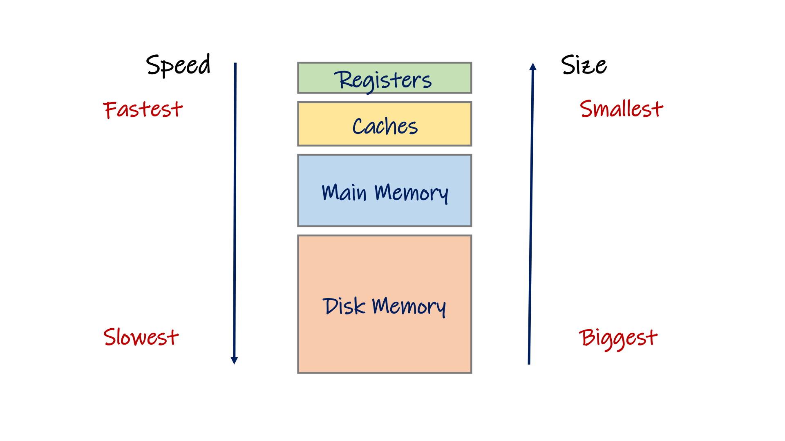
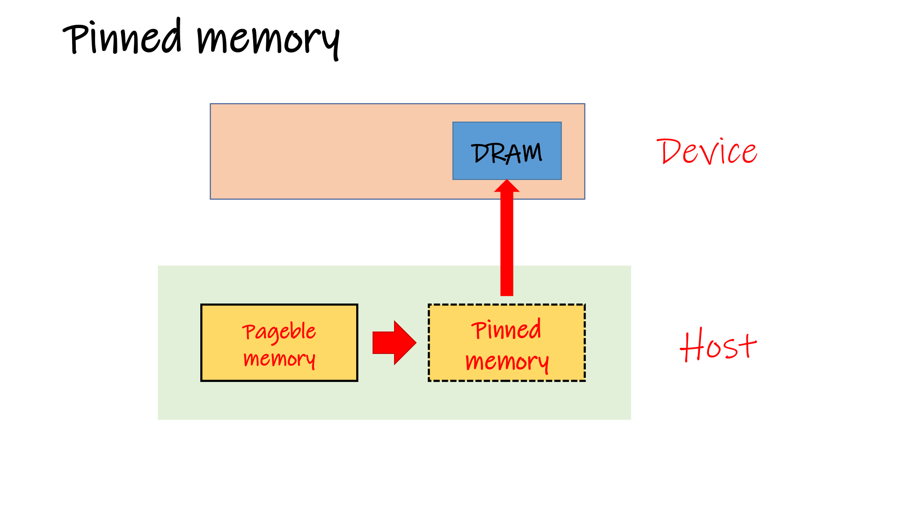

# 第 13 章 CUDA 内存层次与主机内存策略

CUDA 程序的性能不仅取决于核函数中的计算，还取决于数据位于何处、以何种路径到达执行单元，以及同一份数据会被访问多少次。设备显存带宽、主机与设备之间的互连带宽、片上存储容量和访问延迟属于不同层次，不能用一个“内存速度”概括。合理的设计应先划定数据生命周期，再选择存储空间和迁移方式，最后用端到端测量验证选择。



*图 13.1　内存层次中，越靠近处理器的存储通常越快但容量越小。（原课程课件）*

## 13.1 从局部性理解内存层次

内存层次利用两种局部性降低平均访问成本：

- **时间局部性**：一个地址被访问后，短期内可能再次被访问。缓存可以保留该数据，避免重复访问较低层存储。
- **空间局部性**：一个地址被访问后，邻近地址也可能很快被访问。缓存行、内存扇区和连续数据布局可以利用这一特征。

越靠近执行单元的存储通常容量越小、延迟越低；越靠近层次的底部，容量通常越大，但访问成本和共享范围也随之增加。缓存的存在并不保证访问一定廉价：如果数据没有重用，或者线程束请求的地址过于分散，高层缓存就无法弥补低效的访问模式。

分析一条数据通路时，应分别回答以下问题：

1. 数据由单个线程、一个线程块、整个设备还是主机与设备共同访问？
2. 数据需要存活一个线程、一个线程块、一次核函数调用，还是跨越多次调用？
3. 数据会被读取一次还是反复重用，主机和设备是否会交替访问？
4. 数据移动发生在显式复制、设备直接访问主机内存，还是运行时管理的页面迁移中？

这些答案比“尽量使用最快的内存”更能指导实现。

## 13.2 逻辑内存空间不等于物理位置

CUDA 内存名称首先描述编程模型中的作用域与生命周期。常见空间可归纳如下。

| 空间 | 典型声明或分配 | 可见范围与生命周期 | 选择时的关键点 |
|---|---|---|---|
| 寄存器 | 核函数中的普通标量、可完全静态索引的小数组 | 线程私有，随线程结束而释放 | 由编译器分配；每线程用量会影响驻留线程块和线程束数量 |
| 局部内存 | 寄存器溢出、大型局部对象、部分动态索引局部数组 | 逻辑上线程私有 | 通常有片外存储作为后备，“局部”不表示片上或低延迟 |
| 共享内存 | `__shared__` | 线程块内共享，随线程块结束而失效 | 适合显式组织的块内重用；容量使用会影响占用率 |
| 全局内存 | `cudaMalloc`、核函数参数所指的设备缓冲区 | 设备端广泛可见，可跨核函数存活 | 容量大，需关注合并访问、对齐、缓存与同步 |
| 常量内存 | 文件作用域的 `__constant__` | 设备端只读，生命周期由模块管理 | 适合线程束内相同地址的只读访问，不适合分散写入 |
| 主机内存 | `new`、`malloc`、`cudaMallocHost`、`cudaHostAlloc` | 由主机分配方式与 CUDA 映射属性共同决定 | 是否可分页、是否页锁定、能否异步复制或被设备直接访问必须分别判断 |

以下声明展示了共享内存与普通局部变量的基本形式。示例使用一维线程块，并要求启动时满足 `1 <= blockDim.x <= 256`，从而保证 `lane` 不会越过固定共享数组的边界；若块大小在运行时变化，应先检查该条件或调整数组容量。

```cpp
__global__ void loadTile(const float* input, float* output, int n) {
    __shared__ float tile[256];
    int lane = threadIdx.x;
    int index = blockIdx.x * blockDim.x + lane;

    float scale = 2.0f;             // 通常可由寄存器保存
    tile[lane] = index < n ? input[index] : 0.0f;
    __syncthreads();

    if (index < n) {
        output[index] = scale * tile[lane];
    }
}
```

变量声明本身不能精确预测寄存器数量。编译器会进行常量传播、消除无用代码、复用临时值，并为地址计算保留寄存器；反过来，过大的局部对象或无法静态展开的数组也可能进入局部内存。资源判断应依据编译报告和生成代码，而不是按源码变量个数估算。

全局内存、常量内存所依赖的存储以及局部内存的后备存储通常位于设备 DRAM 一侧，L1、L2、只读数据缓存等则用于缩短部分访问路径。具体缓存层级、可配置方式和事务粒度随架构而变，不应把某一代设备的参数当成 CUDA 编程模型的固定承诺。


*图 13.2　内存选择同时取决于访问者、物理位置、重用和生命周期；零拷贝仍经过互连，统一地址也不代表相同访问成本。（SVG 示意图）*

## 13.3 用一个数组加法统一比较数据路径

后续示例都执行同一个操作：

\[
c[i]=a[i]+b[i],\qquad 0\leq i<n。
\]

核函数保持不变，只改变主机缓冲区、设备指针和同步方式。这样可以区分“内存策略改变了什么”和“计算本身没有改变什么”。

```cpp
#include <cuda_runtime.h>
#include <cstddef>
#include <stdexcept>

#define CUDA_CHECK(expression)                                           \
    do {                                                                 \
        cudaError_t status_ = (expression);                              \
        if (status_ != cudaSuccess) {                                    \
            throw std::runtime_error(cudaGetErrorString(status_));        \
        }                                                                \
    } while (false)

__global__ void addKernel(const float* a, const float* b,
                          float* c, std::size_t n) {
    std::size_t i = blockIdx.x * blockDim.x + threadIdx.x;
    if (i < n) {
        c[i] = a[i] + b[i];
    }
}
```

示例使用异常报告错误，以突出数据路径，并假设 `n > 0` 且网格维度不超过设备限制。实际工程还应保证异常路径上的资源释放，可使用 RAII 包装设备缓冲、主机页锁定缓冲和流。

## 13.4 显式复制：数据移动完全可见

显式方案分别拥有主机缓冲区和设备缓冲区。普通 `std::vector`、`new` 或 `malloc` 得到的通常是可分页主机内存，设备 DMA 不能任意依赖其物理页长期固定。传输时，运行库和驱动可能借助内部暂存页锁定区完成复制，因此主机侧会存在额外的数据整理或复制成本。

一次完整的同步流程如下：

```cpp
#include <vector>

void explicitCopyExample(std::size_t n) {
    const std::size_t bytes = n * sizeof(float);
    std::vector<float> hA(n, 1.0f);
    std::vector<float> hB(n, 2.0f);
    std::vector<float> hC(n, 0.0f);
    float *dA = nullptr, *dB = nullptr, *dC = nullptr;

    CUDA_CHECK(cudaMalloc(reinterpret_cast<void**>(&dA), bytes));
    CUDA_CHECK(cudaMalloc(reinterpret_cast<void**>(&dB), bytes));
    CUDA_CHECK(cudaMalloc(reinterpret_cast<void**>(&dC), bytes));

    CUDA_CHECK(cudaMemcpy(dA, hA.data(), bytes, cudaMemcpyHostToDevice));
    CUDA_CHECK(cudaMemcpy(dB, hB.data(), bytes, cudaMemcpyHostToDevice));

    const unsigned threads = 256;
    const unsigned blocks = static_cast<unsigned>((n + threads - 1) / threads);
    addKernel<<<blocks, threads>>>(dA, dB, dC, n);
    CUDA_CHECK(cudaGetLastError());
    CUDA_CHECK(cudaDeviceSynchronize());

    CUDA_CHECK(cudaMemcpy(hC.data(), dC, bytes, cudaMemcpyDeviceToHost));
    // 此处 hC 已可用于结果校验。

    CUDA_CHECK(cudaFree(dA));
    CUDA_CHECK(cudaFree(dB));
    CUDA_CHECK(cudaFree(dC));
}
```

其所有权和顺序都很明确：

```text
主机初始化 hA、hB
    → H2D 复制到 dA、dB
    → 设备核函数读取 dA、dB，写 dC
    → 核函数完成
    → D2H 复制到 hC
    → 主机校验 hC
```

显式复制的优势是传输阶段可见、缓冲区位置明确，也便于把中间结果长期留在设备上。若一个输入会被多个核函数反复使用，一次 H2D 复制可以由后续设备端访问摊销；若多个中间结果只在设备端流动，就不应为了查看或组织代码而反复复制回主机。



*图 13.3　页锁定内存为主机—设备传输提供稳定地址，但会占用不可分页的物理内存。（原课程课件）*

## 13.5 页锁定主机内存：优化复制并支持异步提交

页锁定内存由 CUDA 分配并固定在物理内存中，为 DMA 提供稳定页面。它主要改善**主机与设备之间的数据移动路径**，不会把核函数中的设备全局内存访问变成页锁定内存访问。

`cudaMallocHost` 用于普通页锁定分配，`cudaFreeHost` 必须配对释放。下面的流程还使用非默认流表达异步复制：

```cpp
void pinnedCopyExample(std::size_t n) {
    const std::size_t bytes = n * sizeof(float);
    float *hA = nullptr, *hB = nullptr, *hC = nullptr;
    float *dA = nullptr, *dB = nullptr, *dC = nullptr;
    cudaStream_t stream;

    CUDA_CHECK(cudaMallocHost(reinterpret_cast<void**>(&hA), bytes));
    CUDA_CHECK(cudaMallocHost(reinterpret_cast<void**>(&hB), bytes));
    CUDA_CHECK(cudaMallocHost(reinterpret_cast<void**>(&hC), bytes));
    for (std::size_t i = 0; i < n; ++i) {
        hA[i] = 1.0f;
        hB[i] = 2.0f;
        hC[i] = 0.0f;
    }

    CUDA_CHECK(cudaMalloc(reinterpret_cast<void**>(&dA), bytes));
    CUDA_CHECK(cudaMalloc(reinterpret_cast<void**>(&dB), bytes));
    CUDA_CHECK(cudaMalloc(reinterpret_cast<void**>(&dC), bytes));
    CUDA_CHECK(cudaStreamCreateWithFlags(&stream, cudaStreamNonBlocking));

    CUDA_CHECK(cudaMemcpyAsync(dA, hA, bytes,
                               cudaMemcpyHostToDevice, stream));
    CUDA_CHECK(cudaMemcpyAsync(dB, hB, bytes,
                               cudaMemcpyHostToDevice, stream));
    const unsigned threads = 256;
    const unsigned blocks = static_cast<unsigned>((n + threads - 1) / threads);
    addKernel<<<blocks, threads, 0, stream>>>(dA, dB, dC, n);
    CUDA_CHECK(cudaGetLastError());
    CUDA_CHECK(cudaMemcpyAsync(hC, dC, bytes,
                               cudaMemcpyDeviceToHost, stream));

    CUDA_CHECK(cudaStreamSynchronize(stream));
    // 只有同步完成后，主机才能读取 hC，或修改、释放传输所用缓冲区。

    CUDA_CHECK(cudaStreamDestroy(stream));
    CUDA_CHECK(cudaFree(dA));
    CUDA_CHECK(cudaFree(dB));
    CUDA_CHECK(cudaFree(dC));
    CUDA_CHECK(cudaFreeHost(hA));
    CUDA_CHECK(cudaFreeHost(hB));
    CUDA_CHECK(cudaFreeHost(hC));
}
```

`cudaMemcpyAsync` 返回表示操作已经提交，不表示主机结果已经可读。对于涉及主机内存的异步复制，页锁定缓冲、合适的流和明确的完成同步缺一不可。仅把同步 `cudaMemcpy` 改名为异步接口，而仍使用可分页内存，不能据此假定获得异步执行或重叠。

页锁定并非越多越好。分配和释放本身有成本，过量页锁定还会限制操作系统的内存调度，影响主机和其他进程。应优先把频繁复用、需要异步传输的 staging 缓冲区页锁定，而不是把所有主机对象都改为页锁定对象。

`cudaHostAlloc` 还提供额外标志：`cudaHostAllocDefault` 对应普通页锁定属性，`cudaHostAllocPortable` 涉及跨上下文的可移植性，`cudaHostAllocWriteCombined` 面向主要由主机写入、设备读取的缓冲区，`cudaHostAllocMapped` 则建立设备映射。写合并内存通常不适合主机频繁读取，不能仅因其传输特性而替换通用结果缓冲。

## 13.6 零拷贝：设备直接访问映射主机内存

零拷贝不是“没有数据移动”，而是**没有单独的显式主机到设备数组复制**。核函数访问映射页锁定内存时，数据仍需通过主机与设备之间的互连传输；每次访问的延迟、带宽和缓存行为也不同于设备本地全局内存。

典型实现包含“检查能力—分配映射内存—取得设备指针—核函数访问—同步—主机读取”六个步骤：

```cpp
void zeroCopyExample(std::size_t n) {
    const std::size_t bytes = n * sizeof(float);
    int device = 0;
    cudaDeviceProp properties{};
    CUDA_CHECK(cudaGetDevice(&device));
    CUDA_CHECK(cudaGetDeviceProperties(&properties, device));
    if (!properties.canMapHostMemory) {
        throw std::runtime_error("mapped host memory is unavailable");
    }

    float *hA = nullptr, *hB = nullptr, *hC = nullptr;
    CUDA_CHECK(cudaHostAlloc(reinterpret_cast<void**>(&hA), bytes,
                             cudaHostAllocMapped));
    CUDA_CHECK(cudaHostAlloc(reinterpret_cast<void**>(&hB), bytes,
                             cudaHostAllocMapped));
    CUDA_CHECK(cudaHostAlloc(reinterpret_cast<void**>(&hC), bytes,
                             cudaHostAllocMapped));
    for (std::size_t i = 0; i < n; ++i) {
        hA[i] = 1.0f;
        hB[i] = 2.0f;
    }

    float *dA = nullptr, *dB = nullptr, *dC = nullptr;
    CUDA_CHECK(cudaHostGetDevicePointer(reinterpret_cast<void**>(&dA), hA, 0));
    CUDA_CHECK(cudaHostGetDevicePointer(reinterpret_cast<void**>(&dB), hB, 0));
    CUDA_CHECK(cudaHostGetDevicePointer(reinterpret_cast<void**>(&dC), hC, 0));

    const unsigned threads = 256;
    const unsigned blocks = static_cast<unsigned>((n + threads - 1) / threads);
    addKernel<<<blocks, threads>>>(dA, dB, dC, n);
    CUDA_CHECK(cudaGetLastError());
    CUDA_CHECK(cudaDeviceSynchronize());
    // 同步后直接读取 hC；不存在单独的 D2H 数组复制。

    CUDA_CHECK(cudaFreeHost(hA));
    CUDA_CHECK(cudaFreeHost(hB));
    CUDA_CHECK(cudaFreeHost(hC));
}
```

`cudaHostGetDevicePointer` 返回供设备使用的映射地址。即使某些统一虚拟地址环境中主机指针与设备指针数值相同，代码也不应省略可移植的获取步骤或自行假定二者始终相等。

零拷贝适合以下情形：

- 数据只被设备读取或写入一次，没有必要再建立一份长期设备副本；
- 数据量较小，建立显式复制流程的固定成本较突出；
- 设备容量不足，且算法能够接受通过互连访问主机内存的成本；
- 某些控制信息或结果需要在明确同步边界下由主机与设备共享。

如果同一数组会被多个核函数反复读取，直接映射可能让访问多次经过互连。此时先复制到设备内存通常更便于利用设备端带宽和缓存。主机与设备同时读写同一缓冲区还可能形成数据竞态；映射不会自动生成互斥或一致性协议，必须以流、事件或设备同步建立先后关系。

## 13.7 统一内存：共享指针与运行时数据管理

`cudaMallocManaged` 分配可由主机和设备使用同一指针访问的托管内存。系统根据平台能力处理数据所在位置和一致性，可能涉及页面迁移、故障处理或其他维护机制。单一地址空间视图消除了显式数组复制代码，但没有消除数据移动成本。

```cpp
void unifiedMemoryExample(std::size_t n) {
    const std::size_t bytes = n * sizeof(float);
    float *a = nullptr, *b = nullptr, *c = nullptr;
    CUDA_CHECK(cudaMallocManaged(reinterpret_cast<void**>(&a), bytes));
    CUDA_CHECK(cudaMallocManaged(reinterpret_cast<void**>(&b), bytes));
    CUDA_CHECK(cudaMallocManaged(reinterpret_cast<void**>(&c), bytes));

    for (std::size_t i = 0; i < n; ++i) {
        a[i] = 1.0f;
        b[i] = 2.0f;
        c[i] = 0.0f;
    }

    const unsigned threads = 256;
    const unsigned blocks = static_cast<unsigned>((n + threads - 1) / threads);
    addKernel<<<blocks, threads>>>(a, b, c, n);
    CUDA_CHECK(cudaGetLastError());
    CUDA_CHECK(cudaDeviceSynchronize());

    // 同步后由主机校验 c。
    for (std::size_t i = 0; i < n; ++i) {
        if (c[i] != 3.0f) {
            throw std::runtime_error("result mismatch");
        }
    }

    CUDA_CHECK(cudaFree(a));
    CUDA_CHECK(cudaFree(b));
    CUDA_CHECK(cudaFree(c));
}
```

托管分配仍须由 `cudaFree` 释放；简化显式复制不等于省略资源生命周期管理。主机在设备操作尚未完成时访问数据，也可能违反并发访问规则，因此同步仍然是正确性条件，而不是可选的性能调优。

支持的平台上，还可使用 `cudaMemPrefetchAsync` 表达预取意图，使用 `cudaMemAdvise` 提供主要访问者、读取倾向等建议。这些接口的语义和效果依赖操作系统、设备与 CUDA 版本；预取也不改变同步要求。若主机与设备频繁交替触碰同一批页面，管理开销可能明显增加，应通过时间线观察迁移和页面故障，而不能只测量核函数主体。

## 13.8 四种策略的对比与选择

| 策略 | 指针与存储视图 | 数据移动由谁组织 | 主要收益 | 主要代价与适用边界 |
|---|---|---|---|---|
| 可分页主机内存 + 显式复制 | 主机、设备各自分配 | 程序调用 `cudaMemcpy` | 结构直接，适合一般数据和一次性传输 | 可能存在暂存复制；主机涉及的可分页复制不利于真正异步重叠 |
| 页锁定主机内存 + 显式复制 | 主机、设备各自分配，主机页固定 | 程序调用同步或异步复制 | 通常改善 DMA 传输，可配合流实现异步流水线 | 分配成本及系统内存压力较高；仍需设备缓冲和复制 |
| 映射页锁定内存（零拷贝） | 数据驻留主机，设备获得映射指针 | 设备访问时经过互连 | 省去独立显式复制，可共享小数据或扩展可访问容量 | 重复设备访问可能反复付出互连成本；必须同步主机与设备访问 |
| 统一内存 | 主机与设备使用同一托管指针 | 运行时和硬件按平台机制管理 | 降低复杂数据结构和渐进迁移的管理成本 | 页面迁移、故障与一致性开销较隐式；性能依赖访问局部性和平台 |

选择可按数据流推进：

1. **数据是否会在设备上重复使用？** 若是，优先考虑显式设备副本，或在支持的平台上用统一内存配合预取与访问建议。
2. **主要问题是否是主机到设备的传输流水线？** 若是，页锁定缓冲和流比零拷贝更直接。
3. **数据是否只访问一次，或容量、共享语义比设备端带宽更重要？** 若是，可评估零拷贝。
4. **工程难点是否主要是复杂所有权和逐步移植？** 若是，统一内存可降低代码复杂度，但仍需分析迁移成本。
5. **中间结果是否还会被设备使用？** 若是，应避免无意义的 D2H/H2D 往返，无论采用哪种主机内存策略。

比较时必须保持核函数、数据规模、初始化和结果校验一致，并分别记录分配、传输、页面迁移、核函数和同步成本。只比较核函数时间会漏掉显式复制，只比较复制时间又会漏掉零拷贝在核函数中的互连访问。最终依据应是完整数据通路的正确性和端到端成本，而不是某个策略名称。

## 13.9 本章小结

内存层次通过时间局部性和空间局部性降低平均访问成本，但逻辑空间名称不能直接说明物理位置。寄存器、局部内存、共享内存和全局内存分别承担不同的作用域与生命周期；主机侧则必须进一步区分可分页、页锁定、映射和托管属性。

显式复制让数据位置与传输阶段最清晰；页锁定内存优化 DMA 并支撑异步流水线；零拷贝以设备直接访问映射主机内存取代独立复制；统一内存用共享指针和自动管理降低编程复杂度。四者都没有消除互连成本。正确的选择来自访问次数、数据生命周期、同步边界和端到端测量。
