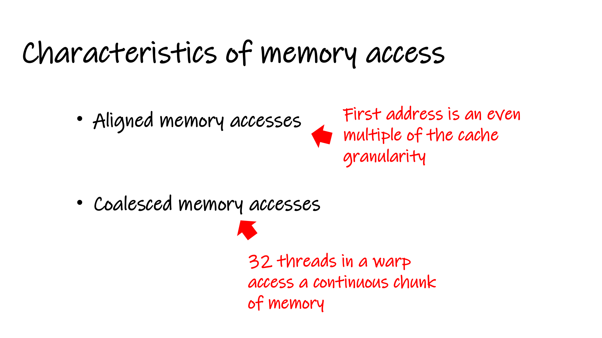
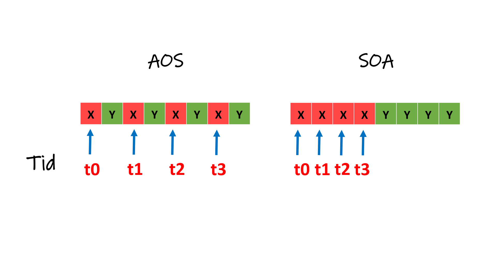
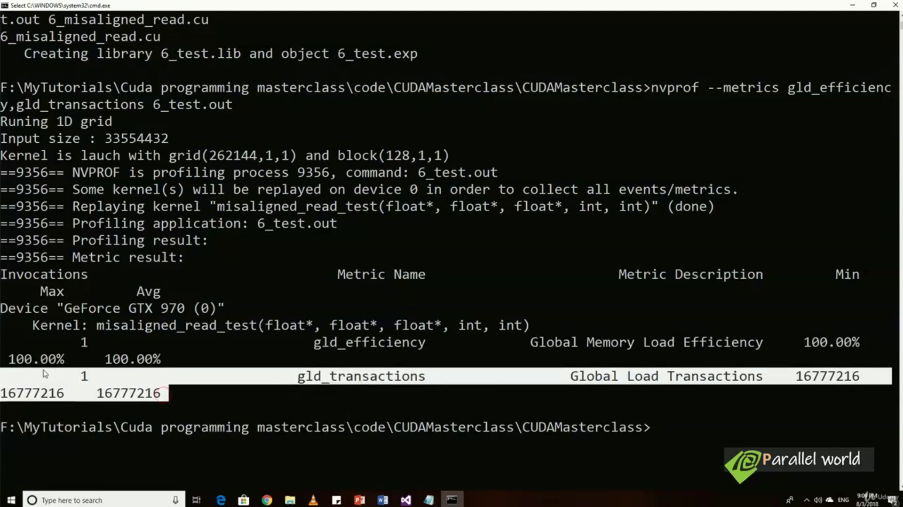

# 第 14 章 全局内存合并访问、写入与 AoS/SoA 布局

全局内存优化不能只检查单个线程是否访问了正确下标。内存指令以线程束为单位发射，真正决定请求覆盖范围的是同一时刻所有活跃 lane 提供的地址集合。连续线程、连续下标通常是良好起点，但还需要同时考虑对齐、访问步长、数据类型、缓存状态以及写入地址。AoS 与 SoA 的布局差异，则是这一分析在数据结构层面的直接应用。

## 14.1 请求、事务与有效带宽

一个 warp 通常包含 32 个 lane。执行同一条全局加载或存储指令时，每个活跃 lane 提供自己的地址，硬件据此组织一个或多个内存事务。这里需要区分三个概念：

- **请求**：一条 warp 级内存指令产生的访问需求；
- **事务**：内存系统为满足请求而传输的一个或多个对齐区域；
- **有效数据比例**：程序实际使用的字节数与相关事务所覆盖字节数之间的关系。

请求与事务不是一一对应关系。事务如何划分、是否合并、缓存行和扇区多大，均与设备架构、访问类型和缓存路径有关。分析源码时，应先确定 warp 地址集合及其跨越的对齐区域，再使用对应架构的性能计数器验证，而不是为所有 GPU 套用固定事务数。

“合并访问”也不等于“lane 编号必须严格按地址升序”。只要各 lane 所需数据集中在少量内存区域内，即使访问顺序在区域内部发生置换，仍可能高效利用事务。相反，每个线程单独看都是连续循环，也不代表同一 warp 的横向地址连续。

有效带宽需要与理论峰值区分。若算法要求读写 `B` 字节，测得核函数时间为 `T`，可以计算

\[
BW_{algorithm}=\frac{B}{T}。
\]

这一指标便于比较同一算法的不同实现，但分子是算法逻辑字节数，不一定是 DRAM 实际传输字节数。未对齐、跨步和重复访问可能让实际传输量大于 `B`，缓存命中又可能让 DRAM 传输量小于请求总量。


*图 14.1　合并访问要观察整个 Warp 的地址集合；只读取单字段时 SoA 更易形成连续访问，但布局选择仍需计入字段使用和转换成本。（SVG 示意图）*



*图 14.2　合并访问关注整个 Warp 的地址集合，连续与对齐共同影响内存事务。（原课程课件）*

## 14.2 用 Warp 地址集合判断访问模式

设某 warp 的 32 个 lane 都活跃，每个 lane 读取一个 4 字节 `float`，基地址按 128 字节对齐。用 `t` 表示 lane 编号，以下公式可直接列出地址集合。

### 连续且对齐

```text
元素下标：base + t
字节地址：A + 4 × (base + t)，t = 0, 1, ..., 31
```

若 `A + 4 × base` 位于一个 128 字节区域的起点，32 个地址恰好覆盖 128 字节，且区域中的字节全部被本次请求使用。这是常见的理想模式：

```cpp
__global__ void add(const float* inputA, const float* inputB,
                    float* output, std::size_t n) {
    std::size_t i = blockIdx.x * blockDim.x + threadIdx.x;
    if (i < n) {
        output[i] = inputA[i] + inputB[i];
    }
}
```

在 `threadIdx.x` 连续且没有边界掩码影响的主体 warp 中，三条内存指令分别形成连续地址集合。

### 区域内置换

```text
元素下标：base + permutation(t)
```

如果 `permutation` 只是 0 至 31 的一个排列，地址仍覆盖同一连续区域。事务覆盖范围与顺序访问相同，说明“连续区域”比“lane 必须升序”更准确。不过，复杂置换可能增加地址计算，并可能改变后续访问的局部性。

### 连续但起点未对齐

若首地址比 128 字节边界多 4 字节，则地址范围为：

```text
A + 4, A + 8, ..., A + 128
```

请求仍然连续，但跨越两个 128 字节区域。连续性没有被破坏，对齐却发生了变化，二者不能混为一谈。

为便于手算，可以暂时采用“每 32 字节一个扇区”的简化模型：上述请求触及字节偏移 0、32、64、96、128 开始的五个扇区，覆盖 160 字节，而程序需要 128 字节，因此该模型下的单次请求有效数据比例为 `128/160 = 80%`。若采用 128 字节缓存行模型，则会得到另一种事务描述。这个计算展示的是地址分析方法，不是所有设备上的固定性能计数器结果。

### 固定跨步

```text
元素下标：base + stride × t
```

当 `stride = 2` 时，lane 地址相隔 8 字节，32 个 `float` 分布在 256 字节范围内。仍按 32 字节扇区作理想化估算，需要覆盖八个扇区，而请求只使用其中 128 字节，有效数据比例为 50%。当 `stride = 32` 时，地址相隔 128 字节，可能触及 32 个不同扇区，同样请求量对应的覆盖范围进一步扩大。

### 全部 lane 访问同一地址

所有 lane 读取同一标量通常可由广播或少量事务满足，不需要为 32 个 lane 分别访问 32 个区域。此时若只用一个标量的 4 字节去除以事务覆盖字节数，比例可能很低，但这并不代表它一定比分散访问更慢。效率指标、事务数和实际延迟应结合访问语义分析，不能仅凭一个百分比排序。

下表汇总上述理想化示例：

| 模式 | lane `t` 的相对元素下标 | 地址集合特征 | 分析重点 |
|---|---:|---|---|
| 连续对齐 | `t` | 完整覆盖一个连续区域 | 通常具有较少事务和高有效数据比例 |
| 区域内置换 | `permutation(t)` | 覆盖集合不变，lane 顺序改变 | 不必因非升序就判断为低效 |
| 连续未对齐 | `offset + t` | 连续但多跨一个边界 | 区分连续性和对齐 |
| 跨步访问 | `stride × t` | 地址范围扩大，夹有未使用数据 | 检查事务带入的额外字节 |
| 相同地址 | `0` | 地址集合只有一个元素 | 可考虑广播，避免误判为 32 路分散访问 |

边界检查会使末尾 warp 的部分 lane 不活跃，此时只需分析活跃 lane 的地址。小块尺寸也可能让一个 warp 中只有少量 lane 对应有效工作，但其最终影响仍取决于线程块组织、并发块数量和架构，不能直接换算为固定效率。

## 14.3 从源码展开地址，而不是凭名称判断

下面两个内核分别制造输入偏移和跨步读取：

```cpp
__global__ void offsetLoad(const float* input, float* output,
                           std::size_t n, std::size_t offset) {
    std::size_t i = blockIdx.x * blockDim.x + threadIdx.x;
    if (i < n && offset < n - i) {
        output[i] = input[i + offset];
    }
}

__global__ void stridedLoad(const float* input, float* output,
                            std::size_t inputCount, std::size_t stride) {
    std::size_t i = blockIdx.x * blockDim.x + threadIdx.x;
    if (inputCount != 0 && stride != 0) {
        const std::size_t outputCount = 1 + (inputCount - 1) / stride;
        if (i < outputCount) {
            output[i] = input[i * stride];
        }
    }
}
```

`offsetLoad` 的主体 warp 仍读取连续数据，只是整体起点平移；`stridedLoad` 则让相邻 lane 的地址间隔扩大。`stridedLoad` 要求 `stride > 0`，其输出至少应有 `1 + (inputCount - 1) / stride` 个元素（`inputCount > 0` 时），从而覆盖所有满足 `i × stride < inputCount` 的输入位置。

实际分析可以按以下步骤进行：

1. 选定一条加载或存储指令；
2. 写出 `i` 与 `blockIdx`、`threadIdx` 的关系；
3. 固定一个主体 warp，把 `threadIdx.x` 换成 lane `t`；
4. 将元素下标乘以 `sizeof(element)`，列出首地址、末地址和步长；
5. 计算地址覆盖的对齐区域，并考虑活跃 lane 掩码；
6. 用目标设备上的事务、扇区、请求和 DRAM 吞吐指标验证。

全局读取可能经过不同缓存路径，编译选项和硬件代际也会影响观察结果。优化目标应是减少不必要的覆盖区域和重复传输，而不是追求某个旧指标名称在所有工具中的相同数值。

## 14.4 全局写入同样由地址集合决定

存储指令也以 warp 地址集合组织事务。连续、适当对齐的输出通常能减少写请求覆盖的区域；跨步、分散或部分覆盖输出区域则可能增加事务和额外开销。只写不读并不意味着地址模式无关紧要。

以下内核把输入平移写入另一块输出缓冲区：

```cpp
__global__ void shiftedStore(const float* input, float* output,
                             std::size_t n, std::size_t offset) {
    std::size_t i = blockIdx.x * blockDim.x + threadIdx.x;
    if (i < n) {
        output[i + offset] = input[i];
    }
}
```

调用方必须保证输入与输出不重叠，并为 `output` 预留至少 `n + offset` 个元素；该内核只定义平移后的输出区域，其余位置由调用方另行初始化。主体 warp 的读取连续，写入也连续，但 `offset` 可能改变写入起点对齐。若把 `output[i + offset]` 错当成“非合并写入”，就会遗漏真正原因：它不是跨步，而是可能未对齐。

写入优化还包括减少逻辑上不必要的数据流：

- 中间结果若立即被下一个设备核函数使用，可保留在设备端；
- 多个简单核函数若在中间数组上形成“写出后马上读回”，可评估融合；
- 不必为了调试而在每次迭代中复制整个结果回主机；
- 输出若只需部分字段，应避免构造并写回完整临时对象。

核函数融合也会提高寄存器压力、降低模块化程度，并非必然获益。`__restrict__` 可向编译器声明指针不重叠，从而帮助优化，但它不改变 warp 地址集合；只有在确实不存在别名时才能使用。



*图 14.3　AoS 将对象字段聚集，SoA 将同一字段连续排列，两者形成不同的 Warp 地址集合。（原课程课件）*

## 14.5 AoS 与 SoA：同一逻辑数据的两种布局

结构体数组（Array of Structures，AoS）把一个对象的字段连续存放，再依次存放各对象：

```text
对象0.x  对象0.y  对象1.x  对象1.y  对象2.x  对象2.y ...
```

数组结构体（Structure of Arrays，SoA）把同一字段组织为独立数组，通过相同下标恢复对象关系：

```text
x数组：对象0.x  对象1.x  对象2.x ...
y数组：对象0.y  对象1.y  对象2.y ...
```

下面的 C++ 类型和内核均使用运行期指针，不依赖非标准变长数组：

```cpp
#include <cstddef>

struct Vec2 {
    float x;
    float y;
};
static_assert(sizeof(Vec2) == 2 * sizeof(float),
              "the address example assumes two adjacent floats");

struct Vec2SoA {
    float* x;
    float* y;
};

__global__ void scaleXAoS(Vec2* values, std::size_t n, float scale) {
    std::size_t i = blockIdx.x * blockDim.x + threadIdx.x;
    if (i < n) {
        values[i].x *= scale;
    }
}

__global__ void scaleXSoA(Vec2SoA values, std::size_t n, float scale) {
    std::size_t i = blockIdx.x * blockDim.x + threadIdx.x;
    if (i < n) {
        values.x[i] *= scale;
    }
}
```

设主体 warp 的 lane `t` 处理对象 `base + t`，两种布局的 `x` 地址分别为：

\[
\begin{aligned}
\text{AoS:}\quad &\operatorname{address}(x)=\operatorname{baseAddress}+8(base+t),\\
\text{SoA:}\quad &\operatorname{address}(x)=x_{\operatorname{array}}+4(base+t)。
\end{aligned}
\]

因此，只访问 `x` 时，AoS 形成 8 字节跨步，事务还会覆盖当前指令未使用的 `y`；SoA 形成 4 字节连续访问。若只考虑一批互不重用的事务，AoS 的有效数据比例可能接近一半，但这不是脱离缓存和后续访问也始终成立的固定效率。

如果紧接着又访问 `y`，AoS 先前带入的 `y` 可能仍在缓存中，并且一个对象的字段天然聚集；SoA 则形成两条连续字段流。若每个线程总是同时读取完整的 `Vec2`，AoS 的完整对象本身也是连续排列，不能简单断言 SoA 一定更快。选择应依据实际指令序列、字段重用和缓存表现。

## 14.6 布局转换也是一项内存成本

从 AoS 转为 SoA 可以使用独立内核：

```cpp
__global__ void splitVec2(const Vec2* input, Vec2SoA output,
                          std::size_t n) {
    std::size_t i = blockIdx.x * blockDim.x + threadIdx.x;
    if (i < n) {
        Vec2 value = input[i];
        output.x[i] = value.x;
        output.y[i] = value.y;
    }
}
```

该转换至少需要读取原布局并写出新布局，还要准备新存储。只有当后续核函数能够反复利用更好的访问模式时，转换成本才可能被摊销。如果数据只使用一次，在数据生产阶段直接生成合适布局通常比先构造 AoS、再单独转换更合理。

两种布局的选择可归纳为：

| 访问与工作流特征 | 更值得优先评估的布局 | 原因 |
|---|---|---|
| 每线程处理一个对象，当前阶段只触碰少数字段 | SoA | 相同字段在 lane 间连续，减少无关字段传输 |
| 每线程频繁同时使用整个对象，字段之间存在明显局部重用 | AoS 或 SoA 都需测量 | AoS 的对象局部性可能有利，SoA 的各字段流也可合并 |
| 数据只经过一次简单处理 | 尽量避免额外转换 | 转换流量可能超过访问改善 |
| 多阶段设备流水线反复读取少数字段 | SoA | 一次布局成本可由多次访问摊销 |
| 主机面向对象代码与设备计算共享数据定义 | 依据两端成本共同决定 | 不能只优化设备端而忽略序列化和维护成本 |


*图 14.4　全局内存写入实验的真实 nvprof 输出：参数为 11 的本次运行得到 80.00% gst_efficiency 和 5242878 次 gst_transactions；同屏保留 Min、Max、Avg 及指标描述。（原课程视频帧，历史开发环境）*



*图 14.5　全局内存读取实验的真实 nvprof 指标：本次运行 gld_efficiency 为 100.00%，gld_transactions 为 16777216；保留 Invocations、Metric Name、Metric Description、Min、Max、Avg 完整字段。（原课程视频帧，历史开发环境）*

## 14.7 可复现的验证方法

访问模式优化应同时验证正确性、请求组织和端到端收益：

1. 对齐、偏移和跨步版本使用相同有效输入，逐元素检查结果；
2. 覆盖 `n` 不能被 warp 或线程块整除的情况，确认尾 warp 的活跃 lane 与边界条件正确；
3. 分别记录加载和存储的请求、事务或扇区指标，并注明设备、架构和工具版本；
4. 同时报告核函数时间、算法逻辑字节数及实际内存计数，避免只用单一“效率”指标下结论；
5. AoS/SoA 比较应包含布局生成与转换成本，并区分“只读一个字段”和“读取全部字段”两种工作负载；
6. 若修改数据布局，还需验证主机侧初始化、设备分配大小和下标映射均已同步改变。

这些步骤能够建立“源码下标—warp 地址集合—内存计数—整体时间”的证据链。没有该证据链时，不应把某个优化描述为必然提升，也不应把一次测量外推到不同架构和数据规模。

## 14.8 本章小结

全局内存访问的基本分析单位是 warp 地址集合。连续、对齐通常有利于减少事务覆盖范围；区域内置换不一定低效，连续但未对齐与固定跨步则应分别处理。全局写入遵循同样的地址分析原则，并可通过减少中间结果写回降低总流量。

AoS 将对象字段聚集，SoA 将同一字段连续排列。只访问少数字段时，SoA 往往更容易形成合并访问；字段全部使用、缓存重用和布局转换成本则可能改变结论。后续矩阵转置将把这一方法用于二维索引，直接展示连续读取与连续写入之间的矛盾。
