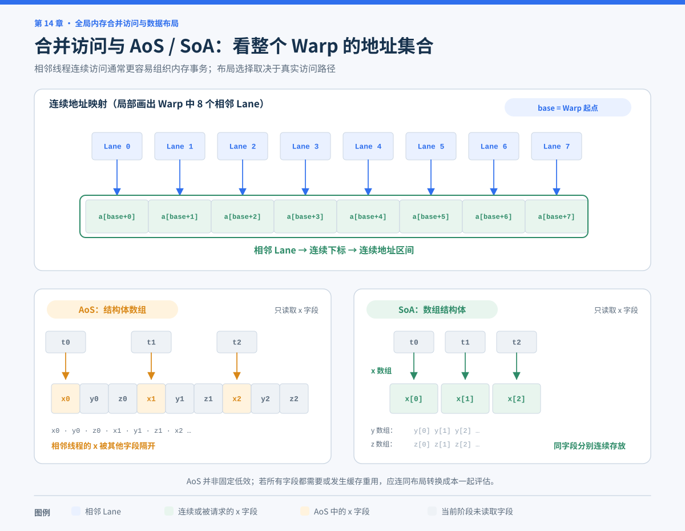
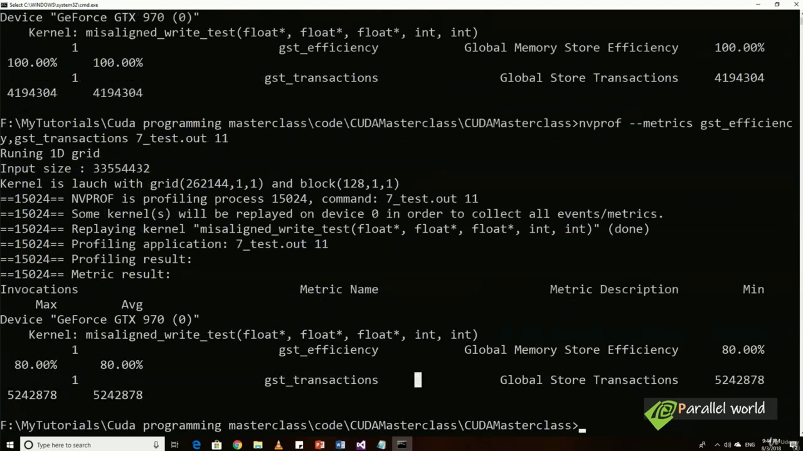

# 第 14 章 让全局内存访问更连续

前面的章节已经解决了一个重要问题：如何让每个线程用正确的下标处理正确的数据。但**结果正确并不代表内存访问高效**。本章从一个简单的数组缩放核函数出发，逐步回答三个问题：

1. 为什么分析全局内存时，不能只看一个线程，而要看整个 Warp？
2. 连续、对齐、跨步和合并访问之间有什么关系？
3. 为什么只改变数据在内存中的排列方式，就可能明显改变性能？

## 14.1 一个正确的核函数，为什么还有访问效率问题

先来看一个熟悉的核函数。它把输入数组的每个元素乘以 2：

```cpp
__global__ void scale(const float* input, float* output, std::size_t n) {
    std::size_t i = blockIdx.x * blockDim.x + threadIdx.x;
    if (i < n) {
        output[i] = input[i] * 2.0f;
    }
}
```

从计算逻辑看，每个线程只负责一个元素，工作非常均匀。现在比较两种下标安排。假设一个 Warp 中的 32 个线程分别用 `t = 0、1、……、31` 表示它们在 Warp 内的编号，也就是 lane 编号：

| 安排方式 | lane 0 | lane 1 | lane 2 | lane 3 | …… |
|---|---:|---:|---:|---:|---:|
| 连续下标 `i = base + t` | `base` | `base+1` | `base+2` | `base+3` | …… |
| 跨步下标 `i = base + 2*t` | `base` | `base+2` | `base+4` | `base+6` | …… |

两种安排都可以写出完全正确的程序，但它们让同一 Warp 的 32 个线程访问了不同的地址集合。第一种安排集中在一小段连续内存中，第二种安排则在地址之间留下了间隙。

这就是本章的出发点：**全局内存优化的基本观察对象，不是“某线程读了一个 `float`”，而是“一个 Warp 执行同一条内存指令时，32 个 lane 一共请求了哪些地址”。**

这里的全局内存，是设备上容量较大、可被不同线程块和多次核函数调用共同使用的存储空间，例如由 `cudaMalloc` 创建的设备缓冲区。它不是指 C++ 源码中的“全局变量”。

## 14.2 合并访问：从 Warp 地址集合到内存事务

内存系统通常不是为每个 4 字节元素都单独跑一趟，而是按一定的对齐区域组织传输。因此需要区分三个概念：

- **请求（request）**：一条 Warp 级加载或存储指令提出的访问需求。
- **事务（transaction）**：内存系统为满足请求而处理的对齐区域传输。一个请求可能需要多个事务，多个 lane 也可能共享同一个事务。
- **合并访问（coalesced access）**：同一 Warp 的地址能够集中在较少数量的内存区域中，从而减少不必要的事务和数据传输。

可以把“请求”理解为程序说“我要这些元素”，把“事务”理解为内存系统实际“搬来了哪些区域”。如果程序只需要区域中的一小部分，其余字节也可能被一起带入。


*图 14.1　连续地址和适当对齐通常有利于减少请求覆盖的内存区域。*

### 连续、对齐和合并不是同一个概念

- **连续**描述地址之间是否相邻。
- **对齐**描述起始地址是否落在某个边界上。
- **合并**描述整个 Warp 的地址能否由较少数量的内存区域满足。

连续访问通常有利于合并，但连续而起点未对齐时，可能多跨一个区域。另一方面，lane 也不必严格按照地址升序访问：如果 lane 0 和 lane 1 交换了彼此要读的元素，但 32 个地址合起来仍覆盖同一连续区域，那么地址集合并没有改变。

!!! note "不要只背“线程连续就一定快”"

    更准确的说法是：**同一 Warp 的活跃 lane 所请求的地址越集中，通常越容易减少事务覆盖范围。** 线程编号连续只是形成这种地址集合的一种常见方法，不是合并访问的定义。

## 14.3 用一个简化模型手算访问成本

为了把抽象概念变成可以手算的例子，暂时采用以下简化条件：

- 一个 Warp 有 32 个活跃 lane；
- 每个 lane 读取一个 4 字节 `float`，所以程序实际需要 `32 × 4 = 128` 字节；
- 假设内存系统按 32 字节扇区组织传输；
- 不考虑缓存命中、访问类型差异和其他架构细节。

!!! note "简化模型的用途"

    下面的扇区数用于练习地址分析，不是所有 GPU 上固定不变的事务计数。真实设备的内存区域大小、事务划分和性能计数器会因架构而异，最后仍需用目标设备上的分析工具验证。

### 情况一：连续且对齐

设 lane `t` 读取元素 `base + t`，首地址正好位于 128 字节边界：

```text
元素下标：base + t
字节地址：首地址 + 4 × t，t = 0、1、……、31
```

32 个 `float` 恰好覆盖连续的 128 字节，也就是 4 个 32 字节扇区。此次请求需要的 128 字节全部被程序使用，是理想情况。

### 情况二：仍然连续，但起点偏移了一个元素

如果首地址从原来的边界向后移动 4 字节，32 个元素仍然连续，但地址范围会从前一个扇区的偏移 4 开始，并延伸到下一个 128 字节区域：

```text
字节地址：A+4、A+8、……、A+128
```

按上述简化模型，请求会触及 5 个扇区，共覆盖 `5 × 32 = 160` 字节，而程序仍只使用 128 字节。这个例子说明：**连续性没有改变，只是对齐发生变化，也可能增加覆盖范围。**

### 情况三：固定跨步读取

仍沿用情况一的对齐首地址。若 lane `t` 读取 `base + 2*t`，相邻 lane 的地址就相隔 `2 × 4 = 8` 字节。32 个元素分布在大约 256 字节的地址范围内，按简化模型会触及 8 个扇区，而程序仍只使用其中的 128 字节。

若把跨步增大到 32，每个 lane 的地址就相隔 `32 × 4 = 128` 字节。不同 lane 很可能落在完全不同的扇区中，内存系统需要覆盖更多区域才能取出同样数量的有效元素。

将这些情况放在一起，可以更直观地看到差异：

| 访问模式 | lane `t` 的相对下标 | 简化模型触及的扇区数 | 扇区覆盖字节 | 程序实际使用 | 有效比例 |
|---|---:|---:|---:|---:|---:|
| 连续且对齐 | `t` | 4 | 128 B | 128 B | 100% |
| 连续但偏移 4 B | `1 + t` | 5 | 160 B | 128 B | 80% |
| 跨步 2 个元素 | `2*t` | 8 | 256 B | 128 B | 50% |
| 跨步 32 个元素 | `32*t` | 32 | 1024 B | 128 B | 12.5% |

这里的“有效比例”只描述这个简化模型中的扇区覆盖情况，不等于核函数的最终性能，也不等于 DRAM 实测带宽利用率。缓存可能让后续访问变便宜，其他 Warp 的访问也可能复用已经带入的数据。

还有两个容易误判的特殊情况：

- **区域内置换**：若 `permutation(t)` 只是 0 至 31 的重新排列，地址集合仍覆盖原来的连续区域，不应仅因 lane 顺序改变就判定为低效。
- **所有 lane 读取同一地址**：硬件通常可以通过广播（把同一次取值提供给多个 lane）或少量事务满足，不应当成 32 路分散访问。此时单独计算“一个标量占整个事务的百分比”也不能说明完整性能。

边界检查还可能让末尾 Warp 的部分 lane 不活跃。分析这种 Warp 时，只统计真正参与内存访问的 lane，不能默认每次都有完整的 32 个地址。

## 14.4 从源码下标推出访问模式

分析一个核函数时，不需要先猜它“看起来是否合并”。只要按下面四步展开即可：

1. 选定一条全局加载或存储指令。
2. 写出一个主体 Warp（除尾部边界外，32 个 lane 都有有效工作的 Warp）中 lane `t` 的元素下标。
3. 将相邻 lane 的下标差乘以 `sizeof(元素类型)`，得到字节地址间隔。
4. 检查地址覆盖范围、起始对齐和活跃 lane，再用性能计数器验证。

下面两个内核分别制造整体偏移和固定跨步：

```cpp
__global__ void offsetLoad(const float* input, float* output,
                           std::size_t n, std::size_t offset) {
    std::size_t i = blockIdx.x * blockDim.x + threadIdx.x;
    if (i < n && offset < n - i) {
        output[i] = input[i + offset];
    }
}

__global__ void stridedLoad(const float* input, float* output,
                            std::size_t inputCount, std::size_t stride) {
    std::size_t i = blockIdx.x * blockDim.x + threadIdx.x;
    if (inputCount != 0 && stride != 0) {
        const std::size_t outputCount = 1 + (inputCount - 1) / stride;
        if (i < outputCount) {
            output[i] = input[i * stride];
        }
    }
}
```

`offsetLoad` 的主体 Warp 仍然读取连续地址，只是整个地址区间向后平移。它是否多跨内存区域，主要取决于偏移后的对齐，而不是因为出现了 `offset` 就自动变成“非合并访问”。

`stridedLoad` 则不同：相邻 lane 分别访问 `i`、`i+1`、`i+2` 等输出位置，但输入下标为 `(i × stride)`、`((i+1) × stride)`……，所以相邻 lane 的输入地址相差 `stride × sizeof(float)`。这才是真正的固定跨步。

!!! note "代码中的边界处理"

    `offsetLoad` 中的 `offset < n - i` 保证 `i + offset < n`，不满足条件的线程不会写输出，因此调用方若需要完整输出，应事先初始化其余位置。

    `stridedLoad` 中的 `outputCount` 是满足 `i × stride < inputCount` 的元素数量。`inputCount != 0` 和 `stride != 0` 的检查分别避免下溢公式和无效跨步；调用方还要为输出数组预留足够的空间。

## 14.5 全局写入也要看 Warp 地址集合

前面主要用读取举例，但存储指令同样按 Warp 的地址集合组织内存访问。连续写入通常更容易减少覆盖区域，跨步或分散写入则可能增加事务和部分区域写入的开销。

下面这个内核把输入平移后写入输出：

```cpp
__global__ void shiftedStore(const float* input, float* output,
                             std::size_t n, std::size_t offset) {
    std::size_t i = blockIdx.x * blockDim.x + threadIdx.x;
    if (i < n) {
        output[i + offset] = input[i];
    }
}
```

主体 Warp 的输入地址连续，输出地址也连续；`offset` 改变的是写入起点的对齐，而不是让写入变成跨步。调用方必须保证输入与输出不重叠，并为 `output` 至少预留 `n + offset` 个元素。平移区域之外的输出值不由该内核定义，需要调用方另行初始化。

减少写入流量有时比调整下标更直接。例如，中间结果如果马上会被下一个设备核函数使用，就应考虑保留在设备端，而不是无意义地复制回主机。多个简单核函数若反复形成“写出中间数组—马上读回”，也可以评估融合；但融合可能让每个线程占用更多寄存器、减少可并行驻留的线程数，也会降低代码可维护性，仍需实测。

## 14.6 AoS 与 SoA：数据布局为什么会制造跨步访问

跨步访问不一定是程序员显式写下了 `i * stride`。数据结构本身也可能让相邻线程需要的字段彼此隔开。

假设每个对象都有 `x、y、z` 三个 `float` 字段。**结构体数组（Array of Structures，AoS）**先完整存放一个对象，再存放下一个对象：

```text
x0  y0  z0  x1  y1  z1  x2  y2  z2  …
```

**数组结构体（Structure of Arrays，SoA）**则把每个字段分别组织成数组：

```text
x 数组：x0  x1  x2  x3  …
y 数组：y0  y1  y2  y3  …
z 数组：z0  z1  z2  z3  …
```

两种布局保存的是同一批逻辑对象，区别只在字段的物理排列。



*图 14.2　AoS 与 SoA 中 x 字段的地址分布。*

下面用对应的三字段类型实现“只缩放 x”：

```cpp
struct Vec3 {
    float x;
    float y;
    float z;
};
static_assert(sizeof(Vec3) == 3 * sizeof(float),
              "the address example assumes three adjacent floats");

struct Vec3SoA {
    float* x;
    float* y;
    float* z;
};

__global__ void scaleXAoS(Vec3* values, std::size_t n, float scale) {
    std::size_t i = blockIdx.x * blockDim.x + threadIdx.x;
    if (i < n) {
        values[i].x *= scale;
    }
}

__global__ void scaleXSoA(Vec3SoA values, std::size_t n, float scale) {
    std::size_t i = blockIdx.x * blockDim.x + threadIdx.x;
    if (i < n) {
        values.x[i] *= scale;
    }
}
```

设主体 Warp 的 lane `t` 处理对象 `base + t`。每个 `Vec3` 占 12 字节，因此两种布局中 `x` 元素的地址分别如下，加载和写回都使用该地址：

```text
AoS：对象基地址 + 12 × (base + t)
SoA：x 数组基地址 +  4 × (base + t)
```

相邻 lane 在 AoS 中访问 `x` 时，地址相差 12 字节，中间隔着当前指令不使用的 `y` 和 `z`；在 SoA 中则只相差 4 字节，`x` 连续排列。于是，前面讨论的“固定跨步”和“连续访问”就自然对应到了两种数据布局。

### SoA 是不是一定更快

不是。关键取决于程序接下来还要访问什么。

- 如果当前阶段只使用 `x`，SoA 通常更容易减少无关字段的覆盖和传输。
- 如果紧接着还要使用同一对象的 `y`、`z`，AoS 先前带入的数据可能仍在缓存中。
- 如果每个线程总是读取完整对象，AoS 的完整对象在布局上连续排列，SoA 则会形成三条连续的字段流。编译器可能把完整对象拆成多次字段加载，因此 AoS 的优势不是“每条字段指令都天然连续”，而是被带入的各个字段最终都可能使用，并可能产生缓存重用。两种方式都应实测。

因此，不应把规则背成“SoA 好、AoS 坏”，而应先问：**这一阶段需要哪些字段，这些字段在相邻 lane 的地址上如何排列？**

## 14.7 布局转换本身也要付出成本

如果原始数据是 AoS，可以用一个独立内核拆成 SoA：

```cpp
__global__ void splitVec3(const Vec3* input, Vec3SoA output,
                          std::size_t n) {
    std::size_t i = blockIdx.x * blockDim.x + threadIdx.x;
    if (i < n) {
        Vec3 value = input[i];
        output.x[i] = value.x;
        output.y[i] = value.y;
        output.z[i] = value.z;
    }
}
```

这段代码的逻辑很直接：每个线程读取一个完整对象，再把三个字段分别写入对应数组。但它至少需要读取整个原布局、写出完整的新布局，还需要额外分配存储。

如果数据只使用一次，转换流量可能抵消后续访问改善；如果后续多个核函数都反复只读取 `x`，一次转换成本才可能被多次收益摊销。更理想的情况往往是在数据生产阶段就直接生成适合后续计算的布局，而不是先构造 AoS，再马上转换一次。

| 工作负载 | 优先考虑的方案 | 原因 |
|---|---|---|
| 多阶段反复读取少数字段 | 评估 SoA | 同字段连续，转换成本有机会被多次访问摊销 |
| 每线程经常同时使用整个对象 | AoS 与 SoA 都测量 | AoS 有对象局部性，SoA 的字段流也能连续 |
| 数据只经过一次简单处理 | 尽量避免额外转换 | 转换本身的读写成本可能更高 |
| 主机与设备共享同一数据定义 | 同时评估两端成本 | 不能只优化设备端而忽略主机维护和数据编解码成本 |

## 14.8 用实验建立完整证据链

访问优化不能只凭源码外观下结论。一个可靠的实验应当把“下标—地址—内存计数—时间”连起来。

### 先验证结果，再比较性能

1. 连续、偏移和跨步版本应使用相同的输入初始值，并分别与对应的串行参考映射检查结果，不能假设它们会写出完全相同的结果序列。
2. 测试 `n = 31、32、33` 等边界，确认尾 Warp 的活跃 lane 和输出初始化正确。
3. AoS/SoA 比较必须分别测试“只访问 x”和“访问全部字段”，否则测到的不是同一个工作负载。
4. 修改布局后，要同步检查主机初始化、设备分配大小和所有下标映射。

### 再观察内存系统，而不只看总时间

前面的 `scale`、`offsetLoad` 和 `stridedLoad` 用于解释地址，输出数量与计算语义并不相同，不能原样拿来做严格性能对比。公平基准应另设固定的 `outputCount = M`，让三个版本都在 `i < M` 时执行一次加载和一次存储：

```text
连续版本：output[i] = input[i]
偏移版本：output[i] = input[i + offset]
跨步版本：output[i] = input[i * stride]
```

测试驱动必须保证输入缓冲区覆盖各版本的最大下标，三个版本使用相同的输入初始值、输出容量和启动配置，并分别验证结果。这样固定的是加载次数、存储次数和输出数量，而不是强行让三种映射访问相同的输入位置。

| 实验 | 保持不变的量 | 重点观察 |
|---|---|---|
| 连续、偏移与跨步读取 | 输入初始值、输出数量 `M`、加载/存储次数、线程数 | 加载请求、事务或扇区、核函数时间 |
| 连续与偏移写入 | 输入和有效输出 | 存储请求、事务或扇区、核函数时间 |
| AoS 与 SoA 只访问 x | 对象数、计算次数、输出 | 无关字段带来的覆盖、缓存表现、时间 |
| AoS 与 SoA 访问全部字段 | 完整字段访问与输出 | 对象局部性与字段流的差异 |
| 包含布局转换的端到端流程 | 全部阶段 | 转换、后续核函数、同步和分配总成本 |

当前工具可以使用 Nsight Compute 分析核函数内存指标，使用 Nsight Systems 查看布局转换、核函数和同步的完整时间线。指标名称与含义应以目标 CUDA 版本和设备架构为准，不要把旧工具中的固定数值当作所有 GPU 的承诺。



*图 14.3　全局写入实验的存储效率与事务数。*


*图 14.4　全局读取实验的加载效率与事务数。*

前文的 80% 来自便于手算的 32 字节扇区模型，这里的 100% 则来自特定设备、核函数和分析工具的指标定义。两者的硬件、访问类型和统计口径不同，不能直接比较，也不存在谁推翻谁的问题。

### 区分算法逻辑字节数与实际传输量

若算法逻辑上需要读写 `B` 字节，核函数耗时为 `T` 秒，可以计算：

```text
算法有效带宽 = B / T
```

它适合比较同一算法的不同实现，但分子 `B` 是程序逻辑上的字节数，不一定是 DRAM 实际传输量。跨步和未对齐可能增加请求覆盖范围，缓存命中又可能减少真正的 DRAM 传输。因此，最可靠的结论应同时包含正确性、逻辑字节数、内存计数和端到端时间。

## 14.9 本章小结

本章从同一个简单核函数出发，建立了一条分析链：

```text
源码下标
  → 一个 Warp 中各 lane 的字节地址
  → 地址覆盖的内存区域
  → 请求、事务与实际流量
  → 核函数和端到端时间
```

连续且适当对齐的地址通常有利于合并访问；连续但未对齐与固定跨步是两种不同问题，写入也要遵循同样的地址分析。AoS 和 SoA 则把这些地址规则扩展到数据结构：只访问少数字段时，SoA 往往更容易形成连续访问；需要完整对象或存在缓存重用时，结论可能改变，布局转换成本也必须计入。

下一章的矩阵转置会继续使用这条分析链。那时将出现一个更具体的两难问题：一种线程映射让读取连续，另一种让写入连续，而好的实现需要同时照顾两者。
