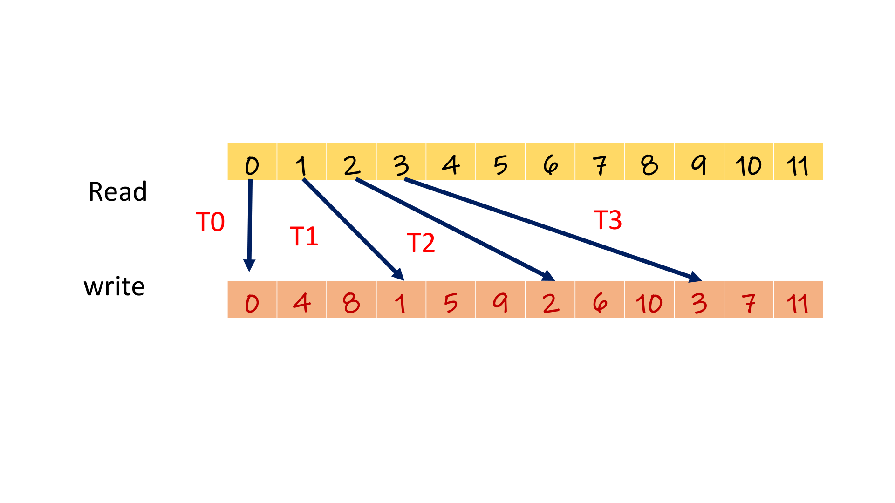
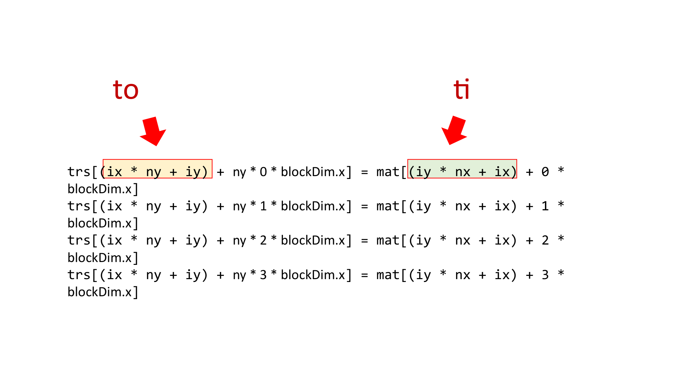

# 第 15 章 实现并优化矩阵转置

第 14 章已经说明，核函数是否正确与内存访问是否高效是两个问题。矩阵转置把这两个问题非常集中地放在一起：

- 从数学上看，它只需交换每个元素的行、列坐标，没有任何复杂计算；
- 从内存上看，连续读取输入的一行，却往往要把这些元素分散写入输出的不同行。

本章先用一个小矩阵把下标算清楚，再实现直接转置，最后讨论循环展开和对角块映射。每种优化都要回答同一个问题：**它到底改变了什么，又没有改变什么？**

## 15.1 先看清一个元素怎样移动

设输入矩阵 `A` 有 3 行 4 列，元素值直接用一维位置编号：

```text
A：3 行 × 4 列
     0   1   2   3
     4   5   6   7
     8   9  10  11
```

矩阵在 CUDA 中通常保存在一维数组里。采用**行主序**时，一行中的元素连续存放，一行结束后才保存下一行：

```text
A 的一维数组：0  1  2  3  4  5  6  7  8  9  10  11
```

转置后，原来的列变成行，输出矩阵 `B` 有 4 行 3 列：

```text
B = A 的转置：4 行 × 3 列
     0   4   8
     1   5   9
     2   6  10
     3   7  11

B 的一维数组：0  4  8  1  5  9  2  6  10  3  7  11
```

以元素 6 为例。它在输入中的坐标是“第 1 行、第 2 列”，转置后必须移动到“第 2 行、第 1 列”：

```text
输入坐标：(row, col) = (1, 2)
输出坐标：(col, row) = (2, 1)
```

把坐标换成一维下标时，要注意输入、输出的行宽不同：

```text
输入每行有 W 个元素：src = row * W + col
输出每行有 H 个元素：dst = col * H + row
```

这里 `H = 3`、`W = 4`，所以元素 6 的位置为：

```text
src = 1 * 4 + 2 = 6
dst = 2 * 3 + 1 = 7
```

输出一维数组的下标 7 确实是 6。

!!! warning "最容易写错的下标"

    输出下标必须使用输入高度 `H`，不能写成 `col * W + row`。方阵测试中，`H == W` 会掩盖这个错误；非方阵则会立即暴露。

更一般地，若输入有 `H` 行、`W` 列，输出就有 `W` 行、`H` 列。对任意 `0 <= row < H`、`0 <= col < W`：

```text
B(col, row) = A(row, col)
src = row * W + col
dst = col * H + row
```

本章所有内核都要求输入与输出使用独立、不重叠的缓冲区，不讨论原地转置。

## 15.2 为什么连续读取会带来跨步写入

仍使用上面的 `3 × 4` 矩阵，只观察输入第一行。假设 4 个 lane 分别处理列 0、1、2、3：

| lane | 输入坐标 | `src` | 输出坐标 | `dst` |
|---:|---|---:|---|---:|
| 0 | `(0,0)` | 0 | `(0,0)` | 0 |
| 1 | `(0,1)` | 1 | `(1,0)` | 3 |
| 2 | `(0,2)` | 2 | `(2,0)` | 6 |
| 3 | `(0,3)` | 3 | `(3,0)` | 9 |

相邻 lane 的输入下标是 `0、1、2、3`，可以形成连续读取；输出下标却是 `0、3、6、9`，相邻地址相隔 `H = 3` 个元素。若元素是 4 字节 `float`，输出地址就相隔 12 字节。

**这不是代码写错了，而是转置坐标关系自然产生的结果：连续读取输入的一行，往往对应跨步写入输出的不同行。**



*图 15.1　以 3 × 4 矩阵的第一行为例，连续读取的 4 个元素需要写入输出的不同行。*

也可以交换线程映射，让相邻 lane 优先处理同一输出行中的元素。两种直接映射的取舍如下：

| 线程 `x` 维对应 | 主体 Warp 的输入地址 | 主体 Warp 的输出地址 |
|---|---|---|
| 输入列 `col` | 连续 | 以 `H` 为元素步长 |
| 输入行 `row` | 以 `W` 为元素步长 | 连续 |

它们只是交换了读取侧和写入侧的访问模式，并没有凭空消除矛盾。本章先使用第一种映射建立正确性基线。

## 15.3 直接实现：一个线程处理一个元素

让线程的 `x` 维负责输入列，`y` 维负责输入行，就可以直接把前两节的坐标关系写成代码：

```cpp
#include <cuda_runtime.h>
#include <cstddef>

__global__ void transposeDirect(const float* __restrict__ input,
                                float* __restrict__ output,
                                int height, int width) {
    const int col = blockIdx.x * blockDim.x + threadIdx.x;
    const int row = blockIdx.y * blockDim.y + threadIdx.y;

    if (row < height && col < width) {
        const std::size_t src =
            static_cast<std::size_t>(row) * width + col;
        const std::size_t dst =
            static_cast<std::size_t>(col) * height + row;
        output[dst] = input[src];
    }
}
```

代码按四步执行：

1. 用 `blockIdx` 和 `threadIdx` 生成输入坐标 `(row,col)`；
2. 排除网格覆盖范围中超出矩阵的线程；
3. 分别计算输入、输出的一维下标；
4. 每个有效线程执行一次读取和一次写入。

`__restrict__` 是程序员向编译器作出的非别名承诺；这里表示 `input` 与 `output` 不重叠，与本章的独立缓冲区前提一致。它只帮助编译器优化，不改变下标计算和边界检查。

启动端按输入形状建立线程块和网格：

```cpp
void launchTransposeDirect(const float* input, float* output,
                           int height, int width) {
    const dim3 block(32, 8);
    const dim3 grid(
        (static_cast<unsigned>(width) + block.x - 1) / block.x,
        (static_cast<unsigned>(height) + block.y - 1) / block.y);

    transposeDirect<<<grid, block>>>(input, output, height, width);
    CUDA_CHECK(cudaGetLastError());
    CUDA_CHECK(cudaDeviceSynchronize());
}
```

`CUDA_CHECK` 沿用第 13 章。`grid.x` 覆盖 `width`，`grid.y` 覆盖 `height`，不能因为矩阵恰好是方阵就交换它们。这里的设备同步用于教学示例中的结果检查，正式性能计时则应区分核函数事件时间与包含主机等待的墙钟时间。

### 为什么尾块不会越界

假设矩阵是 `3 × 5`，块尺寸改为 `(4,2)`：

```text
grid.x = ceil(5 / 4) = 2
grid.y = ceil(3 / 2) = 2
```

网格包含 `2 × 2 = 4` 个线程块，元素坐标实际覆盖 8 列、4 行，大于矩阵的 5 列、3 行：

- 第二个列块生成列 4、5、6、7，只有列 4 有效；
- 第二个行块生成行 2、3，只有行 2 有效；
- 右下角的块同时包含无效行和无效列。

因此，本章这些通用内核必须在读写之前保留：

```cpp
row < height && col < width
```

它同时处理行尾块和列尾块。后续优化可以重新划分工作，但不能遗漏这项边界保护。

## 15.4 循环展开：先看一个线程承担哪些列

直接版本中，一个线程只处理一个元素。循环展开则让一个线程处理同一行中的多个列位置，从而减少处理整个矩阵所需的总线程数。

先不急着看公式。取：

```text
H = 3，W = 10
块尺寸 BX = 2，BY = 2
展开因子 U = 4
```

让每个线程每隔 `BX` 列处理一个元素。前两个物理列块中的工作分配如下：

| `blockIdx.x` | `threadIdx.x` | 首次列 `firstCol` | `k = 0、1、2、3` 时的列 | 有效列 |
|---:|---:|---:|---|---|
| 0 | 0 | 0 | 0、2、4、6 | 全部有效 |
| 0 | 1 | 1 | 1、3、5、7 | 全部有效 |
| 1 | 0 | 8 | 8、10、12、14 | 仅 8 |
| 1 | 1 | 9 | 9、11、13、15 | 仅 9 |

可以看到两个关键点：

1. **一个物理块不再只覆盖 `BX = 2` 列，而是覆盖 `BX × U = 8` 列**；
2. **第二个列块中的许多工作项超出宽度，必须分别检查 `col < width`**。

从这个例子再归纳公式就直观多了：

```text
row      = blockIdx.y * BY + threadIdx.y
firstCol = blockIdx.x * BX * U + threadIdx.x
col[k]   = firstCol + k * BX，k = 0、1、……、U-1

src[k] = row * W + col[k]
dst[k] = col[k] * H + row
```

由于每块覆盖 `BX × U` 列，启动网格也必须相应缩小：

```text
GX = ceil(W / (BX * U))
GY = ceil(H / BY)
```

对应实现如下：

```cpp
template <int U>
__global__ void transposeUnrolled(const float* __restrict__ input,
                                  float* __restrict__ output,
                                  int height, int width) {
    static_assert(U > 0, "unroll factor must be positive");

    const int row = blockIdx.y * blockDim.y + threadIdx.y;
    const int firstCol =
        blockIdx.x * blockDim.x * U + threadIdx.x;

    if (row >= height) {
        return;
    }

#pragma unroll
    for (int k = 0; k < U; ++k) {
        const int col = firstCol + k * blockDim.x;
        if (col < width) {
            const std::size_t src =
                static_cast<std::size_t>(row) * width + col;
            const std::size_t dst =
                static_cast<std::size_t>(col) * height + row;
            output[dst] = input[src];
        }
    }
}
```

`#pragma unroll` 建议编译器展开固定次数循环，但工作划分是否正确的依据是 `firstCol`、`col` 和边界条件，而不是 pragma 本身。启动 `U = 4` 时，`grid.x` 必须按 4 倍块宽计算：

```cpp
constexpr int U = 4;
const dim3 block(32, 8);
const unsigned tileWidth = block.x * U;
const dim3 grid(
    (static_cast<unsigned>(width) + tileWidth - 1) / tileWidth,
    (static_cast<unsigned>(height) + block.y - 1) / block.y);
transposeUnrolled<U><<<grid, block>>>(input, output, height, width);
CUDA_CHECK(cudaGetLastError());
CUDA_CHECK(cudaDeviceSynchronize());
```



*图 15.2　每线程多列展开及其边界处理。*

### 展开没有改变什么

对固定的 `k`，相邻 lane 仍读取相邻列，输入可以保持连续；输出仍以 `H` 为元素步长。展开**没有自动修复跨步写入**。

它改变的是线程工作组织：减少总线程数，让同一线程拥有多个独立加载和存储，增加指令级并行机会，同时也可能增加寄存器使用和尾部被屏蔽的工作项。因此，`U = 1、2、4` 应作为待测参数，而不是预设为越大越好。

## 15.5 对角块映射：只重排块，不改块内下标

直接映射中，物理块坐标就是逻辑数据块坐标：

```text
logicalX = blockIdx.x    // 输入列块
logicalY = blockIdx.y    // 输入行块
```

对角块映射会重新计算 `logicalX、logicalY`，让物理块按照另一种顺序覆盖逻辑数据区域。它**不改变块内的 `threadIdx`、元素边界条件或 Warp 地址关系**，只改变块级访问顺序。

### 先看一个 4 × 4 块网格

一种常见的斜移写法是：

```cpp
const int logicalY = blockIdx.x;
const int logicalX = (blockIdx.x + blockIdx.y) % gridDim.x;
```

当 `gridDim.x = gridDim.y = 4` 时，物理块在不同 `blockIdx.y` 下得到的 `logicalX` 如下，`logicalY` 则始终等于 `blockIdx.x`：

| `blockIdx.y` \ `blockIdx.x` | 0 | 1 | 2 | 3 |
|---|---:|---:|---:|---:|
| 0 | 0 | 1 | 2 | 3 |
| 1 | 1 | 2 | 3 | 0 |
| 2 | 2 | 3 | 0 | 1 |
| 3 | 3 | 0 | 1 | 2 |

例如：

```text
物理块 (1,0) → 逻辑块 (1,1)
物理块 (3,1) → 逻辑块 (0,3)
物理块 (2,3) → 逻辑块 (1,2)
```

把 16 个物理块全部展开后，16 个逻辑坐标各出现一次。也可以从逻辑坐标反推唯一的物理坐标：

```text
blockIdx.x = logicalY
blockIdx.y = (logicalX - logicalY + N) % N
```

这就是“不重不漏”的含义。

求得逻辑块后，元素坐标仍按原方式计算：

```cpp
const int col = logicalX * blockDim.x + threadIdx.x;
const int row = logicalY * blockDim.y + threadIdx.y;
if (row < height && col < width) {
    const std::size_t src =
        static_cast<std::size_t>(row) * width + col;
    const std::size_t dst =
        static_cast<std::size_t>(col) * height + row;
    output[dst] = input[src];
}
```

!!! warning "这个公式要求块网格为正方形"

    它要求 `gridDim.x == gridDim.y == N`，并不要求矩阵元素形状一定是方阵。长条形块网格不能直接套用，否则 `logicalY` 的范围可能与实际行块数不一致。

对角映射的实际收益与设备内存组织、缓存和块调度有关。线程块也不会按源码中的编号顺序保证完成，因此它只能作为一种待测的访问重排方法。

## 15.6 扩展：矩形块网格的逐对角线枚举

如果块网格是任意的 `GX × GY`，可以改用另一种方法：按反对角线 `d = logicalX + logicalY` 枚举逻辑块。它与上一节的模运算斜移是**两种不同的排列算法**，不要把表格和公式混用。

仍以 `3 × 2` 块网格为例。先把物理块写成线性编号：

```text
q = blockIdx.y * GX + blockIdx.x
```

然后按对角线顺序安排 6 个逻辑块：

| 物理线性号 `q` | 对角线 `d` | 对角线内序号 `t` | `(logicalX, logicalY)` |
|---:|---:|---:|---|
| 0 | 0 | 0 | `(0,0)` |
| 1 | 1 | 0 | `(0,1)` |
| 2 | 1 | 1 | `(1,0)` |
| 3 | 2 | 0 | `(1,1)` |
| 4 | 2 | 1 | `(2,0)` |
| 5 | 3 | 0 | `(2,1)` |

六个逻辑块恰好覆盖三列两行，没有重复。

### 从例子归纳对角线范围

对编号为 `d` 的对角线，合法的 `logicalX` 必须同时满足：

```text
0 <= logicalX < GX
0 <= d - logicalX < GY
```

因此，每条对角线的起点、终点和块数为：

```text
xBegin = max(0, d - GY + 1)
xEnd   = min(GX - 1, d)
count  = xEnd - xBegin + 1
```

若 `prefix` 是之前所有对角线的块数，且物理线性号 `q` 落在当前对角线内，则：

```text
t        = q - prefix
logicalX = xBegin + t
logicalY = d - logicalX
```

下面的伪代码按顺序寻找 `q` 所在的对角线，重点是坐标定义，而不是查找性能：

```text
prefix = 0

对 d = 0 到 GX + GY - 2：
    计算 xBegin、xEnd 和 count

    若 q < prefix + count：
        t = q - prefix
        logicalX = xBegin + t
        logicalY = d - logicalX
        返回 (logicalX, logicalY)

    prefix = prefix + count
```

每条对角线的坐标互不重复，各对角线又按 `d` 分段覆盖全部物理线性号。对角线很多时，可以预计算 `prefix` 后使用二分查找，但不能改变坐标定义。

矩形块映射和尾块处理仍是两个独立问题：映射保证逻辑块不重不漏，`row < height && col < width` 保证块内元素不越界。

## 15.7 组合展开与块映射时，按什么顺序检查

两种技术可以组合，但不要同时修改所有下标后再猜结果。正确顺序是：

1. 先按展开后的块宽计算 `GX = ceil(W / (BX * U))` 和 `GY = ceil(H / BY)`；
2. 对这个 `GX × GY` 块网格选择适用的块映射；
3. 用映射后的 `logicalX、logicalY` 计算块原点；
4. 在循环内部继续逐个检查 `col < width`。

展开部分的块原点改为：

```cpp
const int firstCol =
    logicalX * blockDim.x * U + threadIdx.x;
const int row = logicalY * blockDim.y + threadIdx.y;
```

循环仍使用：

```cpp
const int col = firstCol + k * blockDim.x;
```

调试时按“直接版本 → 只展开 → 只改块映射 → 组合”的顺序推进，出错时才能迅速定位是工作覆盖、块坐标还是元素下标的问题。

## 15.8 用一套清单验证正确性与性能

### 正确性：先证明每个元素恰好写一次

串行参考实现放在这里，作为所有设备版本的统一判据：

```cpp
void transposeReference(const float* input, float* output,
                        int height, int width) {
    for (int row = 0; row < height; ++row) {
        for (int col = 0; col < width; ++col) {
            output[static_cast<std::size_t>(col) * height + row] =
                input[static_cast<std::size_t>(row) * width + col];
        }
    }
}
```

测试流程如下：

1. 用可识别坐标的输入初始化。小型 `float` 测试可使用 `input[r * W + c] = r * W + c`；大型测试应注意 `float` 精确整数范围和 `int` 中间计算溢出。
2. 将设备输出初始化为哨兵值，暴露未写元素。
3. 检查核函数启动错误与执行错误，并复制回全部 `W × H` 个输出元素。
4. 与串行参考逐项比较，使用内存检查工具确认尾块没有越界。
5. 对块映射枚举小规模 `q`，断言每个逻辑坐标恰好出现一次。

测试形状至少包括：

- `1 × 1`、单行和单列；
- 明显非方阵，防止 `H/W` 写反被对称性掩盖；
- 行、列不能被块尺寸整除的情况；
- 展开后 `W` 不能被 `BX × U` 整除的情况；
- `GX = 3、GY = 2` 和 `GX = 2、GY = 3` 等矩形块网格。

### 性能：把四个版本放在相同条件下比较

比较直接、展开、对角和组合版本时，应固定矩阵、数据放置、块尺寸、编译选项和正确性检查。使用 CUDA 事件测量核函数区域，预热后重复运行，并单独列出分配、传输和预处理成本。

直接转置的逻辑流量是每个元素一次读取、一次写入：

```text
logicalBytes = 2 * H * W * sizeof(T)
```

循环展开和对角映射都没有减少这份逻辑读写量，实际内存事务还会受到跨步访问、缓存和尾块影响。因此，没有目标设备上的测量，就只能说明工作组织发生变化，不能预设加速比。

## 15.9 本章小结与下一步

矩阵转置先从两条下标开始：

```text
src = row * W + col
dst = col * H + row
```

直接内核让每个线程处理一个元素，**连续读取往往伴随跨步写入**。循环展开减少总线程数并增加每线程独立工作，但**不自动改变这种访问矛盾**；对角块映射只重排逻辑块的覆盖顺序，也**不改变块内 Warp 地址关系**。

如果希望同时改善输入读取和输出写入，就需要改变数据在计算过程中的暂存方式。接下来的共享内存章节将介绍如何先把二维分块装入片上存储，再按另一种顺序写出，并继续处理同步和 Bank 冲突等新问题。
