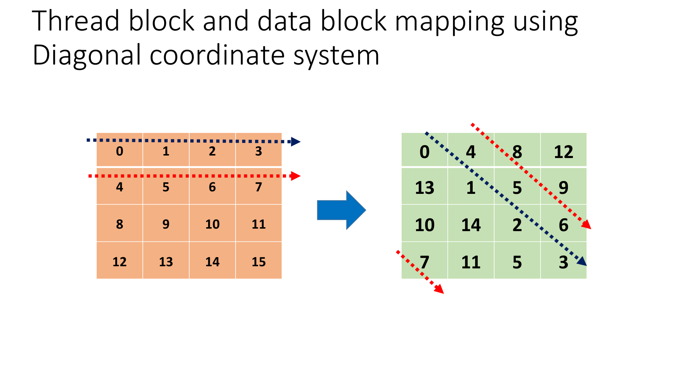

# 第 15 章 矩阵转置：直接实现、循环展开与对角块映射

矩阵转置没有元素间数据依赖，却天然包含两种相反的全局内存访问方向：按输入行连续读取时，输出通常沿列分散写入；按输出行连续写入时，输入又需要跨步读取。因此，转置既适合验证二维线程映射的正确性，也适合检验 warp 地址分析、每线程多元素处理和线程块重排等优化。所有优化都必须先保持索引双射，再讨论可能的性能收益。

## 15.1 行主序存储与转置索引

设输入矩阵 `A` 有 `height = H` 行、`width = W` 列，且 `H`、`W` 均为正整数；输出 `B = Aᵀ` 有 `W` 行、`H` 列。两者都采用行主序，并保存在独立的一维数组中。对任意

\[
0\leq r<H,\qquad 0\leq c<W，
\]

元素满足：

\[
B(c,r)=A(r,c)。
\]

相应的一维下标为：

\[
\boxed{src=rW+c},\qquad
\boxed{dst=cH+r}。
\]

输出下标中使用的是输入高度 `H`，因为输出每一行有 `H` 个元素。把输出误写为 `c * W + r`，是方阵测试可能掩盖、非方阵测试必然暴露的错误。

例如，一个 `2 × 3` 矩阵为：

```text
A = 0  1  2        输入一维数组：0  1  2  3  4  5
    3  4  5

B = 0  3           输出一维数组：0  3  1  4  2  5
    1  4
    2  5
```

输入坐标 `(r,c) = (0,2)` 的元素 2 满足 `src = 0×3+2 = 2`，输出下标为 `dst = 2×2+0 = 4`。这个例子同时验证了坐标交换和输出行宽变化。

串行参考实现可直接作为设备结果的判据：

```cpp
void transposeReference(const float* input, float* output,
                        int height, int width) {
    for (int row = 0; row < height; ++row) {
        for (int col = 0; col < width; ++col) {
            output[static_cast<std::size_t>(col) * height + row] =
                input[static_cast<std::size_t>(row) * width + col];
        }
    }
}
```

以下实现均要求输入与输出使用不重叠的缓冲区。直接交换一维数组中的读写位置并不构成通用的原地转置算法，非方阵原地转置还涉及存储形状变化，不属于这些内核的功能。


*图 15.1　直接转置展示了连续读取与连续写入难以同时满足的访问矛盾。（原课程课件）*

## 15.2 直接内核：一个线程处理一个元素

最基础的映射让 `x` 维负责输入列，`y` 维负责输入行。每个线程独立执行一次读取和一次写入。

```cpp
#include <cuda_runtime.h>
#include <cstddef>

__global__ void transposeDirect(const float* __restrict__ input,
                                float* __restrict__ output,
                                int height, int width) {
    const int col = blockIdx.x * blockDim.x + threadIdx.x;
    const int row = blockIdx.y * blockDim.y + threadIdx.y;

    if (row < height && col < width) {
        const std::size_t src = static_cast<std::size_t>(row) * width + col;
        const std::size_t dst = static_cast<std::size_t>(col) * height + row;
        output[dst] = input[src];
    }
}
```

这是一个完整的设备内核：线程坐标、元素坐标、边界条件、输入下标和输出下标均明确给出。调用端按输入形状建立网格：

```cpp
void launchTransposeDirect(const float* input, float* output,
                           int height, int width) {
    const dim3 block(32, 8);
    const dim3 grid(
        (static_cast<unsigned>(width) + block.x - 1) / block.x,
        (static_cast<unsigned>(height) + block.y - 1) / block.y);

    transposeDirect<<<grid, block>>>(input, output, height, width);
    CUDA_CHECK(cudaGetLastError());
    CUDA_CHECK(cudaDeviceSynchronize());
}
```

其中 `CUDA_CHECK` 沿用第 13 章的错误检查宏。`grid.x` 覆盖列，`grid.y` 覆盖行，二者不能因矩阵恰好是方阵而交换定义。主机在复制回结果后，应对全部 `H × W` 个逻辑元素与 `transposeReference` 比较。

### Warp 读取与写入地址

固定一个主体 warp，令 lane 编号为 `t`。在 `blockDim.x = 32` 且同一 `threadIdx.y` 下：

```text
col = col0 + t
row = row0
src = row0 × W + col0 + t
dst = (col0 + t) × H + row0
    = col0 × H + row0 + t × H
```

因此，输入地址以 `sizeof(float)` 为间隔连续增长，输出地址以 `H × sizeof(float)` 为间隔增长。直接版本具备连续读取和跨步写入；方阵或非方阵都保持这一结构，只是步长数值不同。

若希望优先保证输出连续，可以交换线程映射的职责：让 `x` 维对应输入行 `row`，让 `y` 维对应输入列 `col`，并相应交换网格覆盖范围：

```cpp
// x 维对应 row，y 维对应 col。
const int row = blockIdx.x * blockDim.x + threadIdx.x;
const int col = blockIdx.y * blockDim.y + threadIdx.y;
if (row < height && col < width) {
    output[static_cast<std::size_t>(col) * height + row] =
        input[static_cast<std::size_t>(row) * width + col];
}
```

此时主体 warp 的 `dst` 连续，`src` 以 `W` 为元素步长。两种直接实现的数学操作完全相同，只是将非合并访问从写入侧移到读取侧。它们可作为后续优化的正确性与访问模式基线，不能把其中一种描述为对所有形状都更优。

## 15.3 尾块与网格覆盖不变量

设块尺寸为 `(BX, BY)`，直接内核的网格必须为：

\[
GX=\left\lceil\frac{W}{BX}\right\rceil,\qquad
GY=\left\lceil\frac{H}{BY}\right\rceil。
\]

网格通常会覆盖一个比矩阵更大的逻辑坐标矩形。最后一个列块可能满足 `col >= W`，最后一个行块可能满足 `row >= H`，元素级的 `row < height && col < width` 会同时处理两类尾块。即使采用循环展开或块坐标重排，也不能移除这项检查。

正确性可分解为三个不变量：

1. 每个有效 `(row,col)` 至少被一个线程生成；
2. 没有任何两个有效线程写出同一个 `dst`；
3. 每个无效坐标都在读写之前被排除。

后续优化只改变“哪个线程处理哪个有效元素”或“线程块以何种逻辑顺序编号”，不能破坏这些条件。


*图 15.2　循环展开让每个线程处理多个元素，每个位置仍需独立计算输出下标。（原课程课件）*

## 15.4 循环展开：一个线程处理多个列位置

设展开因子为编译期常量 `U`。一个线程处理同一行中相隔 `blockDim.x` 的 `U` 个元素。对第 `k` 个工作项：

\[
\begin{aligned}
row &= blockIdx.y \times BY + threadIdx.y,\\
firstCol &= blockIdx.x \times BX \times U + threadIdx.x,\\
col_k &= firstCol+k\times BX,\qquad k=0,1,\ldots,U-1,\\
src_k &= row\times W+col_k,\\
dst_k &= col_k\times H+row。
\end{aligned}
\]

一个物理块覆盖的列宽为 `BX × U`，所以启动网格的 `x` 维必须缩小为：

\[
GX=\left\lceil\frac{W}{BX\times U}\right\rceil,
\qquad GY=\left\lceil\frac{H}{BY}\right\rceil。
\]

对应的模板内核如下：

```cpp
template <int U>
__global__ void transposeUnrolled(const float* __restrict__ input,
                                  float* __restrict__ output,
                                  int height, int width) {
    static_assert(U > 0, "unroll factor must be positive");

    const int row = blockIdx.y * blockDim.y + threadIdx.y;
    const int firstCol =
        blockIdx.x * blockDim.x * U + threadIdx.x;

    if (row >= height) {
        return;
    }

#pragma unroll
    for (int k = 0; k < U; ++k) {
        const int col = firstCol + k * blockDim.x;
        if (col < width) {
            const std::size_t src =
                static_cast<std::size_t>(row) * width + col;
            const std::size_t dst =
                static_cast<std::size_t>(col) * height + row;
            output[dst] = input[src];
        }
    }
}
```

以 `U = 4` 为例，启动方式为：

```cpp
constexpr int U = 4;
const dim3 block(32, 8);
const unsigned tileWidth = block.x * U;
const dim3 grid(
    (static_cast<unsigned>(width) + tileWidth - 1) / tileWidth,
    (static_cast<unsigned>(height) + block.y - 1) / block.y);
transposeUnrolled<U><<<grid, block>>>(input, output, height, width);
CUDA_CHECK(cudaGetLastError());
CUDA_CHECK(cudaDeviceSynchronize());
```

`#pragma unroll` 建议编译器展开固定次数循环；即使编译器选择不完全展开，`U` 和工作划分仍决定正确性。优化效果不能依赖 pragma 名称推断。

### 用非方阵和尾块逐项验证

取 `H = 3`、`W = 10`、`BX = BY = 2`、`U = 4`，则：

```text
每块列宽 = 2 × 4 = 8
GX = ceil(10 / 8) = 2
GY = ceil(3 / 2) = 2
```

只考察列映射，`blockIdx.x = 0` 和 `1` 的各线程如下：

| `blockIdx.x` | `threadIdx.x` | `firstCol` | `k = 0,1,2,3` 时的 `col` | 有效列 |
|---:|---:|---:|---|---|
| 0 | 0 | 0 | 0、2、4、6 | 全部有效 |
| 0 | 1 | 1 | 1、3、5、7 | 全部有效 |
| 1 | 0 | 8 | 8、10、12、14 | 仅 8 |
| 1 | 1 | 9 | 9、11、13、15 | 仅 9 |

第一组两个线程覆盖 0 至 7，第二组只补充 8、9，没有重复，也没有遗漏。行方向由 `row = blockIdx.y × 2 + threadIdx.y` 生成：`blockIdx.y = 0` 覆盖行 0、1；`blockIdx.y = 1` 生成行 2、3，其中行 3 被提前返回排除。因此全部 `3 × 10` 个有效元素恰好处理一次，尾部行列均有明确去向。

再检查其中一个边界元素：`row = 1`、`col = 9` 时：

```text
src = 1 × 10 + 9 = 19
dst = 9 × 3 + 1 = 28
```

输出共有 `W × H = 30` 个元素，合法下标为 0 至 29，所以下标 28 合法且对应输出第 9 行、第 1 列。

### 展开能够改变什么

对固定的 `k`，相邻 lane 仍读取相邻列，输入访问可以保持连续；输出仍以 `H` 为元素步长。展开没有自动消除转置的访问矛盾。它可能带来的变化是：

- 减少每元素对应的线程数和部分索引、循环控制工作；
- 让同一线程拥有多个独立加载与存储，增加指令级并行机会；
- 增加同时存活的地址和临时值，可能提高寄存器使用；
- 在尾部产生更多被边界条件屏蔽的工作项。

因此，展开因子应作为待测参数，而不是预设为越大越好。比较 `U = 1、2、4` 时，必须分别使用正确的 `GX`，并验证非方阵、单行、单列和尾块输入。



*图 15.3　对角坐标系重排线程块到数据块的映射，改变块级访问顺序。（原课程课件）*

## 15.5 对角块映射的目的与边界

直接映射使用：

```text
logicalX = blockIdx.x    // 输入列块
logicalY = blockIdx.y    // 输入行块
```

线程块内仍按连续 `threadIdx.x` 访问数据，对角映射只重排**块坐标**，不改变块内 lane 的连续关系。其目的在于让线性编号的物理块对应到不同的逻辑数据区域，调整缓存局部性和设备内存分区上的访问分布，从而评估是否能够缓解某些访问集中现象。

设备内存分区、内存交织方式和块调度均与架构有关，线程块完成顺序也不确定。对角映射不能承诺固定调度顺序，更不能脱离目标设备声称必然提升性能。它首先必须是一个块坐标双射。

### 方阵块网格中的斜移公式

原始斜移形式为：

```cpp
const int logicalY = blockIdx.x;
const int logicalX = (blockIdx.x + blockIdx.y) % gridDim.x;
```

随后使用：

```cpp
const int col = logicalX * blockDim.x + threadIdx.x;
const int row = logicalY * blockDim.y + threadIdx.y;
```

当且仅当 `gridDim.x == gridDim.y == N` 时，可以把该公式直接用于 `N × N` 个逻辑块。其逆映射为：

\[
blockIdx.x=logicalY,\qquad
blockIdx.y=(logicalX-logicalY+N)\bmod N。
\]

任意逻辑块都能反推出唯一物理块，所以映射完整且无重复。这里的限制是**块网格必须为正方形**，不是矩阵元素形状必须为正方形。一个非方阵矩阵若恰好被划分为正方形块网格，也可满足这一条件；反之，长条形块网格不能直接套用该公式，否则 `logicalY` 的范围可能与实际行块数不一致。

## 15.6 适用于矩形块网格的逐对角线映射

对于任意 `GX × GY` 块网格，可以把所有逻辑块按反对角线 `d = logicalX + logicalY` 分组，再为物理块建立线性编号：

\[
q=blockIdx.y\times GX+blockIdx.x,
\qquad 0\leq q<GX\times GY。
\]

对角线编号范围为 `0 <= d < GX + GY - 1`。在给定 `d` 上，合法的 `logicalX` 必须同时满足：

```text
0 <= logicalX < GX
0 <= d - logicalX < GY
```

所以其起点、终点和该对角线块数为：

\[
\begin{aligned}
xBegin &= \max(0,d-GY+1),\\
xEnd   &= \min(GX-1,d),\\
count  &= xEnd-xBegin+1。
\end{aligned}
\]

令 `prefix` 为之前所有对角线的块数。若 `q` 落在当前对角线内，则：

\[
t=q-prefix,\qquad
logicalX=xBegin+t,\qquad
logicalY=d-logicalX。
\]

可直接按以下伪代码求逆，不需要矩阵或块网格为方阵：

```text
输入：GX、GY，以及 q = blockIdx.y × GX + blockIdx.x
prefix = 0

对 d = 0 到 GX + GY - 2：
    xBegin = max(0, d - GY + 1)
    xEnd   = min(GX - 1, d)
    count  = xEnd - xBegin + 1

    若 q < prefix + count：
        t = q - prefix
        logicalX = xBegin + t
        logicalY = d - logicalX
        返回 (logicalX, logicalY)

    prefix = prefix + count
```

每条对角线上的坐标互不重复，各对角线又按 `d` 分段覆盖全部 `q`，最终 `prefix = GX × GY`。因此，该映射包含每个逻辑块恰好一次。伪代码采用顺序查找以突出推导；若对角线数量很大，可依据相同的 `count` 公式预计算前缀并使用二分查找，但不能改变坐标定义。

### `3 × 2` 块网格手工展开

取 `GX = 3`、`GY = 2`，总块数为 6。逐条对角线得到：

| 物理线性号 `q` | 对角线 `d` | 对角线内序号 `t` | `(logicalX, logicalY)` |
|---:|---:|---:|---|
| 0 | 0 | 0 | `(0,0)` |
| 1 | 1 | 0 | `(0,1)` |
| 2 | 1 | 1 | `(1,0)` |
| 3 | 2 | 0 | `(1,1)` |
| 4 | 2 | 1 | `(2,0)` |
| 5 | 3 | 0 | `(2,1)` |

六个输出恰好是 `(0,0)、(0,1)、(1,0)、(1,1)、(2,0)、(2,1)`，覆盖全部三列两行逻辑块，没有重复。将 `q` 还原为物理坐标时，`q = 0、1、2` 对应 `blockIdx.y = 0`，`q = 3、4、5` 对应 `blockIdx.y = 1`，所以映射同时覆盖全部物理块。

求得逻辑块后，直接转置只需替换块原点：

```cpp
// logicalX、logicalY 由上述矩形对角映射求得。
const int col = logicalX * blockDim.x + threadIdx.x;
const int row = logicalY * blockDim.y + threadIdx.y;
if (row < height && col < width) {
    const std::size_t src = static_cast<std::size_t>(row) * width + col;
    const std::size_t dst = static_cast<std::size_t>(col) * height + row;
    output[dst] = input[src];
}
```

块内 warp 地址公式与直接版本相同，因此该映射改善的是块级访问顺序，而不是把跨步的 `dst` 自动变成连续地址。

### 非方阵与双重尾块

设输入为 `H = 10`、`W = 70`，块尺寸仍为 `(32,8)`，则 `GX = ceil(70/32) = 3`、`GY = ceil(10/8) = 2`，正好对应上表。六个逻辑块的尾部情况为：

- `logicalX = 2` 的块从列 64 开始，仅列 64 至 69 有效；
- `logicalY = 1` 的块从行 8 开始，仅行 8、9 有效；
- `(2,1)` 同时是列尾块和行尾块，只有 `6 × 2` 个有效元素；
- 其他坐标即使由对角映射改变了处理次序，也仍由同一个元素级边界条件筛选。

这一例说明，矩形映射和尾块处理是两个独立问题：前者保证块不重不漏，后者保证块内元素不越界，二者不能相互替代。

## 15.7 对角映射与循环展开的组合

两种技术可以组合，但网格尺寸必须先按展开后的工作覆盖范围计算：

\[
GX=\left\lceil\frac{W}{BX\times U}\right\rceil,
\qquad GY=\left\lceil\frac{H}{BY}\right\rceil。
\]

然后对这个 `GX × GY` 网格执行对角映射，并把展开内核中的块起点改为：

```cpp
const int firstCol =
    logicalX * blockDim.x * U + threadIdx.x;
const int row = logicalY * blockDim.y + threadIdx.y;
```

循环内仍使用 `col = firstCol + k * blockDim.x`，并分别检查 `col < width`；行方向仍检查 `row < height`。启动网格的 `GX`、对角映射使用的 `GX` 和列坐标缩放必须来自同一个定义，否则会出现重复块或漏块。

组合后的验证顺序应保持清晰：先令 `U = 1` 验证对角映射，再令对角映射退化为直接块坐标以验证展开，最后组合两者。这样出现错误时，可以区分是块覆盖范围、块坐标双射还是单线程多元素索引的问题。

## 15.8 正确性与性能的完整验证

转置测试不应只使用边长等于块尺寸整数倍的方阵。至少应覆盖：

- `1 × 1`、单行 `1 × W`、单列 `H × 1`；
- `W < BX` 或 `H < BY`，使网格只有一个方向或两个方向都只有尾块；
- `W`、`H` 分别不能被 `BX`、`BY` 整除；
- 对展开版本，额外覆盖 `W` 不能被 `BX × U` 整除的情况；
- 块网格为长方形的情况，例如 `GX = 3、GY = 2`，以及反向的 `GX = 2、GY = 3`；
- 输入输出尺寸差异明显的非方阵，防止错误的 `height`、`width` 被对称性掩盖。

验证流程应包含以下步骤：

1. 用可唯一识别坐标的输入初始化，例如 `input[r * W + c] = r * W + c`；
2. 将设备输出初始化为哨兵值，以暴露未写元素；
3. 运行内核并检查启动错误与执行错误；
4. 复制回全部 `W × H` 个输出元素，与串行参考实现逐项比较；
5. 使用 CUDA 内存检查工具确认尾块没有越界读写；
6. 对小网格枚举 `q`，断言逻辑块数量等于 `GX × GY`，且每个坐标只出现一次。

性能比较则应固定输入、线程块尺寸、数据放置和正确性检查，分别测量直接、展开、对角和组合版本。CUDA 事件可包围核函数区域，主机与设备之间的传输、分配及布局预处理应另行列出。重复运行前需要预热，报告中应给出设备、编译配置、矩阵形状和计时方法。没有这些测量时，只能陈述访问模式发生了变化，不能给出虚构的加速比或实测结论。

直接转置的理想逻辑流量为每个元素一次读取和一次写入，即：

\[
B_{logical}=2\times H\times W\times sizeof(T)。
\]

可以用它计算算法逻辑带宽，但实际事务量仍受非合并访问、缓存和尾块影响。循环展开不会减少这份逻辑读写量，对角映射也不会；它们是否改善时间，需要由目标设备上的证据决定。

## 15.9 第三部分总结

内存策略决定数据在哪里以及如何迁移。显式复制、页锁定缓冲、零拷贝和统一内存分别调整了数据位置、传输可见性和管理复杂度，但都没有消除主机—设备互连成本。全局内存优化进一步要求从 warp 地址集合分析读取和写入，AoS/SoA 则表明数据布局可以直接改变这一集合。

矩阵转置把这些原则集中到二维索引中：直接实现提供正确性基线；循环展开改变每线程工作量，却不自动修复跨步写入；对角块映射重排块级访问顺序，也不改变块内 warp 的基本地址关系。任何版本都必须覆盖非方阵和尾块，并以索引双射和串行参考结果保证正确性。

若需要同时获得连续的输入读取和连续的输出写入，可在后续共享内存技术中先把二维分块加载到片上，再改变块内读取顺序并写出。共享内存容量、同步和存储体冲突将成为下一阶段需要处理的新约束。
