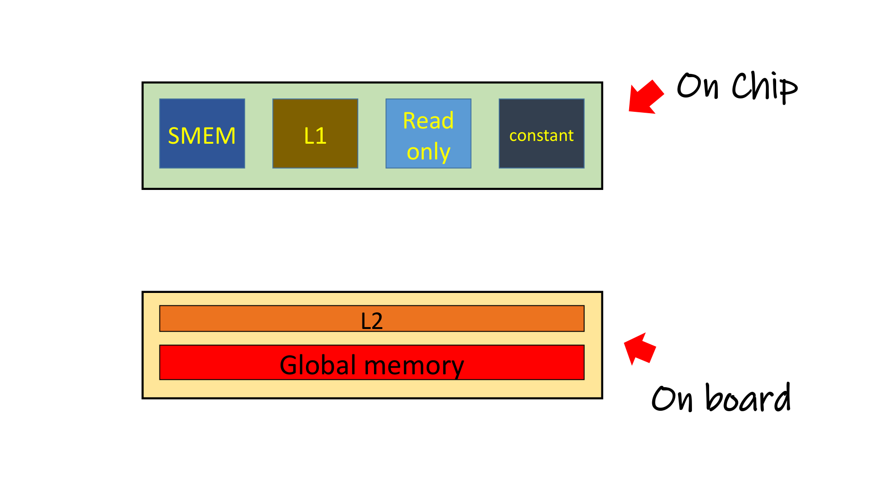
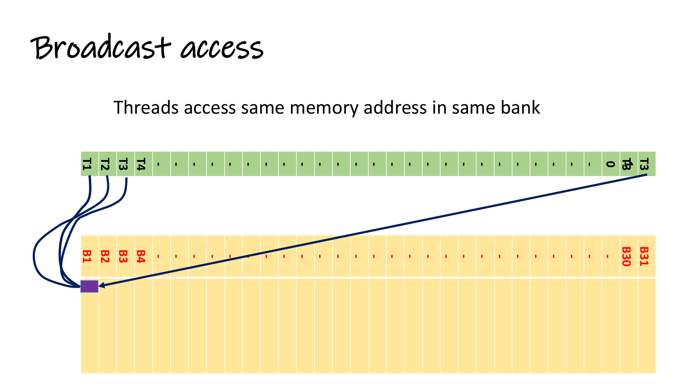
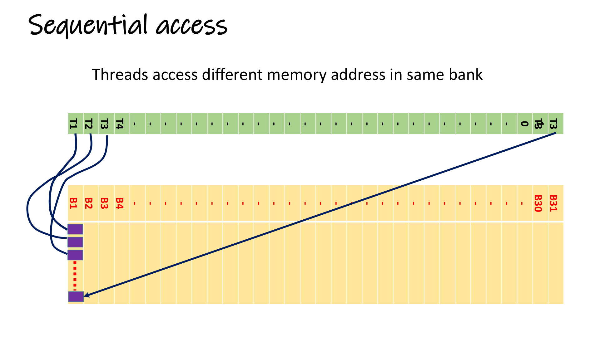
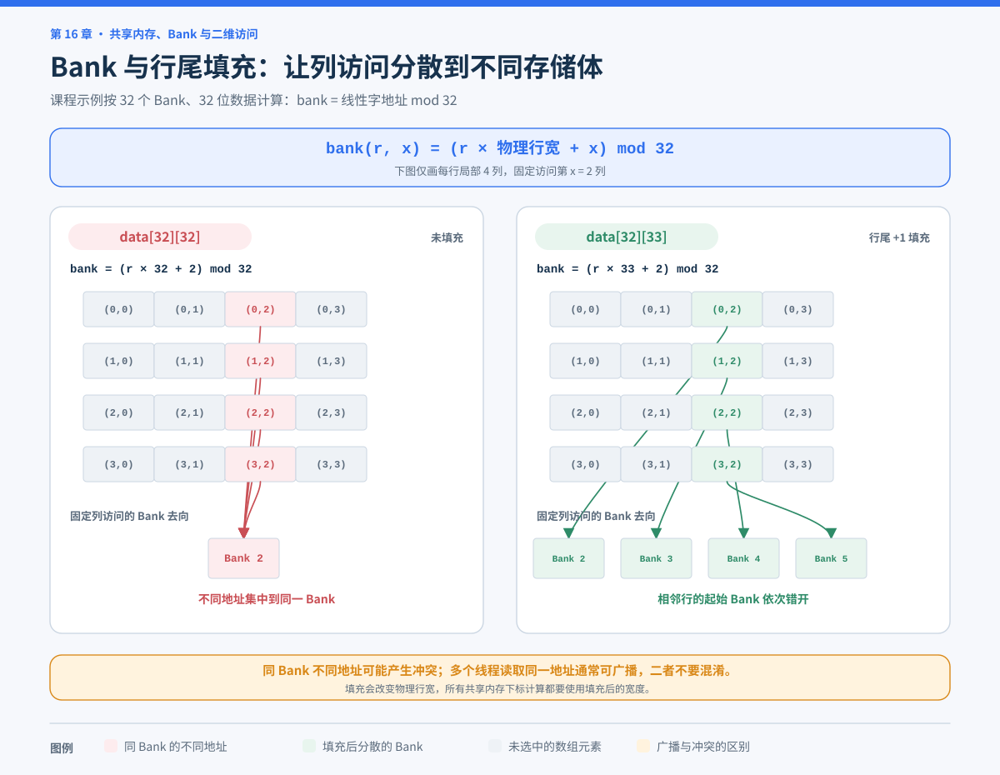

# 第 16 章 理解共享内存与 Bank 冲突

全局内存优化强调对齐与合并访问，但并非所有算法都能让每一次全局访问保持理想模式。矩阵转置需要改变元素顺序，归约需要反复交换中间结果，模板计算则会多次使用相邻元素。这类问题适合把一部分数据显式搬入片上存储，在片内完成重用或重排，再把结果写回全局内存。共享内存正是实现这一策略的基础。



*图 16.1　共享内存位于 SM 片上，与板载全局内存及硬件管理缓存承担不同作用。*

## 块内可见的显式片上存储

共享内存位于流式多处理器（SM）一侧，由同一个线程块中的线程共同访问。它的生命周期与线程块一致：块开始执行时获得存储空间，块结束后其中的内容不再可供其他块使用。不同线程块不能依靠各自的共享数组交换数据，跨块结果仍须写入全局内存，或采用 CUDA 明确提供的其他协作机制。

共享内存与硬件自动管理的缓存有本质区别。程序员不仅决定是否缓存，还决定装入哪些元素、采用什么布局、哪些线程写入以及何时可以读取。因此，它通常承担三类工作：

- **块内通信**：一个线程写入部分结果，其他线程在同步后读取。
- **显式数据重用**：把会被多次访问的全局数据保留在片上，避免重复访问高延迟存储层级。
- **局部数据重排**：在片上交换索引或调整布局，使全局内存两侧的访问都尽量连续。

低延迟并不意味着使用共享内存必然加速。若一个元素只被使用一次，先写共享内存再读出反而增加了指令；若分块占用过多片上空间，同一 SM 能驻留的线程块数量还可能下降。共享内存的收益必须同时扣除装载、同步、额外容量和占用率变化的成本。

下面的核函数把每个块的首元素加到该块的各个有效元素上。它同时展示了共享内存的块内广播、全局索引和尾块边界处理。

```cpp
constexpr int kBlockSize = 256;

__global__ void add_block_first(const float* input,
                                float* output,
                                int n) {
    __shared__ float staging[kBlockSize];

    const int tid = threadIdx.x;
    const int gid = blockIdx.x * kBlockSize + tid;

    // 所有线程都初始化自己的共享元素，包括尾块中的无效线程。
    staging[tid] = (gid < n) ? input[gid] : 0.0f;
    __syncthreads();

    if (gid < n) {
        // staging[0] 由 0 号线程写入，其他线程必须在屏障后读取。
        output[gid] = staging[tid] + staging[0];
    }
}

// n > 0；主机启动配置固定为每块 256 个线程。
const int blocks = (n + kBlockSize - 1) / kBlockSize;
add_block_first<<<blocks, kBlockSize>>>(input, output, n);
```

`tid` 只用于当前块的共享数组，`gid` 才用于全局输入和输出。不能把 `gid` 直接用作 `staging` 的下标，因为每个块拥有的都是独立的 256 元素数组。尾块中 `gid >= n` 的线程不访问全局数组，却仍执行共享元素赋值和 `__syncthreads()`，从而既避免越界，又保证块内所有线程到达同一屏障。

这个例子中的 `staging[0]` 会被多个线程读取。这样的同地址读取与下面所说的“同 Bank 不同地址冲突”不是同一种情况。



*图 16.2　同地址读取可通过广播完成，不应与同 Bank 不同地址冲突混淆。*



*图 16.3　同一线程束访问同一 Bank 中的不同地址可能产生存储体冲突。*

## Bank：按 Warp 分析的并行存储组织

共享内存通常按 32 个存储体（Bank）组织，使一个 Warp 中不同通道的访问能够并行得到服务。对于常见的 32 位字，可用下面的简化模型理解地址映射：

\[
\operatorname{bank}(\text{address})=
\left(\frac{\text{byte address}}{4}\right)\bmod 32
\]

数组元素在地址空间中连续放置时，连续的 32 位字会轮转到不同 Bank。以 `float data[]` 为例，若数组首地址按 4 字节对齐且起始 Bank 为 0，则 `data[lane]` 在一个完整 Warp 中依次落在 Bank 0 至 Bank 31。

一次 Warp 级共享内存访问主要有三种典型情况：

| 地址分布 | 服务方式 | 性能含义 |
|---|---|---|
| 不同线程访问不同 Bank | 可并行服务 | 通常没有 Bank 冲突 |
| 多个线程读取同一地址 | 读取结果可广播或多播 | 不应误判为同 Bank 冲突 |
| 多个线程访问同一 Bank 中的不同字 | 请求需要拆分为多个无冲突阶段 | 发生 Bank 冲突，有效带宽下降 |

Bank 冲突影响性能，不改变 C++ 层面数组读写的正确性。真正可能破坏结果的是缺少同步造成的读写竞争，两者必须分别排查。

### 用步长推导冲突，而不是凭感觉判断

若通道 `lane` 访问 `data[base + lane * stride]`，在 32 位字的简化模型下，其 Bank 可由下式估计：

\[
b_{lane}=(base+lane\times stride)\bmod 32
\]

步长为 1 时，一个完整 Warp 通常覆盖 32 个不同 Bank。步长为 32 时，所有地址对 32 取模的结果相同，会形成严重的同 Bank 不同地址访问。更一般地，`stride` 与 32 的公因数越大，一个 Warp 能覆盖的 Bank 通常越少；奇数步长与 32 互质，常能遍历全部 Bank。

该模型用于解释机制，而不是替代具体架构文档。更宽的数据类型、64 位访问模式以及不同架构的服务规则会改变事务计数。在支持 8 字节 Bank 配置的部分 Kepler 设备上，还必须同时考虑数据宽度和 Bank 宽度，不能把 32 位 `float` 的公式直接套到所有类型和设备上。



*图 16.4　行尾填充改变 Bank 映射。*

例如改为 `float tile[32][33]` 后，在上述简化模型中，固定 `y`、令 `x` 随 lane 递增时，`tile[x][y]` 的 Bank 为 `(33*x+y) mod 32 = (x+y) mod 32`，完整 Warp 因而可覆盖 32 个 Bank；代价是每行多一个 `float`，整个数组增加 128 字节。

## 二维共享数组为什么有行列差异

C/C++ 的二维数组采用行主序。对于

```cpp
__shared__ float tile[32][32];
```

元素 `tile[y][x]` 的逻辑线性位置为 `y * 32 + x`。若一个 Warp 的 32 个通道对应固定的 `y` 和连续的 `x`，访问 `tile[y][x]` 就得到连续地址；若同一组通道改为访问 `tile[x][y]`，地址变为 `x * 32 + y`，相邻通道之间相隔 32 个 `float`，在简化模型下全部落入同一 Bank。

下面的微基准完成一次片上转置，使“按行写入、按列读取”的差异直接出现在代码中。示例仍使用全局坐标和边界检查，启动时再固定为一个 `32 × 32` 线程块。

```cpp
constexpr int kMatrixSize = 32;

__global__ void set_row_read_col(const float* input,
                                 float* output,
                                 int n) {
    __shared__ float tile[kMatrixSize][kMatrixSize];

    const int tx = threadIdx.x;
    const int ty = threadIdx.y;
    const int x = blockIdx.x * kMatrixSize + tx;
    const int y = blockIdx.y * kMatrixSize + ty;

    // 逻辑元素全部赋值；本例启动尺寸恰好覆盖整个数组。
    tile[ty][tx] = (x < n && y < n) ? input[y * n + x] : 0.0f;
    __syncthreads();

    if (x < n && y < n) {
        output[y * n + x] = tile[tx][ty];
    }
}

// 本微基准处理 32 × 32 输入。
dim3 block(kMatrixSize, kMatrixSize);
set_row_read_col<<<1, block>>>(input, output, kMatrixSize);
```

加载阶段的 `tile[ty][tx]` 在一行内连续，读取阶段的 `tile[tx][ty]` 则沿列跨步。屏障保证任何线程读取其他线程装入的元素之前，整个块的写入均已完成。输出仍按 `y * n + x` 写出，交换的只是共享数组索引，因此该核函数得到的是转置结果。

“行访问快、列访问慢”只是这个特定映射下的结论。若改变线程线性化方式、数组行宽或元素大小，Bank 分布也会改变。严谨分析应写出整个 Warp 的地址序列，而不能只盯着某一条 `tile[y][x]` 表达式。

## 行、列访问实验矩阵

二维访问实验不应只比较核函数总时间。微基准规模很小时，启动开销会掩盖访问差异，更有解释力的指标是每次共享加载或存储请求所需的事务数，以及新工具中对应的 Bank 冲突统计。

| 版本 | 共享写入模式 | 共享读取模式 | 主要观察对象 | 简化模型下的预期 |
|---|---|---|---|---|
| `setRowReadRow` | 行 | 行 | 读、写请求 | 两者通常均无 Bank 冲突 |
| `setRowReadCol` | 行 | 列 | 读请求 | 写入顺畅，列读出现严重冲突 |
| `setColReadRow` | 列 | 行 | 写请求 | 列写出现严重冲突，读取顺畅 |
| 填充后的行列版本 | 行 | 列 | 读请求与额外容量 | 物理行宽改变后，列读冲突下降 |

原课程的 GTX 970 微基准中，`32 × 32` 数组的行写列读版本表现为每次共享读请求约 32 个事务、每次写请求约 1 个事务；列写行读版本的读写计数相反；行写行读版本两者均约为 1。这些数值属于指定数组、线程映射、工具和设备，不能直接当作其他架构的固定结果。

实验时应保持矩阵尺寸、数据类型、块形状和输出校验不变，只改变一个访问维度。旧版分析工具中的 `shared_load_transactions_per_request` 与 `shared_store_transactions_per_request` 可帮助复现原始观察；新版工具应选用含义相近的共享内存事务和冲突指标，并核对指标定义。

## 从容量到账本

共享内存按块计入 SM 的资源预算。静态声明和动态声明都会占用这份预算，二维数组额外增加的填充列也不例外。块使用量增加后，可能减少同时驻留的块数，进而影响隐藏全局内存延迟的能力。设计时应记录以下四项：

1. 每块共享内存字节数，包括对齐和填充；
2. 每块线程数及一个 SM 上可驻留的块数；
3. 每个元素被重用的次数，以及省去的全局访问量；
4. 引入的屏障、Bank 冲突和额外索引计算。

至此，共享内存的价值已经不只是“速度更快的一片数组”，而是一套可计算的数据布局与协作方案。后续章节将在此基础上完善静态与动态分配、填充、同步和块内归约，并把行宽调整应用到完整的矩阵转置中。
