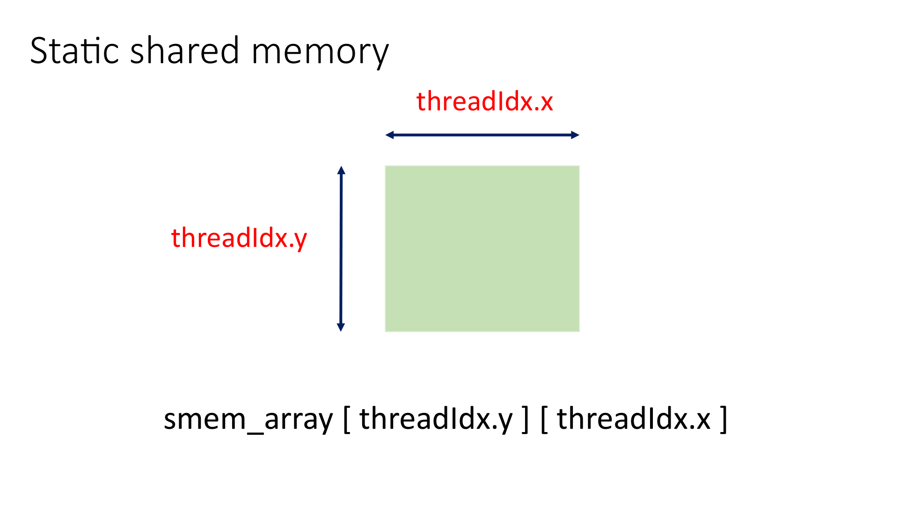
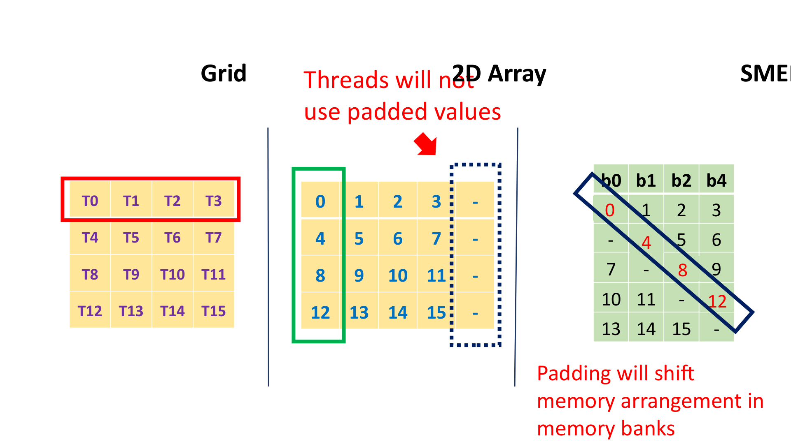
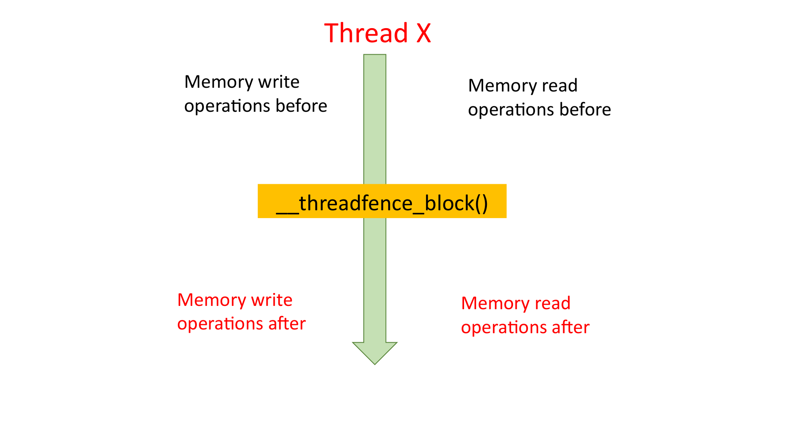
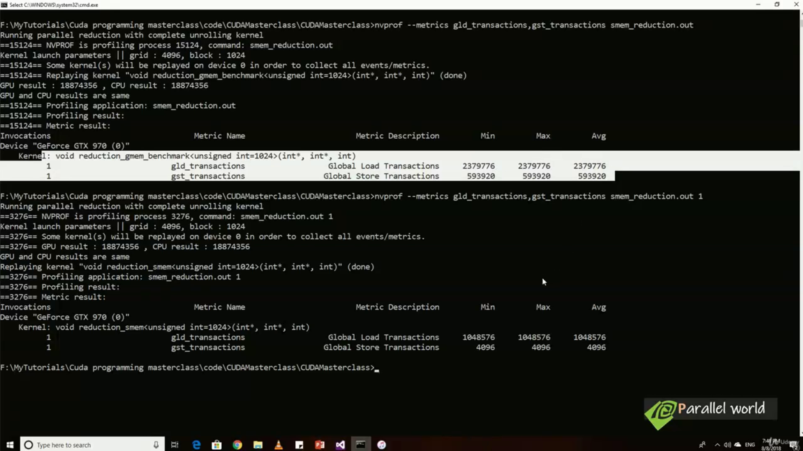

# 第 17 章 用共享内存完成块内归约

共享内存算法通常同时面对四个问题：数组容量在何时确定，二维数据采用什么物理布局，线程之间如何建立执行顺序，以及中间结果怎样在片内合并。这四个问题相互关联。分配方式决定可用字节数，填充改变索引和容量，同步保护跨线程数据依赖，归约则把前三者组合成一个完整的块级计算。



*图 17.1　静态共享内存在声明时确定数组形状，二维索引应与实际线程组织一致。*

## 静态分配与动态分配

### 编译期固定的存储形状

静态共享内存在源码中给出数组尺寸，适合分块形状固定的算法：

```cpp
__shared__ float tile[16][17];
__shared__ float partial[256];
```

数组大小必须是编译期可确定的常量。编译器能够据此报告每块的静态共享内存需求，索引也通常较直观。静态并不意味着“免费”或“必然更快”，这些字节同样参与 SM 的驻留资源核算。

### 启动时确定的存储容量

动态共享内存使用 `extern __shared__` 声明，实际字节数由核函数执行配置的第三个参数指定：

```cpp
extern __shared__ float staging[];

const int threads = 256;
const size_t shared_bytes = threads * sizeof(float);
kernel<<<blocks, threads, shared_bytes>>>(input, output, n);
```

这里的 `staging` 是运行时分配区域的一维视图。即使逻辑上要保存二维矩阵，也需要自行完成行主序索引，例如用 `tile[y * physical_width + x]` 表示 `(y, x)`。核函数不知道主机传入了多少字节，所有边界仍由程序自行保证。

同一段动态共享内存可以划分为多个逻辑数组，但多个 `extern __shared__` 声明通常指向同一动态区域，并不会自动得到彼此独立的空间。手动切分时必须计算偏移、总字节数和对齐；主机端与设备端若使用不同的尺寸假设，就会产生越界或数据覆盖。

两种分配方式的选择主要取决于形状是否固定以及调用方是否需要调整容量，而不是访问速度的名称差异。超过设备默认动态共享内存上限时，还需按照具体架构查询限制并完成相应的 CUDA 属性配置，不能通过任意增大第三个启动参数绕过硬件约束。



*图 17.2　行尾填充改变物理行宽，使相邻行的访问错位到不同 Bank。*

## 填充：修改物理行宽而非逻辑矩阵

第 16 章的 `float tile[32][32]` 在特定列访问映射下会产生严重 Bank 冲突。最直接的布局修正是在每行末尾增加一个不使用的新列：

```cpp
__shared__ float tile[32][33];
```

逻辑矩阵仍为 `32 × 32`，物理行宽却由 32 变为 33。相邻行同一列的线性地址相差 33 个 `float`，在 32 位字、32 Bank 的简化模型下，相邻行会错开一个 Bank。原本集中在一个 Bank 的列访问由此分散开来。

对于动态一维数组，同样的布局必须显式写入每个地址公式：

```cpp
const int physical_width = blockDim.x + 1;
const int row_index = threadIdx.y * physical_width + threadIdx.x;
const int col_index = threadIdx.x * physical_width + threadIdx.y;
```

这两行适用于逻辑行、列下标均小于 `blockDim.x` 的方形分块。启动时分配的容量必须包含填充，例如 `32 × 33` 个元素需要 `32 * 33 * sizeof(float)` 字节，而不能仍按 `32 * 32` 分配。所有读写都应使用同一个 `physical_width`；若一部分索引使用 32、另一部分使用 33，元素就会错位。

填充列只负责改变后续行的起始位置，不保存矩阵的有效列。只要程序从不读取它，就不必为它赋予计算意义；但所有会被读取的逻辑分块元素，包括矩阵边界外的补位元素，都必须初始化。填充也不改变全局输入、输出的真实行宽，全局索引仍使用原矩阵宽度。

一个 `32 × 32` 的 `float` 分块占用 4096 字节，改成 `32 × 33` 后占用 4224 字节，额外成本为 128 字节。这个交换常常值得，但并非任何数据宽度、任何步长都恰好填充 1 个元素。填充量应由 Warp 地址分布决定，并通过冲突指标验证。



*图 17.3　Fence 约束内存操作顺序，但并不等同于让其他线程同时到达的屏障。*

## 同步建立顺序，Fence 不等于屏障

CUDA 采用弱顺序内存模型。一个线程写入共享内存，并不意味着另一个线程可以在任意时刻自动观察到符合算法需要的执行顺序。`__syncthreads()` 同时承担块内执行屏障和块内共享数据可见性协调的作用：在屏障前完成的块内写入，对屏障后的块内读取可见。

### 屏障必须由整个块共同到达

归约中常见的正确结构是把“是否工作”与“是否同步”分开：

```cpp
if (tid < stride) {
    partial[tid] += partial[tid + stride];
}
__syncthreads();
```

条件只限制更新的线程，屏障则由块内所有线程执行。若不同线程因条件分支走向不同的 `__syncthreads()`，或在屏障前提前返回，就可能产生未定义行为或挂起。尾块中的无效线程可以跳过全局写入，但不能因此跳过其他线程依赖的屏障。

屏障保护的是阶段之间的依赖。例如，装载后、跨线程读取前需要一次屏障；循环复用同一共享缓冲区时，在下一轮覆盖之前还需确保所有线程已完成上一轮读取。多放一个屏障不能修复错误索引，少放一个屏障则可能使程序只在某些时序下偶然正确。

### Fence 与同步的作用范围不同

`__threadfence_block()` 和 `__threadfence()` 用于约束调用线程内存操作的观察顺序，前者面向块内观察者，后者面向设备范围内的观察者。它们不会让一组线程等待彼此，因此不能替代归约中的 `__syncthreads()`。仅添加 Fence 或 `volatile` 也不能自动构造出完整的跨线程协议；算法仍须明确谁写、谁读、在哪个执行点读，以及采用何种原子性或屏障保证。

主机和设备时间线上的同步同样不能混用：

| 机制 | 协调范围 | 不能替代的能力 |
|---|---|---|
| `__syncthreads()` | 同一线程块 | 不能同步不同线程块 |
| `cudaDeviceSynchronize()` | 设备上的相关主机等待 | 不能保护块内共享数组的阶段依赖 |
| `cudaStreamSynchronize()` | 指定流 | 不等同于等待所有流 |
| 事件等待与 `cudaStreamWaitEvent()` | 事件及流之间的依赖 | 不是线程级数据竞争修复手段 |

## 块内树形归约

归约把许多输入元素合并为一个结果。求和、最大值和乘积都属于归约，区别在合并运算及其单位元。若每一轮中间结果都写入全局内存，会产生大量片外往返；共享内存可以把一个块的主要合并阶段保留在片上，只为每个块写一个部分结果。

下面给出完整的块内求和核函数。它固定每块 256 个线程，支持任意正整数 `n`，并显式初始化尾块的所有共享元素。

```cpp
constexpr int kBlockThreads = 256;

__global__ void reduce_block_sum(const float* input,
                                 float* block_sums,
                                 int n) {
    __shared__ float partial[kBlockThreads];

    const int tid = threadIdx.x;
    const int gid = blockIdx.x * kBlockThreads + tid;

    // 加法单位元 0 使尾块无效位置不贡献结果。
    partial[tid] = (gid < n) ? input[gid] : 0.0f;
    __syncthreads();

    // kBlockThreads 为 2 的幂，每一轮都能恰好平分剩余区间。
    for (int stride = kBlockThreads / 2; stride > 0; stride >>= 1) {
        if (tid < stride) {
            partial[tid] += partial[tid + stride];
        }
        __syncthreads();
    }

    if (tid == 0) {
        block_sums[blockIdx.x] = partial[0];
    }
}

// n > 0，block_sums 至少能保存 blocks 个 float。
const int blocks = (n + kBlockThreads - 1) / kBlockThreads;
reduce_block_sum<<<blocks, kBlockThreads>>>(input, block_sums, n);
```

### 2 的幂前提属于块尺寸，不属于输入长度

上述循环从 128 开始，依次使用 64、32、16、8、4、2、1 的步长。它要求参与树形平分的线程数为 2 的幂；本例通过固定的 `kBlockThreads = 256` 和固定启动尺寸满足这一前提。输入长度 `n` 不必是 2 的幂，因为尾块已经用 0 补齐。

若把核函数改成运行时 `blockDim.x`，就必须在主机端验证 `blockDim.x` 是 2 的幂，并保证共享数组至少有对应容量。不能一边允许任意块大小，一边继续使用这种无条件对半折分的循环。非 2 的幂块需要补齐到下一个 2 的幂，或改用明确处理奇数个元素的归约算法。

对于最大值、最小值等运算，不能直接照搬数值 0。应选用对应运算的单位元，或只让有效元素参与合并。对于浮点求和，树形顺序与串行顺序不同，结果比较应采用合理的绝对误差和相对误差，而不是默认要求位级一致。

### 全局结果仍需块间阶段

该核函数只产生 `blocks` 个部分和，并未直接得到整个数组的总和。后续可再次启动归约核函数处理这些部分和，直到只剩一个结果。`__syncthreads()` 不可能把这一步合并到当前核函数内，因为它不具备跨块同步能力。

在装载阶段让每个线程先累加多个全局元素，可以减少块数和中间结果数量；在最后几轮使用 Warp Shuffle，则可进一步减少共享内存访问和块级屏障。这些优化都必须保留相同的边界、单位元和同步语义。



*图 17.4　共享内存归约前后的内存事务对比。*

## 实验矩阵：把机制与计数对应起来

共享内存归约的实验应至少包含全局中间结果版、共享内存树形版，以及后续的多元素装载或 Warp 优化版。固定输入、块尺寸和输出校验后，再比较时间、全局事务、共享事务和屏障成本。

| 实验版本 | 固定条件 | 重点指标 | 用于验证的机制 |
|---|---|---|---|
| 全局内存树形归约 | 相同输入与分块 | 全局加载/存储事务、时间 | 中间结果反复经过片外层级的成本 |
| 共享内存树形归约 | 相同输入与分块 | 全局事务、共享事务、时间 | 片内合并是否减少全局往返 |
| 每线程预累加多个元素 | 相同总输入 | 块数、指令数、占用率、时间 | 全局装载合并与额外串行工作的平衡 |
| 共享内存加 Warp 末级归约 | 相同数学结果 | 共享事务、同步开销、寄存器 | Warp 内寄存器通信的收益 |

原课程的一组记录中，全局中间结果版本耗时超过约 500 μs，共享内存版本约为 320 μs；全局加载事务由约 238 万降至约 105 万，全局存储事务由约 59.4 万降至 4096。该结果清晰展示了共享内存减少全局往返的机制，但具体数值依赖当时的实现、输入、块大小、缓存配置、GPU 和分析工具，不能作为新设备的性能承诺。

性能实验之外，还应设置 `n = 1`、`n = 255`、`n = 256`、`n = 257` 以及非 2 的幂大规模输入，检查尾块补零和块间续归约。块尺寸则必须始终满足当前实现的 2 的幂前提。正确性、资源使用和性能计数共同构成完整结论，单独一次耗时比较不足以说明优化原因。
