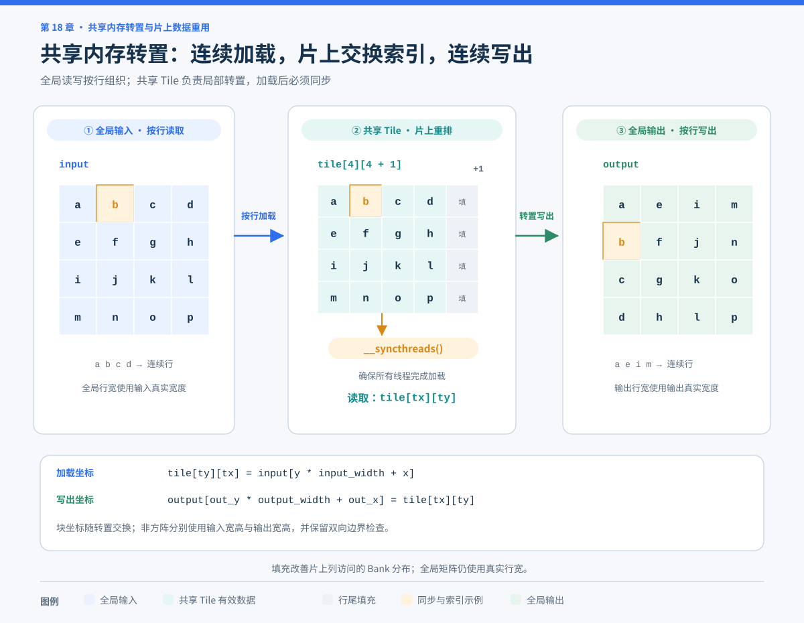
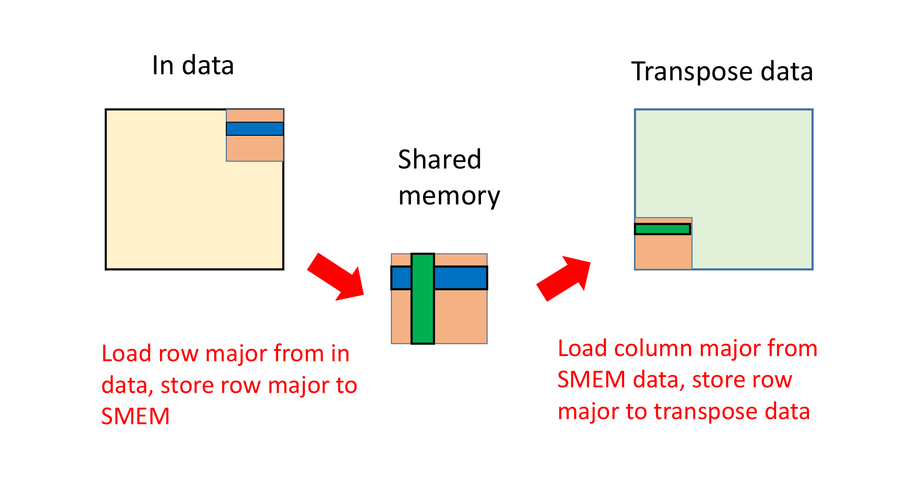
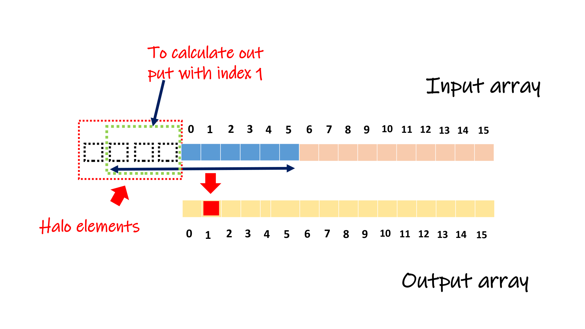
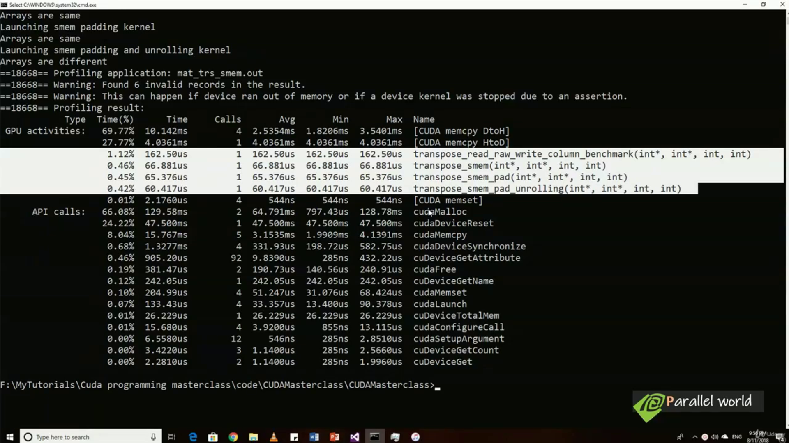

# 第 18 章 用共享内存优化矩阵转置

矩阵转置和模板计算代表了两种典型的片上数据重用。前者利用共享内存改变访问顺序，使全局读取与全局写出都能保持连续；后者把重复使用的输入邻域放入共享内存，并让所有线程广播读取同一组只读系数。填充与循环展开可以进一步减少 Bank 冲突和控制开销，但前提是坐标、边界和同步仍然完整。



*图 18.1　共享内存转置采用连续加载、片上交换索引、连续写出的流程，并区分共享数组填充行宽与全局矩阵真实行宽。*



*图 18.2　共享内存转置按行加载、按列读取，再按行写出，将局部重排留在片上。*

## 共享内存转置：把不连续访问留在片上

对于行主序输入 `input[y * n + x]`，直接转置通常把元素写到 `output[x * n + y]`。若相邻线程读取连续的 `x`，输入读取很理想，输出却沿列跨步；交换线程映射后，不连续访问只会转移到输入一侧。共享内存分块把这个矛盾拆成两个阶段：

1. 按输入行方向连续读取全局内存，并按行写入共享分块；
2. 在屏障后交换共享数组索引，再按输出行方向连续写回全局内存。

这样，转置所需的列访问发生在片上，而全局内存两侧都保持行方向访问。

### 方阵实现及其边界

下面的核函数只实现 **`n × n` 方阵转置**。它支持 `n` 不能被分块尺寸整除的情况，但不是通用非方阵实现。

```cpp
constexpr int kTile = 32;

__global__ void transpose_square(const float* input,
                                 float* output,
                                 int n) {
    // 物理行宽为 33，最后一列只用于缓解 Bank 冲突。
    __shared__ float tile[kTile][kTile + 1];

    const int tx = threadIdx.x;
    const int ty = threadIdx.y;

    const int input_x = blockIdx.x * kTile + tx;
    const int input_y = blockIdx.y * kTile + ty;

    // 所有逻辑分块元素均被赋值，越界位置用 0 初始化。
    tile[ty][tx] = (input_x < n && input_y < n)
                       ? input[input_y * n + input_x]
                       : 0.0f;
    __syncthreads();

    // 输出块的块坐标交换，输出元素仍在原线程块内连续写出。
    const int output_x = blockIdx.y * kTile + tx;
    const int output_y = blockIdx.x * kTile + ty;

    if (output_x < n && output_y < n) {
        output[output_y * n + output_x] = tile[tx][ty];
    }
}

// n > 0；输入和输出均按 n × n 行主序矩阵分配。
dim3 block(kTile, kTile);
dim3 grid((n + kTile - 1) / kTile,
          (n + kTile - 1) / kTile);
transpose_square<<<grid, block>>>(input, output, n);
```

加载坐标 `(input_x, input_y)` 定位输入块，输出坐标 `(output_x, output_y)` 则交换了 `blockIdx.x` 与 `blockIdx.y`。共享数组中的 `tile[tx][ty]` 完成块内转置，物理行宽 `kTile + 1` 让这种列读取不再沿用未填充数组的 Bank 映射。

**非整除边界不能依赖“稍后不会被使用”的未初始化共享元素。** 本例用条件表达式给整个 `32 × 32` 逻辑分块赋值，包括输入矩阵外的位置，然后所有线程执行同一个屏障。额外填充列从不读取，因此无需参与计算；若未来代码会读取这些位置，也必须相应初始化。输出阶段的独立边界检查保证尾块不会写越界。

### 为什么这段代码不能冒称非方阵实现

非方阵输入若具有 `height` 行、`width` 列，其输入行宽是 `width`，输出尺寸则是 `width × height`，输出行宽是 `height`。两个维度还会改变块坐标、网格形状和两侧的边界条件。继续共用一个 `n`，或只把输入索引中的 `n` 换成 `width`，都会造成错误。

通用实现需要分别传入高度和宽度，明确交换输入、输出块的坐标，并分别检查 `x < width`、`y < height` 及对应的输出范围。方形分块并不意味着输入必须是方阵；但本章上述函数名、启动配置和单一 `n` 都刻意限定为方阵，不能将它直接用于矩形矩阵。

## 填充与二路展开的组合优化

分块、填充和循环展开分别解决不同问题：分块改善全局访问组织，填充改善共享内存 Bank 分布，展开则让每个线程处理更多独立元素并减少部分控制与启动工作。组合三者时，共享缓冲区的物理形状必须随展开因子同步变化。

下面的方阵版本让每个线程沿输入 `x` 方向处理两个相邻分块。逻辑共享分块变为 `32 × 64`，物理行宽为 `64 + 1`；每个线程在加载和写出阶段各执行两次独立工作。

```cpp
constexpr int kUnroll = 2;

__global__ void transpose_square_unroll2(const float* input,
                                         float* output,
                                         int n) {
    __shared__ float tile[kTile][kUnroll * kTile + 1];

    const int tx = threadIdx.x;
    const int ty = threadIdx.y;
    const int base_x = blockIdx.x * kUnroll * kTile;
    const int base_y = blockIdx.y * kTile;

    // 两个水平相邻的输入分块共用一个 32×64 逻辑缓冲区。
    #pragma unroll
    for (int part = 0; part < kUnroll; ++part) {
        const int input_x = base_x + part * kTile + tx;
        const int input_y = base_y + ty;
        tile[ty][part * kTile + tx] =
            (input_x < n && input_y < n)
                ? input[input_y * n + input_x]
                : 0.0f;
    }
    __syncthreads();

    // 转置后，两个输入分块对应输出中两个垂直相邻的分块。
    #pragma unroll
    for (int part = 0; part < kUnroll; ++part) {
        const int output_x = base_y + tx;
        const int output_y = base_x + part * kTile + ty;

        if (output_x < n && output_y < n) {
            output[output_y * n + output_x] =
                tile[tx][part * kTile + ty];
        }
    }
}

// n > 0；仅输入 x 方向的网格块数按展开因子缩小。
dim3 block(kTile, kTile);
dim3 grid((n + kUnroll * kTile - 1) / (kUnroll * kTile),
          (n + kTile - 1) / kTile);
transpose_square_unroll2<<<grid, block>>>(input, output, n);
```

加载时，第二个元素的偏移加到输入 `x`；转置后，对应偏移出现在输出 `y`。共享读取 `tile[tx][part * kTile + ty]` 与输出坐标一一对应，不能机械地把两次写出都使用同一个局部下标。

这个实现仍然给全部 `32 × 64` 个逻辑元素赋值，并对每次全局写入分别检查边界。物理行宽 65 同时用于两部分的索引，最后一个填充列不参与读写。它依然只处理方阵，只是比基础版本具有更宽的逻辑分块。

若把代码改为顺序循环复用同一个共享缓冲区，每轮加载前还要确认所有线程已经完成上一轮读取，通常需要在循环末尾增加另一处块内同步。本例的两部分在屏障前全部装入不同位置，屏障后也只读取，不存在这种覆盖依赖。

展开并非越多越好。基础 `32 × 33` 的 `float` 分块占 4224 字节，而 `32 × 65` 已占 8320 字节。更大的共享缓冲区可能降低驻留块数，额外寄存器和指令也可能抵消收益。若全局内存带宽已经饱和，继续展开往往不会带来成比例加速。



*图 18.3　邻域计算需要额外加载分块边界的 Halo 元素，常量系数则可通过广播重用。*

## 常量广播与共享邻域重用

转置中的数据重排并不是唯一的片上优化。九点一维模板计算中，每个输出元素需要自身及左右各四个输入元素。相邻线程的输入邻域高度重叠，同时，在一次系数循环迭代中，一个 Warp 的所有线程使用同一个系数。这分别适合共享内存和常量内存。

`__constant__` 声明的是设备常量内存空间。数据对核函数只读，由主机在启动前写入，可被网格中的所有线程读取。SM 的常量缓存尤其擅长同一 Warp 访问同一地址时的广播；若不同通道同时访问许多不同地址，请求可能串行化，广播优势随之消失。普通 `const` 参数或 `const float*` 只表达只读约束，并不会因此自动进入 `__constant__` 空间。

下面的实现把块内元素和左右 Halo 一起装入共享数组，所有映射到全局输入范围外的位置均补 0。九个系数采用二项式权重，主机在启动前复制到常量符号。

```cpp
constexpr int kRadius = 4;
constexpr int kStencilSize = 2 * kRadius + 1;
constexpr int kBlockThreads = 256;

__constant__ float d_coefficients[kStencilSize];

__global__ void stencil1d_shared_constant(const float* input,
                                          float* output,
                                          int n) {
    __shared__ float tile[kBlockThreads + 2 * kRadius];

    const int tid = threadIdx.x;
    const int base = blockIdx.x * kBlockThreads;
    const int gid = base + tid;

    // 循环覆盖主体、左右 Halo 和尾块无效区，所有共享元素都有确定值。
    for (int local = tid;
         local < kBlockThreads + 2 * kRadius;
         local += kBlockThreads) {
        const int global_index = base - kRadius + local;
        tile[local] = (global_index >= 0 && global_index < n)
                          ? input[global_index]
                          : 0.0f;
    }
    __syncthreads();

    if (gid < n) {
        float sum = 0.0f;
        #pragma unroll
        for (int k = -kRadius; k <= kRadius; ++k) {
            // 展开后的每次系数读取中，Warp 内各通道访问同一地址，可利用常量缓存广播。
            sum += d_coefficients[k + kRadius] *
                   tile[tid + kRadius + k];
        }
        output[gid] = sum;
    }
}
```

主机端使用相同的九点权重并固定每块 256 个线程：

```cpp
const float h_coefficients[kStencilSize] = {
    1.0f / 256.0f,  8.0f / 256.0f, 28.0f / 256.0f,
   56.0f / 256.0f, 70.0f / 256.0f, 56.0f / 256.0f,
   28.0f / 256.0f,  8.0f / 256.0f,  1.0f / 256.0f
};

cudaMemcpyToSymbol(d_coefficients,
                   h_coefficients,
                   sizeof(h_coefficients));

// n > 0；实际程序还应检查 CUDA API 和核函数启动错误。
const int blocks = (n + kBlockThreads - 1) / kBlockThreads;
stencil1d_shared_constant<<<blocks, kBlockThreads>>>(input, output, n);
```

共享数组的长度是 `256 + 2 × 4 = 264`。主体线程从共享下标 `tid + kRadius` 读取中心元素，因此左右下标始终落在已初始化区域内。输入首尾的零补位与相邻块边界的 Halo 使用同一个加载循环，不需要为首块、中间块和尾块编写三套容易偏离的边界逻辑。

常量内存适合小规模、核函数内只读且具有广播访问特征的数据，不适合替代所有只读全局数组。如果每个线程都按自身 `gid` 读取完全不同的系数地址，或系数集合很大且缺少重用，全局只读路径或其他布局可能更合适。采用常量内存前，应同时检查容量、更新频率和 Warp 地址分布。



*图 18.4　转置计时及展开版本的结果错误。*

## 实验矩阵：拆分每一项优化的贡献

组合优化最容易出现的问题，是只比较“最初”和“全部优化后”两个版本，从而无法判断收益究竟来自分块、填充还是展开。转置实验至少应保留下列版本，并在相同矩阵尺寸、数据类型和设备上运行。

| 版本 | 共享布局与工作量 | 主要指标 | 预期观察 |
|---|---|---|---|
| 直接转置 | 无共享内存 | 全局读/写事务、时间 | 一侧全局访问跨步 |
| 分块转置 | `tile[32][32]` | 全局事务、共享事务、时间 | 全局两侧连续，但列读有 Bank 冲突 |
| 分块加填充 | `tile[32][33]` | Bank 冲突、共享事务、占用率 | 列读冲突下降，容量增加 128 字节 |
| 填充加二路展开 | `tile[32][65]`，每线程两元素 | 时间、共享容量、寄存器、占用率 | 独立工作增加，同时资源压力上升 |
| 共享邻域加常量系数 | 264 元素共享数组，9 个常量 | 全局事务、常量广播、时间 | 输入重用与系数广播共同作用 |

性能测试可使用规则尺寸以减少边界干扰，正确性测试则必须额外覆盖 `n = 1`、`31`、`32`、`33`、`63`、`64`、`65` 等尺寸。方阵版本使用 CPU 参考转置逐元素校验，模板版本检查首尾 Halo 和尾块。转置的有效带宽可按理想最小流量估算：

\[
\text{有效带宽}=\frac{2\times n^2\times \operatorname{sizeof}(float)}
{\text{核函数执行时间}}
\]

分子分别计入一次输入读取和一次输出写入。若还包括缓存、分析器开销或其他流量，应说明统计口径，不能把该值直接等同于 DRAM 的实测利用率。

原课程记录提供了可用于核对机制的观察：共享内存转置相对直接版本曾取得两倍以上的执行时间改善，全局存储事务下降约 80%；在未填充与填充版本的对应实验中，共享加载事务由 262144 降至 65536，下降 75%。这些结果说明的是“事务结构确实改变”，不是所有硬件都会获得相同倍率。旧展开实现虽然记录了更短的核函数时间，但同屏输出 `Arrays are different`，因此这段计时只能作为正确性失败的排错案例，**不能作为展开优化的加速证据**。新实验必须先修复结果，再使用当前分析工具重新定义并采集相应指标。

常量广播也需要对照实验，而不能只检查输出。保持权重与输入不变，可分别比较常量系数、全局只读系数，以及 Warp 内同地址和不同地址访问的微基准；结合时间、缓存命中和事务指标，才能判断性能是否来自广播，而不是循环展开或其他编译器优化。
