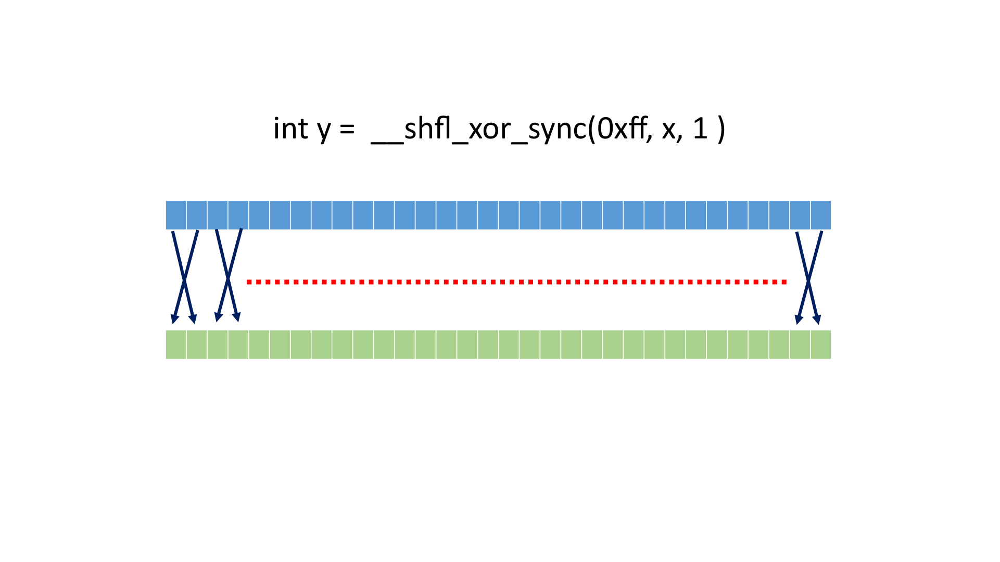
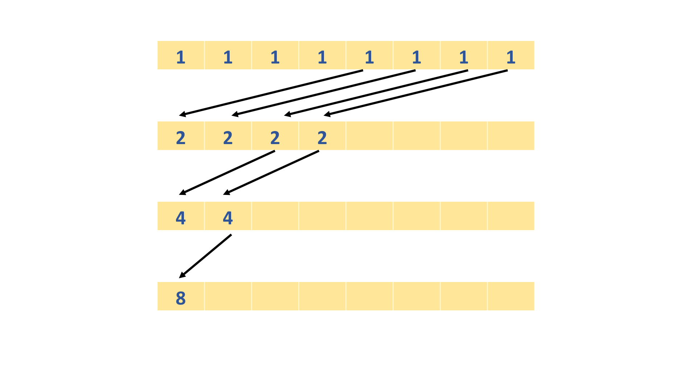
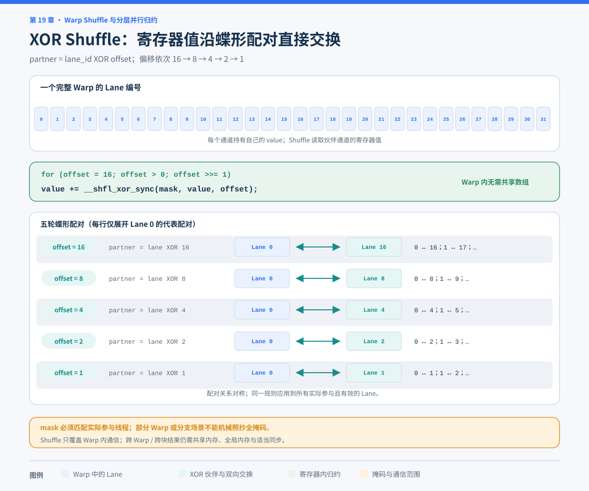

# 第 19 章 用 Shuffle 完成分层归约

共享内存归约减少了块内中间结果的全局内存读写，但 Warp 内部的通信仍可通过更直接的机制完成。Warp Shuffle 允许同一 Warp 的通道读取彼此寄存器中的值，无需先把这些数据写入共享数组。它缩小的是寄存器交换的通信范围与成本，并没有消除 Warp 间和线程块间的归约阶段。完整实现必须明确区分这三个层次。



*图 19.1　异或 Shuffle 根据 Lane 编号与掩码的异或结果确定源通道。*

## 从通道编号到 Shuffle 语义

一个 Warp 通常包含 32 个通道（lane）。在一维线程块中，可用下面的表达式得到线程所属 Warp 和 Warp 内通道号：

```cpp
const int lane = threadIdx.x & 31;
const int warp = threadIdx.x >> 5;
```

不同 Warp 都可以有 lane 0，因此通道号不是块内全局线程编号。Shuffle 也只能在同一个 Warp 内交换数据；一个 Warp 的 lane 3 与下一个 Warp 的 lane 3 是不同线程，不能通过单次 Shuffle 互相取值。

现代 CUDA 使用带 `_sync` 后缀的接口显式表达参与线程：

| 接口 | 数据来源 | 典型用途 |
|---|---|---|
| `__shfl_sync` | 指定源通道 | 广播或按通道表重排 |
| `__shfl_up_sync` | 当前通道减去 `delta` | 向较高通道传递数据、扫描 |
| `__shfl_down_sync` | 当前通道加上 `delta` | 向较低通道传递数据、归约 |
| `__shfl_xor_sync` | 当前通道号与 `laneMask` 异或 | 对称的蝶形交换与归约 |

例如，在一个所有 32 个通道都参与且已汇合的 Warp 中，以下调用把 lane 3 的 `value` 广播给其他通道：

```cpp
const unsigned int full_mask = 0xffffffffu;
float broadcast = __shfl_sync(full_mask, value, 3, 32);
```

`width` 默认是 32，也可取 2、4、8、16 等小于 32 的 2 的幂，把 Warp 划分为对齐的逻辑段。段内源通道编号与整个 Warp 的 lane 编号不能混为一谈。例如 `width = 16` 时，第二个半 Warp 的段内 lane 3 实际是整个 Warp 的 lane 19。

`__shfl_up_sync` 和 `__shfl_down_sync` 不会在段边界处循环取值。源通道越过当前段边界时，调用者保留自己的输入值，不能把这种情况当作来自其他通道的新数据。`__shfl_xor_sync` 的第三个参数则是用于计算配对通道的异或位掩码，与第一个参数所表示的“参与线程掩码”不是同一个概念。

## 掩码是正确性条件，不是固定装饰

带 `_sync` 的 Shuffle 第一个参数用位集合标明参与调用的 Warp 通道。`0xffffffffu` 表示完整 32 通道 Warp，只有在这些通道都实际参与、都执行相匹配的 Shuffle 调用时才能使用。掩码中列出的所有未退出线程必须执行同一 intrinsic，并使用相同掩码，否则结果未定义；从不满足条件的源通道取值同样不能得到可靠结果。

因此，以下做法都不成立：

- 在部分通道已经退出的分支中，不加分析地照抄全掩码；
- 把 `__activemask()` 的瞬时结果当作自动恢复汇合的保证；
- 只修改参与掩码，却继续假设异或归约的每个配对通道都含有有效数据；
- 把输入数组末尾的无效元素与“Warp 物理上不足 32 个线程”混为一谈。

最稳妥的归约组织方式是固定块大小为 32 的倍数，让所有已启动 Warp 都完整，并用加法单位元填充全局输入的越界位置。这样，输入长度可以不是 32 的倍数，执行 Shuffle 的 Warp 却仍然完整。若算法确实产生非完整 Warp 或分化分支，则必须根据实际参与集合重新设计汇合、掩码、有效源通道和补位方案，不能只替换一个掩码常量。



*图 19.2　Shuffle 蝶形归约在不同偏移下交换寄存器值，逐步得到 Warp 总和。*



*图 19.3　XOR Shuffle 的 Warp 内归约。*

## 带 `__device__` 的 Warp 内蝶形求和

异或 Shuffle 每一轮都把通道对称配对。偏移依次为 16、8、4、2、1 时，各通道持有的部分和会逐步合并；五轮之后，完整 Warp 的每个通道都得到同一 Warp 总和。

```cpp
__device__ float warp_reduce_sum(float value) {
    constexpr unsigned int kFullWarpMask = 0xffffffffu;

    // 仅适用于 32 个通道全部参与且每次调用均汇合的完整 Warp。
    for (int offset = 16; offset > 0; offset >>= 1) {
        value += __shfl_xor_sync(kFullWarpMask,
                                 value,
                                 offset,
                                 32);
    }
    return value;
}
```

`__device__` 不可省略。该函数由设备核函数调用，若只定义成普通主机函数，NVCC 会拒绝这种设备端调用。函数名本身不会自动决定其执行空间。

这段代码的前提比普通函数签名所能表达的内容更强：完整 Warp 的 32 个通道必须全部调用它，每个通道的初始 `value` 必须是有效输入或已经设置好的加法单位元。它不适合直接放进仅部分通道满足条件的 `if (lane < active_count)` 分支。即使把全掩码换成某个非完整掩码，缺失配对通道仍会破坏蝶形求和，因而需要另外的算法，而不是沿用这段循环。

`__shfl_down_sync` 也能构造归约，但通常只让 lane 0 保留最终总和，并须正确处理每轮的有效通道范围。异或版本的配对对称，所有通道得到总和，适合随后由 lane 0 写出 Warp 部分和，也适合再次归约一组 Warp 部分和。

## 第一层与第二层：Warp 内、Warp 间的块级归约

一个 256 线程块包含 8 个完整 Warp。块级求和可分成两个阶段：每个 Warp 先用 Shuffle 得到部分和，各 Warp 的 lane 0 再把结果写入共享数组；屏障之后，由第一个 Warp 对这 8 个部分和做第二次 Shuffle 归约。

```cpp
constexpr int kBlockThreads = 256;       // 32 的倍数，保证所有 Warp 完整
constexpr int kWarpsPerBlock = kBlockThreads / 32;

__global__ void reduce_blocks_shuffle(const float* input,
                                      float* block_sums,
                                      int n) {
    __shared__ float warp_sums[kWarpsPerBlock];

    const int tid = threadIdx.x;
    const int lane = tid & 31;
    const int warp = tid >> 5;
    const int gid = blockIdx.x * kBlockThreads + tid;

    // 输入长度可任意；固定启动尺寸保证所有 Warp 均完整。
    float value = (gid < n) ? input[gid] : 0.0f;

    // 第一层：Warp 内寄存器归约，所有 32 个通道共同参与。
    value = warp_reduce_sum(value);
    if (lane == 0) {
        warp_sums[warp] = value;
    }

    // 8 个 Warp 的部分和全部写出后，第一个 Warp 才能读取。
    __syncthreads();

    // 第二层：Warp 间通过共享内存交换，随后由一个完整 Warp 合并。
    if (warp == 0) {
        float block_value = (lane < kWarpsPerBlock)
                                ? warp_sums[lane]
                                : 0.0f;
        block_value = warp_reduce_sum(block_value);

        if (lane == 0) {
            block_sums[blockIdx.x] = block_value;
        }
    }
}

// n > 0；block_sums 至少能保存 blocks 个 float。
const int blocks = (n + kBlockThreads - 1) / kBlockThreads;
reduce_blocks_shuffle<<<blocks, kBlockThreads>>>(input, block_sums, n);
```

这里的 `if (warp == 0)` 以整个 Warp 为条件，warp 0 的 32 个通道全部进入，其他 Warp 整体跳过。因此，第二次 `warp_reduce_sum` 仍满足全掩码前提。lane 8 至 lane 31 没有对应的 Warp 部分和，显式使用 0 补齐；lane 0 至 lane 7 则读取 8 个已经初始化的 Warp 部分和。

共享数组在本例中只承担 Warp 间通信，不再保存 256 个逐线程中间值。屏障仍然不可省略，因为 Shuffle 不能同步不同 Warp。Warp 0 若在其他 Warp 的 lane 0 写入之前读取，就会得到旧值或未初始化值。

固定 256 线程是 32 的倍数，保证不存在物理上的尾 Warp；第二层已将未使用的 lane 补 0，因此 `kWarpsPerBlock` 不必额外限定为 2 的幂。输入 `n` 仍不需要是 2 的幂或 256 的倍数。

## 第三层：线程块之间的多阶段归约

上述核函数为每个线程块产生一个 `block_sums[blockIdx.x]`。Shuffle 无法跨线程块，`__syncthreads()` 也无法让网格中的块等待彼此，因此还必须显式完成块间归约。

多阶段核函数是最直接的组织方式。设第一轮产生

\[
B_0=\left\lceil\frac{n}{256}\right\rceil
\]

个部分和，则后续各轮沿用同一个核函数：

| 阶段 | 输入 | 输出 | 通信范围的变化 |
|---|---|---|---|
| 初始加载 | 原数组的 `n` 个元素 | 每线程一个值或 0 | 全局内存到寄存器 |
| Warp 内归约 | 每 Warp 32 个值 | 每 Warp 一个总和 | 通道寄存器之间 |
| Warp 间归约 | 每块 8 个 Warp 部分和 | 每块一个总和 | 共享内存加块屏障 |
| 块间归约第 1 轮 | `B0` 个块部分和 | `B1 = ceil(B0 / 256)` 个值 | 全局内存与后续核函数 |
| 后续块间轮次 | 上一轮部分和 | 更少的部分和 | 重复直到只剩一个值 |

实现时可为中间数组准备两个缓冲区，在每轮之间交换输入和输出角色。若 `n <= 256`，首次启动已经只留下一个结果，无需额外轮次；若 `n > 256`，则根据当前元素数重新计算网格大小，而不是沿用第一轮的块数。所有启动放在同一流中时，流顺序会保证下一轮看到上一轮写出的部分和，不必在每轮之间插入全设备同步。最后再通过设备到主机复制取得唯一的总和，并检查复制和启动错误。

也可以采用全局原子加法或受控的网格协作方案，但它们引入不同的确定性、初始化和启动约束，不能在未说明这些差异时视作等价替换。分层多阶段方法的优势在于每一层的通信范围都与所用机制精确对应。

## Shuffle 基础实验与归约实验矩阵

Shuffle 的教学微基准适合使用 32 或 64 个连续整数，让每个线程先装载与全局线程编号相同的值。固定完整 Warp 和全掩码后，可直接核对输出序列：

| 实验 | 参数 | 第一个 Warp 的预期结果 |
|---|---|---|
| 指定通道广播 | `__shfl_sync(mask, value, 3, 32)` | 所有通道得到 lane 3 的值 3 |
| 半 Warp 广播 | `__shfl_sync(mask, value, 3, 16)` | lane 0–15 得到 3，lane 16–31 得到 lane 19 的值 19 |
| 向上传递 | `__shfl_up_sync(mask, value, 3, 32)` | lane 0–2 保持原值，lane 3 得到 0，lane 4 得到 1，依此类推 |
| 向下传递 | `__shfl_down_sync(mask, value, 3, 32)` | lane 0 得到 3，lane 28 得到 31，lane 29–31 保持原值 |
| 异或交换 | `__shfl_xor_sync(mask, value, 1, 32)` | 输出按 `1, 0, 3, 2, …` 成对交换 |

若输入扩展到 64 个元素，第二个 Warp 的全 Warp 广播得到的是其自身 lane 3 的值 35，而不是第一个 Warp 的 3。这一结果可直接验证 Shuffle 的作用范围。

块级归约则应比较以下版本，而不能只验证某一个 Shuffle 指令：

| 版本 | 固定条件 | 重点指标 | 验证目标 |
|---|---|---|---|
| 共享内存完成全部块内轮次 | 相同输入、块尺寸和部分和数量 | 共享事务、屏障、时间 | 建立基准 |
| 仅最后 32 元素改用 Shuffle | 相同数学结果 | 共享事务、时间 | 观察 Warp 内寄存器通信替代了多少共享访问 |
| 完整 Warp／Warp 间分层版本 | 相同数学结果 | 共享容量、寄存器、占用率、时间 | 判断更小共享数组与额外指令的综合收益 |
| 多阶段网格归约 | 相同最终总和 | 每轮块数、启动开销、全局流量 | 验证块间阶段及扩展性 |

原课程的一次对照中，Shuffle 版本与共享内存版本的执行时间接近，Shuffle 版本甚至略慢，但共享内存事务约减少一半。这个结果符合“寄存器交换减少共享流量”的机制，也提醒性能结论不能从事务数直接跳到加速比。寄存器压力、指令调度、全局加载和启动开销都可能成为主要限制。

正确性测试应覆盖空输入的主机侧处理、`n = 1`、31、32、33、255、256、257，以及需要多轮块间归约的大输入。浮点求和采用误差范围校验；若要求可重复的位级结果，还需固定求值顺序，不能依赖原子归约或随意改变分层结构。

## 按通信范围收束第三部分

共享内存、常量内存与 Warp Shuffle 并不是可以相互随意替换的“快速内存”。共享内存面向块内显式重用和重排，常量内存面向小规模只读数据的 Warp 广播，Shuffle 面向 Warp 内寄存器交换，全局内存则继续承担块间结果传递。矩阵转置展示了片上布局调整，分层归约展示了片上通信范围逐层扩大的过程。

选择机制时，依次明确数据的生命周期、可见线程范围、重用次数和访问地址分布，再检查容量、同步和占用率。这样的资源与通信分析也将延续到下一部分：CUDA 流和事件将进一步组织核函数、复制与主机之间的时间线，并用更细粒度的依赖表达异步执行和重叠机会。
