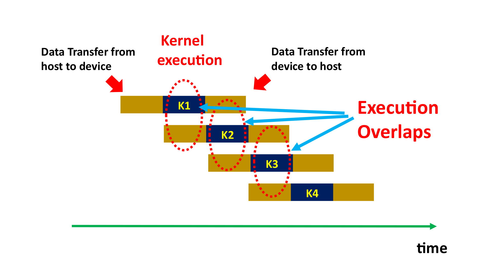
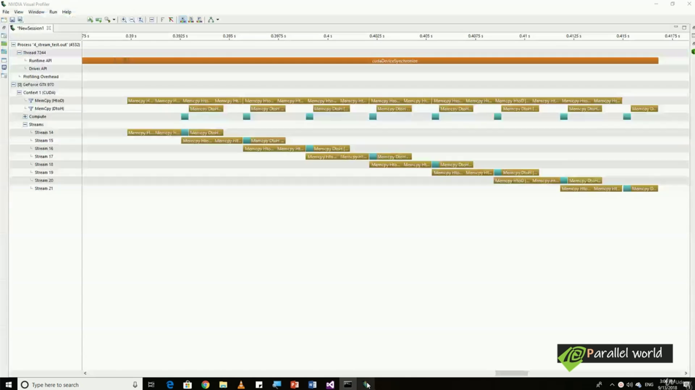

# 第 20 章 流、异步复制与传输—计算重叠

## 用流描述操作顺序

CUDA 流是一系列按提交顺序执行的设备操作，例如内存复制和核函数启动。同一流中的操作保持顺序，不同流则用于表达相互独立的任务。流首先描述依赖关系，操作是否真正并发还取决于设备能力、资源和数据依赖。

异步 API 与流密切配合。核函数启动或 `cudaMemcpyAsync` 返回时，主机通常只完成了任务提交，并不代表设备操作已经结束。主机可以继续准备其他工作，但必须保护异步操作仍在使用的缓冲区，并在读取结果前建立完成关系。

## 一个闭合的流内数据流

下面的示例使用显式流完成输入复制、计算和结果复制。核函数同时接收输入与输出指针，使数据流从主机输入一直闭合到主机结果：

```cpp
cudaStream_t stream;
CUDA_CHECK(cudaStreamCreate(&stream));

CUDA_CHECK(cudaMemcpyAsync(d_input, h_input, bytes,
                           cudaMemcpyHostToDevice, stream));
transform<<<blocks, threads, 0, stream>>>(d_input, d_output, n);
CUDA_CHECK(cudaGetLastError());
CUDA_CHECK(cudaMemcpyAsync(h_output, d_output, bytes,
                           cudaMemcpyDeviceToHost, stream));

CUDA_CHECK(cudaStreamSynchronize(stream));
CUDA_CHECK(cudaStreamDestroy(stream));
```

核函数执行配置的第三个参数是动态共享内存字节数，第四个参数才是流。上述三个设备操作位于同一流中，因此核函数在输入复制之后执行，结果复制又排在核函数之后。

用于异步主机复制的 `h_input` 和 `h_output` 通常应为页锁定内存。流同步完成前，主机不能修改输入、读取输出或释放相关缓冲区。`cudaStreamDestroy` 也不能替代整个程序中必要的错误检查和数据生命周期管理。

## 页锁定缓冲区的作用

普通可分页主机内存在设备传输前可能需要额外暂存。页锁定内存提供稳定的物理地址，通常具有更高的传输带宽，并支持合适的异步复制：

```cpp
float* h_input = nullptr;
float* h_output = nullptr;
CUDA_CHECK(cudaMallocHost(&h_input, bytes));
CUDA_CHECK(cudaMallocHost(&h_output, bytes));

// 使用完毕后
CUDA_CHECK(cudaFreeHost(h_input));
CUDA_CHECK(cudaFreeHost(h_output));
```

页锁定内存会减少操作系统可灵活分页的物理内存，不应无差别用于所有主机数组。它主要服务于频繁传输的缓冲区，分配失败和释放路径也需要处理。



*图 20.1　独立流为核函数与内存传输提供重叠执行的机会，实际时间线需要工具验证。（原课程课件）*


*图 20.2　分块多流流水线保持每个块内的 H2D、Kernel、D2H 顺序，同时为独立块的传输与计算提供重叠机会而非并发保证。（SVG 示意图）*

## 从顺序执行到分块流水线

若核函数必须等待整幅输入传输完成，主机到设备复制、核函数和设备到主机复制会依次执行。将数据划分为独立块后，每个块都可以形成自己的 `H2D → Kernel → D2H` 链条，不同块使用不同流，从而为传输与计算重叠创造机会。

| 数据块 | 流内操作顺序 | 与其他块的关系 |
|---|---|---|
| A | 输入复制 A → 核函数 A → 输出复制 A | 在缓冲区独立时与 B 无数据依赖 |
| B | 输入复制 B → 核函数 B → 输出复制 B | 可与 A 的不同阶段尝试重叠 |
| C | 输入复制 C → 核函数 C → 输出复制 C | 在上一轮缓冲区释放后复用资源 |

每个块的内部顺序不能打乱，不同块之间则不能共享未受保护的缓冲区。若两个流同时写入同一输出而没有事件依赖，多流只会引入竞态，不会形成有效流水线。



*图 20.3　分块异步流实验的 profiler 时间线：多个流的内存复制与核函数执行在时间上交错重叠，直观对应传输—计算重叠，而不是仅给出串行流程示意。（原课程视频帧，历史开发环境）*

## 重叠是否真的发生

实现重叠通常需要页锁定主机内存、适当的非默认流、独立的任务与缓冲区，以及设备相应的复制引擎和并发能力。核函数占用全部计算资源、复制时间过短或默认流形成额外顺序约束，都可能减少重叠。

流水线总时间也不能简单取 `H2D`、`Kernel`、`D2H` 三者最大值。它还包括流水线填充与排空、任务调度、资源竞争和缓冲区复用等待。增加块数可以细化流水线，却会增加启动和内存管理开销。

验证重叠应使用 Nsight Systems 等时间线工具观察复制与核函数的实际区间，而不能只根据异步 API 的调用顺序推断。端到端计时仍应包含分配、同步和结果读取。

## 小结

流用于表达设备操作顺序，异步 API 保留主机与设备的并发机会，分块流水线则把独立数据的传输和计算组织成可重叠任务。正确实现必须同时管理页锁定内存、流内依赖、缓冲区生命周期和同步，最终通过时间线确认重叠确实发生。
