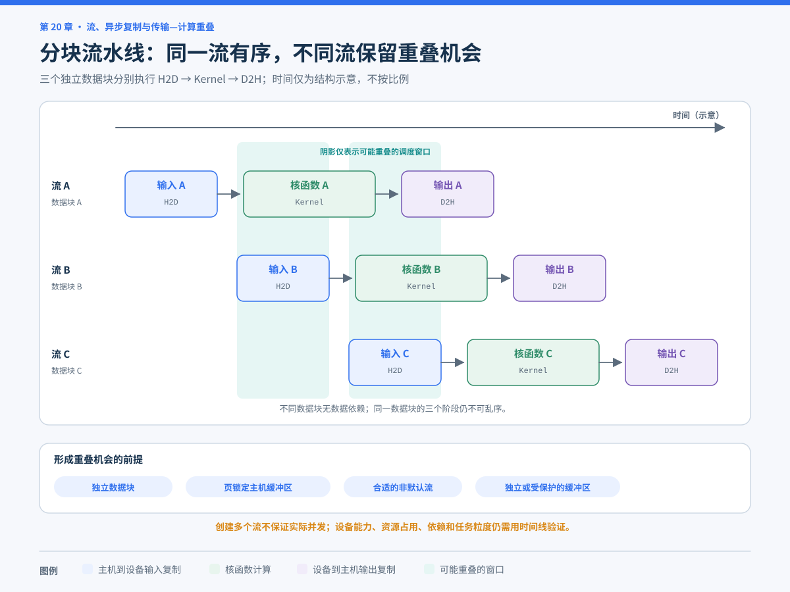

# 第 20 章 用 CUDA 流重叠传输与计算

第 13 章已经用过一次异步复制：主机把输入交给设备，设备计算，再把结果写回主机。但当时只有一条操作链，还没有回答一个更实际的问题：**复制下一份输入时，GPU 能不能同时计算当前这一份？**

本章始终处理同一个数组变换，不更换算法：

```text
input:  hInput[0 ... n)
output: hOutput[i] = 2 * hInput[i] + 1
path:   主机输入 → H2D → transformKernel → D2H → 主机输出
```

H2D 是 Host to Device，D2H 是 Device to Host。我们先让这个任务在一条流中正确完成，再把它分块并改成多流流水线。这样，每次修改代码时都能明确：是在改变执行顺序，还是在创造重叠机会。

## 20.1 先固定任务、指针和边界

沿用第 13 章的 `CUDA_CHECK` 错误检查约定，核函数如下：

```cpp
#include <algorithm>
#include <cstddef>
#include <cstdio>
#include <cuda_runtime.h>

__global__ void transformKernel(const float* input, float* output,
                                std::size_t count) {
    const std::size_t i = blockIdx.x * blockDim.x + threadIdx.x;
    if (i < count) {
        output[i] = 2.0f * input[i] + 1.0f;
    }
}
```

`count` 是这一次启动要处理的元素个数，不是字节数。最后一个线程块可能没有排满有效数据，所以 `i < count` 不能省略。

本章统一使用以下名字：

- `hInput`、`hOutput`：主机数组，CPU 可以直接读写；
- `dInput`、`dOutput`：设备数组，供核函数访问；
- `threads = 256`：每个 CUDA 线程块的线程数；
- `blocks = (count + threads - 1) / threads`：覆盖 `count` 个元素所需的线程块数。

示例假设 `n > 0`，且网格尺寸不超过设备限制。空数组应在启动前直接返回，因为不能用 0 个线程块启动核函数。主机和设备缓冲区都以 `float` 为单位索引，而复制长度必须换算成字节。

## 20.2 单流基线：三个操作仍然依次执行

先看不分块的完整流程：

```text
H2D：整个 hInput → 整个 dInput
Kernel：整个 dInput → 整个 dOutput
D2H：整个 dOutput → 整个 hOutput
```

为了让异步复制有明确的主机缓冲区和完成边界，本例使用页锁定主机内存，并把三个操作放进同一条显式流：

```cpp
const std::size_t bytes = n * sizeof(float);

// 1. 准备主机输入和输出缓冲区。
float* hInput = nullptr;
float* hOutput = nullptr;
CUDA_CHECK(cudaMallocHost(reinterpret_cast<void**>(&hInput), bytes));
CUDA_CHECK(cudaMallocHost(reinterpret_cast<void**>(&hOutput), bytes));
for (std::size_t i = 0; i < n; ++i) {
    hInput[i] = static_cast<float>(i % 100) * 0.25f;
    hOutput[i] = 0.0f;
}

// 2. 为整个数组准备设备副本。
float* dInput = nullptr;
float* dOutput = nullptr;
CUDA_CHECK(cudaMalloc(reinterpret_cast<void**>(&dInput), bytes));
CUDA_CHECK(cudaMalloc(reinterpret_cast<void**>(&dOutput), bytes));

// 3. 创建一条非阻塞显式流。
cudaStream_t stream;
CUDA_CHECK(cudaStreamCreateWithFlags(&stream, cudaStreamNonBlocking));

// 4. 依次提交 H2D、Kernel、D2H。
CUDA_CHECK(cudaMemcpyAsync(dInput, hInput, bytes,
                           cudaMemcpyHostToDevice, stream));

const unsigned threads = 256;
const unsigned blocks =
    static_cast<unsigned>((n + threads - 1) / threads);
transformKernel<<<blocks, threads, 0, stream>>>(dInput, dOutput, n);
CUDA_CHECK(cudaGetLastError());

CUDA_CHECK(cudaMemcpyAsync(hOutput, dOutput, bytes,
                           cudaMemcpyDeviceToHost, stream));

// 5. 主机等待这条流到达终点，然后才能读取 hOutput。
CUDA_CHECK(cudaStreamSynchronize(stream));

// 此处可以检查 hOutput[i] == 2 * hInput[i] + 1。
// 正常路径上的清理如下；实际工程还应覆盖异常路径。
CUDA_CHECK(cudaStreamDestroy(stream));
CUDA_CHECK(cudaFree(dOutput));
CUDA_CHECK(cudaFree(dInput));
CUDA_CHECK(cudaFreeHost(hOutput));
CUDA_CHECK(cudaFreeHost(hInput));
```

这段代码虽然短，却包含了后续所有优化的基础。

### 页锁定内存解决什么问题

`cudaMallocHost` 分配的是**页锁定主机内存**：相关页面固定在物理内存中，为主机与设备之间的 DMA 复制提供稳定地址。它仍然不是设备内存，核函数也不能把它当成这里由 `cudaMalloc` 创建的设备数组来使用。

普通 `std::vector` 通常使用可分页内存，复制时可能需要运行时或驱动先经过内部暂存区。页锁定缓冲是这里实现主机异步复制与多流重叠的常规前提。使用可分页主机内存时，某些方向的复制会经过暂存并带有同步返回行为，不能把 `Async` 一律理解成立即返回，更不能据此推断一定会与其他设备工作重叠。

页锁定并非越多越好。分配和释放本身有成本，过量使用还会限制操作系统的内存调度，因此应把它用于会反复传输的缓冲区，并用 `cudaFreeHost` 配对释放。

### 流决定了什么顺序

**CUDA 流是一串按提交顺序执行的设备操作。** 这里的顺序是：

```text
stream: H2D 完成 → Kernel 开始并完成 → D2H 完成
```

因此，核函数不会读取尚未复制完整的 `dInput`，D2H 也不会提前读取 `dOutput`。核函数执行配置中的四个参数依次是网格线程块数、每块线程数、动态共享内存字节数和流；本例不需要动态共享内存，所以第三个参数为 0，第四个参数为 `stream`。

`cudaStreamNonBlocking` 中的“非阻塞”是指这条显式流**不参与传统默认流的隐式同步**，并不取消本流内部的先后顺序，也不表示主机永远无需等待。第 21 章会详细比较默认流模式。

### API 返回与设备完成是两件事

主机执行到三次异步提交之后，通常只是把工作交给了 CUDA，**API 返回并不表示复制或计算已经完成**：

- `cudaMemcpyAsync` 返回，不等于主机输出已经可读；
- 核函数启动返回，不等于所有线程已经执行完；
- `cudaGetLastError` 用于检查启动错误，不是完成通知；
- `cudaStreamSynchronize(stream)` 才让主机等待这条流中此前提交的工作完成。

同步之后，主机才能读取 `hOutput`、改写下一次传输要复用的 `hInput`，以及释放相关缓冲区。同步之前释放设备数组或调用 `cudaFreeHost`，会让仍在执行的操作失去有效存储。示例先同步再销毁流和释放内存，是为了让完成边界一眼可见。

## 20.3 为什么“异步”了，时间线还是没有重叠

单流基线的设备时间线只能排成：

```text
时间 →
stream: [------ H2D 全部输入 ------][------ Kernel 全部数据 ------][------ D2H 全部结果 ------]
```

即使主机很快完成了三次 API 调用，设备仍要遵守流内顺序。主机可以在 `cudaStreamSynchronize` 之前做不依赖这些缓冲区的 CPU 工作，但这不会改变上述设备链。单流异步主要把“主机提交”与“设备执行”分开，**不会自动让本流中的 H2D、Kernel、D2H 相互重叠**。

再观察核函数的数据依赖。第 `i` 个输出只依赖第 `i` 个输入：

```text
hOutput[0] 只依赖 hInput[0]
hOutput[1] 只依赖 hInput[1]
...
```

所以，**每个输出只依赖同位置输入，可以按连续块独立处理**，没有必要等整个数组都到设备后才开始计算。每块仍保持原来的三步：

```text
块 0: H2D(0) → Kernel(0) → D2H(0)
块 1: H2D(1) → Kernel(1) → D2H(1)
块 2: H2D(2) → Kernel(2) → D2H(2)
```

例如 `n = 1000`、每块 256 个元素时，四块分别是：

```text
[0, 256)    256 个元素
[256, 512)  256 个元素
[512, 768)  256 个元素
[768, 1000) 232 个元素，最后一块较短
```

块区间左闭右开，下一块的起点就是上一块的终点。最后一块不能按 256 个元素复制或启动，否则会越过主机数组末尾。

但是，**只分块、不换执行结构仍然不够**。如果把这些块全部提交到同一条流，时间线仍是：

```text
stream: [H0][K0][D0][H1][K1][D1][H2][K2][D2][H3][K3][D3]
```

`H1` 不会越过前面的 `D0`，因为同一条流必须有序。分块只是提供了独立工作；下一步要用不同流表达不同块之间的独立性。

## 20.4 多流时间线：保留块内顺序，交错不同块

假设三块数据分别使用三条流，一种可能的设备时间线是：

```text
时间 →
流 A: [H2D A][Kernel A][D2H A]
流 B:         [H2D B][Kernel B][D2H B]
流 C:                 [H2D C][Kernel C][D2H C]
```

这里出现了想要的关系：计算 A 时，可以复制 B；写回 A 时，可以计算 B 或复制 C。每一行内部仍是严格的 `H2D → Kernel → D2H`，重叠只发生在不同块之间。


*图 20.1　独立任务在流水线中的重叠机会。*

**不同流只提供并发机会，不保证实际同时执行。** 核函数可能占满计算资源，设备可能只有一个适合某方向的复制引擎，复制任务也可能短到无法覆盖调度成本。流先表达允许怎样调度，硬件再决定实际时间线。

## 20.5 把单流代码改成槽位流水线

流数量不必等于数据块数量。一个常见做法是建立少量**槽位**：**每个槽位有一条流和一对设备缓冲区**，多个数据块轮流使用槽位。

下面保留前面已经分配并初始化的整份页锁定 `hInput、hOutput`，但把设备内存改为每个槽位一小块。假设 `n > 0`，所有主机输入在提交前都已写好：

```cpp
constexpr std::size_t chunkSize = 16384;  // 每块最多包含的元素数
constexpr int slotCount = 4;              // 流和设备缓冲槽位数量
constexpr unsigned threads = 256;

const std::size_t maxChunkBytes = chunkSize * sizeof(float);
cudaStream_t streams[slotCount];
float* dInputs[slotCount] = {};
float* dOutputs[slotCount] = {};

// 1. 每个槽位拥有自己的流和独立设备存储。
for (int slot = 0; slot < slotCount; ++slot) {
    CUDA_CHECK(cudaStreamCreateWithFlags(&streams[slot],
                                         cudaStreamNonBlocking));
    CUDA_CHECK(cudaMalloc(reinterpret_cast<void**>(&dInputs[slot]),
                          maxChunkBytes));
    CUDA_CHECK(cudaMalloc(reinterpret_cast<void**>(&dOutputs[slot]),
                          maxChunkBytes));
}

// 2. 所有块的提交循环中不做主机同步。
std::size_t offset = 0;
int slot = 0;
while (offset < n) {
    const std::size_t count = std::min(chunkSize, n - offset);
    const std::size_t chunkBytes = count * sizeof(float);

    CUDA_CHECK(cudaMemcpyAsync(dInputs[slot], hInput + offset,
                               chunkBytes, cudaMemcpyHostToDevice,
                               streams[slot]));

    const unsigned blocks =
        static_cast<unsigned>((count + threads - 1) / threads);
    transformKernel<<<blocks, threads, 0, streams[slot]>>>(
        dInputs[slot], dOutputs[slot], count);
    CUDA_CHECK(cudaGetLastError());

    CUDA_CHECK(cudaMemcpyAsync(hOutput + offset, dOutputs[slot],
                               chunkBytes, cudaMemcpyDeviceToHost,
                               streams[slot]));

    offset += count;
    slot = (slot + 1) % slotCount;
}

// 3. 先提交全部块，再等待所有流。此时所有 hOutput 块才可读。
for (int s = 0; s < slotCount; ++s) {
    CUDA_CHECK(cudaStreamSynchronize(streams[s]));
}

// 此处统一校验整个 hOutput，然后清理资源。
for (int s = 0; s < slotCount; ++s) {
    CUDA_CHECK(cudaStreamDestroy(streams[s]));
    CUDA_CHECK(cudaFree(dOutputs[s]));
    CUDA_CHECK(cudaFree(dInputs[s]));
}
CUDA_CHECK(cudaFreeHost(hOutput));
CUDA_CHECK(cudaFreeHost(hInput));
```



*图 20.2　分块多流流水线与槽位复用。*

### 每个参数怎样随块变化

提交循环中的 `offset` 是当前块在完整数组中的起点，`count` 是当前块的实际元素数：

- `hInput + offset` 和 `hOutput + offset` 指向当前块的主机起点；
- `dInputs[slot]` 和 `dOutputs[slot]` 总是从槽位缓冲区的起点开始，所以核函数仍用局部下标 `0 ... count`；
- `chunkBytes` 使用当前块的实际长度，最后一块因此只复制有效数据；
- `blocks` 也按当前 `count` 重新计算，尾块中多余的线程由核函数的 `i < count` 排除；
- `streams[slot]` 同时出现在两次复制和核函数启动中，保证这三个操作属于同一条块内操作链。

**每个块都必须使用自己的 `count` 和 `chunkBytes`。** 如果误把整个 `bytes` 用在每个块上，即使普通块暂时看起来正确，最后一块也会越界。如果给核函数传入 `n` 而不是 `count`，它同样会访问槽位缓冲区之外。

### 为什么槽位可以安全复用

槽位按 `0、1、2、3、0、1、2、3……` 循环。块 4 再次使用槽位 0 时，它在流 0 中排在块 0 的 D2H 后面：

```text
流 0: H2D(块0) → Kernel(块0) → D2H(块0)
      → H2D(块4) → Kernel(块4) → D2H(块4)
```

所以块 4 不会提前覆盖块 0 仍在使用的 `dInputs[0]` 或 `dOutputs[0]`。这里不需要额外的跨流事件，因为**复用发生在同一条流内，流内顺序已经提供了等待**。不同槽位则使用不同的设备缓冲区，主机输入、输出块也互不重叠。

**本例把最终同步放在全部提交之后，避免每块提交后立刻排空流水线。** 主机先等待流 0、再等待流 1，并不会把已经提交的流 1 工作变成串行；所有流在主机开始等待前都已有任务。相反，如果在每块提交后立即调用 `cudaStreamSynchronize`，主机就会反复停住，流水线难以保持充足的在途工作。

**同步完成前，不能读取、改写或释放仍在被异步操作使用的缓冲区。** 因此，此时主机不能统一读取 `hOutput`，也不能重写整份 `hInput` 或释放任何槽位。若只想提前消费某一块，就应等待该块的 D2H 完成位置，而不是盲目等待整个设备；第 21 章会用事件缩小这个边界。

## 20.6 重叠需要条件，块数也需要选择

这条流水线已经具备重叠所需的软件结构，但**软件结构正确不等于硬件一定重叠**，还需同时满足几个条件：

1. **主机传输缓冲合适**：页锁定内存为异步复制提供稳定页面；
2. **操作进入合适的显式流**：每个阶段的流参数都必须正确，不能意外落到默认流；
3. **数据与缓冲区独立或受顺序保护**：不同流不能无保护地读写同一块存储；
4. **设备具有相应并发能力**：复制引擎、计算资源和任务占用都会影响实际重叠；
5. **在途任务足够且粒度合适**：块太少难以填满流水线，块太多又会增加启动、复制和调度开销。

流水线总时间不能简单写成三个阶段耗时的最大值。开头要等待第一块输入到达，结尾要等待最后一块计算和写回，中间还可能有资源竞争与槽位复用等待。`slotCount` 和 `chunkSize` 因而都是可调整参数，而不是对所有设备都适用的常数。


*图 20.3　一次分块多流运行的时间线。*

比较单流与多流版本时，应保持输入、核函数、总元素数和结果校验一致。除了记录端到端耗时，还可以用 Nsight Systems 观察各条流的复制和核函数区间：API 名称只能说明程序怎样提交，时间线才能说明这些操作怎样执行。

## 20.7 小结

本章从同一个数组变换出发，先建立了 `H2D → Kernel → D2H` 的单流顺序基线。异步提交把主机调用与设备完成区分开，却不会打破流内顺序。把数组分块后，每个块仍保留这条链；再把不同块分配到多个流和独立槽位，传输与计算才获得重叠机会。

正确实现必须同时处理页锁定内存、尾块长度、核函数边界、流内顺序、槽位复用和最终同步。下一章继续使用这条流水线，解决三个更细的问题：默认流为什么会加入隐式顺序，事件怎样测量单段与整条流水线，以及不同阶段分到不同流后怎样建立必要依赖。
