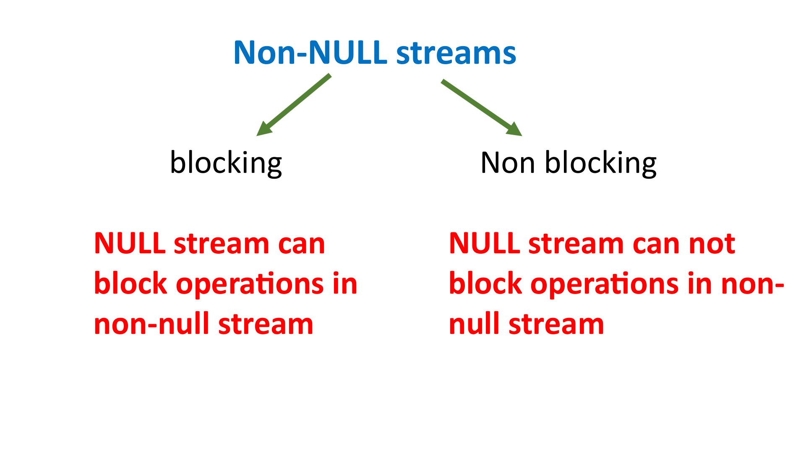
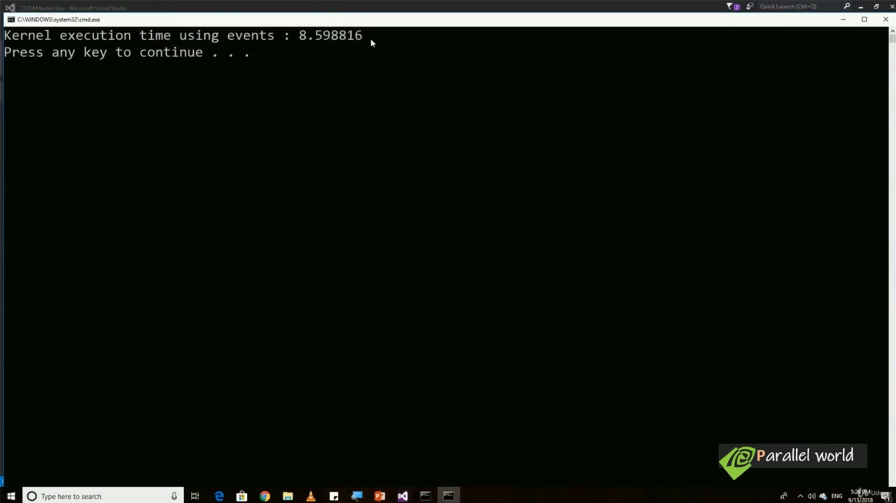
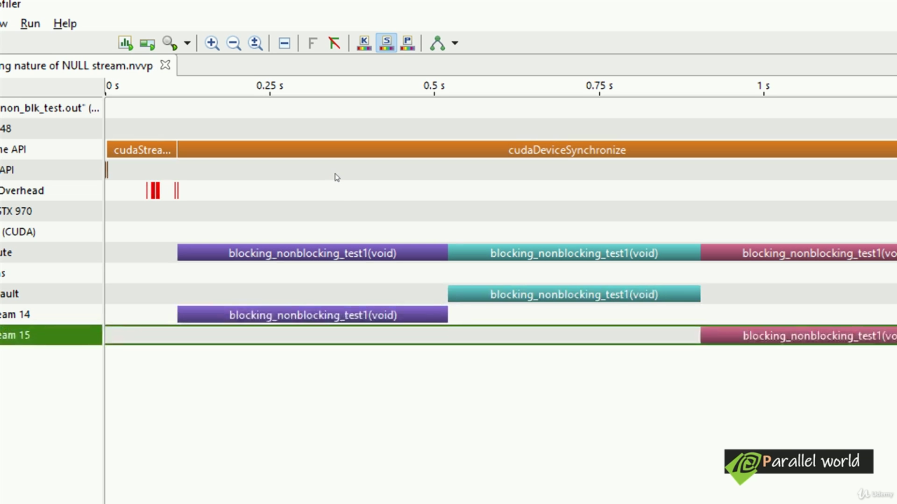

# 第 21 章 默认流、同步范围与事件计时/跨流依赖



*图 21.1　默认流与阻塞流的组合会影响并发关系，应结合创建标志和运行环境分析。（原课程课件）*

## 默认流与隐式顺序

核函数启动时不指定流，或者异步 API 使用空流句柄，都表示使用默认流。默认流并不是并发程序中的空白背景，它仍参与设备时间线排序，并可能与其他显式流形成额外的顺序约束。

传统默认流和每线程默认流具有不同语义，具体行为还受到编译模式、流创建标志和 CUDA 版本影响。分析多流程序时，应明确默认流模式以及是否使用了非阻塞显式流，不能仅凭“流 A 与流 B 不同”就假设它们完全独立。

隐式顺序也可能来自同步内存操作、共享缓冲区和运行时行为。排查意外的串行区间时，需要同时检查默认流、同步 API 和数据依赖，并用时间线工具验证。

## 选择合适的同步范围

不同同步机制解决的问题不同。全设备等待虽然简单，却可能把本来可以重叠的任务重新串行化；细粒度流与事件依赖则只等待真正需要的数据或阶段。

| 机制 | 主要作用范围 | 典型用途与注意事项 |
|---|---|---|
| `cudaDeviceSynchronize` | 设备上的广泛工作 | 简单程序收尾或调试；并发路径中可能造成过宽等待 |
| `cudaStreamSynchronize` | 指定流 | 主机等待该流完成，常用于读取该流写回的结果 |
| `cudaEventSynchronize` | 指定事件 | 主机等待某个时间线位置，不等于等待整个设备 |
| `cudaStreamWaitEvent` | 在指定流中建立依赖 | 不阻塞主机，只让后续流操作等待事件 |
| `__syncthreads()` | 一个线程块内部 | 协调共享内存等块内数据，不同步网格或主机 |

显式同步并不天然低效，隐式顺序也不一定错误。关键是同步范围应与真实数据依赖一致：输入在被设备读取完成前不能改写，输出在设备写完前不能消费，缓冲区复用前必须等待上一轮使用结束。

## 使用显式流事件计时

CUDA 事件可以记录到指定流中，用于测量设备时间线上的区间。与第 7 章的默认流入门示例相比，显式流更适合并发程序，因为事件覆盖的操作和依赖关系更加明确：

```cpp
cudaEvent_t start, stop;
CUDA_CHECK(cudaEventCreate(&start));
CUDA_CHECK(cudaEventCreate(&stop));

CUDA_CHECK(cudaEventRecord(start, stream));
kernel<<<blocks, threads, 0, stream>>>(data, n);
CUDA_CHECK(cudaEventRecord(stop, stream));
CUDA_CHECK(cudaEventSynchronize(stop));

float elapsed_ms = 0.0f;
CUDA_CHECK(cudaEventElapsedTime(&elapsed_ms, start, stop));
```

`stop` 只有在同一流中的核函数完成后才会到达，因此测得的是两个事件之间的设备区间，而不是主机提交任务的时间。事件创建、记录和耗时查询都应检查错误，使用完毕后还需销毁事件。

事件计时仍需要预热和重复测量。若希望统计多个流的总耗时，应明确开始与结束事件如何覆盖所有相关分支，不能只测其中一个流后将其称为整个应用时间。


*图 21.2　事件把数据生产位置连接到需要它的消费流，形成只含必要边的任务 DAG，并可另行用于设备时间线计时。（SVG 示意图）*

## 用事件建立生产者—消费者依赖

假设流 A 生成数据，流 B 只在数据准备好后执行消费者核函数。直接启动两个流会产生竞态，全设备同步又会等待无关任务。事件可以建立只针对这一阶段的依赖：

```cpp
cudaEvent_t ready;
CUDA_CHECK(cudaEventCreate(&ready));

producer<<<blocks, threads, 0, stream_a>>>(data);
CUDA_CHECK(cudaGetLastError());
CUDA_CHECK(cudaEventRecord(ready, stream_a));

CUDA_CHECK(cudaStreamWaitEvent(stream_b, ready, 0));
consumer<<<blocks, threads, 0, stream_b>>>(data);
CUDA_CHECK(cudaGetLastError());
```

`cudaStreamWaitEvent` 将等待关系提交到流 B，主机可以继续执行其他工作。流 B 中位于该调用之后的操作必须等待 `ready` 所标记的生产阶段，但流 B 中此前已经提交的操作不受这条新依赖反向影响。

事件位置决定依赖范围。记录过早会让消费者读取未完成数据，记录过晚则引入多余等待。事件、流和缓冲区的销毁或复用也必须遵守相关操作的生命周期，不能在依赖仍被使用时提前清理。



*图 21.3　CUDA 事件计时实验的实际输出为 8.598816。原程序此行没有打印时间单位，因此配图与说明均保留这一事实，不自行补写单位。（原课程视频帧，历史开发环境）*



*图 21.4　默认流阻塞实验的原始时间线：Default 流中的核函数处于 Stream 14 与 Stream 15 的操作之间，可见各核函数段依次衔接，用实测画面说明 NULL stream 带来的同步边界。（原课程视频帧，历史开发环境）*

## 用任务图理解并发

流和事件可以把应用表示为有向任务图：节点是复制或核函数，边是必要的数据与执行依赖。只保留真实依赖能够保留并发机会，全设备同步则相当于加入大量额外边。

性能分析应同时检查任务图和实际时间线。若理论上独立的操作仍然串行，可能是默认流、过宽同步、共享资源或硬件能力造成；若时间线看似重叠却结果错误，则应检查缺失的事件边和缓冲区生命周期。

## 小结

默认流和隐式顺序会影响多流并发，同步机制则具有不同作用范围。事件既能测量显式流的设备区间，也能在不阻塞主机的情况下连接生产者与消费者。以真实数据依赖构建任务图，再用时间线验证，是兼顾正确性和并发性的基本方法。
