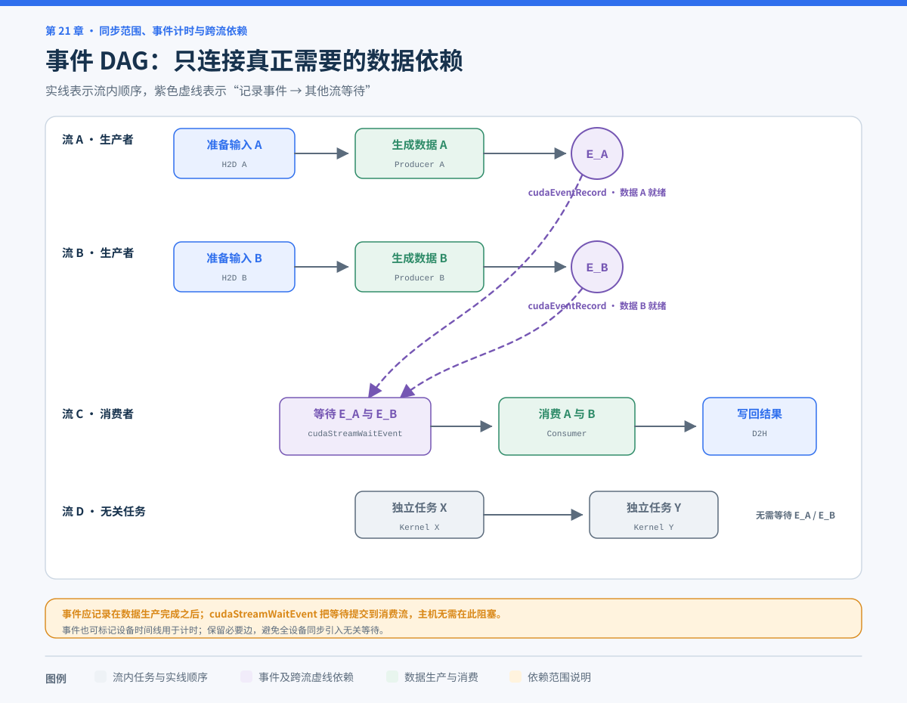

# 第 21 章 用事件管理异步依赖

第 20 章的多流流水线已经让不同数据块获得重叠机会，但也留下了三个不能靠“多创建几条流”解决的问题：

1. 忘记给某个操作指定流，为什么有时会多出串行边界，有时又会直接破坏顺序？
2. 一对事件可以测一个核函数，怎样测量横跨多条流的整条流水线？
3. 如果 H2D、Kernel、D2H 被分到不同流，原来由流内顺序提供的保护怎样补回来？

本章仍使用同一个任务：

```text
hInput → 分块 H2D → transformKernel → 分块 D2H → hOutput
hOutput[i] = 2 * hInput[i] + 1
```

先在一条流的局部看清默认流和事件，再回到完整多流流水线。

## 21.1 默认流：没有写流参数，不等于没有顺序规则

先看一个只包含本任务核函数的小实验。假设三个数据块的输入都已准备好，输出缓冲区互不重叠；这里暂时把两条显式流用普通的 `cudaStreamCreate` 创建，并使用传统默认流模式：

```cpp
// 同一主机线程依次提交；count0、count1、count2 分别对应三个独立块。
transformKernel<<<blocks0, threads, 0, streams[0]>>>(
    dInputs[0], dOutputs[0], count0);
CUDA_CHECK(cudaGetLastError());

// 没有第四个执行配置参数，因此这次启动使用默认流。
transformKernel<<<blocks1, threads>>>(dInputs[1], dOutputs[1], count1);
CUDA_CHECK(cudaGetLastError());

transformKernel<<<blocks2, threads, 0, streams[1]>>>(
    dInputs[2], dOutputs[2], count2);
CUDA_CHECK(cudaGetLastError());
```

在上述**传统默认流 + 阻塞显式流**配置下，设备顺序相当于：

```text
stream 0: [Kernel 0]
default:            [Kernel 1]
stream 1:                       [Kernel 2]
```

即使三个块没有数据依赖，默认流中的 Kernel 1 也要等待此前提交到阻塞显式流的 Kernel 0；随后提交到阻塞显式流的 Kernel 2 又要等待 Kernel 1。这里增加的不是算法需要的数据依赖，而是默认流带来的**隐式顺序**。

### 哪些写法使用默认流

以下常见写法都涉及默认流：

```cpp
kernel<<<blocks, threads>>>(args);                 // 未指定第四个参数
kernel<<<blocks, threads, 0, 0>>>(args);           // 流句柄为 0
cudaMemcpyAsync(dst, src, bytes, direction, 0);    // 复制进入默认流
cudaEventRecord(event, 0);                         // 在默认流记录事件
```

默认流也被称为 NULL stream 或 0 stream。**它仍然是一条有顺序的设备工作通道**，不是“与流无关的后台区域”。

### 为什么必须说明启动配置

CUDA 有两种需要区分的默认流语义：

- **传统默认流（legacy default stream）**：与阻塞显式流之间存在上述前后隐式顺序。普通 `cudaStreamCreate` 创建的流默认属于阻塞显式流。
- **每线程默认流（per-thread default stream）**：每个主机线程拥有自己的默认流，各显式流不会因为传统默认流规则而自动汇入同一道屏障。可用 `nvcc --default-stream per-thread` 等构建配置启用相应模式。

此外，`cudaStreamCreateWithFlags(..., cudaStreamNonBlocking)` 创建的**非阻塞显式流不参与传统默认流的隐式同步**。第 20 章特意使用了这个标志，因此各槽位不会因为传统默认流而自动串起来。

所以，不能笼统地说“默认流一定让所有流串行”，也不能说“不同流一定独立”。**实际关系要同时看默认流模式、显式流创建标志和操作提交顺序**；涉及多个编译单元或第三方库时，还要确认它们各自的启动配置。


*图 21.1　传统默认流与阻塞显式流的隐式顺序。*

最容易出错的情况不是刻意做默认流实验，而是在第 20 章的提交循环里漏写流参数：

```cpp
// 错误示例：H2D 和 D2H 在 streams[slot]，Kernel 却进入默认流。
cudaMemcpyAsync(dInputs[slot], hInput + offset, chunkBytes,
                cudaMemcpyHostToDevice, streams[slot]);
transformKernel<<<blocks, threads>>>(dInputs[slot], dOutputs[slot], count);
cudaMemcpyAsync(hOutput + offset, dOutputs[slot], chunkBytes,
                cudaMemcpyDeviceToHost, streams[slot]);
```

此时**不能根据源码排列推断三个阶段有序**。在非阻塞显式流或每线程默认流配置下，默认流核函数并不自动等待那条显式流中的 H2D，结果复制也不自动等待核函数。修复方法是把同一个 `streams[slot]` 明确传给三个阶段，而不是依赖某种隐式顺序碰巧救回程序。


*图 21.2　一次默认流隐式同步实验的时间线。*

最后要区分：**隐式同步不等于主机同步**。隐式同步描述设备操作的先后；主机仍可能很快提交完三个核函数，只是设备按照额外约束执行它们，并不表示主机线程正在调用 `cudaDeviceSynchronize`。

## 21.2 主机等待时，到底在等待多大范围

回到第 20 章，全部块提交后需要读取完整 `hOutput`，最直接的办法仍是：

```cpp
for (int slot = 0; slot < slotCount; ++slot) {
    CUDA_CHECK(cudaStreamSynchronize(streams[slot]));
}
// 所有槽位的 D2H 均已完成，现在可以校验完整 hOutput。
```

虽然主机逐条等待流，设备上的各条流早已提交完毕，仍可在等待期间继续推进。如果程序还要释放整个流水线的资源，这个范围正好合适。

但如果主机只想读取最早完成的一个块，等待整条槽位流可能连带等待该流后面的其他块；调用 `cudaDeviceSynchronize()` 又可能等待与当前结果无关的设备工作。**同步范围应当跟随真正的完成条件**，而不是越大越保险。

| 调用 | 谁等待 | 等待范围 | 在本任务中的典型用途 |
|---|---|---|---|
| `cudaDeviceSynchronize()` | 主机线程 | 当前设备上此前提交的广泛工作 | 整个程序收尾或调试；可能等待无关流 |
| `cudaStreamSynchronize(stream)` | 主机线程 | 指定流中此前提交的工作 | 等待某槽位的全部块，或最终读取其输出 |
| `cudaEventSynchronize(event)` | 主机线程 | 指定事件所记录的时间线位置 | 等待一个核函数或一块 D2H 的精确完成点 |
| `cudaStreamWaitEvent(stream, event, 0)` | 不阻塞主机 | 给目标流中后续操作加入设备侧等待 | 让另一流中的 Kernel 或 D2H 等待数据就绪 |
| `cudaEventRecord(event, stream)` | 不阻塞主机 | 在流中记录一个位置，本身不负责等待 | 标记计时端点或数据生产完成点 |

`cudaGetLastError()` 不在这个表中：它用于检查核函数启动等错误，不承担等待设备完成的职责。`__syncthreads()` 也不是上表任何一种主机或跨流同步，它只协调同一个 CUDA 线程块内的线程。

## 21.3 用事件测量一个块的核函数区间

第 7 章已经在默认流中用过事件。现在把同样的方法放进第 20 章的显式流：从当前块的 H2D 开始提交，但只希望测量 `transformKernel`，不把 H2D 和 D2H 算进去。

事件可以先理解成**流中的时间线标记**。把开始标记放在核函数前，把结束标记放在核函数后，就能得到这两个设备时间线位置之间的间隔：

```cpp
// 当前块使用已创建的 stream；count、chunkBytes、blocks、threads 已计算。
cudaEvent_t kernelStart;
cudaEvent_t kernelStop;
CUDA_CHECK(cudaEventCreate(&kernelStart));
CUDA_CHECK(cudaEventCreate(&kernelStop));

CUDA_CHECK(cudaMemcpyAsync(dInput, hInput + offset, chunkBytes,
                           cudaMemcpyHostToDevice, stream));

CUDA_CHECK(cudaEventRecord(kernelStart, stream));
transformKernel<<<blocks, threads, 0, stream>>>(dInput, dOutput, count);
CUDA_CHECK(cudaGetLastError());
CUDA_CHECK(cudaEventRecord(kernelStop, stream));

CUDA_CHECK(cudaMemcpyAsync(hOutput + offset, dOutput, chunkBytes,
                           cudaMemcpyDeviceToHost, stream));

// 主机等待结束事件完成，再读取两个事件之间的时间差。
CUDA_CHECK(cudaEventSynchronize(kernelStop));
float kernelMilliseconds = 0.0f;
CUDA_CHECK(cudaEventElapsedTime(&kernelMilliseconds,
                                kernelStart, kernelStop));
std::printf("Chunk kernel: %.6f ms\n", kernelMilliseconds);

// 注意：结束事件位于 D2H 之前，所以还要等待 D2H。
CUDA_CHECK(cudaStreamSynchronize(stream));
// 现在才可以读取 hOutput + offset 指向的当前块。

CUDA_CHECK(cudaEventDestroy(kernelStop));
CUDA_CHECK(cudaEventDestroy(kernelStart));
```

同一条流保证实际顺序为：

```text
H2D → 记录 kernelStart → Kernel → 记录 kernelStop → D2H
```

因此 `kernelStart` 不会在 H2D 之前完成，`kernelStop` 不会在核函数之前完成。`cudaEventRecord` 本身也是异步提交，**主机调用它返回，不代表设备已经走到这个位置**。等待 `kernelStop` 后，前面的 `kernelStart` 在同一条流中也已完成，此时才能查询完整时间差。

`cudaEventElapsedTime` 通过第一个参数返回**毫秒**为单位的浮点值。它测量两个事件完成时刻之间的设备区间，不是主机提交这些异步调用所花的时间，也不自动包含事件之外的分配、初始化和校验。

这里还有一个很容易忽略的边界：**`kernelStop` 完成不代表 D2H 完成**。由于 D2H 排在它后面，主机从 `cudaEventSynchronize(kernelStop)` 返回时，D2H 可能仍在执行，所以代码又等待了 `stream`。如果只需要核函数时间而不需要立即读取输出，就不必在此处提前做这次流同步。

普通 `cudaEventCreate` 创建的事件支持计时。后文只为跨流依赖创建事件时，会使用 `cudaEventDisableTiming`；带这个标志的事件不能再用于 `cudaEventElapsedTime`。

## 21.4 把三个阶段分到不同流：用事件补回数据依赖

第 20 章把同一块的三个阶段放在一条流中，顺序天然正确。假设现在为了单独调度传输和计算，把一块数据改成下面的组织：

```text
h2dStream:    [H2D] → 记录 inputReady
computeStream:          等待 inputReady → [Kernel] → 记录 outputReady
d2hStream:                                       等待 outputReady → [D2H]
```

这条时间线先给出我们真正需要的两条边：

```text
H2D 完成 → Kernel 才能开始
Kernel 完成 → D2H 才能开始
```

CUDA 事件除了计时，还能**标记“某个生产阶段已经完成”的位置**；`cudaStreamWaitEvent` 则**把这个位置变成另一条流的等待条件**。对应代码如下，仍使用页锁定主机缓冲和当前块的 `offset、count、chunkBytes`：

```cpp
cudaStream_t h2dStream;
cudaStream_t computeStream;
cudaStream_t d2hStream;
CUDA_CHECK(cudaStreamCreateWithFlags(&h2dStream, cudaStreamNonBlocking));
CUDA_CHECK(cudaStreamCreateWithFlags(&computeStream, cudaStreamNonBlocking));
CUDA_CHECK(cudaStreamCreateWithFlags(&d2hStream, cudaStreamNonBlocking));

cudaEvent_t inputReady;
cudaEvent_t outputReady;
CUDA_CHECK(cudaEventCreateWithFlags(&inputReady, cudaEventDisableTiming));
CUDA_CHECK(cudaEventCreateWithFlags(&outputReady, cudaEventDisableTiming));

// 1. 生产输入，并在 H2D 之后记录“输入就绪”。
CUDA_CHECK(cudaMemcpyAsync(dInput, hInput + offset, chunkBytes,
                           cudaMemcpyHostToDevice, h2dStream));
CUDA_CHECK(cudaEventRecord(inputReady, h2dStream));

// 2. 计算流中的后续操作等待输入，再启动同一个核函数。
CUDA_CHECK(cudaStreamWaitEvent(computeStream, inputReady, 0));
transformKernel<<<blocks, threads, 0, computeStream>>>(
    dInput, dOutput, count);
CUDA_CHECK(cudaGetLastError());
CUDA_CHECK(cudaEventRecord(outputReady, computeStream));

// 3. 写回流中的后续操作等待输出，再提交 D2H。
CUDA_CHECK(cudaStreamWaitEvent(d2hStream, outputReady, 0));
CUDA_CHECK(cudaMemcpyAsync(hOutput + offset, dOutput, chunkBytes,
                           cudaMemcpyDeviceToHost, d2hStream));

// 4. 主机等待最终写回，再读取当前块或复用全部相关缓冲。
CUDA_CHECK(cudaStreamSynchronize(d2hStream));

CUDA_CHECK(cudaEventDestroy(outputReady));
CUDA_CHECK(cudaEventDestroy(inputReady));
CUDA_CHECK(cudaStreamDestroy(d2hStream));
CUDA_CHECK(cudaStreamDestroy(computeStream));
CUDA_CHECK(cudaStreamDestroy(h2dStream));
```

`cudaStreamWaitEvent` 的第一个参数是要加入等待的目标流，第二个参数是已经记录的生产位置，第三个参数对本例传 0。**这个调用只提交设备侧依赖，不让主机等待**；主机可以继续提交其他工作。

事件记录的位置决定依赖的含义：

- `inputReady` 必须记录在 H2D **之后**，否则计算流可能读到尚未复制完整的输入；
- `outputReady` 必须记录在 Kernel **之后**，否则 D2H 可能读到尚未写完的输出；
- 等待只约束目标流中该调用**之后**提交的操作，不会反向重排目标流此前的工作。

最后一个 `cudaStreamSynchronize(d2hStream)` 能覆盖整条链，是因为 D2H 依赖核函数，核函数又依赖 H2D。同步结束后，`hOutput + offset` 才安全可读，正常清理也不会撞到仍在使用缓冲区的设备操作。

### 事件完成点与缓冲区生命周期不是同一件事

知道“某个事件完成了”，还要进一步问它代表哪一个阶段：

| 已等待的位置 | 此时可以确定 | 仍然不能据此假定 |
|---|---|---|
| `inputReady` | H2D 已完成，设备输入已经可读 | Kernel 或 D2H 已完成；`dInput` 已不再被使用 |
| `outputReady` | Kernel 已完成，设备输出已经可读 | D2H 已完成；主机 `hOutput` 已可读 |
| `d2hStream` 到达终点 | 当前块 D2H 已完成，整条依赖链已走完 | 其他无关流也已完成 |

因此，**缓冲区复用必须等待上一个相关使用者完成**。输入页锁定主机缓冲区是否能改写，要看使用它的 H2D 是否完成；`dInput` 是否能被另一流中的下一次 H2D 覆盖，还要看读取它的 Kernel 是否完成；`dOutput` 是否能被下一轮核函数改写，还要等读取它的 D2H 完成。流内顺序或跨流事件都可以表达这些等待，但不能只凭异步 API 已返回来复用存储。

本例为一块数据使用一对事件。多块在途时，事件重录和槽位复用必须保持清晰对应；一种简单的组织是给每个在途块或槽位准备事件，并在相应等待关系建立后再复用。不要把“事件对象已经创建”误当成“任意次重录都自动表达了你想要的批次”。

把三个阶段拆到三条流主要是为了看清依赖，并不表示这种拆分一定比第 20 章的单块单流更快。流和事件用于表达必要顺序，性能收益仍取决于实际任务和资源。

## 21.5 给整条多流流水线设置计时边界

现在回到第 20 章的完整流水线。要测一个核函数，可以把两个事件放在同一条流中；要测整条流水线，则不能简单地：

- 只测流 0 的 Kernel，把它称为总时间；
- 把各流 Kernel 时间相加，因为不同流可能重叠；
- 在流 0 记录结束事件，却没有等其他流的 D2H。

正确的设备区间应满足两个条件：**开始事件先于所有分支，结束事件晚于所有分支**。可以用一条控制流完成这个“发令 + 汇聚”结构。

下面的代码沿用第 20.5 节的 `streams、slotCount、dInputs、dOutputs、hInput、hOutput、n`。假设这些流水线流当前没有其他遗留任务，且主机输入已经初始化：

```cpp
cudaStream_t control;
CUDA_CHECK(cudaStreamCreateWithFlags(&control, cudaStreamNonBlocking));

cudaEvent_t start;
cudaEvent_t stop;
cudaEvent_t done[slotCount];
CUDA_CHECK(cudaEventCreate(&start));
CUDA_CHECK(cudaEventCreate(&stop));
for (int slot = 0; slot < slotCount; ++slot) {
    CUDA_CHECK(cudaEventCreate(&done[slot]));
}

// 1. 控制流先记录统一起点，各流水线流显式等待这个起点。
CUDA_CHECK(cudaEventRecord(start, control));
for (int slot = 0; slot < slotCount; ++slot) {
    CUDA_CHECK(cudaStreamWaitEvent(streams[slot], start, 0));
}

// 2. 在这里原样放入第 20.5 节的 while (offset < n) 提交循环。
//    每块仍提交 H2D → transformKernel → D2H。
//    此处先不执行该节末尾的主机流同步循环。

// 3. 每条流在自己的全部 D2H 后记录 done。
for (int slot = 0; slot < slotCount; ++slot) {
    CUDA_CHECK(cudaEventRecord(done[slot], streams[slot]));
}

// 4. 控制流等待所有 done，然后记录统一的 stop。
for (int slot = 0; slot < slotCount; ++slot) {
    CUDA_CHECK(cudaStreamWaitEvent(control, done[slot], 0));
}
CUDA_CHECK(cudaEventRecord(stop, control));

// 5. stop 到达时，所有流水线流都已到达各自终点。
CUDA_CHECK(cudaEventSynchronize(stop));
float pipelineMilliseconds = 0.0f;
CUDA_CHECK(cudaEventElapsedTime(&pipelineMilliseconds, start, stop));
std::printf("Pipeline device interval: %.6f ms\n", pipelineMilliseconds);

// 此时所有 D2H 均已完成，可以校验完整 hOutput。
// 校验后销毁 stop、start、done 事件、control 和流水线资源。
```

起点部分的关系是：

```text
control: start
            ├→ 各流水线流等待 start 后才开始第一块 H2D
```

终点部分的关系是：

```text
stream 0: ... 最后一块 D2H → done[0] ┐
stream 1: ... 最后一块 D2H → done[1] ├→ control 等待全部 done → stop
stream 2: ... 最后一块 D2H → done[2] ┤
stream 3: ... 最后一块 D2H → done[3] ┘
```

`stop` 因而不只是“控制流提交到了这里”，而是设备已经越过所有 `done` 依赖。**等待 `stop` 可以同时作为完整输出的完成边界**，所以此后可以读取 `hOutput`，不必再靠猜测哪条流最慢。



*图 21.3　用事件汇聚多个生产阶段。*

这个 `pipelineMilliseconds` 是从统一设备起点到统一设备终点的区间，包含流水线中的复制、核函数、依赖等待和设备空闲间隙，不会把重叠部分重复相加。它不包含开始事件之前已经完成的主机初始化和内存分配，也不包含结束事件之后的结果校验。如果设备已经到达 `start`，而主机尚未及时提交后续工作，提交不足造成的设备等待也可能落在这个区间内。

若要评价用户真正感受到的应用耗时，还应使用第 7 章的主机单调时钟，并明确墙钟区间是否包含分配、初始化、任务提交、最终同步和校验。事件回答“设备时间线上这一段多久”，主机墙钟回答“主机观察到的完整过程多久”，两者不能混为一个数字。

## 21.6 沿同一条时间线排查问题

遇到默认流、同步或事件问题时，可以按任务链逐项检查，而不必一次怀疑所有 API：

1. **结果偶发错误**：每个操作是否进入了预期的流？跨流读写是否有事件边？事件是否记录在生产完成之后？缓冲区是否在上一个使用者完成前被复用？
2. **独立块完全串行**：是否漏用了非阻塞显式流、在传统默认流中插入操作，或在提交循环内做了全设备同步？同时也要看设备资源是否允许重叠。
3. **事件时间异常短**：结束事件是否只覆盖了提交或一个局部阶段？是否误把 `cudaEventRecord` 返回当成完成？是否漏等其他流？
4. **主机输出尚未就绪就校验**：等待的是 Kernel 后的事件，还是 D2H 后的位置？`cudaEventSynchronize(kernelStop)` 不能替代最终写回同步。
5. **依赖越加越慢**：是否把只需等待一个块的逻辑扩大成等待整条流或整个设备？是否记录了过晚的事件，引入了无关工作？

任务图负责说明“应该有哪些先后边”，Nsight Systems 等时间线负责显示“实际怎样执行”。两者对照，才能区分缺失依赖、额外同步和硬件并发限制。

## 21.7 小结

默认流并非顺序规则的空白区域：传统默认流会与阻塞显式流形成隐式顺序，非阻塞流和每线程默认流则有不同语义，因此多流程序应明确指定流并确认启动配置。

主机同步与设备侧依赖也不同。`cudaDeviceSynchronize`、`cudaStreamSynchronize` 和 `cudaEventSynchronize` 让主机等待不同范围；`cudaStreamWaitEvent` 只给目标流中的后续设备操作添加等待，不阻塞主机。异步提交返回始终不能代替相应的完成关系。

事件既能测量同一流中的设备区间，也能在生产阶段之后标记完成位置，为其他流建立精确依赖。测量整条流水线时，需要统一起点和覆盖所有分支的终点。把这些依赖与页锁定主机缓冲区、设备槽位和主机输出的生命周期对应起来，才能在保持正确结果的同时保留第 20 章建立的重叠机会。
