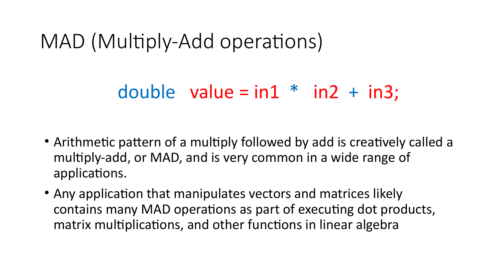
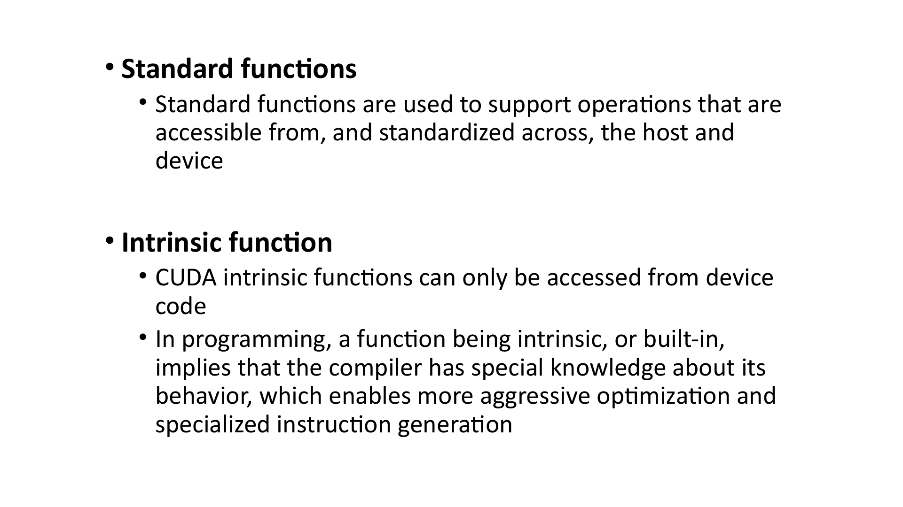
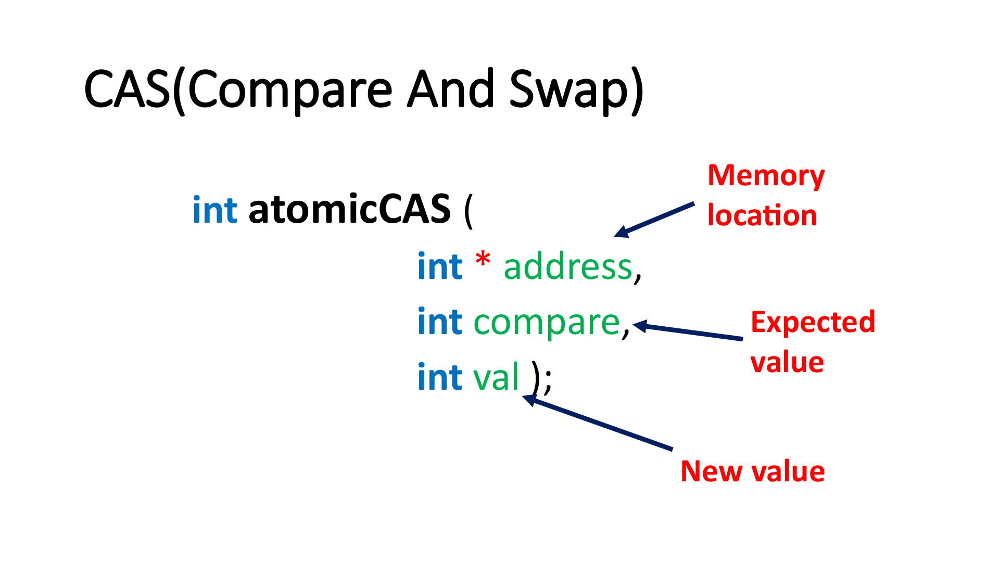

# 第 22 章 处理浮点误差与并发更新

## 从一次多项式求值看指令级优化

假设每个线程都要计算 \(y=ax^2+bx+c\)。取 \(x=2\)、\(a=3\)、\(b=4\)、\(c=5\)，直接按多项式展开就是：

```text
3×2×2 + 4×2 + 5 = 12 + 8 + 5 = 25
```

这里需要做 3 次乘法和 2 次加法。若改写成 Horner 形式，计算路径变为：

```text
(a×x + b)×x + c
(3×2 + 4)×2 + 5 = 10×2 + 5 = 25
```

现在只剩 2 次乘法和 2 次加法，而且两个计算层次都呈现“乘法后紧跟加法”的模式：

```cpp
__device__ float polynomial(float x, float a, float b, float c) {
    return (a * x + b) * x + c;
}
```

在支持融合乘加（FMA）的设备上，编译器可能把两个乘加模式生成两条 FMA 指令，而不是分别生成乘法和加法。若需要明确指定逐次融合的舍入方式，也可以在设备代码中写成：

```cpp
__device__ float polynomial_fma(float x, float a, float b, float c) {
    float t = __fmaf_rn(a, x, b);  // 计算 a*x+b，只在最后舍入一次
    return __fmaf_rn(t, x, c);     // 计算 t*x+c，同样只舍入一次
}
```



*图 22.1　乘法后紧跟加法是常见计算模式，可以映射为融合乘加指令。*

这段优化同时包含两个决定：**代数上重排计算**，以及**让编译器或显式 intrinsic 选择指令**。后者不能仅凭源码断定。普通表达式是否融合，会受到编译选项、目标架构和上下文影响；即使指令条数减少，也还要检查寄存器使用、依赖延迟和实际运行时间。可以用 `cuobjdump --dump-sass` 或相应工具检查生成代码，再用统一输入做性能对照。

Horner 形式也不是无条件的“优化按钮”。它改变了浮点运算的结合顺序，结果可能与原表达式不同；对逐位复现有要求的程序，必须把这一点与指令数量一起评估。

## FMA 为什么会改变数值结果

先看一个刻意构造的单精度例子：

```text
a = 1 + 2^-23
b = 1 - 2^-23
c = -1
```

三个数都可以由 `float` 表示。实数范围内的乘积和最终结果为：

\[
(1+2^{-23})(1-2^{-23})-1=-2^{-46}
\]

如果乘法先单独执行，乘积 \(1-2^{-46}\) 与 1 的差别太小，单精度舍入后会变成 1，再加 \(-1\) 就得到 0。若使用 FMA，**乘积不以单精度中间值的形式先舍入，而是直接与 \(-1\) 相加后再舍入**，因此能保留 \(-2^{-46}\)。

```cpp
float separate = __fadd_rn(__fmul_rn(a, b), c);
float fused = __fmaf_rn(a, b, c);
```

在这个例子中，`separate` 为 0，`fused` 为 `-0x1p-46f`，也就是 \(-2^{-46}\)。两者都遵守各自的运算约定，不能据此说某一条指令“算错了”。FMA 通常减少一次中间舍入，但“通常更接近实数结果”不等于它在每种误差度量、每种后续算法中都更合适。

源码 `a * b + c` 也没有单独承诺一定采用上述哪条路径。需要固定行为时，应使用明确的运算接口并核对编译结果，而不是根据一次运行或代码外观猜测。

## 求和顺序也是结果的一部分

FMA 展示了“少一次舍入”的影响；并行归约还会改变“哪些数先相加”。单精度 `float` 有 23 个显式有效数字位，连同规格化数的隐含位共有 24 位精度；双精度相应为 52 个显式位和 53 位有效精度。


*图 22.2　单精度与双精度的符号位、指数位和有效数字位分配不同。*

考虑下面 4 个 `float` 按不同顺序求和：

```text
[100000000, 1, -100000000, 1]
```

实数总和是 2。但 \(10^8\) 位于单精度间隔为 8 的范围内，所以 `100000000.0f + 1.0f` 会舍入回 `100000000.0f`。三种合法的加法分组可能得到：

| 计算顺序 | 手算过程 | `float` 结果 |
|---|---|---:|
| 从左到右 | `1e8+1 → 1e8`，再减 `1e8` 得 0，最后加 1 | 1 |
| 相邻配对成树 | `(1e8+1) + (-1e8+1) → 1e8 + (-1e8)` | 0 |
| 先抵消大数 | `(1e8-1e8) + (1+1) → 0 + 2` | 2 |

因此，把第 10 章的串行累加改成树形归约，不只是改变性能，也改变了舍入路径。**浮点加法不满足严格结合律；树形归约也不保证在任何输入上都比串行更准确**，抵消发生的时机同样重要。

实际验证应先明确需要的是**逐位一致**还是**误差可接受**。后者通常同时考虑绝对误差和相对误差，并覆盖接近 0、很大、很小以及特殊值等输入，而不是对所有数据套用一个固定 `epsilon`。若误差预算无法满足，可以考虑双精度累加、更稳定的求和算法或固定的分组方式；若要求可重复，则还要固定归约树、分块和最终合并顺序。固定顺序有助于复现，但仍不等于数学精确。

## 数学 intrinsic：先给误差预算，再换实现

指令级选择不仅发生在加减乘。假设要把二维向量归一化，输入为 `(3, 4)`，手算得到：

```text
长度平方 = 3² + 4² = 25
长度倒数 = 1 / √25 = 0.2
归一化结果 = (3×0.2, 4×0.2) = (0.6, 0.8)
```

标准写法可以用 `1.0f / sqrtf(norm2)`。若算法允许近似误差，设备端可以使用 `rsqrtf` 直接求近似倒数平方根：

```cpp
__device__ float2 normalize_fast(float2 v) {
    float norm2 = v.x * v.x + v.y * v.y;
    if (norm2 == 0.0f) {
        return make_float2(0.0f, 0.0f);
    }

    float scale = rsqrtf(norm2);
    return make_float2(v.x * scale, v.y * scale);
}
```

这里保留零长度分支，是因为没有可定义的单位方向，也避免用 `0 × ∞` 产生 NaN。对非零输入，`rsqrtf` 通常比“标准平方根后再除法”更直接地利用硬件能力，但返回值不应默认与标准实现逐位相同。



*图 22.3　标准数学函数强调统一的数值行为，设备 intrinsic 允许编译器选择更专门的指令与实现。*

同样的取舍也出现在 `sinf` 与 `__sinf`、普通除法与近似除法之间。**替换前必须确认输入定义域、文档给出的误差和特殊值语义，并用真实数据检验最终结果的误差**，而不只检查函数输出看起来是否接近。特别要注意 `--use_fast_math` 这类全局编译选项可能同时改变多个运算的精度、舍入或次正规数处理；它不等于只把某一个 `sinf` 换成 `__sinf`。

如果数学函数只占核函数很小一部分，近似替换可能几乎不影响总时间。合理流程仍是：保留标准版本作为参考，测量误差和端到端性能，再决定是否采用近似版本。

## 三个线程同时加 1：原子操作解决什么

数值误差不是共享数据的唯一问题。设 `counter` 初值为 0，三个线程各执行一次普通的 `counter += 1`。这条源码实际包含读取、加法和写回，可能出现如下交错：

```text
线程 A 读取 0    线程 B 读取 0    线程 C 读取 0
线程 A 写回 1    线程 B 写回 1    线程 C 写回 1
最终 counter = 1，而不是 3
```

`atomicAdd` 把同地址的读—改—写作为原子操作执行，使三次更新不会互相覆盖：

```cpp
__global__ void count_three(int* counter) {
    atomicAdd(counter, 1);
}
```

若初值为 0，最终计数必为 3。某次执行中三个线程看到的旧值会分别是 0、1、2，但哪个线程取得哪个旧值没有保证。也就是说，**原子性保证更新不丢失，不保证线程先后次序。**



*图 22.4　比较并交换只有在目标地址仍保存期望值时才写入新值，并返回操作前的旧值。*

更一般的条件更新可以使用 `atomicCAS(address, expected, desired)`。例如地址中的当前值为 4，某线程以 `expected=4`、`desired=7` 调用 CAS，成功后地址变为 7，返回旧值 4。若另一线程已先把地址改成 7，这次比较就会失败，函数返回实际旧值 7，地址不会被错误地写回。调用者可根据返回的旧值重新计算并重试。CAS 保护的是这一次比较与交换，不会把后续整段代码自动变成临界区。

## 浮点原子求和：不丢更新仍可能不确定

把整数计数换成浮点累加，还要叠加前面讨论的舍入顺序。设结果初值为 0，三个线程分别加 `1e8`、`1`、`-1e8`：

```text
次序 A：0 + 1e8 → 1e8；再加 1 → 1e8；再减 1e8 → 0
次序 B：0 + 1e8 → 1e8；再减 1e8 → 0；最后加 1 → 1
```

原子操作保证三个加法都发生，但不同调度可能分别得到 0 和 1。**浮点原子累加“不丢更新”不等于“结果逐位确定”**；相同程序重复运行时，结果可能随原子操作到达顺序变化，这与更新丢失是两回事。

下面的核函数展示最直接的全局累加形式：

```cpp
__global__ void atomic_sum(const float* input, float* result, int n) {
    int index = blockIdx.x * blockDim.x + threadIdx.x;
    if (index < n) {
        atomicAdd(result, input[index]);
    }
}
```

若语义是从 0 开始求和，必须在启动前初始化结果。全零字节表示 `0.0f`，所以可以这样准备并检查执行：

```cpp
CUDA_CHECK(cudaMemset(result, 0, sizeof(float)));
atomic_sum<<<blocks, threads>>>(d_input, result, n);
CUDA_CHECK(cudaGetLastError());
CUDA_CHECK(cudaDeviceSynchronize());
```

`cudaMemset` 只负责初值，原子操作也不等于等待所有更新完成；主机读取最终结果前仍需建立完成关系。如果目标是在已有值上继续累加，就不应擅自清零。

当许多线程更新同一地址时，竞争还会增加串行化成本。常用改进是先按第 10 章完成块内归约，再把最后的块结果写出改为一次原子累加：

```cpp
// 块内归约结束后，data[0] 是当前块的总和。
if (threadIdx.x == 0) {
    atomicAdd(result, data[0]);
}
```

这样每个块只进行一次全局 `atomicAdd`，但块间到达次序仍未固定，所以浮点结果依然不保证逐位确定。**分层归约可以减少原子竞争，却不会自动固定浮点合并顺序。**若结果必须可重复，应把各块部分和写入 `block_sums[blockIdx.x]`，再用固定的树形或串行顺序合并，而不是依赖全局浮点原子累加。

## 小结

指令级优化需要同时检查生成指令和数值语义：Horner 重写与 FMA 会改变计算及舍入路径，数学 intrinsic 以明确的误差预算换取更直接的硬件实现，原子操作则解决并发读—改—写中的更新丢失，却不提供顺序保证。性能优化、数值误差和并发确定性必须分别验证，不能用其中一项的正确代替另外两项。
