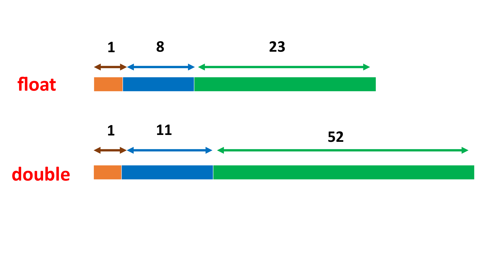

# 第 22 章 指令级优化、浮点精度与原子操作


*图 22.1　乘法加加法模式可映射为融合指令，优化时需要同时检查生成指令和数值行为。（原课程课件）*

## 从源码语句到设备指令

CUDA C/C++ 核函数需要经过编译，才能转换为目标 GPU 架构的设备指令。源码中的一条语句可能被展开为多条地址计算和内存指令，也可能被编译器融合、重排或删除。因此，指令级优化不能停留在数源码行数，而应同时考察生成代码、目标架构和运行指标。

常见设备指令包括整数与浮点算术、类型转换、内存加载与存储、分支控制、同步以及特殊函数操作。它们的吞吐、延迟和使用的硬件单元不同。内存指令还要结合线程束地址集合分析，分支指令需要结合线程束内的条件分布分析，算术指令则与数据类型、精度和依赖关系密切相关。

指令数量减少并不必然意味着性能提高。例如，增加几条独立算术指令来避免一次高延迟全局访问，可能明显改善总时间；反之，过度展开虽然减少循环控制，却可能提高寄存器压力并降低驻留并行度。可靠的优化流程是保留基准实现，检查编译结果，再用执行时间和硬件指标验证假设。



*图 22.2　单精度与双精度在符号位、指数和有效数字位数上的分配不同。（原课程课件）*

## 浮点运算的顺序与舍入

浮点数的有限精度使运算顺序成为结果的一部分。浮点加法不满足严格结合律，串行累加、树形归约和原子累加可能得到略有差异的结果。这种差异不一定代表算法错误，但验证时必须使用与数据范围、数据类型和运算规模相适应的误差标准。

乘加表达式还可能被编译为融合乘加（FMA）：

```cpp
float result = a * b + c;
```

FMA 将乘法与加法组合为一条操作，减少中间舍入并通常提高吞吐。它可能使结果与分别执行乘法、加法略有不同。对数值复现性有严格要求时，应检查编译器融合行为和 CUDA 提供的相应控制接口，而不能仅凭源码推断每一步舍入。

单精度和双精度的选择同样重要。双精度提供更高精度，但不同 GPU 的双精度吞吐差异很大；单精度计算更快、存储更少，却可能不满足迭代算法的误差要求。数据类型应依据数值需求和目标硬件共同决定。


*图 22.3　标准函数与 intrinsic 在可移植性、指令生成和精度方面具有不同设计目标。（原课程课件）*

## 标准数学函数与 intrinsic

CUDA 标准数学函数重视精度、定义域和特殊值处理，数学 intrinsic 则提供更接近硬件指令或近似实现的选择。例如，标准 `sinf` 与快速近似 `__sinf` 不能被视为数值行为完全相同的同义函数，除法、平方根等操作也存在不同精度和舍入语义的版本。

选择近似函数之前，需要明确三个条件：

1. 输入是否始终位于近似实现适用的范围内。
2. 算法能够接受多大的绝对误差和相对误差。
3. 数学函数是否真的是核函数的主要瓶颈。

测试数据应覆盖正常值、边界值以及算法可能遇到的特殊输入。性能比较必须保持数据规模、编译选项和目标设备一致，并同时报告误差。快速数学编译选项还可能改变其他运算，不能只比较函数名称而忽略全局编译影响。


*图 22.4　比较并交换通过目标地址、期望值和新值实现条件更新，是许多自定义原子操作的基础。（原课程课件）*

## 原子操作与并发更新

多个线程同时执行普通的 `result[0] += value` 时，读取、加法和写回可能交错，导致更新丢失。原子函数把特定读—改—写操作作为不可分割的硬件操作完成，可以避免这种竞态。

下面的核函数将输入元素累加到同一地址：

```cpp
__global__ void atomic_sum(const float* input, float* result, int n) {
    int index = blockIdx.x * blockDim.x + threadIdx.x;
    if (index < n) {
        atomicAdd(result, input[index]);
    }
}
```

若示例语义是“从 0 求和”，主机必须在启动前初始化结果并检查错误：

```cpp
CUDA_CHECK(cudaMemset(result, 0, sizeof(float)));
atomic_sum<<<blocks, threads>>>(d_input, result, n);
CUDA_CHECK(cudaGetLastError());
CUDA_CHECK(cudaDeviceSynchronize());
```

如果语义是“累加到已有结果”，初始值则应由调用者明确提供。无论采用哪种语义，未初始化的 `cudaMalloc` 缓冲区都不能作为确定性的求和起点。

## 原子性不等于顺序保证

原子操作保证同地址更新不会相互破坏，但不规定不同线程的执行顺序。整数计数通常不受顺序影响，浮点累加则可能因顺序变化产生不同的舍入结果。原子操作也不替代阶段同步，程序仍需通过内核边界、事件或其他机制等待整批更新完成。

大量线程直接更新同一地址还会形成竞争，使硬件执行趋于串行。更好的结构是分层汇总：先在线程内累计多个元素，再通过 Shuffle 完成线程束归约，通过共享内存完成线程块归约，最后只让每个线程块执行少量全局 `atomicAdd`。这种方案保留跨块汇总的简洁性，同时显著降低同地址原子操作次数。

## 小结

指令级优化需要同时考虑编译结果和硬件执行，浮点优化必须说明运算顺序、舍入与误差，原子优化则要处理初始值、竞争和顺序不确定性。三者共同遵循同一原则：先定义正确性与实验条件，再讨论性能收益，不能用更短的代码或一次更快的运行代替验证。
