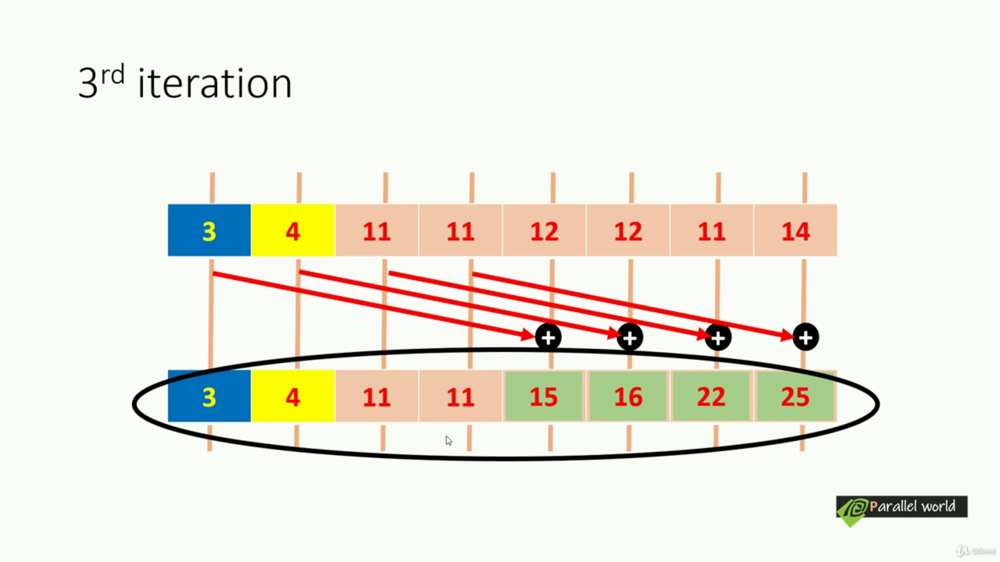
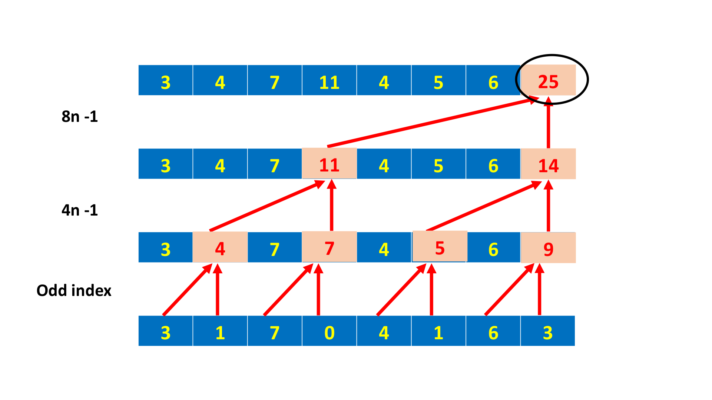

# 第 23 章 实现块内并行扫描

## 扫描是什么：每个位置都保留前缀结果

第 10 章的归约把整个数组合并成一个结果。例如，对 `[3, 1, 7, 0, 4, 1, 6, 3]` 求和，最终只得到 `25`。但很多任务不只想知道“全部加起来是多少”，还想知道**到每一个位置为止，累计结果是多少**。

这就是扫描要解决的问题。**扫描（scan，也叫前缀计算）会为一组输入生成一系列前缀结果，而不是只保留最后总和。** 这里的“前缀”，是指从数组起点到当前位置的一段累计结果；根据是否包含当前元素，又分为包含扫描与排他扫描。

## 包含扫描与排他扫描

先用 8 个整数分清两种类型，不急着写核函数：

```text
下标 i   0  1  2  3  4  5  6  7
输入     3  1  7  0  4  1  6  3
```

**包含扫描（inclusive scan）**把当前元素也算进去。例如下标 2 的结果是 `3+1+7=11`，下标 4 的结果是 `3+1+7+0+4=15`。**排他扫描（exclusive scan）**只累计当前位置之前的元素，所以下标 2 的结果是 `3+1=4`，下标 4 的结果是 `3+1+7+0=11`。

| 下标 `i` | 输入 | 包含扫描 | 排他扫描 |
|---:|---:|---:|---:|
| 0 | 3 | 3 | 0 |
| 1 | 1 | 4 | 3 |
| 2 | 7 | 11 | 4 |
| 3 | 0 | 11 | 11 |
| 4 | 4 | 15 | 11 |
| 5 | 1 | 16 | 15 |
| 6 | 6 | 22 | 16 |
| 7 | 3 | 25 | 22 |

排他扫描的第一个 0 不是输入中的某个值，而是加法单位元，表示“前面没有任何元素时的总和”。两种结果在整数加法下满足：

```text
inclusive[i] = exclusive[i] + input[i]
exclusive[i + 1] = inclusive[i]
```

扫描也可用于其他二元运算，但算法重排部分结果时要求运算满足结合律，并用到正确的单位元。若运算不满足交换律，还必须保持元素的先后次序。浮点加法只在实数意义上满足结合律，因此不同扫描算法可能产生不同舍入结果；本章先用整数把数据依赖和同步讲清楚。

## 为什么需要扫描：三个具体用途

### 用途一：查看每天的累计数量

假设连续 4 天新增的任务数是 `[3, 1, 7, 0]`，我们想知道的不只是 4 天一共有多少任务，还想知道截至每天的累计数量：

| 天数 | 当天新增 | 截至当天的累计计算 | 累计结果 |
|---:|---:|---|---:|
| 第 1 天 | 3 | 3 | 3 |
| 第 2 天 | 1 | 3 + 1 | 4 |
| 第 3 天 | 7 | 3 + 1 + 7 | 11 |
| 第 4 天 | 0 | 3 + 1 + 7 + 0 | 11 |

归约只返回最后的 `11`，扫描则返回 `[3, 4, 11, 11]`。**如果后续要绘制累计曲线、检查某天达到多少工作量，或找出何时首次超过阈值，就需要扫描而不只是归约。**

### 用途二：把筛选出的元素连续写入输出

假设要从 `[5, 8, 3, 4, 6]` 中保留偶数，并紧凑地写入另一个数组。先把“是否为偶数”写成 1 或 0，再对这些标记做排他扫描：

| 原始下标 | 原始值 | 保留标记 | 前面的保留元素数（排他扫描） | 保留时写入的位置 |
|---:|---:|---:|---:|---:|
| 0 | 5 | 0 | 0 | 不写入 |
| 1 | 8 | 1 | 0 | `output[0] = 8` |
| 2 | 3 | 0 | 1 | 不写入 |
| 3 | 4 | 1 | 1 | `output[1] = 4` |
| 4 | 6 | 1 | 2 | `output[2] = 6` |

这里的“排他”表示**不把当前位置的标记计入当前扫描值**：

```text
scan[i] = flag[0] + flag[1] + …… + flag[i-1]
```

因此，表格中的 0、1、2 不是在给元素编号，而是在说“前面已经有多少个保留元素”：

- **下标 2 的扫描值 1**：它前面只有 8 一个保留元素，即 `0+1=1`。当前的 3 被丢弃，所以这里不执行写入。
- **下标 3 的扫描值仍为 1**：它前面仍然只有 8 一个保留元素，即 `0+1+0=1`。因为下标 2 的 3 被丢弃，不会增加计数。当前的 4 被保留，所以写入 `output[1]`。
- **下标 4 的扫描值 2**：它前面有 8 和 4 两个保留元素，即 `0+1+0+1=2`。当前的 6 被保留，所以写入 `output[2]`。

最终输出是 `[8, 4, 6]`。**对保留元素来说，这个“前面保留元素的数量”恰好就是写入地址。** 地址提前算好后，不同元素可以各自写输出，不必争抢同一个“下一个空位”，同时还能保持原来的先后顺序。第 24 章的流压缩使用的就是这个过程。

### 用途三：把各块的局部结果拼成全局结果

假设把 12 个数分成 3 块，每块 4 个。先对每块求和，再对 3 个块和做排他扫描：

| 数据块 | 块内元素 | 块总和 | 块和的排他扫描，也就是块偏移 |
|---|---|---:|---:|
| 块 0 | `[3, 1, 7, 0]` | 11 | 0 |
| 块 1 | `[4, 1, 6, 3]` | 14 | 11 |
| 块 2 | `[2, 5, 1, 4]` | 12 | 25 |

块 1 的偏移 11，表示块 0 已经累计了 11；块 2 的偏移 25，表示块 0 和块 1 合计 `11+14=25`。

现在看块 1 中的 6。它在块内的包含前缀是 `4+1+6=11`，要得到它在整个数组中的前缀，只需加上块偏移：

```text
全局前缀 = 块偏移 + 块内前缀 = 11 + 11 = 22
```

**没有块偏移，每个块只能算出自己的局部前缀，无法知道前面所有块已经累计了多少。** 第 24 章的跨块扫描就是按“块内计算 → 扫描块和 → 加回块偏移”连接的。

这三个用途都在使用前缀信息，但用途一包含当前位置，用途二、三只统计之前的位置；前缀可分别表示累计数量、输出地址或块起始偏移。

扫描并不改变元素的先后次序，也不是排序算法。本章聚焦前缀求和，先在一个线程块内回答两个问题：如何减少串行依赖，以及如何保证并行更新时读到正确的旧值。

## Hillis–Steele：每轮把前缀范围扩大一倍

串行求包含扫描只需从 0 到 7 依次累加，但每个结果都依赖上一个结果。Hillis–Steele 扫描改为按距离 1、2、4……合并旧值：第 `offset` 轮中，位置 `i` 加上同一轮开始时位置 `i-offset` 的值。**每一轮都必须读取该轮开始时的旧值，不能混入其他线程刚写出的新值。**

仍用上面的数组，逐轮手算如下：

| 阶段 | 本轮完成后的数组 |
|---|---|
| 输入 | `[3, 1, 7, 0, 4, 1, 6, 3]` |
| `offset=1` | `[3, 4, 8, 7, 4, 5, 7, 9]` |
| `offset=2` | `[3, 4, 11, 11, 12, 12, 11, 14]` |
| `offset=4` | `[3, 4, 11, 11, 15, 16, 22, 25]` |

以位置 6 为例，可以看清数值为何逐步变成前缀：

```text
初始：       values[6] = 6
第 1 轮：    6 + values[5] 的旧值 1  = 7
             现在保存原输入 [5..6] 的和
第 2 轮：    7 + values[4] 的旧值 4  = 11
             现在保存原输入 [3..6] 的和，即 0+4+1+6
第 3 轮：    11 + values[2] 的旧值 11 = 22
             加上原输入 [0..2] 的和，得到 [0..6] 的前缀
```

第 2 轮的 `values[4]=4` 是第 1 轮产生的部分和 `input[3]+input[4]=0+4`，不是最初下标 4 的值；第 3 轮读取的 `values[2]=11` 则是第 2 轮产生的 `3+1+7`。这正是“每轮使用同一轮旧值”的含义。


*图 23.1　第一轮把每个位置与前一个位置的旧值相加，得到相邻两项的部分和。*

### 单块就地实现与两次同步

下面的核函数限定为**一个线程块、`0 < n <= blockDim.x`**。它直接在共享数组上更新，因此每一轮都先读旧值，再同步，最后写回：

```cpp
__global__ void hillis_steele_inclusive(
    const float* input, float* output, int n) {
    extern __shared__ float values[];
    const int tid = threadIdx.x;

    // 每个共享位置都初始化；无效位置补加法单位元 0。
    values[tid] = tid < n ? input[tid] : 0.0f;
    __syncthreads();

    for (int offset = 1; offset < n; offset <<= 1) {
        float previous = 0.0f;
        if (tid >= offset) {
            previous = values[tid - offset];  // 先保存本轮旧值
        }
        __syncthreads();                       // 等所有线程完成本轮读取

        if (tid >= offset && tid < n) {
            values[tid] += previous;           // 再覆盖本位置
        }
        __syncthreads();                       // 等本轮写入全部完成
    }

    if (tid < n) {
        output[tid] = values[tid];
    }
}
```

代码中的每一轮做了三件事：

1. **读。** 对 `tid >= offset` 的线程，把 `values[tid-offset]` 保存到寄存器 `previous`。位置小于 `offset` 的线程不需要累加任何前方值。
2. **读后同步。** 所有线程都完成读取后，才允许任何线程覆盖共享数组。没有这个屏障，线程 1 可能先把 `values[1]` 从 1 改成 4，较慢的线程 2 随后就会算出 `7+4=11`，而第一轮正确结果应是 `7+1=8`。
3. **写并再次同步。** 本轮更新全部完成后才进入下一轮。否则下一轮可能读到尚未更新的部分和，或在其他线程尚未读取时提前覆盖它。

两个 `__syncthreads()` 都位于条件语句之外。即使线程本轮不做加法，或者它对应尾部的补值位置，也必须到达相同的屏障。启动时第三个执行配置参数至少应为 `blockDim.x * sizeof(float)`；无效线程不能通过提前 `return` 离开，否则其余线程会在屏障中等待。

8 个元素的三轮分别更新 7、6、4 个位置，共 17 次加法，而串行包含扫描只需 7 次。一般情况下，Hillis–Steele 只需对数级轮数，却要做 \(O(n\log n)\) 次工作。它的优势是结构直观，代价是大量重复合并。



*图 23.2　第三轮读取距离为 4 的旧值，把已有的四项部分和扩展为完整的八项包含前缀。*

## 工作高效排他扫描：先求部分和，再分发前缀

17 次加法能否减少？工作高效扫描把过程分成上扫和下扫。**上扫类似第 10 章的树形归约，负责构建部分和；下扫负责把“左子树之前的前缀”传回各节点，最终直接得到排他扫描。**

### 上扫：从叶节点合并到根

第 `stride` 轮把下标 `right` 与 `right-stride` 合并，其中 `right` 依次为 `2*stride-1`、`4*stride-1`……。数组仍然逐轮写全：

| 上扫阶段 | 合并距离 | 本轮完成后的数组 |
|---|---:|---|
| 输入 | — | `[3, 1, 7, 0, 4, 1, 6, 3]` |
| 第 1 轮 | 1 | `[3, 4, 7, 7, 4, 5, 6, 9]` |
| 第 2 轮 | 2 | `[3, 4, 7, 11, 4, 5, 6, 14]` |
| 第 3 轮 | 4 | `[3, 4, 7, 11, 4, 5, 6, 25]` |

第 1 轮更新下标 1、3、5、7，分别得到 `3+1=4`、`7+0=7`、`4+1=5`、`6+3=9`。第 2 轮只更新下标 3 和 7：下标 3 变为 `7+4=11`，下标 7 变为 `9+5=14`。最后一轮把下标 3 的 11 加到下标 7，根位置得到总和 25。



*图 23.3　上扫逐层合并相邻子树，根位置保存总和，内部节点保留下扫所需的左子树部分和。*

三轮分别执行 4、2、1 次加法，总数为 7，与归约相同。此时数组还不是扫描结果，因为许多内部节点保存的是某一子树的和，而不是从原数组起点开始的前缀。

### 根置零与下扫：把排他前缀送向叶节点

根之前的元素数量为 0，所以先把最后的根位置改为加法单位元 0。**必须先保存根中的块总和，再将根置零，否则总和会丢失。**随后按相反层次处理每对左右子节点。设 `left` 和 `right` 是本轮读取的旧值，则更新规则是：

```text
new_left  = right
new_right = right + left
```

这里的旧 `right` 是父节点携带的“整棵左子树之前的排他前缀”，旧 `left` 是上扫留下的“左子树总和”。因此，左子节点直接继承父前缀，右子节点则还要加上左子树的总和。

下扫各轮为：

| 下扫阶段 | 合并距离 | 本轮完成后的数组 |
|---|---:|---|
| 根置零 | — | `[3, 4, 7, 11, 4, 5, 6, 0]` |
| 第 1 轮 | 4 | `[3, 4, 7, 0, 4, 5, 6, 11]` |
| 第 2 轮 | 2 | `[3, 0, 7, 4, 4, 11, 6, 16]` |
| 第 3 轮 | 1 | `[0, 3, 4, 11, 11, 15, 16, 22]` |

例如下扫第 2 轮处理下标 5 和 7：旧父值是 `values[7]=11`，旧左子树值是 `values[5]=5`，于是写入 `values[5]=11`、`values[7]=11+5=16`。最后一轮再处理相邻位置，就得到开头手算的排他扫描。


*图 23.4　下扫先保存左右旧值，再把父前缀写给左节点，把父前缀与左子树总和写给右节点。*

### 单块代码：上扫、下扫和同步一一对应

以下实现使用整数，以便与手算完全一致。前置条件是一个线程块、`blockDim.x` 为 2 的幂、`0 < n <= blockDim.x`。`block_sum` 可为空指针；若非空，它会在根置零前保存本块总和，供下一章的跨块扫描使用。

```cpp
__global__ void work_efficient_exclusive(
    const int* input, int* output, int* block_sum, int n) {
    extern __shared__ int values[];
    const int tid = threadIdx.x;
    const int size = blockDim.x;

    values[tid] = tid < n ? input[tid] : 0;
    __syncthreads();

    // 上扫：stride 依次为 1、2、4……，每轮合并相邻子树。
    for (int stride = 1; stride < size; stride <<= 1) {
        const int right = (tid + 1) * (stride << 1) - 1;
        if (right < size) {
            values[right] += values[right - stride];
        }
        __syncthreads();
    }

    // 先保存总和，再把根改成排他扫描的单位元。
    if (tid == 0) {
        if (block_sum != nullptr) {
            *block_sum = values[size - 1];
        }
        values[size - 1] = 0;
    }
    __syncthreads();

    // 下扫：stride 从最大距离返回 1，每轮传播一对排他前缀。
    for (int stride = size >> 1; stride > 0; stride >>= 1) {
        const int right = (tid + 1) * (stride << 1) - 1;
        if (right < size) {
            const int left_value = values[right - stride];
            const int parent_prefix = values[right];
            values[right - stride] = parent_prefix;
            values[right] = parent_prefix + left_value;
        }
        __syncthreads();
    }

    if (tid < n) {
        output[tid] = values[tid];
    }
}
```

上扫中，`right=(tid+1)*2*stride-1` 让线程 0、1、2……依次负责间隔为 `2*stride` 的右节点；`right < size` 关掉本轮不再需要的线程。每轮内的节点对互不重叠，但下一轮会读取本轮新产生的子树和，**所以每轮末尾的屏障不能省略**。

根置零后的屏障既等待块总和保存，也保证所有下扫线程看到根部的 0。下扫的两个临时变量不可少：如果先把 `values[right-stride]` 覆盖，再计算右节点，就读不到旧的左子树值了。下扫每轮同样需要同步，最后一个屏障还保证所有写回完成后才复制输出。

主机启动时必须提供与线程数相同的共享存储容量：

```cpp
// threads 为 2 的幂，且 n <= threads；d_block_sum 至少有一个 int。
work_efficient_exclusive<<<1, threads, threads * sizeof(int)>>>(
    d_input, d_output, d_block_sum, n);
CUDA_CHECK(cudaGetLastError());
```

若 `n` 小于 `threads`，补 0 让每个共享位置都有定义，并保持树形配对完整；它们不会改变总和或有效位置的前缀。若换成其他运算，补值也必须换成该运算的单位元。例如对全为负数的数组求最大值时，补 0 会错误地成为最大值。若 `n` 大于一个块能容纳的范围，则不能再使用这里的单块启动方式，需要第 24 章的跨块阶段。

上扫和下扫各做 `size-1` 次加法，总计约 `2*size`，所以相对树容量 `size` 的总工作量为 \(O(\mathrm{size})\)；当填充只把规模扩大常数倍时，通常写作 \(O(n)\)，这就是“工作高效”的含义。**“工作高效”只描述渐进工作量，并不保证实际运行一定更快。**树形索引、共享内存访问、屏障和线程空闲情况仍会影响实测性能，小数组上尤其需要与 Hillis–Steele 实测比较。

## 小结

包含扫描包含当前元素，排他扫描只包含当前位置之前的元素。Hillis–Steele 通过倍增距离在对数级轮数内得到包含扫描，但重复合并带来 \(O(n\log n)\) 工作；工作高效排他扫描先上扫建立部分和，再从根部的单位元下扫传播前缀，把工作量降为 \(O(n)\)。两种就地实现都依赖明确的轮次、旧值保存和块内同步，单块扫描保存的总和则是跨块扩展的直接起点。
