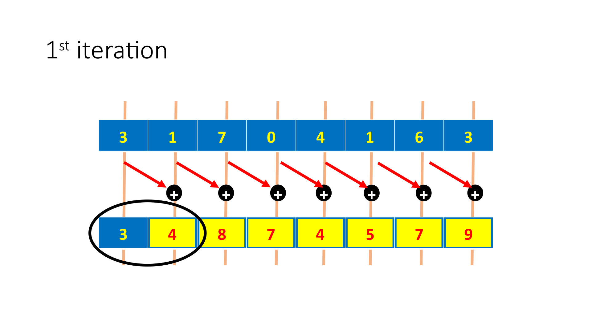
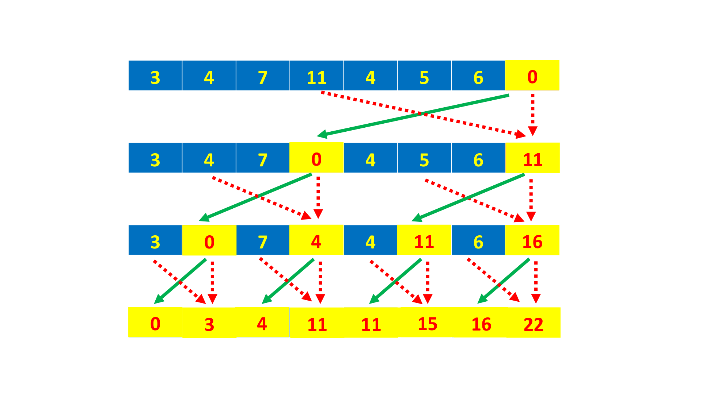
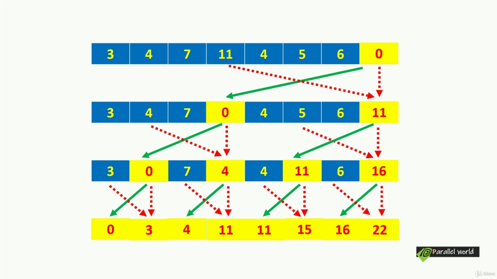

# 第 23 章 扫描基础：Hillis–Steele 与工作高效排他扫描

## 扫描、结合运算与单位元

扫描（scan）根据输入序列和二元结合运算生成累积结果。以求和为例，输入 `[a₀, a₁, a₂, a₃]` 的包含扫描为：

```text
[a₀, a₀+a₁, a₀+a₁+a₂, a₀+a₁+a₂+a₃]
```

排他扫描不包含当前位置：

```text
[0, a₀, a₀+a₁, a₀+a₁+a₂]
```

0 是加法的单位元。更换为最大值等运算时，需要选择相应单位元，并满足算法要求的结合性。扫描不仅用于前缀和，还可用于流压缩、排序和资源分配。

两种扫描以求和为例满足 `inclusive[i] = exclusive[i] + input[i]`。浮点环境中通过加减来回转换可能增加舍入，因此实际实现应明确保存需要的输入与输出形式。



*图 23.1　Hillis–Steele 扫描在每轮合并当前位置与前方固定偏移的旧值。（原课程课件）*

## Hillis–Steele：倍增传播部分和

Hillis–Steele 扫描的第 `offset` 轮将当前位置与前方 `offset` 个位置的旧值合并，偏移量依次为 1、2、4、8。经过 `O(log n)` 轮后，每个位置都得到从序列起点到当前位置的累计结果。

下面是一个限定为**单线程块、2 的幂块大小、`n <= blockDim.x`** 的教学实现，用于突出每轮的读写关系：

```cpp
__global__ void scan_block(float* data, int n) {
    extern __shared__ float values[];
    int tid = threadIdx.x;

    values[tid] = tid < n ? data[tid] : 0.0f;
    __syncthreads();

    for (int offset = 1; offset < blockDim.x; offset <<= 1) {
        float previous = tid >= offset ? values[tid - offset] : 0.0f;
        __syncthreads();

        if (tid >= offset && tid < n) {
            values[tid] += previous;
        }
        __syncthreads();
    }

    if (tid < n) {
        data[tid] = values[tid];
    }
}
```

动态共享内存需要按 `blockDim.x * sizeof(float)` 在第三个执行配置参数中分配。第一轮读取之后的同步保证所有线程取得同一轮旧值，写回之后的同步则阻止下一轮提前读取。若只保留其中一次同步，线程之间就可能看到不同阶段的值。

该算法具有 `O(log n)` 的并行步数，但每轮仍处理约 `n` 个位置，总工作量为 `O(n log n)`。它结构简单、易于验证，却不属于工作高效算法。


*图 23.2　工作高效排他扫描先在上扫阶段构建部分和，再在下扫阶段传播前缀；每一轮都必须保持正确的读写与同步顺序。（SVG 示意图）*


*图 23.3　上扫阶段逐层构建部分和，有效操作数量逐轮减半。（原课程课件）*

## 工作高效排他扫描：上扫

工作高效扫描使用上扫与下扫两阶段树结构。上扫类似归约，从叶节点向根节点合并部分和。以下伪代码以长度为 `n = 2^k` 的数组为输入：

```text
for d = 0 .. log2(n) - 1:
    stride = 2^(d+1)
    并行处理 i = stride-1, 2*stride-1, 3*stride-1, ...:
        a[i] = a[i] + a[i - stride/2]
    同步
```

每轮有效操作数量减半，上扫总工作量为 `O(n)`。完成后，根位置保存整个数组的归约结果，各内部节点保存后续下扫需要的部分和。



*图 23.4　下扫从根部的单位元开始，将排他前缀逐层传播到叶节点。（原课程课件）*

## 工作高效排他扫描：下扫

上扫结束后，将根位置设置为加法单位元 0。下扫从根向叶节点传播排他前缀：

```text
a[n-1] = 0

for d = log2(n)-1 .. 0:
    stride = 2^(d+1)
    并行处理 i = stride-1, 2*stride-1, 3*stride-1, ...:
        left  = a[i - stride/2]
        right = a[i]
        a[i - stride/2] = right
        a[i] = right + left
    同步
```

每一步先保存左子节点旧值，再将父节点值写给左子节点，并将父节点值与左子节点旧值之和写给右子节点。临时变量保证同一轮中的左右读取都基于旧值，最终数组即为排他扫描。



*图 23.5　工作高效排他扫描：上扫形成部分和并将末端置 0，下扫通过交换与累加传播前缀，最终把输入 [3, 1, 7, 0, 4, 1, 6, 3] 变为排他前缀 [0, 3, 4, 11, 11, 15, 16, 22]。（原课程视频帧）*


*图 23.6　Hillis–Steele 包含扫描的第 3 轮（stride = 4）：对 i ≥ 4 的位置累加 i − 4 处的旧值，数组由 [3, 4, 11, 11, 12, 12, 11, 14] 更新为最终包含前缀 [3, 4, 11, 11, 15, 16, 22, 25]。（原课程视频帧）*

## 规模与边界条件

经典树算法通常以 2 的幂长度描述。实际块数据可以填充到下一个 2 的幂，加法使用 0 作为填充值；其他运算则使用相应单位元。填充会增加工作量，因此需要合理选择块大小，不能让大量无效元素抵消算法优势。

工作高效只描述渐进运算量，并不保证任何实现都快于 Hillis–Steele。共享内存存储体冲突、同步、占用率和块规模仍会影响实测性能，应与简单实现使用相同输入比较。

## 小结

Hillis–Steele 以较少并行步数换取 `O(n log n)` 总工作量，上扫/下扫扫描则将工作量降为 `O(n)`。理解读写分离、每轮同步以及下扫中左右子节点的值传递，是进一步实现跨块扫描的基础。
