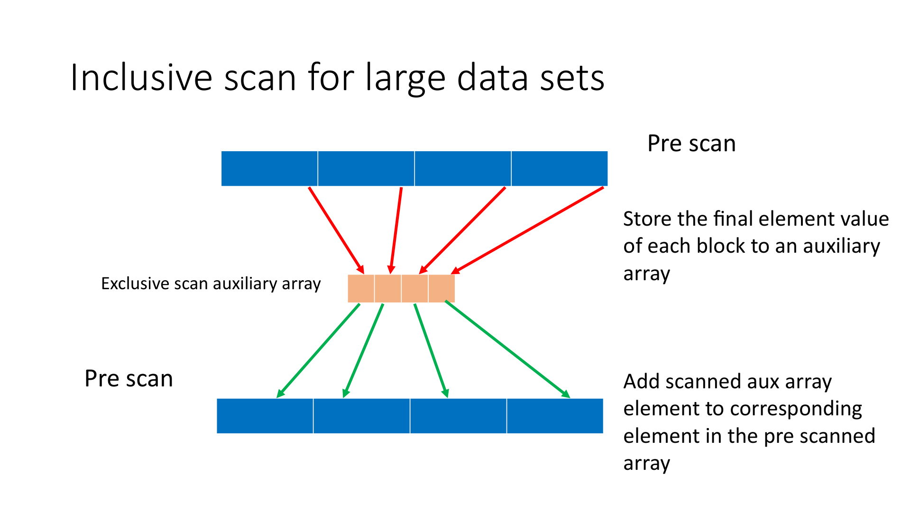
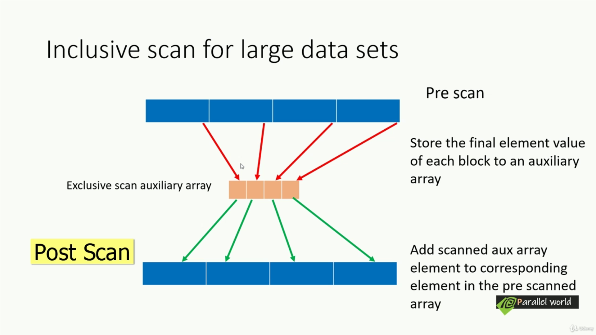
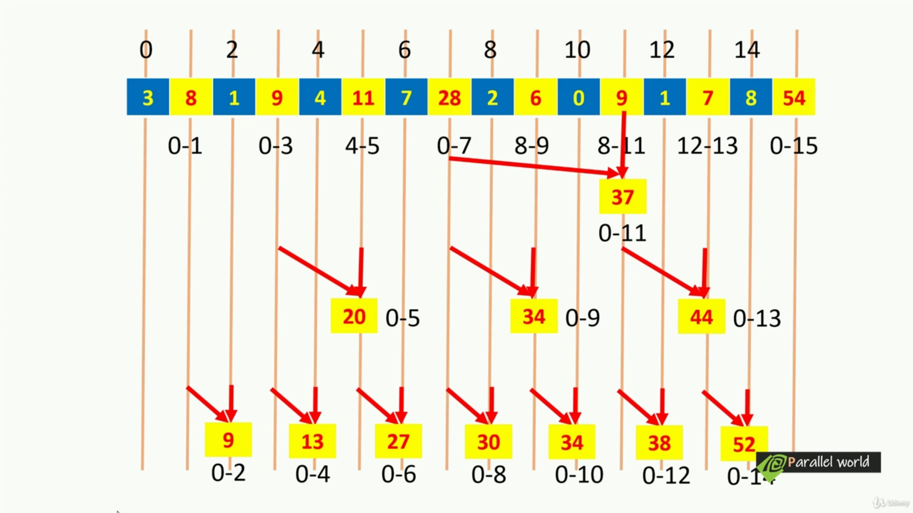

# 第 24 章 包含扫描、大规模跨块扫描与并行压缩

## 从排他结果得到包含结果

以求和为例，包含扫描可以在排他扫描基础上加入当前输入元素：

```cpp
inclusive[i] = exclusive[i] + input[i];
```

如果树形扫描已经原地覆盖输入数组，就不能再次从原位置读取 `input[i]`。实现时需要提前保存输入、使用独立输出数组，或者直接调整下扫阶段的写入逻辑。忽略这一点会将已经计算过的前缀误认为原输入。

额外转换只需要 `O(n)` 次操作，因此不会改变工作高效扫描的渐进复杂度。转换前后的共享内存读写仍需适当同步，最后一个输出元素还可以用于核对整个数据块的归约结果。

测试应覆盖单元素、全零、普通整数序列和非 2 幂尺寸。除逐元素参考比较外，还应重点检查第一个元素、最后一个元素以及分块边界。

## 为什么大规模扫描需要多个阶段

一个线程块的共享内存和线程数有限，`__syncthreads()` 也不能同步整个网格。处理大规模数组时，常用方案是将输入划分为多个数据块，每个 CUDA 线程块先独立计算局部扫描。

局部结果只包含本块内部的前缀。第 2 个及后续数据块还缺少之前所有块的累计偏移，因此需要第二阶段计算块偏移，再在第三阶段回填。



*图 24.1　大规模扫描先计算局部结果，再扫描块和辅助数组，最后回填块偏移。（原课程课件）*

## 三阶段跨块扫描

完整流程如下：

1. **局部扫描**：每个线程块扫描一段输入，并将本块总和写入 `block_sums[blockIdx.x]`。
2. **扫描块和**：对 `block_sums` 执行排他扫描，使每个元素成为对应块之前所有块的总和。
3. **偏移回填**：每个线程块读取自己的块偏移，并将其加到本块的局部扫描结果上。

```text
局部扫描 → 块和排他扫描 → 块偏移回填
```

若块和数组仍然很大，可以递归执行同样的分块扫描。不同阶段通过独立核函数启动形成完成关系，而不是依赖不受支持的跨块 `__syncthreads()`。

每个线程可以先串行处理少量连续元素，再参与块内扫描，以减少线程块数量和块和规模。这种设计必须同时保存线程内部前缀与块级偏移，不能只把多个元素简单累加后丢掉中间结果。


*图 24.2　并行流压缩通过谓词、排他扫描和散射获得唯一输出位置；按原索引扫描可保持保留元素的相对顺序。（SVG 示意图）*

## 并行压缩：扫描的直接应用

并行压缩从输入中保留满足条件的元素，并连续写入输出。它通过“谓词、排他扫描、散射”三个阶段计算目标位置。

以输入 `[5, 0, 3, 2]`、保留非零元素为例：

| 阶段 | 数据 |
|---|---|
| 输入 | `[5, 0, 3, 2]` |
| 谓词标记 | `[1, 0, 1, 1]` |
| 标记的排他扫描 | `[0, 1, 1, 2]` |
| 保留元素的目标位置 | 5→0，3→1，2→2 |
| 紧凑输出 | `[5, 3, 2]` |

散射核函数只写入满足条件的元素：

```cpp
if (keep(input[i])) {
    output[position[i]] = input[i];
}
```

每个保留元素获得不同目标位置，因此不会发生输出地址竞争。按照原索引顺序计算前缀时，保留元素的相对顺序不变，这种压缩是稳定的。

最后一个排他前缀与最后一个标记之和等于保留元素总数。若需要主机读取该数量，应在相应设备阶段完成后同步并复制结果。



*图 24.3　大规模包含扫描的三阶段数据流：先做块内预扫描并收集各块末元素，再对辅助数组做排他扫描，最后在后扫阶段把相应块偏移加回预扫描结果。（原课程视频帧）*

![并行流压缩示意：输入数组 [3, 0, 2, 4, 0, 0, 8, 0] 生成临时标记数组 [1, 0, 1, 1, 0, 0, 1, 0]，经扫描得到 [0, 1, 1, 2, 3, 3, 3, 4]，红色连线把非零项映射为输出 [3, 2, 4, 8]。](../resources/video/v077/v077-f00009.png)

*图 24.4　并行流压缩中的扫描索引：先用临时数组标记非零元素，再扫描标记得到输出位置，最终把 [3, 0, 2, 4, 0, 0, 8, 0] 压缩为 [3, 2, 4, 8]。（原课程视频帧）*



*图 24.5　工作高效包含扫描的下扫写回：红色箭头传播已经求得的前缀，依次写入 0–2、0–4、…、0–14 的包含前缀 9、13、27、30、34、38、52，顶端保留 0–15 的总和 54。（原课程视频帧）*

## 跨块压缩与边界验证

大规模压缩同样先计算各块的局部保留位置，再扫描每块保留数量，最后将块偏移加到局部位置上。这与跨块前缀和的偏移传播完全对应。

测试应覆盖全部保留、全部丢弃、单元素、末尾块不足以及跨块连续保留等情况。块边界位置最容易暴露遗漏偏移或重复散射问题。

## 小结

包含扫描可以由排他结果和原输入构造，大规模扫描则通过局部扫描、块和扫描与偏移回填完成。并行压缩复用同一前缀机制，以谓词标记计算稳定输出位置，是扫描从算法基础走向实际并行模式的典型示例。
