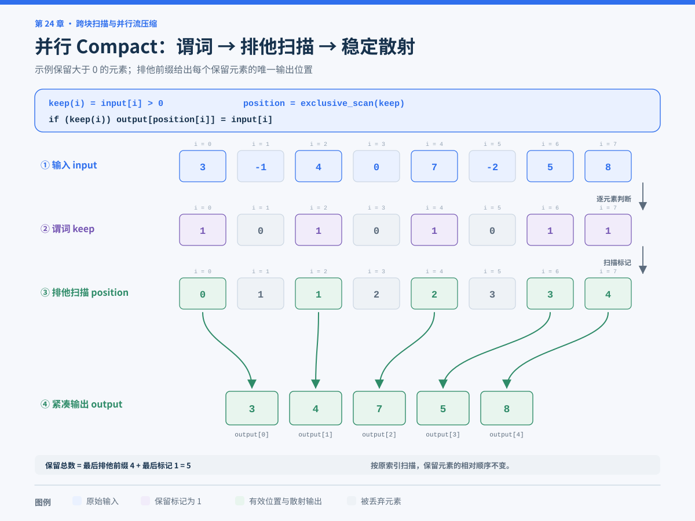

# 第 24 章 扩展到跨块扫描与流压缩

## 从单块排他结果到包含扫描

第 23 章的工作高效核函数留下两类待处理问题：调用者可能需要包含扫描，输入也可能大于一个线程块。先看第一类。仍取前 4 个输入：

```text
原输入       [3, 1, 7, 0]
排他扫描     [0, 3, 4, 11]
包含扫描     [3, 4, 11, 11]
```

包含结果只是把原输入当前位置加回排他结果。例如下标 2 为 `4+7=11`，下标 3 为 `11+0=11`。独立转换核函数可以逐元素完成这项工作：

```cpp
__global__ void exclusive_to_inclusive(
    const float* input, const float* exclusive,
    float* inclusive, int n) {
    const int i = blockIdx.x * blockDim.x + threadIdx.x;
    if (i < n) {
        inclusive[i] = exclusive[i] + input[i];
    }
}
```

这里每个线程只读写自己的下标，不需要共享内存或块内同步。关键是 `input[i]` 必须是**原输入**。如果排他扫描已经原地覆盖输入，`input[i]` 里保存的就是前缀而不是原元素，再次相加会重复计数。解决方法可以是保留原输入、使用独立输出数组，或者在块内扫描装载时把当前元素保存在寄存器中，写回前再完成这次加法。

对浮点数据，`exclusive[i]+input[i]` 也是一种新的加法分组，不保证与 Hillis–Steele 直接生成的包含扫描逐位相同。它同样只需 \(O(n)\) 次额外工作，不会抵消工作高效扫描的渐进优势。

## 单块之外还缺什么：一个 12 元素例子

`__syncthreads()` 只能同步一个线程块，共享内存和块内线程数也有限，不能把一个超长数组都放进第 23 章的共享树中。把下面的输入按每块 4 项分成 3 块：

```text
块 0：[3, 1, 7, 0]
块 1：[4, 1, 6, 3]
块 2：[2, 5, 0, 4]
```

若各块只独立计算包含扫描，会得到：

```text
块 0 局部结果：[3, 4, 11, 11]，块总和 11
块 1 局部结果：[4, 5, 11, 14]，块总和 14
块 2 局部结果：[2, 7,  7, 11]，块总和 11
```

块 1 的第一个位置不该是 4，因为前面还有块 0 的 11；块 2 之前则累计了 `11+14=25`。因此，**每块还缺一个由之前所有块的总和构成的偏移，而不是当前块自己的总和**。

先对块总和做排他扫描：

```text
block_sums    = [11, 14, 11]
block_offsets = [ 0, 11, 25]
```

再把对应偏移加回本块的每个局部包含结果：

```text
块 0 加  0：[ 3,  4, 11, 11]
块 1 加 11：[15, 16, 22, 25]
块 2 加 25：[27, 32, 32, 36]
```

拼接后正是 12 个输入的全局包含扫描。整个过程因此自然分成三个阶段：

```text
块内扫描并保存块总和 → 块总和的排他扫描 → 向本块结果回填块偏移
```


*图 24.1　跨块包含扫描先保存各块总和，再把块总和的排他扫描作为偏移加回对应数据块。*

## 第一阶段：块内扫描时同时保留原值和总和

第 23 章的 `work_efficient_exclusive` 已经可以保存根位置的总和。将其扩展为多块版本、把元素类型换成 `float`，并在以下三个位置明确数据含义，就能直接产生局部包含扫描。

装载时把原元素保存在当前线程的寄存器中，再写入共享数组：

```cpp
const int tid = threadIdx.x;
const int base = blockIdx.x * blockDim.x;
const int index = base + tid;
const float original = index < n ? input[index] : 0.0f;
values[tid] = original;
__syncthreads();
```

上扫保持第 23 章不变。根置零前把总和写入本块自己的辅助数组位置：

```cpp
if (tid == 0) {
    block_sums[blockIdx.x] = values[blockDim.x - 1];
    values[blockDim.x - 1] = 0.0f;
}
__syncthreads();
```

下扫也保持不变，最后将寄存器里的原元素加回本线程的排他前缀：

```cpp
if (index < n) {
    output[index] = values[tid] + original;
}
```

尾部补 0 仍使共享树保持完整的 2 的幂大小，块总和不受无效位置影响；全局输入和输出则始终由 `index < n` 保护。块总和在根置零**之前**保存，否则写入辅助数组的会永远是 0。使用寄存器 `original` 还避免了全局输入与输出缓冲区重叠时丢失原值。

## 第二、三阶段：扫描块和并回填偏移

块和数量能由一个块处理时，可以复用第 23 章的树形排他扫描。把其中的元素类型从 `int` 换成 `float`，记为 `work_efficient_exclusive_float`，循环和同步完全不变。随后，每个线程只需读取自己所在块的偏移：

```cpp
__global__ void add_block_offset(
    float* scan, const float* block_offsets, int n) {
    const int index = blockIdx.x * blockDim.x + threadIdx.x;
    if (index < n) {
        scan[index] += block_offsets[blockIdx.x];
    }
}
```

这里把各阶段在同一流中依次启动。设局部扫描核函数名为 `local_inclusive`，并设 `offset_threads` 为不小于 `blocks` 的合法 2 的幂块大小，则在 `n > 0` 且块和能由单块扫描时可写为：

```cpp
const int threads = 256;  // 2 的幂
const int blocks = (n + threads - 1) / threads;

local_inclusive<<<blocks, threads, threads * sizeof(float)>>>(
    d_input, d_scan, d_block_sums, n);
CUDA_CHECK(cudaGetLastError());

// 前置条件：0 < blocks <= offset_threads。
work_efficient_exclusive_float<<<1, offset_threads,
                                 offset_threads * sizeof(float)>>>(
    d_block_sums, d_block_offsets, nullptr, blocks);
CUDA_CHECK(cudaGetLastError());

// 回填核函数使用与局部扫描相同的一块对应一段数据的映射。
add_block_offset<<<blocks, threads>>>(
    d_scan, d_block_offsets, n);
CUDA_CHECK(cudaGetLastError());
```

**这些启动在同一流中有先后依赖，不需要主机在阶段之间调用 `cudaDeviceSynchronize()`。**后一阶段必须等前一阶段完成，因而第二阶段读到的 `d_block_sums` 已包含所有块的输出，第三阶段也能读到完整的 `d_block_offsets`。主机最终复制结果时仍需按所用复制方式和流建立完成关系。

若块和数组仍超过单块容量，就对它递归使用同样的三阶段扫描。**递归返回的必须是各块的排他偏移，不能误用包含扫描**，否则块 0 会错误地加上自己的总和。每一层只负责把“前面各段的总和”传给下一层，直到所有局部结果都获得全局偏移。

!!! warning "不能用 `__syncthreads()` 等待其他块"

    块 1 即使在块 0 之后启动，也不能据此推断块 0 已经写完；CUDA 不保证块的调度顺序。让块内线程调用 `__syncthreads()` 更不会把等待范围扩展到网格。多内核阶段边界提供了清晰的完成关系。若采用单内核跨块依赖，则必须另行设计可证明安全的生产者—消费者协议、内存顺序和调度前提，不能用一个计数器或一次 `__threadfence()` 随意替代。

这个流程也解释了为什么有序扫描通常不通过全局 `atomicAdd` 分配偏移：块 `b` 需要的是确定的 `sum(block_sums[0..b-1])`，而不是“哪个块先抢到哪个数”。固定分块、固定树形扫描和固定回填顺序还能使浮点求和的舍入路径可重复，尽管它仍不必与串行参考逐位一致。

## 稳定流压缩：把扫描结果当作输出地址

扫描块偏移的思想不只用于前缀和。假设要从数组中保留所有大于 0 的元素，并按原顺序紧凑写出：

```text
输入     [3, -1, 4, 0, 7, -2, 5, 8]
保留标记 [1,  0, 1, 0, 1,  0, 1, 1]
```

把标记看作整数并做**排他扫描**，就得到每个位置之前已经保留了多少个元素：

```text
排他位置 [0, 1, 1, 2, 2, 3, 3, 4]
```

只有保留元素执行写入，逐个检查即可看到目标位置：

| 原下标 | 输入 | 是否保留 | 排他位置 | 实际写入 |
|---:|---:|:---:|---:|---|
| 0 | 3 | 是 | 0 | `output[0]=3` |
| 1 | -1 | 否 | 1 | 不写 |
| 2 | 4 | 是 | 1 | `output[1]=4` |
| 3 | 0 | 否 | 2 | 不写 |
| 4 | 7 | 是 | 2 | `output[2]=7` |
| 5 | -2 | 否 | 3 | 不写 |
| 6 | 5 | 是 | 3 | `output[3]=5` |
| 7 | 8 | 是 | 4 | `output[4]=8` |

最终输出为 `[3, 4, 7, 5, 8]`。若误用包含扫描，第一个保留元素就会被写到位置 1，最后一个还可能越过输出末尾；这里需要排他扫描，是因为它回答的是“我前面已有多少项”。



*图 24.2　流压缩依次完成谓词求值、标记的排他扫描和保留元素散射，输出保持原相对顺序。*

谓词生成和散射可以分别写成两个简单核函数：

```cpp
__global__ void make_positive_flags(
    const float* input, int* flags, int n) {
    const int i = blockIdx.x * blockDim.x + threadIdx.x;
    if (i < n) {
        flags[i] = input[i] > 0.0f ? 1 : 0;
    }
}

__global__ void scatter_compact(
    const float* input, const int* flags, const int* position,
    float* output, int n) {
    const int i = blockIdx.x * blockDim.x + threadIdx.x;
    if (i < n && flags[i] != 0) {
        output[position[i]] = input[i];
    }
}
```

两个核函数之间要完成标记的排他扫描，并把结果放在 `position` 中。散射时每个保留元素的目标下标都不同：若两个原位置都被保留，后面位置的前缀至少比前面多计入一个保留标记。因此不会发生输出地址竞争，也不需要原子操作。被丢弃元素即使与相邻位置持有相同的前缀值，也因为不写而不会造成冲突。

**保留元素的目标位置随原下标严格递增，所以原顺序被保留，这就是稳定流压缩。**若改为用原子计数器抢占输出槽位，虽然也能得到无空隙的输出，线程到达顺序却可能改变元素相对次序，不能直接宣称具有同样的稳定性。

## 跨块压缩复用同一套块偏移

上述例子若仍按每块 4 项划分，局部数据为：

```text
块 0：标记 [1, 0, 1, 0]，局部排他位置 [0, 1, 1, 2]，保留数 2
块 1：标记 [1, 0, 1, 1]，局部排他位置 [0, 1, 1, 2]，保留数 3
```

对每块保留数做排他扫描，得到块偏移 `[0, 2]`。块 0 的保留元素仍写入输出 0、1，块 1 则把局部位置 0、1、2 分别加 2，写入输出 2、3、4。跨块压缩的完整数据流与跨块扫描一一对应：

```text
生成标记
→ 每块排他扫描并保存本块保留数
→ 扫描块保留数，得到块输出偏移
→ 用“块偏移 + 局部位置”稳定散射
```

若 `local_position` 尚未加全局偏移，散射核函数可以直接合并最后一步：

```cpp
__global__ void scatter_compact_blocks(
    const float* input, const int* flags, const int* local_position,
    const int* block_offsets, float* output, int n) {
    const int i = blockIdx.x * blockDim.x + threadIdx.x;
    if (i < n && flags[i] != 0) {
        const int destination =
            block_offsets[blockIdx.x] + local_position[i];
        output[destination] = input[i];
    }
}
```

这段代码要求散射与局部扫描采用相同的分块映射，使 `blockIdx.x` 指向正确的偏移。若每块每线程处理多个元素，则还应显式保存元素所属的数据段，不能机械沿用“一线程一元素”的下标关系。

对于非空输入，全局排他位置与最后一个标记可求出保留总数：

```text
count = position[n - 1] + flags[n - 1]
```

本例为 `4+1=5`。跨块版本也可以用最后一块的块偏移加该块保留数得到相同结果。若主机要读取 `count`，必须等待相关设备阶段完成后再复制；若 `n==0`，则直接定义计数为 0，不能访问 `position[-1]`。输出缓冲区至多需要 `n` 个元素，实际有效区间由这个计数决定。

测试时应覆盖全部保留、全部丢弃、单元素、空输入、尾块不足以及保留元素恰好跨块的情况。重点核对块首是否加上前块偏移、块尾计数是否包含最后一个标记，以及输出是否始终保持原相对顺序。

## 小结

包含扫描可以由排他前缀与原输入逐元素合成，但原地覆盖后必须仍能取得原值。大规模扫描通过块内局部扫描、块总和排他扫描和块偏移回填建立跨块依赖；各阶段由内核或流顺序衔接，而不是依靠块内屏障等待其他块。稳定流压缩把同一机制用于标记数组，以排他前缀计算唯一且递增的输出位置，从而同时避免散射竞争并保持元素顺序。
