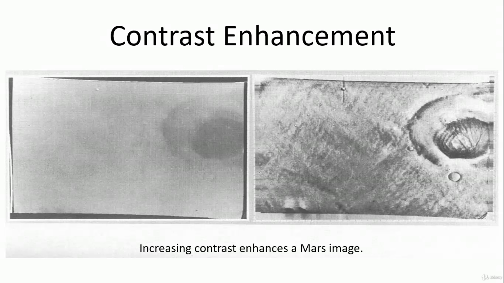
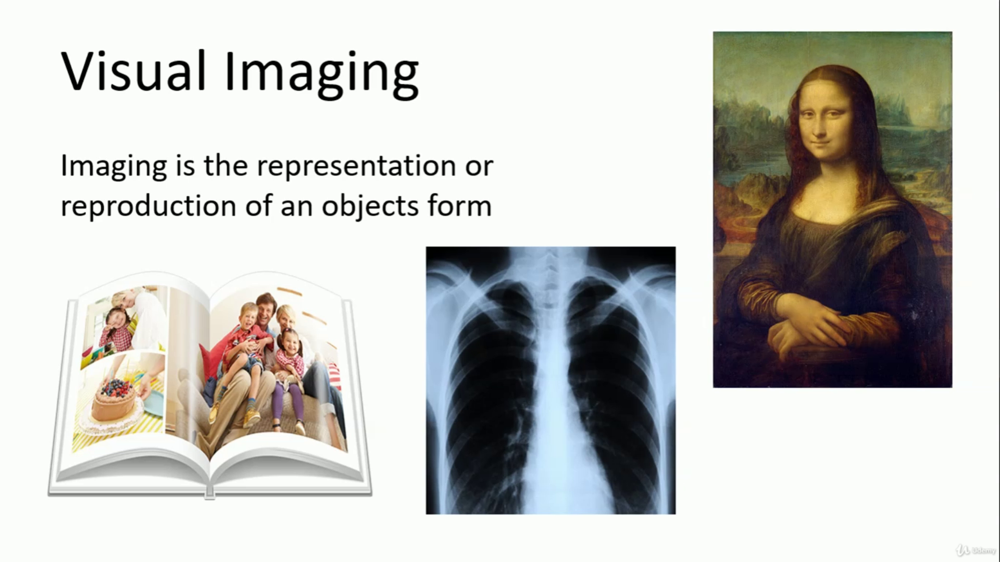
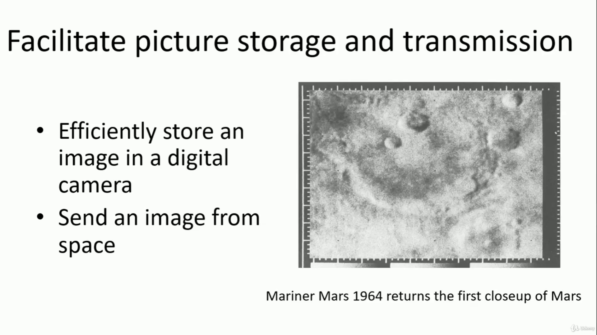
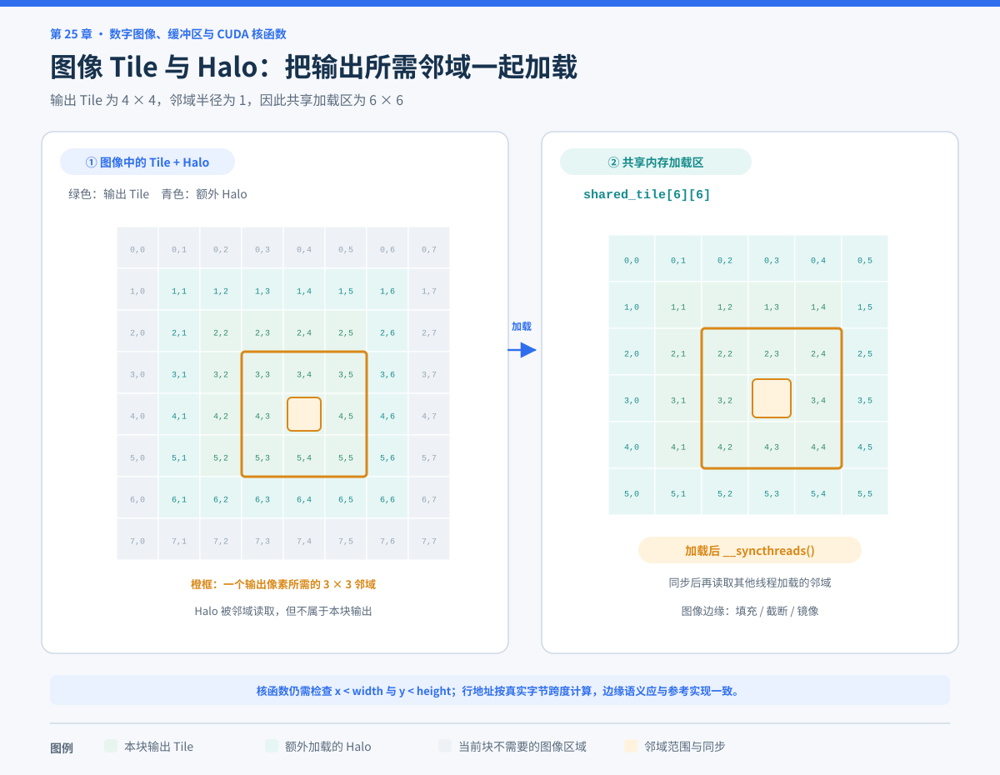

# 第 25 章 从数字图像与缓冲区到 CUDA 核函数

## 从光学成像到离散图像

成像是用某种载体记录对象形态或空间信息的过程。照片、医学 X 射线图像、超声图像和绘画采用了不同的形成方式，但都可以把图像理解为空间位置与观测值之间的对应关系。早期暗箱利用小孔将外部场景投射到暗室的屏幕上，所成图像上下、左右倒置；加入反射镜或将感光材料置于投影面后，这一光学现象便成为实用成像装置的基础。

在理想模型中，连续图像可写成定义在平面区域上的函数：

\[
I=f(x,y)
\]

函数值可以表示灰度、颜色或其他物理量。连续图像在空间位置和取值上都可能无限精细，计算机无法直接保存这种表示，因此需要在空间上采样，并把每个采样位置的响应量化为有限数值。采样结果按行、列排列成二维网格，网格元素称为像素（pixel）。

灰度图像的每个像素通常只有一个强度值，彩色图像则具有多个通道。宽为 `width`、高为 `height` 的图像包含 `width × height` 个像素；这两个方向上的采样数量共同描述图像的空间分辨率，不能把总像素数当作某一方向上的分辨率。无符号 8 位单通道图像具有 256 个可表示级别，取值范围为 0—255。更高的空间采样密度和量化精度可以保留更多细节，但也增加存储、传输和计算成本。

数字图像并不限于可见光照片。X 射线、红外、超声和射电观测同样能够形成图像。不同模态的物理意义不同，但进入计算机后都要面对采样、量化、存储和并行处理等共同问题。



*图 25.1　火星图像的对比度增强前后对照：左侧灰阶变化较弱，右侧增强后地表细节更易辨认。保留同帧对照，避免只展示处理结果。（原课程视频帧）*



*图 25.2　视觉成像的对象并不限于普通照片：原视频并列给出画册、胸部 X 线医学影像和《蒙娜丽莎》艺术作品，说明成像是对物体形态的表现或复制。（原课程视频帧）*



*图 25.3　图像存储与传输的早期航天示例：原幻灯片展示标注为 1964 年 Mariner Mars 传回的首张火星特写，用它说明从太空发送图像。（原课程视频帧）*

## 处理目标与视觉结果

图像处理的输出不一定是另一幅图像。增强、恢复、几何变换和压缩通常以图像为主要输入或输出，条码识别、字符识别、目标检测和测量则提取结构化信息。图像处理、计算机视觉、计算摄影、计算机图形学和机器视觉之间存在交叉，不宜仅按输出是否为图像划定严格边界。

面向显示或打印的处理还必须考虑观察效果。低对比度图像的强度集中在较窄范围内，扩展其动态范围可以使部分细节更容易辨认；直方图能够显示强度分布，但更大的数值差异并不必然带来更好的视觉效果。高动态范围场景需要经过色调映射才能在有限动态范围的显示设备上呈现，不同设备可能需要不同映射。印刷中的半色调技术则利用墨点大小或间距，在有限墨色下形成连续灰度的视觉效果。

这些目标决定了后续算法不能只做数值变换，还应明确参考结果和评价标准。视觉感知、伽马编码与线性光之间的关系将在下一章进一步讨论。

## 像素、通道与数值表示

RGB 图像用红、绿、蓝三个通道表示颜色。将三个通道组合可以重建彩色像素，把三个通道分别显示为灰度图，则可观察各颜色分量的强弱。三通道 8 位图像的有效像素数据量约为同尺寸单通道图像的三倍，不含行填充和容器开销。

通道数量并不等于通道顺序。OpenCV 的 `cv::imread` 在常规三通道彩色读取模式下返回交错排列的 **BGR** 数据，内存顺序为：

```text
B0 G0 R0  B1 G1 R1  B2 G2 R2  ...
```

许多其他接口采用 **RGB**，其顺序为 `R G B`。如果只修改颜色公式中的变量名而不交换实际字节，红色与蓝色通道就会被错误解释。灰度转换、颜色空间转换和通道混合必须同时明确通道顺序、数值范围及所用颜色标准。

通道可以按像素交错保存，也可以拆成多个平面，形成 SoA 布局。前者便于与 OpenCV 主机缓冲区直接衔接，后者可能更适合某些设备端访问模式。布局选择应结合后续算法和实际访存情况进行评估，不能仅依据理论上的连续性判断性能。

中间计算也不应一律沿用 8 位无符号整数。卷积累加、归一化、颜色转换和多图融合可能产生小数、负数或超出原范围的结果，通常需要先转换为浮点数或更宽的整数。写回 8 位图像时，应明确舍入、截断和饱和规则。把已经量化为 8 位的数据转换成浮点数不会恢复采集时丢失的精度，但可以避免后续运算继续发生不必要的整数截断。

## 从 OpenCV 缓冲区到设备内存

### `step` 是字节行跨度

图像进入 CUDA 核函数之前，应先完成文件解码，并确认以下属性：

- 宽度、高度和坐标原点；
- 通道数、通道顺序和元素类型；
- 每行有效数据的字节数；
- 相邻两行首地址之间的字节距离。

OpenCV `cv::Mat` 的 `step` 表示最后一项，即**以字节计的行跨度**。它不一定等于 `cols × elemSize()`：内存对齐、特定分配方式或区域视图都可能使行尾包含填充，或者使相邻行不能直接按紧凑数组推算。`isContinuous()` 只能说明当前矩阵是否可按连续数据遍历，不能说明通道顺序，也不能替代对元素类型和尺寸的检查。

对于带行跨度的主机图像，可以使用 `cudaMemcpy2D` 按行复制有效像素，分别提供主机间距和设备间距。复制宽度应是每行的有效字节数，而不是包含源行填充的 `step`。若设备端使用 `cudaMallocPitch`，设备行跨度由该调用返回，不能假定它等于主机 `step`。另一种方式是先整理成紧凑设备数组，以简化索引，但整理本身也有传输和内存开销。

输入与输出应由各自的行跨度描述。即使两幅图像尺寸相同，也不能默认二者布局相同。所有尺寸到字节偏移的转换都应使用足够宽的整数类型，避免大尺寸图像在计算 `y × step` 时溢出。

### 一个保留 BGR 顺序的复制核函数

以下核函数展示二维坐标、三通道交错布局和独立行跨度的基本用法。它只复制像素，不进行 RGB/BGR 转换：

```cpp
__global__ void copyBgr(
    const unsigned char* src, size_t srcStep,
    unsigned char* dst, size_t dstStep,
    int width, int height)
{
    const int x = blockIdx.x * blockDim.x + threadIdx.x;
    const int y = blockIdx.y * blockDim.y + threadIdx.y;

    if (x >= width || y >= height) {
        return;
    }

    const size_t pixelOffset = static_cast<size_t>(x) * 3;
    const unsigned char* in =
        src + static_cast<size_t>(y) * srcStep + pixelOffset;
    unsigned char* out =
        dst + static_cast<size_t>(y) * dstStep + pixelOffset;

    out[0] = in[0];  // B
    out[1] = in[1];  // G
    out[2] = in[2];  // R
}
```

主机可以按线程块的实际尺寸向上取整计算网格：

```cpp
dim3 block(16, 16);
dim3 grid(
    (width + block.x - 1) / block.x,
    (height + block.y - 1) / block.y);

copyBgr<<<grid, block>>>(
    dSrc, dSrcStep, dDst, dDstStep, width, height);
```

`16 × 16` 只是常用起点，不是适用于所有设备和算法的固定最优值。实际配置还要考虑寄存器、共享内存、占用率和访存方式。

### 尾线程与边界检查

网格向上取整后，右侧和底部可能产生不对应任何像素的**尾线程**。核函数必须同时检查 `x < width` 和 `y < height`，只检查其中一个维度仍可能越界。上述复制核函数没有块内同步，因此无效线程可以直接返回，有效线程再访问内存。

含 `__syncthreads()` 的分块核函数不能机械照搬这种提前返回方式。若块内线程需要共同加载共享内存，应让所有相关线程一致地到达同步点，只对全局加载和最终写入实施必要的边界保护。同步结构、尾线程处理和越界保护必须作为一个整体设计。



*图 25.4　邻域核函数把输出 Tile 与 Halo 一起加载到共享内存，同步后再读取邻域；图像边缘和真实行跨度必须按明确规则处理。（SVG 示意图）*

## 图像处理类型及其 CUDA 映射

### 点运算与图像组合

点运算根据当前位置的像素值生成输出，例如亮度缩放、阈值化、颜色转换和查找表映射。多幅图像的逐像素混合也属于类似的规则映射，但要求各输入的尺寸、坐标关系和格式已经对齐。

这类操作通常可以让一个线程负责一个像素或一个通道，天然适合二维 CUDA 网格。计算量较小时，性能往往主要受内存访问和主机—设备传输限制，而不是算术指令限制。若整幅图像只执行一次很简单的点运算，解码、上传和下载成本可能超过核函数带来的收益。

### 邻域运算、halo 与边界规则

均值滤波、高斯滤波、卷积和边缘检测需要读取当前像素周围的邻域。相邻线程会重复使用大量相同数据，因此常把图像划分为块，将块内像素及其周围的光晕区域（**halo**）装入共享内存。半径为 `r` 的二维标量分块，其共享数据区域至少覆盖：

```text
(blockWidth + 2r) × (blockHeight + 2r)
```

多通道图像还要计入通道布局。halo 区域的待加载元素数量可能多于线程块中的线程数，不能假定每个线程只加载一个元素就能完成整个区域；加载结束后还需要适当的块内同步。

图像边缘必须采用明确的**边界规则**。常见选择包括：

- 常量或零填充；
- 坐标钳制，即复制最近的边缘像素；
- 镜像反射，并明确边缘像素是否重复；
- 周期环绕；
- 只计算邻域完全位于有效区域的输出。

这些规则会产生不同的边缘结果。实现时应与 CPU 参考版本或所用库保持一致，并通过钳制坐标、显式填充或受保护加载避免读取分配范围之外的内存。共享内存分块只解决数据重用问题，不会自动定义正确的边界语义。

### 几何变换与重采样

缩放、旋转和拼接需要建立输出坐标与输入坐标之间的映射。通常从输出像素出发计算对应的源坐标，以保证每个输出位置都有确定结果。最近邻插值实现简单，但可能产生锯齿；双线性及更复杂的插值能够改善平滑程度，同时增加邻域读取和计算量。缩小图像前还可能需要低通滤波，以减轻混叠。

全景图、360 度图像和医学体数据的可视化往往还涉及多图配准或多个二维切片的组合。这些任务的并行单元不一定是原输入像素，线程映射应围绕输出坐标和实际数据依赖设计。

### 直方图与全局统计

**直方图**统计各强度或颜色区间中的像素数量，可用于分析对比度、选择阈值以及实现直方图均衡化。对 8 位单通道图像，最基本的形式包含 256 个 bin。直方图均衡化重新分配强度级别，可能使暗部或亮部细节更易观察，但也可能放大噪声或产生不自然的外观，不能把它视为必然改善图像的操作。

直方图不像点运算那样每个输出只依赖一个输入。大量线程同时更新少量 bin 会产生严重竞争。常用方法是在共享内存中建立块内局部直方图，线程先用共享内存原子操作累计局部结果，再将各 bin 合并到全局直方图。块数量、计数类型和全局合并方式需要根据图像规模确定，并验证所有像素恰好被统计一次。

### 增强、恢复、压缩与信息提取

增强与恢复包括去噪、模糊、锐化、曝光和颜色校正、修复以及对比度调整。颜色校正需要区分光源色温、物体反射和传感器响应；硬件采集阶段的合理校正与后期处理各有适用范围。已经饱和或被噪声淹没的信息通常不能无代价恢复。

压缩用于降低存储和传输成本。无损压缩能够精确重建原始数据，有损压缩则舍弃部分信息以换取更高压缩率。科学测量、医学资料和后续机器分析对信息保真度的要求，通常高于普通展示场景。压缩后的文件字节不能直接当作像素数组交给核函数，必须先解码并确认实际格式。

信息提取包括人脸或条码检测、字符识别、分割和测量。隐私应用中的局部模糊属于图像修改，身份识别则输出判断或特征。二者可能共享预处理步骤，但正确性指标和并行结构并不相同。

## 以完整流水线评估 CUDA 收益

GPU 适合处理大规模、规则且可并行的像素计算，也能通过共享内存支持邻域数据重用。然而，图像读取、格式解码、小尺寸控制逻辑和结果显示通常仍由主机或专用组件承担。有效的性能评估应覆盖：

```text
采集或解码 → 格式整理 → 主机到设备传输 → 一个或多个核函数
→ 设备到主机传输 → 编码、显示或信息提取
```

若多个连续阶段都保留在设备端，传输成本可以被摊薄；若每个小算子都往返主机，加速收益可能被抵消。验证时除核函数计时外，还应比较完整流水线的延迟、吞吐量和结果一致性。测试图像应包含不能整除线程块的尺寸、带行填充的缓冲区以及触及各种边界规则的邻域位置。

## 小结

数字图像由连续场景的采样与量化得到，其像素含义、通道顺序、位深和颜色编码共同决定数据解释。OpenCV 缓冲区映射到 CUDA 时，必须以 `step` 定位行，以实际通道布局定位像素，并对二维网格的尾线程实施边界保护。点运算、邻域运算、几何变换和直方图统计具有不同的数据依赖，分别需要合适的线程映射、halo、边界规则和归并策略。最终性能应以包含解码、传输和后续处理的完整流水线衡量。
