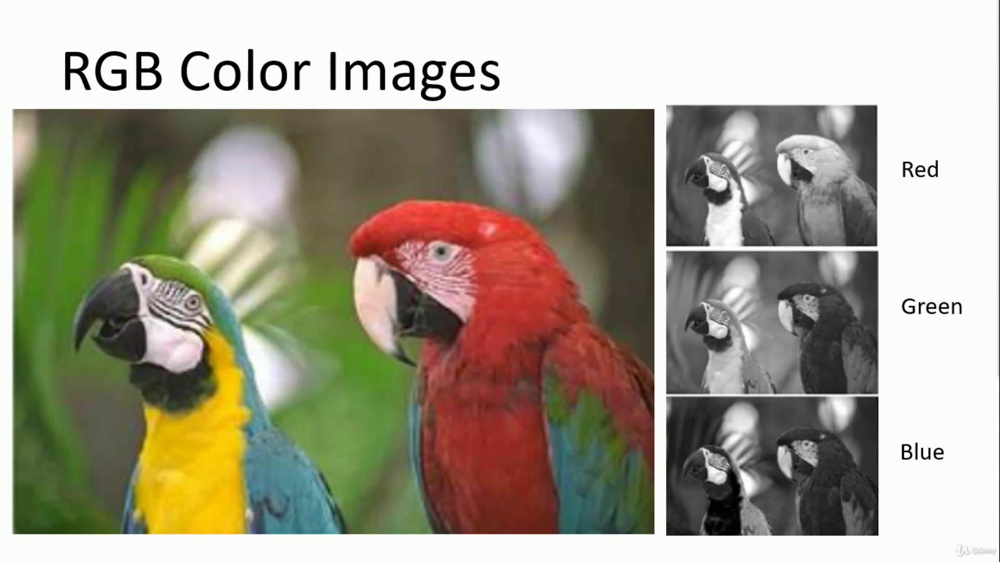

# 第 26 章 图像形成、视觉感知与 OpenCV 环境

## 从场景辐射到传感器响应

数字图像的形成始于场景中的能量。可见光只是电磁波谱中约 400—700 nm 的一段，短波端接近紫色，长波端接近红色。实际物体呈现的颜色通常由多种波长共同形成，而不是单一波长。可见光之外，X 射线、紫外线、红外线、微波和无线电波也可用于医学、遥感或天文成像。不同模态记录的能量和物理过程不同，但都要经过传感、空间离散化和数值离散化。

以普通相机为例，图像形成链路可以概括为：

```text
光源发光或物体自发光 → 物体反射、透射或吸收 → 光学系统投影
→ 传感器积分与光电转换 → 模拟或数字前端处理 → 采样、量化与编码
```

最终像素值不仅由物体本身决定，还受到光源光谱与色温、曝光时间、镜头、传感器灵敏度以及内部处理的影响。同一物体在日光、白炽灯或 LED 照明下可能产生不同的颜色响应，因此颜色校正需要说明光源和参考目标，不能把某次拍摄得到的 RGB 数值直接视为物体固有属性。

传感器把入射能量转换为电信号，再由后续电路转换为数字值。实际感光单元对有限面积、有限时间和一定光谱范围内的能量进行积分，并非测量一个数学点上的瞬时值。镜头模糊、衍射、传感器串扰和电路噪声都会改变结果。

## 采样、量化与数字图像质量

### 空间采样

**采样**把连续的空间响应转换为离散网格。第 25 章已经区分采样位置与幅值量化，本节进一步关注采样密度对图像质量的影响。较密的采样有能力记录更细的空间结构，但不能弥补光学失焦或运动模糊；采样不足会产生混叠，使高频纹理表现为错误的低频条纹或图案。

图像缩小时，先进行与缩放比例相适应的低通滤波通常比直接丢弃像素更合理；放大图像则只能依据已有样本插值，不能创造采集时不存在的真实细节。最近邻、双线性和更高阶插值提供不同的成本与视觉质量，CUDA 实现还需明确坐标中心、边界规则和处理所在的颜色空间。

### 幅值量化与位深

**量化**把连续或高精度响应映射到有限个离散级别。每通道 `b` 位可以表示 `2^b` 个级别，无符号 8 位通道对应 0—255。级别过少时，平滑渐变区域容易出现色带；提高位深可以减小量化间隔，但不会自动降低传感器噪声或扩大已经饱和的动态范围。

第 25 章已经给出像素缓冲区尺寸和 `step` 行跨度的计算方法。这里需要再次强调：将低位深数据转换为浮点数，只能提高后续计算精度，不能恢复量化时已经丢失的级别。空间分辨率和位深应分别评价，图像质量还受到镜头、曝光、噪声、压缩和显示条件的共同影响。

### 饱和、噪声与动态范围

当入射信号超过传感器或后续电路的可表示范围时，多个不同亮度可能被记录为同一个最大值，这种现象称为饱和。饱和区域中的细节已经丢失，后期降低亮度不能可靠恢复。场景动态范围超过单次采集可记录的范围时，暗部可能淹没在噪声中，亮部也可能同时截断。

多曝光合成和色调映射可以改善显示效果，但二者作用不同：前者尝试利用多次采集扩展可记录信息，后者把已有高动态范围数据映射到显示设备可呈现的范围。任何后续处理都不应被描述为能够无条件恢复截断信息。

噪声表现为非目标的随机或结构化变化，可能来自光子统计、读出电路、温度和量化等多个环节。去噪需要在抑制随机变化与保留纹理之间权衡；仅使图像更平滑并不等于恢复了真实细节。

## 彩色图像的形成与表示

RGB 表示使用红、绿、蓝三个分量。某些成像系统能够为每个位置分别测量三个分量，而许多消费级相机采用彩色滤光片马赛克，每个感光位置只直接测量一种颜色，再通过去马赛克插值估计其余通道。因此，最终 RGB 图像中的部分通道值来自邻域估计，而不是该位置的独立测量。

RGB 三个分量与文件或内存中的字节顺序是两个不同概念。OpenCV 常规彩色读取得到 BGR 顺序，其他接口可能使用 RGB；RGBA、BGRA 还包含 alpha 通道。通道重排只改变分量位置，不会完成颜色空间转换、白平衡或伽马解码。进入核函数前仍需同时确认通道数、元素类型、BGR/RGB 顺序和 `step` 行跨度。


*图 26.1　人眼结构与杆体、锥体细胞分布：原视频把眼球解剖图和 Rods/Cones 曲线并置，说明视觉感知与眼球成像结构及视网膜感受器分布相关。（原课程视频帧）*



*图 26.2　RGB 彩色图像的三个分量：同一幅金刚鹦鹉照片分解为红、绿、蓝通道，右侧灰度图表示各通道在对应位置的强弱。（原课程视频帧）*

## 人类视觉感知

### 眼睛不是均匀的像素阵列

人眼通过角膜和晶状体把场景投射到视网膜，视网膜上的视锥细胞和视杆细胞承担不同的感光功能。视锥细胞支持明视觉、颜色感知和精细细节，在中央凹附近密度较高；视杆细胞对弱光更敏感，但不提供与视锥细胞相同的颜色和细节能力。两类细胞的空间分布并不均匀，视网膜上还存在缺乏感光细胞的盲点。

因此，人眼与规则、均匀的相机传感器阵列并不等价。视野中央的高细节能力、弱光与强光条件下的不同响应，以及神经系统对缺失信息的解释，都会影响最终的视觉结果。

### 亮度适应与同时动态范围

视觉系统能够适应跨度很大的环境亮度，但这种能力不意味着可以在同一时刻清楚分辨所有亮度级别。从明亮环境进入暗处后，视觉灵敏度会逐步改变；从暗处进入亮处也需要适应。在某一适应状态下，可有效分辨的同时亮度范围小于视觉系统跨不同状态可覆盖的总范围。

显示高动态范围图像时，色调映射的目标不是简单压缩所有数值，而是在目标设备和观察条件下尽可能保留需要呈现的细节。评价时应区分物理光强、显示设备输出和观察者感知，不能只依据像素值的动态范围判断效果。

### 韦伯定律、背景与对比度

视觉系统对差异的敏感程度依赖于背景和适应状态。在一定工作范围内，韦伯定律可用下式近似描述：

\[
\frac{\Delta I}{I}\approx k
\]

其中 `I` 是背景刺激强度，`ΔI` 是可察觉差异所需的刺激变化量。该关系不是覆盖所有亮度、颜色和空间频率的精确定律，但说明相同的绝对数值差在不同背景下未必具有相同的可察觉性。

对比度增强和直方图均衡化会改变强度分布，也会改变细节的可见程度。增强结果可能更符合观察目标，也可能放大噪声或破坏自然感。算法评价应结合具体任务、参考数据和视觉条件，而不是单纯追求更宽的直方图或更大的像素差。

周围结构也会影响感知。马赫带现象中，实际分段恒定的灰度区域在交界处显得比内部更亮或更暗；其他视觉错觉还可能使相同灰度因背景不同而显得不同。此类现象说明主观观察并不总能直接反推出像素值。视觉检查适合发现感知问题，数值正确性仍需通过与参考实现比较来验证。

## 伽马编码、线性光与颜色计算

### 存储值通常不是线性光强

为了更有效地利用有限位深并适应显示与感知特性，许多图像格式采用非线性传递函数存储颜色，常统称为伽马编码。纯幂函数模型可写成：

\[
V'\approx V_{\mathrm{lin}}^{1/\gamma},\qquad
V_{\mathrm{lin}}\approx(V')^\gamma
\]

其中 `V_lin` 表示归一化线性光量，`V'` 表示编码值。实际格式可能采用分段曲线，例如 sRGB 不能在所有数值范围内都简单等同于固定的 `γ = 2.2`。实现时应依据图像声明的颜色格式选择解码和编码函数。

直接对编码值进行线性插值、光照叠加或物理颜色混合，可能得到不符合线性光关系的结果。涉及这些操作时，通常先把各通道解码到线性空间，在线性空间完成计算，再按输出格式重新编码。并非所有算法都必须采用同一流程：某些面向感知或兼容既有软件的增强会有意在编码域进行，关键是明确目标和参考语义。

OpenCV 的通道转换或 `cvtColor` 不会替调用者自动完成所有线性化工作。BGR 与 RGB 互换只是通道重排，8 位转浮点也只是数值类型转换，二者都不等于伽马解码。

### 灰度权重与通道顺序

人眼对不同光谱成分的敏感程度不同，因此彩色转灰度通常不是三个通道的算术平均。常见的 BT.601 亮度分量计算形式为：

\[
Y'=0.299R'+0.587G'+0.114B'
\]

这里使用带撇号的分量，是为了强调该式通常作用于非线性编码后的 `R'G'B'`，得到的是亮度信号而非严格的物理相对亮度。其他颜色标准或线性光计算可能采用不同系数，不能把这一组权重当作通用常数。

如果输入是 BGR 缓冲区，同一计算按内存分量写为：

\[
Y'=0.114B'+0.587G'+0.299R'
\]

实现必须核对通道顺序、系数来源、输入范围和编码空间。中间结果宜使用浮点或足够宽的整数，输出时再执行规定的舍入和范围限制。

## OpenCV 与 CUDA 环境的职责划分

OpenCV 提供图像读取、主机数据结构、图像处理和计算机视觉算法，CUDA 工具包提供 `nvcc`、CUDA 运行时和设备开发工具。安装其中一个不会自动安装或配置另一个。开始配置前，应区分以下两种使用方式：

1. **OpenCV 负责主机图像处理，自定义 `.cu` 核函数负责设备计算。** 这种方式通常只需要可用的主机 OpenCV 库和独立的 CUDA 工具包，不要求 OpenCV 自身以 CUDA 支持重新构建。
2. **直接调用 OpenCV 的 CUDA 模块。** 这种方式要求当前 OpenCV 构建确实包含所需模块、CUDA 支持及兼容依赖。仅能调用 `cv::imread` 或成功执行 `import cv2`，都不能证明这一点。

两条路径可以共存。例如，主机端使用 `cv::Mat` 解码并检查 `type()`、`channels()` 和 `step`，设备端运行自定义核函数；只有目标算法使用 `cv::cuda` 接口时，才需要进一步核对该模块的构建状态。


*图 26.3　历史版本环境（2018 年画面）：OpenCV 3.4.3 的 Windows/VC14 库目录，包含 opencv_world343.lib、opencv_world343d.lib 和 CMake 配置文件。这里的版本与路径只用于复现原课程环境，不代表当前安装指引。（原课程视频帧，历史开发环境）*

## 安装与源码构建

### 使用预编译包

常规 C++ 主机图像处理可以优先采用平台包管理器或与编译环境匹配的官方预编译库。安装后需要配置头文件搜索路径、库搜索路径、链接库以及动态库运行时搜索路径。Windows 环境通常还需使相应的 OpenCV `bin` 目录可由系统找到，并匹配架构、编译器 ABI 以及 Debug/Release 配置。具体库名随版本和构建选项变化，不应把某一版本的 `opencv_world` 文件名写成通用要求。

Python 环境宜在独立虚拟环境中安装所需发行包。不同发行包的模块和 CUDA 支持可能不同，包名相同不代表构建内容相同。

下面的检查用于验证 Python 主机接口和图像解码：

```python
import cv2

print(cv2.__version__)
print(cv2.getBuildInformation())

image = cv2.imread("input.png", cv2.IMREAD_COLOR)
if image is None:
    raise RuntimeError("无法读取输入图像")

print(image.shape, image.dtype)
```

`IMREAD_COLOR` 的常规输出为三通道 BGR 图像。该脚本成功运行只证明当前包能够导入并读取图像；CUDA 状态需要从构建信息中进一步核对，并通过目标接口的实际运行验证。

### 从源码构建 OpenCV CUDA 支持

需要 OpenCV CUDA 模块时，应根据所用 OpenCV 版本的文档确认 CUDA 工具包、主机编译器、CMake、操作系统和目标 GPU 架构的兼容性。基本配置可使用：

```bash
cmake -S opencv -B build \
  -DWITH_CUDA=ON \
  -DCUDA_ARCH_BIN=<目标GPU的计算能力>
cmake --build build --config Release
```

`CUDA_ARCH_BIN` 应设置为实际目标 GPU 所需且受当前工具包和 OpenCV 版本支持的架构，不必为无关设备生成全部代码。多配置生成器与单配置生成器的构建类型设置方式不同，应遵循所用平台的 CMake 约定。配置后必须检查摘要，确认 CUDA 已被识别、工具包版本和架构符合预期，并且目标模块确实列入待构建模块；`WITH_CUDA=ON` 本身不是构建成功的证据。

**仅当目标模块属于 `opencv_contrib` 仓库时**，才需要获取与该 OpenCV 版本匹配的 contrib 源码，并在配置中加入：

```bash
-DOPENCV_EXTRA_MODULES_PATH=/path/to/opencv_contrib/modules
```

如果目标模块位于 OpenCV 主仓库，就不应仅因为启用了 CUDA 而附加 `opencv_contrib`。是否添加该路径应由目标模块在对应版本源码树中的实际位置决定，而不是由模块名称中是否包含 `cuda` 决定。

编译自定义 `.cu` 文件时，`nvcc` 负责设备代码及 CUDA 编译流程，主机编译器负责相应的主机代码；使用 CMake 等构建系统时，应正确启用 CUDA 语言并传递 OpenCV 的头文件和链接配置。主机 OpenCV 库与应用程序仍需保持架构和 ABI 兼容。

## 分层验证环境

环境验证应从基础能力逐层推进，避免把某一层成功误判为全部功能可用。

### 1. 验证主机 OpenCV

编译或运行一个最小程序，读取一幅已知图像并输出宽度、高度、类型、通道数和 `step`。C++ 中可采用以下检查：

```cpp
cv::Mat image = cv::imread("input.png", cv::IMREAD_COLOR);
if (image.empty()) {
    throw std::runtime_error("无法读取输入图像");
}
CV_Assert(image.type() == CV_8UC3);
std::cout << image.cols << " x " << image.rows
          << ", step = " << image.step << '\n';
```

该步骤验证头文件、链接、动态库加载、图像解码和 `cv::Mat` 数据属性，不验证 CUDA 核函数。

### 2. 验证独立 CUDA 工具链

使用 `nvcc --version` 检查编译器可见性，再编译并运行一个最小设备程序。程序启动核函数后应检查启动错误，并在需要确认执行完成时检查同步错误。设备驱动、运行时和目标架构任何一个环节不匹配，都可能在这一阶段暴露。

对于使用 OpenCV 主机缓冲区与自定义 CUDA 核函数的项目，应随后运行一个最小端到端示例：解码图像、上传有效像素、执行核函数、下载结果，并与 CPU 参考结果比较。测试尺寸应包含不能整除线程块的情况，以覆盖尾线程；使用带行跨度的输入还可检查 `step` 是否被正确处理。

### 3. 验证 OpenCV CUDA 构建和目标模块

只有需要 OpenCV CUDA 模块时才执行这一层。检查构建信息中的 CUDA 项，确认支持的目标模块存在，再调用该模块的最小功能。查询到 CUDA 设备或设备数量大于零，并不能证明某个具体 OpenCV 模块已经编译；同样，模块编译成功也不能替代目标 GPU 上的运行测试。

若目标模块来自 `opencv_contrib`，还需确认主仓库与 contrib 的版本匹配以及 `OPENCV_EXTRA_MODULES_PATH` 指向对应版本的 `modules` 目录。发生配置问题时，应先检查 CMake 摘要和实际构建日志，而不是仅凭安装目录中存在某些文件作出判断。

### 4. 验证结果而不只验证运行

程序无报错运行只说明环境基本可用。图像处理还应检查结果尺寸、通道顺序、数据类型、行跨度、边界和数值误差。至少应覆盖：

- BGR/RGB 通道解释是否一致；
- 非整块尺寸下右侧与底部尾线程是否安全；
- 带填充或非连续输入是否按 `step` 读取；
- 邻域算法的 halo 和边界规则是否与参考实现一致；
- 伽马解码、线性域计算和重新编码是否符合所选颜色格式；
- 直方图总计数是否等于参与统计的像素数。

分层验证能够把安装问题、设备问题、数据布局问题和算法问题分开定位，为后续 CUDA 图像处理提供可重复的基线。

## 小结

图像形成包括场景能量、光学系统、传感器响应、采样和量化。分辨率、位深、噪声、饱和与动态范围共同限制可记录信息。人类视觉具有视锥与视杆分工、亮度适应和背景相关的差异感知，因此像素值、物理线性光与主观视觉效果不能混为一谈。颜色计算应明确伽马传递函数、灰度系数及 RGB/BGR 顺序。OpenCV 主机接口、自定义 CUDA 核函数和 OpenCV CUDA 模块是三种不同职责的组合；CUDA 构建和 `opencv_contrib` 均应按实际目标配置，并通过主机、工具链、目标模块和结果一致性四个层次验证。
