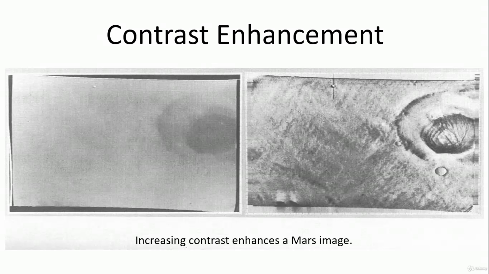
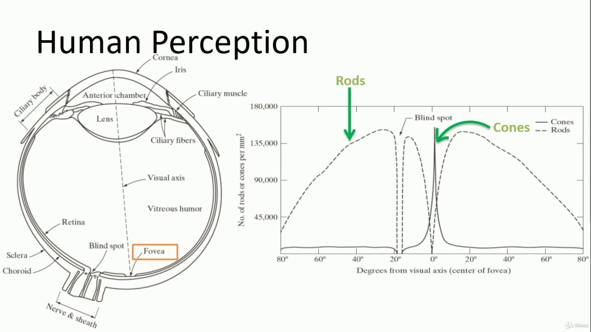
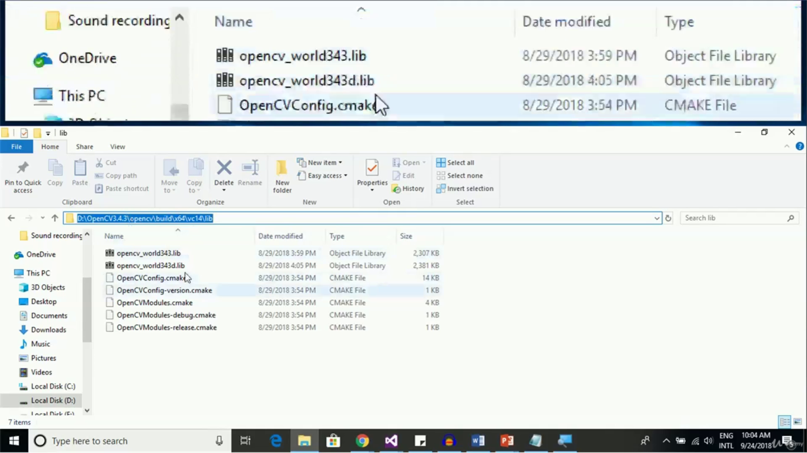

# 第 26 章 理解图像并配置 OpenCV 环境

## 先从一个现象开始：同一物体为何有不同的像素值

想象用同一台相机拍摄同一面灰色墙：第一次放在日光下，第二次移到暖色灯光下。墙没有更换，相机位置也可以保持不变，但两张照片的亮度和颜色仍可能明显不同。

这说明**像素值不是物体永久不变的属性**，而是一次成像过程的结果。第 25 章回答了“数值在缓冲区中的什么位置”，本章先追问“这个数值为什么会是这样”，再讨论人眼看到的结果与数值计算为何不完全等价，最后搭建并验证实际的 OpenCV 与 CUDA 环境。

## 像素值是怎样形成的

### 从场景到传感器

以普通相机为例，可以沿着一束光的旅程理解成像：

```text
光源发光或物体自发光
→ 物体反射、透射或吸收
→ 光学系统把场景投射到传感器
→ 感光单元积累并转换能量
→ 前端电路处理、采样和量化
→ 编码为文件或像素缓冲区
```

在这条链路中，光源光谱、物体表面反射特性、镜头、曝光时间和传感器灵敏度都会影响输出。因此，同一件物体在不同照明下得到不同 RGB 数值并不奇怪。白平衡和颜色校正可以改善特定条件下的结果，但必须说明参考光源和目标颜色，不能把某次拍摄的数值直接视为物体固有颜色。

“图像”也不限于可见光照片。X 射线、红外和超声等模态记录的是不同物理过程，只是在进入计算机后都可以形成空间位置与观测值的网格。


*图 26.1　画册、医学 X 线影像和绘画体现了不同的图像形成与表达方式；数字处理不能只依据外观猜测像素的物理意义。*

### 传感器测量的不是数学点上的瞬时值

实际感光单元具有一定面积，并在一段曝光时间内积累响应。若物体或相机在曝光期间移动，不同位置的信息可能混合到同一个样本中，形成运动模糊。镜头失焦、衍射、传感器串扰和电路噪声也会改变结果。

当信号超过传感器或后续电路能够表示的范围时，不同的高亮度可能都被记录为同一个最大值，这称为**饱和**。**饱和区域中已经被合并的差异，不能仅靠后期降低亮度可靠恢复。**同样，暗处若被噪声淹没，单纯提高像素值也不会凭空找回真实纹理。

这些现象对算法设计有直接意义：去噪、增强和恢复都需要区分“让图像看起来更好”与“恢复原场景信息”。二者有时目标一致，但不能画等号。

## 连续场景怎样变成有限数字

### 空间采样：先看细条纹为何会变形

假设镜头前的真实图案是一组越来越密的黑白细条纹。若采样位置太稀，相邻条纹可能落入同一个样本间隔，最终出现原场景中不存在的宽条纹或错向纹理，这种现象称为**混叠**。

**空间采样**把连续空间响应转换为离散位置上的样本。更密的采样有能力记录更细的结构，但不能弥补已经失焦的光学图像，也不能消除所有噪声。

这个例子也解释了图像缩小时的处理顺序：

- 直接隔行、隔列丢弃像素，容易把高频纹理变成混叠图案；
- **先进行与缩放比例相适应的低通滤波，再重采样**，通常更合理；
- 放大图像只能根据已有样本插值，不能创造采集时不存在的真实细节。

最近邻、双线性和更高阶插值在成本与视觉效果上各有取舍。若用 CUDA 实现，还要明确像素中心的坐标约定、源坐标映射和边缘规则，否则即使公式相同，也可能与库函数错开半个像素或产生不同边缘。

### 幅值量化：再看平滑渐变为何出现色带

空间采样决定“在哪里测”，**量化**决定“用多少个离散级别表示测量结果”。若每个样本使用 `b` 位，可表示的级别数为：

\[
L=2^b
\]

第 25 章使用的 8 位灰度值就是量化后的结果。把一条平滑渐变量化到过少的级别时，相邻区域会共享相同数值，显示后可能出现明显色带。提高位深可以减小量化间隔，却不会自动降低传感器噪声，也不能恢复已经饱和的高光。

把 8 位样本转换为浮点数，可以避免后续运算继续发生整数截断，**但不会找回量化时丢失的中间级别**。类似地，提高显示尺寸也不会增加原始采样信息。

一旦获得数字样本，图像就能被存储、复制、传输和处理，而不必复制原始感光介质。


*图 26.2　数字图像便于存储和远距离传输；火星图像示例展示了采样数据作为可传输信息的用途。*

### 动态范围与显示不是同一件事

**场景动态范围**描述最亮与最暗信号之间的跨度。一次采集能够记录的范围受传感器、曝光和噪声限制，显示设备能够呈现的范围又是另一项约束。

**多曝光合成**尝试利用多次采集保留更多场景信息；**色调映射**则把已有数据映射到目标设备可显示的范围。**前者关注记录，后者关注呈现。**将高动态范围数据简单线性压缩到显示范围，可能丢失暗部或亮部的可见差异，因此实际映射还要考虑观察目的。

## 彩色数值既是测量结果，也是解释结果

人眼和许多相机都使用对光谱不同区域敏感的多种感受器来形成颜色信息。某些成像系统能在每个位置分别测量多个颜色分量；许多消费级相机则采用彩色滤光片马赛克，每个感光位置只直接测量一种颜色，再通过去马赛克插值估计其余分量。

因此，最终彩色图像中的某些通道值来自邻域估计，而不是该位置的独立测量。后续锐化、去噪和压缩还可能继续改变这些数值。

这里要与第 25 章的缓冲区问题分开：

- **颜色解释**关注分量代表什么颜色、采用何种颜色标准、是否经过白平衡和编码；
- **内存解释**关注各分量以何种顺序和元素类型存放。

OpenCV 常规读取得到 BGR 内存顺序，但**把 BGR 重排为 RGB 并不会完成白平衡、伽马解码或颜色空间转换**。字节位置正确，只是颜色计算的前提，不是全部。

## 数值相同，看起来也可能不同

### 对比度是观察结果，不只是数值跨度

将两块完全相同的灰色补丁分别放在黑色和白色背景上，主观亮度可能不同；**一幅图的直方图更宽，也不保证所有重要细节都更容易辨认**。



*图 26.3　对比度增强前后的火星图像：增强后部分地表纹理和撞击坑更易辨认，但评价仍需结合噪声和观察任务。*

对比度增强可以扩大局部或全局强度差异，使部分细节更容易观察；与此同时，它也可能放大噪声、截断高光或产生不自然的外观。图像处理的评价目标因此不能只写成“让像素差越大越好”，而应明确要观察的内容和允许的损失。

### 人眼不是均匀排列的传感器

人眼通过角膜和晶状体把场景投射到视网膜。视锥细胞支持明视觉、颜色感知和精细细节，在中央凹附近密度较高；视杆细胞对弱光更敏感，但不具备同样的颜色和细节能力。两类细胞的空间分布并不均匀，视网膜上还存在缺乏感光细胞的盲点。



*图 26.4　眼球结构与视杆、视锥细胞分布共同影响颜色、细节和弱光感知，人眼不能简单视为均匀的像素阵列。*

视觉系统可以适应跨度很大的环境亮度，但这不意味着能在同一时刻分辨所有亮度级别。从亮处进入暗处，或从暗处进入亮处，都需要适应过程。**在某一适应状态下，可有效分辨的同时亮度范围小于视觉系统跨不同状态能够覆盖的总范围。**

### 可察觉差异依赖背景

在一定工作范围内，**韦伯定律**用下式近似描述差异感知：

\[
\frac{\Delta I}{I}\approx k
\]

其中，\(I\) 是背景刺激强度，\(\Delta I\) 是可察觉差异所需的变化量，\(k\) 在相应条件下近似为常数。它说明相同的绝对变化量在不同背景下未必同样明显。

**这不是覆盖所有亮度、颜色和空间频率的精确定律**，但足以提醒我们：数值误差、物理光强与主观感知不能混为一谈。马赫带等视觉现象也会使交界附近显得比实际灰度变化更亮或更暗。视觉检查适合发现观看问题，数值正确性仍应通过参考实现和受控测试验证。

## 颜色计算前，先确认数值所在的空间

### 存储值通常不是线性光强

许多图像格式使用非线性传递函数保存颜色，常统称为**伽马编码**。用纯幂函数作简化模型时，归一化线性光量与编码值之间的关系可近似写为：

\[
V'\approx V_{\mathrm{lin}}^{1/\gamma}
\]

\[
V_{\mathrm{lin}}\approx(V')^\gamma
\]

其中，\(V_{\mathrm{lin}}\) 表示线性光量，\(V'\) 表示编码值。这个模型用于建立直觉，不代表所有格式都采用同一条纯幂曲线。例如，**sRGB 使用分段传递函数，不能简单等同于固定的 \(\gamma=2.2\)**。

因此，编码值 `128` 不能直接解释为“最大线性光强的一半”。进行线性插值、光照叠加或物理颜色混合时，通常应：

```text
按输入格式解码到线性空间
→ 在线性空间计算
→ 按输出格式重新编码
→ 舍入并限制到输出范围
```

并非所有算法都必须采用这一流程。有些增强有意在编码域进行，以保持感知效果或兼容既有软件。关键是明确目标与参考语义，而不是无差别套用转换。

OpenCV 的 BGR/RGB 重排只是改变分量顺序，8 位转浮点只是改变数值类型；**二者都不等于伽马解码**。`cvtColor` 的每种转换也有各自定义的输入与输出空间，不能假定它会自动完成调用者需要的全部线性化工作。

### 灰度转换为什么不是简单求平均

人眼对不同光谱成分的敏感程度不同，因此彩色转灰度通常不是三个分量的算术平均。常见的 BT.601 亮度分量形式为：

\[
Y'=0.299R'+0.587G'+0.114B'
\]

带撇号的分量表示该式通常作用于非线性编码后的 \(R'G'B'\)，得到的是亮度信号，而不是严格的物理相对亮度。其他颜色标准或线性光计算可能采用不同系数，**不能把这一组权重当作所有场景的通用常数**。

若输入是第 25 章的 BGR 三通道像素，按内存下标应写为：

```text
Y' = 0.114 * pixel[0] + 0.587 * pixel[1] + 0.299 * pixel[2]
```

这里 `pixel[0]` 是 B，`pixel[2]` 是 R。实现还要核对输入范围、所声明的颜色格式以及库函数采用的标准。中间结果宜用浮点或足够宽的整数保存，写回整数图像时执行明确的舍入和饱和处理。

## 从目标出发搭建 OpenCV 与 CUDA 环境

理解图像数据以后，还需要一条可重复的开发路径。安装前先确定目标，因为“OpenCV 能读取图片”“CUDA 能运行核函数”和“OpenCV 的 CUDA 模块可用”是三件不同的事。

| 目标 | 需要具备 | 不需要据此假定 |
|---|---|---|
| 在 CPU 上读取和处理图像 | 可用的主机 OpenCV 库及运行依赖 | 不需要 CUDA 工具包 |
| 用 `cv::Mat` 解码，再运行自定义 `.cu` 核函数 | 主机 OpenCV、CUDA 工具包、兼容的驱动和主机编译器 | 不要求 OpenCV 自身以 CUDA 支持重新构建 |
| 调用 `cv::cuda` 等 OpenCV CUDA 模块 | 包含目标模块和 CUDA 支持的 OpenCV 构建，以及兼容依赖 | 成功 `import cv2` 或检测到 GPU 不足以证明目标模块可用 |

下面按依赖由少到多逐层验证。前一层失败时先解决当前层，不要把所有问题混在一起排查。

### 第一层：安装并验证 CPU OpenCV

常规 C++ 主机图像处理可使用平台包管理器，或与编译环境匹配的官方预编译库。需要配置的不是一个神秘目录，而是四项实际能力：

1. 编译器能找到 OpenCV 头文件；
2. 链接器能找到与目标架构和构建配置匹配的库；
3. 运行时能找到所需动态库；
4. 构建系统能够复现以上配置。

Windows 下还要匹配编译器 ABI、目标架构和 Debug/Release 配置，并让运行程序能够找到相应 OpenCV DLL。具体目录和库文件名会随版本与构建选项变化，应读取当前安装中的实际文件，不能照抄其他环境的名称。

用一个不依赖 GUI 的小程序验证解码、逐像素处理和写回。保存为 `main.cpp`：

```cpp
#include <opencv2/core.hpp>
#include <opencv2/imgcodecs.hpp>

#include <cstdint>
#include <iostream>
#include <stdexcept>

int main()
{
    cv::Mat image = cv::imread("input.png", cv::IMREAD_GRAYSCALE);
    if (image.empty()) {
        throw std::runtime_error("无法读取 input.png");
    }
    if (image.type() != CV_8UC1) {
        throw std::runtime_error("预期得到 8 位单通道图像");
    }

    cv::Mat output(image.rows, image.cols, image.type());
    for (int y = 0; y < image.rows; ++y) {
        const std::uint8_t* src = image.ptr<std::uint8_t>(y);
        std::uint8_t* dst = output.ptr<std::uint8_t>(y);
        for (int x = 0; x < image.cols; ++x) {
            dst[x] = static_cast<std::uint8_t>(255 - src[x]);
        }
    }

    if (!cv::imwrite("inverted.png", output)) {
        throw std::runtime_error("无法写入 inverted.png");
    }

    std::cout << "width = " << image.cols
              << ", height = " << image.rows
              << ", step = " << image.step << '\n';
    return 0;
}
```

程序通过 `ptr` 逐行取地址，没有假定行尾没有填充。准备一幅已知的 `input.png`，运行后应得到尺寸相同的 `inverted.png`；对每个像素都应满足“输出等于 255 减输入”。

再用 CMake 保存构建配置。将下面内容保存为同目录的 `CMakeLists.txt`：

```cmake
cmake_minimum_required(VERSION 3.16)
project(opencv_cpu_check LANGUAGES CXX)

find_package(OpenCV REQUIRED COMPONENTS core imgcodecs)

add_executable(cpu_check main.cpp)
target_include_directories(cpu_check PRIVATE ${OpenCV_INCLUDE_DIRS})
target_link_libraries(cpu_check PRIVATE ${OpenCV_LIBS})
```

配置并构建：

```bash
cmake -S . -B build
cmake --build build --config Release
```

若 `find_package` 找不到 OpenCV，应在下一次配置时把 `OpenCV_DIR` 指向实际包含 `OpenCVConfig.cmake` 的目录，例如：

```bash
cmake -S . -B build -DOpenCV_DIR="path/to/opencv/build"
```

示例路径必须替换为本机实际位置。运行生成的 `cpu_check` 时，确保工作目录中存在 `input.png`，或者把程序中的文件名改为实际路径。该程序成功运行，验证的是主机头文件、链接、动态库加载、图像解码和编码，**不验证任何 CUDA 功能**。



*图 26.5　OpenCV 构建产物与 CMake 配置。*

Python 用户也应在独立虚拟环境中安装所选 OpenCV 发行包，并检查 `cv2.getBuildInformation()`。`cv2.imread` 成功只证明当前 Python 包的主机解码路径可用，不能据此推断 CUDA 模块或自定义 `.cu` 工具链已经就绪。

### 第二层：独立验证 CUDA 工具链

先检查编译器是否对当前终端可见：

```bash
nvcc --version
```

**这只证明 `nvcc` 能启动**，不能证明设备程序已经能够编译和运行。还要编译并运行一个最小设备程序，才能同时检查设备代码生成、驱动、运行时和目标 GPU 执行。保存为 `check_cuda.cu`：

```cpp
#include <cuda_runtime.h>

#include <iostream>

__global__ void write42(int* output)
{
    *output = 42;
}

int main()
{
    int* deviceValue = nullptr;
    cudaError_t status = cudaMalloc(&deviceValue, sizeof(int));

    if (status == cudaSuccess) {
        write42<<<1, 1>>>(deviceValue);
        status = cudaGetLastError();
    }
    if (status == cudaSuccess) {
        status = cudaDeviceSynchronize();
    }

    int hostValue = 0;
    if (status == cudaSuccess) {
        status = cudaMemcpy(
            &hostValue, deviceValue, sizeof(int), cudaMemcpyDeviceToHost);
    }
    if (deviceValue != nullptr) {
        const cudaError_t freeStatus = cudaFree(deviceValue);
        if (status == cudaSuccess) {
            status = freeStatus;
        }
    }

    if (status != cudaSuccess) {
        std::cerr << "CUDA 错误：" << cudaGetErrorString(status) << '\n';
        return 1;
    }

    std::cout << "device value = " << hostValue << '\n';
    return hostValue == 42 ? 0 : 1;
}
```

编译并运行：

```bash
nvcc check_cuda.cu -o check_cuda
./check_cuda
```

Windows 下可将输出文件名写为 `check_cuda.exe`，并在与当前 CUDA 和主机编译器匹配的命令行环境中构建、运行；运行时直接执行生成的可执行文件，不必照搬 Unix shell 的 `./` 前缀。期望输出为：

```text
device value = 42
```

`cudaGetLastError()` 检查启动阶段的错误，`cudaDeviceSynchronize()` 等待执行并返回执行阶段错误。只运行设备查询工具或只看到 GPU 名称，不能替代这个编译与执行测试。

### 第三层：验证 OpenCV 与自定义 CUDA 的联用

前两层分别成功后，再连接第 25 章的完整灰度反相路径：

```text
cv::imread 解码
→ 检查 CV_8UC1 和实际主机 step
→ cudaMemcpy2D 上传有效像素
→ invertGray 核函数
→ 下载到具有独立 step 的主机输出
→ 与 invertGrayCpu 逐像素比较
```

**这条路径不要求 OpenCV 包含 CUDA 模块。**它恰恰能把问题定位清楚：若 CPU OpenCV 和独立 CUDA 测试都成功，而联用失败，应优先检查设备分配、复制方向、主机与设备指针、行步长、核函数启动以及同步错误。

测试不要只用一张尺寸恰好整除线程块的连续大图。至少保留第 25 章的 `4×3` 小矩阵、带行填充输入和非整块尺寸，并检查所有输出像素，而不只是确认程序没有崩溃。

### 第四层：仅在需要时构建 OpenCV CUDA 模块

只有项目确实调用 OpenCV 的 CUDA 模块时，才需要构建带 CUDA 支持的 OpenCV。此时应根据所用 OpenCV 版本的文档，核对 CUDA 工具包、主机编译器、CMake、操作系统和目标 GPU 架构的兼容关系。

基本配置示意如下：

```bash
cmake -S opencv -B build \
  -DWITH_CUDA=ON \
  -DCUDA_ARCH_BIN=<目标GPU的计算能力>
cmake --build build --config Release
```

`CUDA_ARCH_BIN` 必须替换为实际目标 GPU 所需、且受当前工具包和 OpenCV 版本支持的值，不必为无关设备生成全部代码。多配置与单配置生成器设置构建类型的方式不同，应遵循当前平台的 CMake 约定。

配置完成后必须阅读 CMake 摘要和日志，确认：

- CUDA 工具包已被识别，版本和主机编译器组合受支持；
- 目标架构符合实际设备；
- 所需模块确实列入待构建模块；
- 最终构建和安装步骤成功。

**`WITH_CUDA=ON` 只是请求启用，不是成功证明。**

**仅当目标模块属于 `opencv_contrib` 仓库时**，才需要获取与 OpenCV 主源码版本匹配的 contrib 源码，并在配置中加入：

```bash
-DOPENCV_EXTRA_MODULES_PATH=/path/to/opencv_contrib/modules
```

路径必须指向对应版本的 `modules` 目录。若目标模块已在 OpenCV 主仓库中，就不应仅因为名称含有 CUDA 而额外添加 contrib。

构建后还要检查当前库的构建信息，例如 C++ 的 `cv::getBuildInformation()` 或 Python 的 `cv2.getBuildInformation()`，再调用目标模块的最小功能。**查询到 CUDA 设备，或设备数量大于零，并不能证明某个具体模块已经编译**；模块编译成功，也不能替代它在目标 GPU 上的结果验证。

## 小结

像素值来自光源、物体、光学系统、传感器、采样、量化和后续编码的共同作用，不是物体永久不变的属性。空间采样不足会产生混叠，量化会丢失级别，饱和和噪声也会限制可恢复信息。人类视觉具有适应性和背景依赖，因此编码值、线性光量和主观感知必须分别处理。环境搭建则按 CPU OpenCV、独立 CUDA、二者联用和 OpenCV CUDA 模块逐层验证；每一层都用实际运行和结果对照确认能力，避免把一个环节的成功误认为整个系统已经可用。
